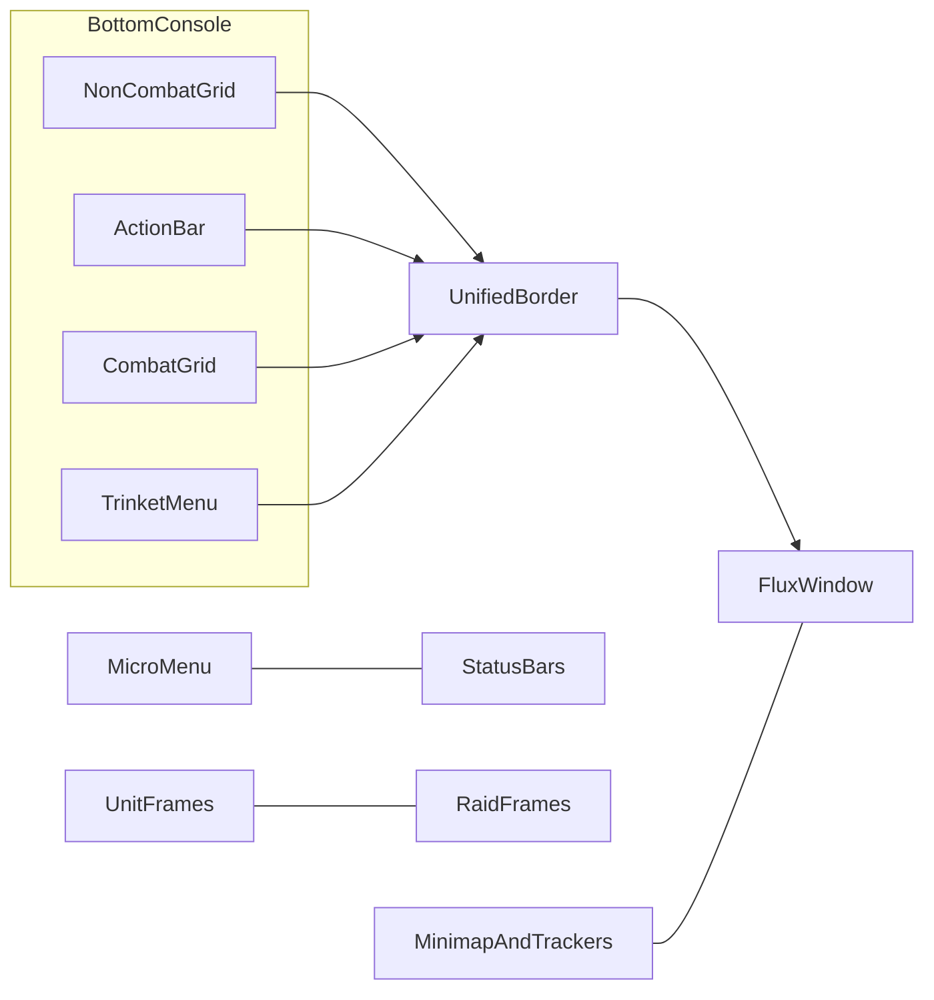

# Product overview

## Purpose

FluxUI is a **full HUD overhaul**: one coherent console for combat and out-of-combat play across Classic Era, TBC Anniversary, Classic (MoP-era), and Retail Midnight. It replaces scattered Blizzard strips with a single visual language, a smart action strip, utility grids, a docked hub window, and optional unit/raid/micromenu/status chrome.

## What the player sees

At a glance the screen reads as one Flux console rather than many independent addons:

- **Bottom strip** — Non-combat utility grid, main action bar (with optional SHIFT/CTRL minirows), combat consumable grid, and trinket menu, sealed by a unified border.
- **Flux Window** — Fixed bottom-right docked hub with tabs for Map, Meter, Respec, and Extra Buttons.
- **Side / corner chrome** — Micro menu, status bars (gold / XP / rep), square minimap with objectives and buffs nearby, unit frames, optional raid frames.
- **Shared accent** — Class color, atlas-natural, or custom tint applied across Flux borders and related surfaces.

## Behaviors (product-level)

- Hides or replaces the default action bars, micro menu, and (when enabled) unit/raid frames so Flux owns those surfaces.
- Treats the bottom strip and Flux Window as one layout problem: when the window is open and UI scale is low, the strip **horizontally squeezes** so nothing collides.
- Offers a Flux **defaults pack**: recommended keybinds, camera/nameplate/control packs, and first-login setup—without forcing the player to keep them forever.
- Integrates optional companions (Details!, Baganator, BigDebuffs, Questie, ConsolePort, etc.) as bridges, not hard requirements.
- On Retail Midnight, combat-sensitive features stay in the **look-and-feel / display** lane; Classic clients keep richer decision logic where the game allows.

## Options / customization (product-level)

Open with `/fluxui` or `/fluxoptions` (also Micro Menu **Config**). Full catalog: [26-options-map.md](26-options-map.md). Layout placements: [06-layout.md](06-layout.md).

- Account-wide vs character scopes for many tabs (several scopes are independent of General).
- Accent: Class color / Default atlas / Custom — applied across chrome.
- Layout click-to-place for Micro, Status, Player/Target, Stance, Info Frame.
- Per-system enable/disable (Flux vs Blizzard unit frames, raid frames, Flux Window tabs, etc.).
- Profiles tab for Ace profiles; `/fluxdefaults` for game-setting / key packs (not a Defaults tab).

### Player-facing commands that matter

`/fluxui`, `/fluxwindow`, `/fluxrespec`, `/fluxsalvage` / `/fsalvage`, `/flyout`, `/buyemall`, `/alreadyknown`, `/fluxhearth`, `/fluxconsumables`, `/fluxtrinket`, `/fluxbind viz`, `/fluxdefaults`.

## Relationships

- Visual identity → [04-visual-system.md](04-visual-system.md)
- Defaults and keybind pack → [05-defaults-and-bindings.md](05-defaults-and-bindings.md)
- Layout placements → [06-layout.md](06-layout.md)
- Hub → [10-flux-window.md](10-flux-window.md)
- Combat strip → [11-action-bars.md](11-action-bars.md), [12-extra-button-system.md](12-extra-button-system.md), [13-binding-system.md](13-binding-system.md)
- Frames → [14-unit-frames.md](14-unit-frames.md)–[19-nameplates.md](19-nameplates.md)
- Economy → [20-vendor-restock-junk.md](20-vendor-restock-junk.md)–[24-baganator-compat.md](24-baganator-compat.md)
- Full options catalog → [26-options-map.md](26-options-map.md)

## Client availability

| Client | Product stance |
|--------|----------------|
| Classic Era | Full concept set where Era APIs exist (no skyriding Extra Ability HUD, limited meter backends, Classic talents/respec). |
| TBC Anniversary | Same shape as Era/TBC Classic; anniversary-specific vendor/flight data where relevant. |
| Classic 2019 (MoP-era) | Rich Classic feature set (stances, runes if SoD-like paths apply on other Classic flavors, compact raid, etc.). |
| Retail Midnight (12.1.0) | Same HUD story; combat logic constrained by secret values—see [03-midnight-constraints.md](03-midnight-constraints.md). |

## Rewrite intent notes

Rebuild the **player mental model** of one sealed bottom console + docked hub + shared chrome. Prefer clarity and cross-client capability gates over preserving old internal module boundaries.

## Explicit non-goals

- Not a thin skin that only recolors Blizzard UI.
- Not a single-client Retail-only addon.
- Not a copy of Bartender4, ElvUI, or any one reference addon—Flux combines several intents into one product.
