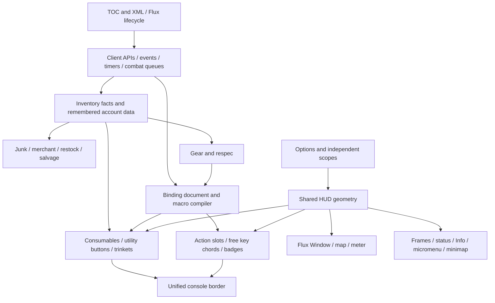

# Product and system overview

FluxUI is one addon package containing a coordinated HUD and several gameplay utility systems. Its central idea is a bottom console: action buttons, modifier rows, combat consumables, out-of-combat utilities, and trinkets share geometry and a border. A docked Flux Window hosts map/meter/respec/category tools. Unit/raid frames, status/Info bars, micromenu, minimap and chat form the surrounding HUD.

The implementation is hybrid. New systems use the `Flux` kernel, shared engines and a small module registry. Other systems retain their own event frames, globals, Ace registrations or the `FLUX_API` compatibility facade. A feature not present in `Flux.Module.List()` can still be fully active. See [startup and ownership](07-runtime-architecture.md) and [shared services](08-shared-services.md).

## Main relationships

The graph describes data/ownership relationships, not a strict sequence of function calls. The linked chapters trace individual flows.

## What happens during use

| Trigger | Current behavior | Implementation guide |
|---|---|---|
| Login or reload | Source files define services and features; saved tables are ensured; eligible modules and independent event handlers start. Forever has an additional startup deferral. | [Runtime](07-runtime-architecture.md), [TOC](../_FluxUI.toc), [kernel](../Core/Flux.lua) |
| First account setup | Flux applies its defaults pack, including keybindings. Later first-seen characters receive narrower character setup. | [Defaults](05-defaults-and-bindings.md), [source](../FluxDefaultSettings.lua) |
| Action, target, modifier or form changes | Separate refresh lanes update displayed identities, range/effects and structural action programs. Protected changes may wait for combat to end. | [Bars](11-action-bars.md), [binding](13-binding-system.md), [services](08-shared-services.md) |
| Bag/bank/item-data changes | Inventory snapshots publish classified notifications; cheap counters and heavier classification/restock consumers run through different paths. | [Inventory](21-inventory-foundation.md), [source](../Inventory/Init.lua) |
| Merchant or bank visit | Session logic evaluates targets and protections, then issues acknowledged buy/sell/move work with bounded asynchronous processing. | [Economy](20-vendor-restock-junk.md) |
| Respec Load | A masked profile coordinates selected talent, gear, rune and downstream HUD/binding state. Completion can include partial failures. | [Respec](23-respec.md), [findings](40-findings.md) |
| Settings changes | Each page writes its own effective store and invokes refresh/apply callbacks. General profile scope does not control every system. | [Options](26-options-map.md), [persistence](09-persistence.md) |
| Optional addon becomes available | Integration readiness decides whether Flux delegates data, embeds third-party UI, suppresses ownership or installs hooks/wrappers. | [Integration matrix](29-integrations.md) |

## Important boundaries

The [inventory foundation](21-inventory-foundation.md) supplies facts to other features; retained `FluxInv` names often point to its compatibility bridge, not the unloaded old scanner. Remembered bank/mail/auction data is different from currently actionable bag/bank access.

The [binding system](13-binding-system.md) stores authored documents and compiles execution programs. A button's visible icon, its native action slot, its modifier-selected face, and its compiled binding action are related identities with different owners.

[WindowMover](28-window-mover.md) handles Blizzard windows. The [Layout page](06-layout.md) handles the Flux HUD. Their scope, saved state and operations are independent.

[Character Info](27-character-info.md) adds statistics and overlays to Blizzard's character window. [Nameplates](19-nameplates.md) add Flux-owned overlays and include explicit Blizzard chrome adjustments. [Raid frames](15-raid-frames.md) use Flux-owned secure cells. These are different ownership models.

## Client and dependency model

The package declares several client interfaces and uses both load filters and runtime probes. Live Midnight and Forever/Camelot can share a module family while taking different APIs and protected/display paths. Classic Era, TBC/Anniversary and progression branches also differ. Folder location alone does not identify a client. See the [client matrix](02-multi-client-matrix.md).

Syndicator, Baganator, Details, BigDebuffs, Questie, TacoTip and ConsolePort are optional integrations; availability can change data ownership and UI behavior. Bundled libraries are separate from those installed addons. [Dependencies/provenance](90-reference-inspirations.md) distinguishes these cases.

## Finding a control or implementation

Open `/fluxui` or `/fluxoptions` for the settings shell. Use the [options map](26-options-map.md) for actual page locations, [command reference](31-commands-and-bindings.md) for tools, [SavedVariables](32-saved-variables.md) for storage, and [source coverage](30-source-coverage.md) to locate the chapter for any file.

This reference describes the current implementation, including quirks and uncertainty. It does not prescribe a future rewrite or claim live validation of every code path.
