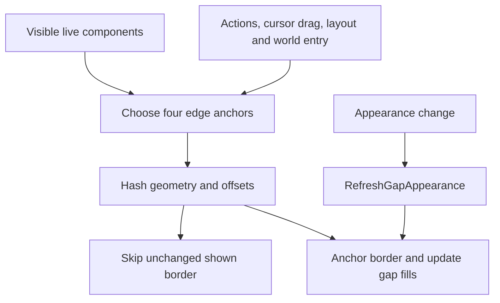

# Visual system: borders, accent and feedback

FluxUI's panel chrome is owned by [FluxBorder.lua](../FluxBorder.lua), exposed as `ns.Border` and global `FluxBorder`. Bottom and optional Micro Menu/status envelopes are owned by [Layout/UnifiedBorder.lua](../Layout/UnifiedBorder.lua), global `FluxUnifiedBorder`. Gameplay button feedback is a separate shared layer under `Flux.ButtonFX`; see [08-shared-services.md](08-shared-services.md).

## Accent resolution and live refresh

`FluxBorder:GetAccentColor()` reads `FluxOptions.db.profile.appearance`, so accent follows the active General AceDB profile. Before options are ready it falls back to player class color. The class-color result is cached and invalidated on `PLAYER_ENTERING_WORLD`.

| Stored `borderAccent` | Border/vertex treatment | Default panel fill |
|---|---|---|
| `class` (default) | Player class RGB. | Accent RGB multiplied by 0.4. |
| `custom` | `customAccent.r/g/b`, each falling back to 1. | Accent RGB multiplied by 0.4. |
| `atlas`, other clients | White vertex preserves natural texture colors. | Neutral `(0.15, 0.15, 0.15)`. |
| `atlas`, Forever | `(0.502, 0.443, 0.278)`, the explicitly encoded Forever chrome palette. | That RGB multiplied by 0.5. |

`IsUntintedAtlasAccent`, `GetThemedVertexRGB` and `GetThemedBackdropFillRGB` expose these distinctions. "Default atlas" does not mean an untinted white vertex on every client.

`SetClassColor(frame, alpha, tintBackdrop)` is the themed operation despite its historical name. It records options on the frame, registers it in a weak-key accent registry and optionally uses the themed fill at 0.85 alpha. `RefreshAllAccentedFrames` revisits registered frames. `RefreshAppearanceDependents` also asks options, Details skins, unified gaps, status/gold/info, bars/grids/trinkets/flyouts, unit frames, Flux Window tabs, addon/minimap popups, minimap and cast bars to refresh through their exported hooks. `FluxUI_RefreshAppearance()` is the global entrypoint.

The options shell uses this accent for panel chrome and selected controls. Explicit gameplay colors, such as health, threat, rarity and usable states, remain consumer-owned.

## Border construction

`ApplyTo(frame, padX, padY, insetX, insetY)` returns the existing `frame.FluxBorderFrame` if one exists. Repeated application does not rebuild padding. `RemoveFrom` detaches/hides border and background, clears theme metadata and removes its accent registry entry so a later call can recreate it.

The implementation creates:

- A background child on BACKGROUND strata/frame level 0, with independent insets and an initially transparent, hidden texture.
- A border child matching the owner's strata and a higher frame level, capped at 65535.
- Four corner and four edge textures. Negative padding expands outward; positive padding moves inward. Background inset is separate.

Atlas availability is resolved once using `battlefieldminimap-border-topleft`. Modern paths use battlefield minimap border atlases; legacy paths slice [Texture/BattlefieldMinimap.tga](../Texture/BattlefieldMinimap.tga). Failed individual atlas assignments fall back to white textures. The legacy texture and portrait ring paths explicitly name the `_FluxUI` addon directory.

`SetBorderColor`, `SetBackdropColor`, `SetBackdropAlpha`, `HideBackground` and `ShowBackground` operate on these regions. `ApplyCircle` uses `Texture/BagPortraitRing.tga`. Applying a border alone does not register theme refresh; consumers use `SetClassColor` or their own appearance hook.

## Unified bottom envelope

`GetComponents` resolves live NonCombat/Combat grids, action strip, trinkets, Info and Flux Window, including compatibility names.

The NonCombat grid must exist and be shown. Normal right-edge priority is: shown Flux Window's left edge with -6 offset; trinkets; Combat grid; action bar or Info if Info occupies the strip; otherwise NonCombat. Grid geometry establishes the base/top anchors; live minirow/layout behavior changes the resulting extent.

Forever gamepad mode uses `GamepadStripFrames`: the envelope follows the utility/combat/trinket/Info row instead of spanning the missing keyboard strip to the Flux Window. `TallerFrame` compares effective-scale geometry in UIParent space. Controller hardware presence alone does not activate this path.

Two additional fills cover trinkets-to-window and the action-strip Info gap when Info lives elsewhere. They use `FluxUIBackgroundLayer`, created early at BACKGROUND strata in `FluxBorder.lua`, so fill stays behind widgets. `RefreshGapAppearance` recolors them.

The Micro Menu/status envelope appears only for the horizontal Micro Menu-over-status stack. Status placements 2/3 and detached chat/minimap Micro Menu layouts suppress it; integrated Info can extend its right edge.

## Refresh lifecycle

The border loads last. On login, a temporary watcher attempts initialization until the grids exist, for at most 30 frames before a forced attempt, then removes its OnUpdate. World entry, action-slot/cursor events, smart-layout hooks and drag enter/leave hooks update it. There is no permanent 0.2-second border polling loop despite an older unused interval constant/comment.

Geometry updates return during combat. Refresh is event/hook-driven; it does not promise that every external frame move immediately updates the envelope. Exported integration points include `UpdateBorder`, `UpdateStatusBarBorder`, `UpdateActionStripInfoGapBackdrop` and `GetActionGridBorderTop`. A geometry hash skips redundant anchoring for an unchanged shown border.

## Gameplay feedback

Proc glow, recharge edges, auto-attack flashes, checked/pushed states, cast/channel/empower fill, interrupts and reticles belong to `Core/ButtonFX`. Isolated child visuals select native templates or fallback media and transfer live animation across visible row/macro-face changes. They require separate testing from accent refresh.

Source inspection does not prove every atlas/fallback animates correctly in-game. Current core/bar smoke failures include fallback-art and visual-transfer contracts; see [40-findings.md](40-findings.md), [41-verification.md](41-verification.md) and the [asset reference](34-assets.md).