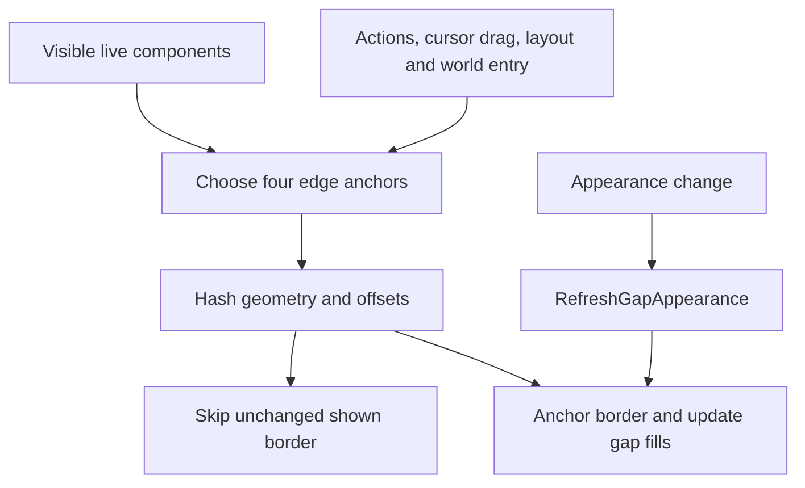

# Visual system: borders, accent and feedback

16 November frozen border `adaptive-fallback-r50`: dedicated1226/Cost74 PASS;
full467/1157 stable and global Lua5.1 689files/24857prototypes max57/0fail PASS.
Native cost PENDING. Adaptive lookup leaves R49 flat
publication/small buckets unchanged, indexing only queried buckets>4. Exact meshes/
current-paint guards retained;24-junction CPU mixed+1.43%,56−6.20%, dense−78.12%
stress only. Native quiet capture must wait for all owned CPU/docs jobs to finish.
Last quiet R49 207.94ms leaves208ms hitch/CB36 OPEN; accepted fits retained.
[Requirements and evidence](CONNECTED_BORDERS.md).

Historical earlier 15 November restore: the user requested an exact return before connected borders.
The experimental junction module, script/geometry hooks, scheduler work, masks,
T/X assets and their later styling changes are removed. Current runtime source
and repo TOC match the verified12:03:41UTC pre-connection checkpoint byte-for-byte.
Prior unrelated runtime changes and player data are preserved.

The checkpoint's independent border rendering is active again. Numbered types,
actual extracted Forever gold, direct status/HP/resource/class/aura registrations
and original consumer anchors/padding remain as in that checkpoint. The earlier
Border thickness control (50%-200%) and preview swatches are restored too; later
fixed100%/150%, full previews and Trinket accent fixes are reverted as part of the
requested exact return. No connected-border observer or clipping mask is loaded.
[Artwork provenance](../Texture/borders/README.md).

Restored regression:652border lifecycle/direct-owner checks,714startup checks and
170raster checks PASS. Full397scripts/1085syntax PASS. This establishes source restore
and desktop behavior, not native pixel/taint/controller/FPS acceptance. The user
still reports columns13-19 wrong; source rollback does not establish recovered
game-stored action contents. Fresh native checking after reload remains pending.
[Rollback identities, checkpoints and remaining state](validation/border-types-2026-11-15.json).

FluxUI's panel chrome is owned by [FluxBorder.lua](../FluxBorder.lua), exposed as `ns.Border` and global `FluxBorder`. Bottom and optional Micro Menu/status envelopes are owned by [Layout/UnifiedBorder.lua](../Layout/UnifiedBorder.lua), global `FluxUnifiedBorder`. Gameplay button feedback is a separate shared layer under `Flux.ButtonFX`; see [08-shared-services.md](08-shared-services.md).

## Accent resolution and live refresh

`FluxBorder:GetAccentColor()` reads `FluxOptions.db.profile.appearance`, so accent follows the active General AceDB profile. Before options are ready it falls back to player class color. The class-color result is cached and invalidated on `PLAYER_ENTERING_WORLD`.

| Stored `borderAccent` | Border/vertex treatment | Default panel fill |
|---|---|---|
| `class` (default) | Player class RGB. | Accent RGB multiplied by 0.4. |
| `custom` | `customAccent.r/g/b`, each falling back to 1. | Accent RGB multiplied by 0.4. |
| `atlas`, other clients | White vertex preserves natural texture colors. | Neutral `(0.15, 0.15, 0.15)`. |
| `atlas`, Forever with type 1 | `(0.502, 0.443, 0.278)`, the explicitly encoded Forever chrome palette. | That RGB multiplied by 0.5. |

`IsUntintedAtlasAccent`, `GetThemedVertexRGB` and `GetThemedBackdropFillRGB` expose these distinctions. "Default atlas" retains the Forever bronze exception only with border type 1.

`SetClassColor(frame, alpha, tintBackdrop)` is the themed operation despite its historical name. It records options on the frame, registers it in a weak-key accent registry and optionally uses the themed fill at 0.85 alpha. `RefreshAllAccentedFrames` revisits registered frames. `RefreshAppearanceDependents` also asks options, Details skins, unified gaps, status/gold/info, bars/grids/trinkets/flyouts, unit frames, Flux Window tabs, addon/minimap popups, minimap and cast bars to refresh through their exported hooks. `FluxUI_RefreshAppearance()` is the global entrypoint.

The options shell uses this accent for panel chrome and selected controls. Explicit gameplay colors, such as health, threat, rarity and usable states, remain consumer-owned.

## Border construction

`ApplyTo(frame, padX, padY, insetX, insetY)` returns the existing `frame.FluxBorderFrame` if one exists. Repeated application does not rebuild padding. `RemoveFrom` detaches/hides border and background, clears theme metadata and removes its accent registry entry so a later call can recreate it.

The implementation creates:

- A background child on BACKGROUND strata/frame level 0, with independent insets and an initially transparent, hidden texture.
- A border child matching the owner's strata and a higher frame level, capped at 65535.
- Four corner and four edge textures. Negative padding expands outward; positive padding moves inward. Background inset is separate.

Type 1 atlas capability is resolved once using `battlefieldminimap-border-topleft` for consumer geometry compatibility. Registered pieces use the canonical `Battlefield100.tga` canvas, preserving the original eight RGBA cells with filtering gutters. Type 2 uses extracted Forever metal at fixed150%. Native atlas and legacy creation paths both register with the same appearance owner. The legacy texture and portrait ring paths explicitly name the `_FluxUI` addon directory.

`SetBorderColor`, `SetBackdropColor`, `SetBackdropAlpha`, `HideBackground` and `ShowBackground` operate on these regions. `ApplyCircle` uses `Texture/BagPortraitRing.tga`. Applying a border joins the shared art registry. Accent/backdrop refresh still uses `SetClassColor` or the consumer's own appearance hook; explicit `SetBorderColor` values survive art changes.

## Unified bottom envelope

`GetComponents` resolves live NonCombat/Combat grids, action strip, trinkets, Info and Flux Window, including compatibility names.

The NonCombat grid must exist and be shown. Normal right-edge priority is: shown Flux Window's left edge with -6 offset; trinkets; Combat grid; action bar or Info if Info occupies the strip; otherwise NonCombat. Grid geometry establishes the base/top anchors; live minirow/layout behavior changes the resulting extent.

Forever gamepad mode uses `GamepadStripFrames`: the envelope follows the utility/combat/trinket/Info row instead of spanning the missing keyboard strip to the Flux Window. `TallerFrame` compares effective-scale geometry in UIParent space. Controller hardware presence alone does not activate this path.

Two additional fills cover trinkets-to-window and the action-strip Info gap when Info lives elsewhere. They use `FluxUIBackgroundLayer`, created early at BACKGROUND strata in `FluxBorder.lua`, so fill stays behind widgets. `RefreshGapAppearance` recolors them.

The Micro Menu/status envelope appears only for the horizontal Micro Menu-over-status stack. Status placements 2/3 and detached chat/minimap Micro Menu layouts suppress it; integrated Info can extend its right edge.

## Refresh lifecycle

The border loads last. On login, a temporary watcher attempts initialization until the grids exist, for at most 30 frames before a forced attempt, then removes its OnUpdate. World entry, action-slot/cursor events, smart-layout hooks and drag enter/leave hooks update it. There is no permanent 0.2-second border polling loop despite an older unused interval constant/comment.

Geometry updates return during combat. Refresh is event/hook-driven; it does not promise that every external frame move immediately updates the envelope. Exported integration points include `UpdateBorder`, `UpdateStatusBarBorder`, `UpdateActionStripInfoGapBackdrop` and `GetActionGridBorderTop`. A geometry hash skips redundant anchoring for an unchanged shown border.

## Gameplay feedback

Proc glow, recharge edges, auto-attack flashes, checked/pushed states, cast/channel/empower fill, interrupts and reticles belong to `Core/ButtonFX`. Isolated child visuals select native templates or fallback media and transfer live animation across visible row/macro-face changes. They require separate testing from accent refresh.

Source inspection does not prove every atlas/fallback animates correctly in-game. Current core/bar smoke failures include fallback-art and visual-transfer contracts; see [40-findings.md](40-findings.md), [41-verification.md](41-verification.md) and the [asset reference](34-assets.md).

<!-- BORDER-BUILDER-R53-20261116 -->
R53 border-builder reflow: unchanged immutable fallback plans and complete public
owner identities inside the readonly commit phase now reuse prepared work; pair
keys are per-pass object identities. Source/privacy/native field checks and paint
remain current.95 focused scripts pass. Native R52 toggle232.41ms is unresolved;
R53 native timing remains pending. See [exact evidence](validation/border-builder-2026-11-16.json).
<!-- /BORDER-BUILDER-R53-20261116 -->

<!-- ACTION-STRIP-BORDER-R55-20261116 -->
R55 `strip-updates-r55`: matching occupied-swap layouts skip redundant decorative
writes/player-layout fanout using fresh native geometry; nearby strip/envelope
crests align in both types. 144 focused scripts pass. Real packing/expansion and
all mapping/binding recovery remain. Actual drag prefixes had0cache hits, so no
extra cut cache was admitted. Native checks are deferred by the user.
[Requirements](ACTION_STRIP_BORDER_UPDATES.md); [scoped evidence](validation/action-strip-borders-2026-11-16.json).
<!-- /ACTION-STRIP-BORDER-R55-20261116 -->

<!-- BORDER-FIELD-RETIREMENT-R184-20261120 -->
The regional border renderer hides outgoing fragments and junction textures through their current ownership records. Twelve modeled held-action crossings removed 1,446 and 1,818 visibility reads in border style order. Twelve roster-layout moves removed 876 and 1,914. Native setter counts, sampled joins, and texture counts match in the model. Desktop timings improved for the two held-action medians and were mixed across roster reflows.
[Matched validation](validation/border-field-retirement-2026-11-20.json).
<!-- /BORDER-FIELD-RETIREMENT-R184-20261120 -->

<!-- BORDER-OBSERVER-SCRATCH-R185-20261120 -->
Regional preflight uses a flat dependency stack and one scratch link set per settled anchor batch. Twelve modeled strip crossings remove 768 temporary dependency entries and 432 temporary snapshot validation tables per style. Twelve modeled roster moves remove 1,056 entries and 576 validation tables. Each replay reduces scratch link sets from 48 to 12, with identical dependency visits and snapshot counts. Texture setters, sampled seams and operation counts match.
[Matched validation](validation/border-observer-scratch-2026-11-20.json).
<!-- /BORDER-OBSERVER-SCRATCH-R185-20261120 -->
