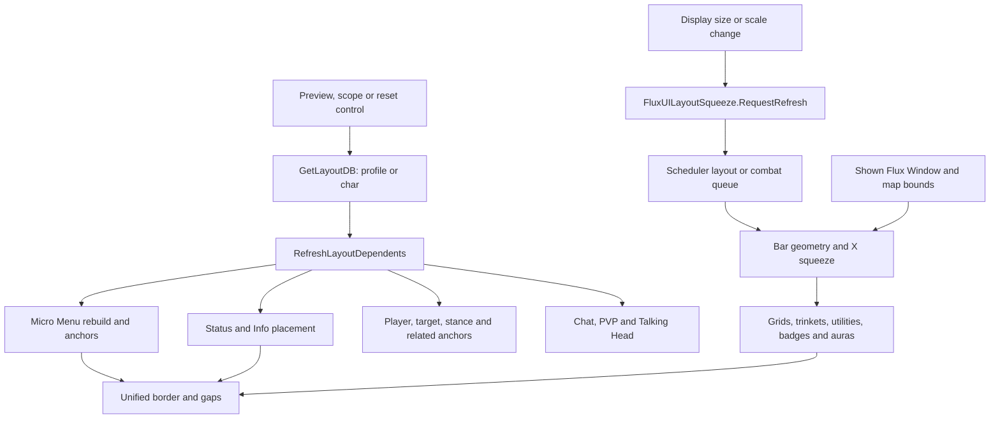
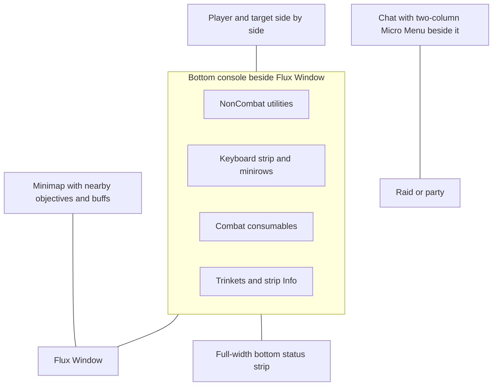

# HUD placement and layout propagation

The Layout tab edits composed HUD presets using a click-to-place preview. Blizzard WindowMover drag/scale is separate. Owners are [FluxOptionsLayout.lua](../AddonOptions/FluxOptionsLayout.lua), [FluxLayoutPreviewUI.lua](../AddonOptions/FluxLayoutPreviewUI.lua) and the accessors/refresh methods in [FluxOptions.lua](../AddonOptions/FluxOptions.lua).

## Storage and preset values

`GetLayoutDB()` selects `db.profile.layout` or `db.char.layout` using `db.char.layoutSettingsScope`. Account mode is default. The selector is independent from General profile choice and Micro Menu sizing/order. Scope transitions copy fields into the destination; reset restores active-scope defaults.

| Field | Values | Default |
|---|---|---|
| `microMenuPosition` | 1 top-left horizontal; 2 beside chat; 3 minimap popup strip. | 2 |
| `microMenuBesideChatColumns` | Integer columns 1–8 for positions 2/3. | 2 |
| `microMenuMinimapStripExpanded` | Position 3 chevron/expanded state. | false |
| `statusBarPosition` | 1 under horizontal Micro Menu; 2 above action strip; 3 screen bottom. | 3 |
| `playerTargetPlacement` | 1 player over bar and target top center; 2 side by side. | 2 |
| `stanceBarPlacement` | 1 beside Flux player; 2 window/status-side strip. | 1 |
| `infoFramePlacement` | `actionStrip`, `statusIntegrated`, `minimapTop`, `screenTopLeft`. | `actionStrip` |
| `infoStatusSlot` | `start`, `middle`, `end` within integrated status row. | `start` |

Getters normalize numeric strings/invalid values; columns round and clamp. Legacy Info value `topLeft` maps to `actionStrip`, while `screenTopLeft` is the actual fourth placement. Old docs omitted it.

`GetStanceBarPlacement` effectively returns position 2 during `Cap.GamepadHudActive()`, preserving the saved value. A stored preset does not invariably equal effective placement.

## Preview interaction

Normalized preview rectangles are schematic. Live usable frame geometry is preferred and proportional fallback rectangles cover frames that are absent/not yet shown. The preview is not a screenshot or arbitrary-pixel editor.

- Colored boxes are movable groups. Selecting one reveals faded ghost tiles for alternatives.
- A ghost click calls `ApplyPosition`, stores the field, refreshes consumers and redraws.
- Empty canvas cancels selection. Selection, other controls, references and ghosts use separate alpha/pulse behavior.
- Reference boxes show surroundings: action strip, Flux Window, chat, minimap, raid, focus, pet bar, PVP objective or Talking Head where supported. They are not movable here.
- "Buttons per row" appears for beside-chat/minimap Micro Menu, range 1–8.
- Integrated Info also has status-slot choices; the preview models its cell within that row.

Canvas dimensions follow the host widget; resize redraws and widget close detaches state/hooks. Before login, fallback geometry avoids requiring all global frames to exist.

## Layout flow

`RefreshLayoutDependents` delegates to the broader Micro Menu scoped refresh, coordinating global consumers. There is no single retained layout tree owning every frame; features read effective getters and position their own widgets.

Shared squeeze is in [FluxDefaultSettings.lua](../FluxDefaultSettings.lua), `FluxUILayoutSqueeze`. `RequestRefresh` coalesces changes on the layout tier and defers during combat. Its math/policy is detailed in [05-defaults-and-bindings.md](05-defaults-and-bindings.md).

## Default composition

This is a relation diagram, not exact horizontal button ordering or pixel coordinates. Feature owners determine live anchors. Forever's native gamepad HUD uses Blizzard's bar as a reference floor; the keyboard strip does not occupy its usual span and utility chrome has a separate row layout.

## Frame and chrome boundaries

Flux Window's shown left edge constrains available console width; Layout does not drag the window. Minimap, raid/party, focus and pet bar own their own behavior; reference tiles do not transfer their settings ownership.

`FluxUnifiedBorder` derives chrome from live component geometry, not preview rectangles. It fills trinket/window and relocated-Info gaps, suppresses Micro Menu/status framing for detached placements and returns during combat. See [04-visual-system.md](04-visual-system.md).

WindowMover's catalog/saved frame positions target Blizzard windows, with their own scope and client exclusions, including the growing Forever bank. See [28-window-mover.md](28-window-mover.md).

## Verification scenarios

Test every placement at both scopes, switch scope/profile and reload. Cover four Info positions/integrated slot order, three Micro Menu modes/columns/chevron, both player-target/stance choices, Flux player disabled, window tabs hidden, minimal grids, minirow expansion and drag. Repeat at 16:9/16:10/ultrawide, the scale floor, and resolution changes yielding the same uiScale.

Combat changes should defer protected structure and settle after regen. Edit Mode open/close must be tested for layout taint. On Forever test both input styles, the reload instruction after style change, and geometry again after reload. See [41-verification.md](41-verification.md).