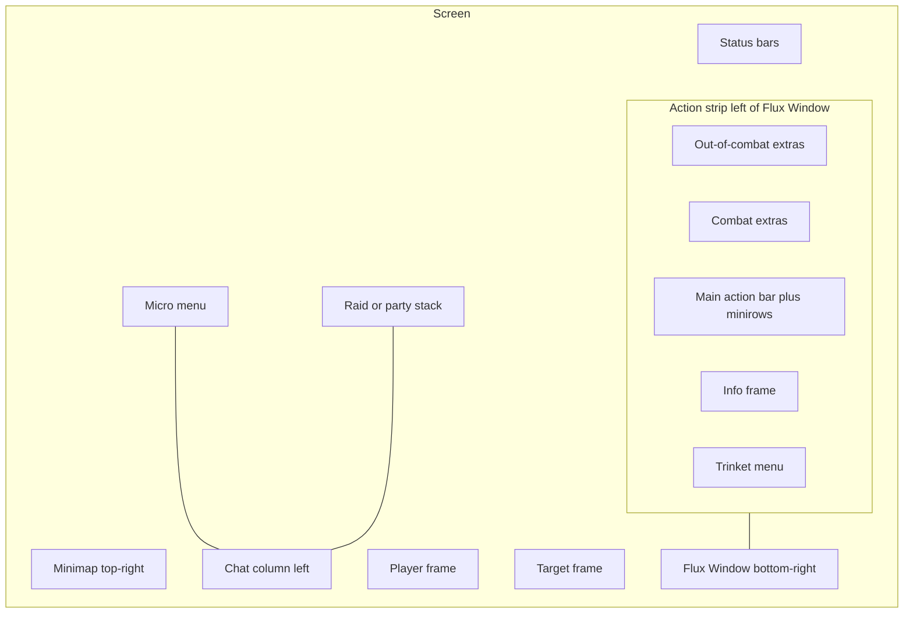

# Layout (placement options)

## Purpose

Let the player place the main HUD pieces with a click-to-place preview so Micro Menu, Status Bars, player/target, stance, and Info Frame form one composed screen—not independently dumped widgets.

## What the player sees

Options tab **Layout**, opened from `/fluxui` / `/fluxoptions`.

Intro copy: “Click a colored box to move it. Faded tiles are other spots. Gray boxes are reference only.”

### Preview rules

| Tile style | Meaning |
|------------|---------|
| Colored (active) | Movable piece — click to select, then click a faded ghost to place |
| Faded | Alternate legal spots for the selected piece |
| Gray | Reference only (not movable here): Minimap, PVP objective, Action strip, Flux Window, Chat, Raid/Party, Focus, Pet bar |

When a piece is selected: “\<Title\> - click a faded tile to move. Click empty canvas to cancel.”

## How it behaves / defaults

### Movable pieces

| Piece | Placement choices | Default |
|-------|-------------------|---------|
| **Micro Menu** | Top bar · Beside chat · Beside minimap | **Beside chat** |
| **Status Bar** | Under micro (top-left) · Above action bar · Screen bottom | **Screen bottom** |
| **Player / Target** | Classic · Side by side | **Side by side** |
| **Stance** | Beside player · Left of Flux Window | **Beside player** |
| **Info FPS** | Action strip · Status row · Minimap top | **Action strip** (“In the bottom button strip”) |

### Buttons per row

Slider **1–8**, shown only when Micro Menu is beside chat or beside minimap. **Default: 2**.

### Placement tooltips (current)

- Micro: Top-left row / Vertical strip left of chat / Docked on minimap
- Status: under micro / full width above action bar / screen bottom
- Player/Target: Classic (target top center…) / Side by side above strip
- Stance: Left of player / Vertical strip left of Flux window
- Info: bottom button strip / status bar row / inside minimap top edge

Ghost tooltip title: “Move here.” Active: “Click to move.”

### Unified chrome

The action strip (out-of-combat extras through combat extras, main bar, trinkets) reads as one envelope up to the Flux Window. Status + Micro may share a second envelope when stacked. See [04-visual-system.md](04-visual-system.md).

### Default screen map

## What can be configured

- **Layout scope** — Account-wide | Character-specific — **default: Account-wide** (independent of General settings scope)
- **Reset layout to defaults**
- Click-to-place for all movable tiles above
- **Buttons per row** when Micro is in a multi-column placement

## How it connects

- Micro size/order → [17-micromenu.md](17-micromenu.md) (separate **Micro menu bar scope**)
- Status height/currency → [16-status-bars.md](16-status-bars.md)
- Player/target sizing → [14-unit-frames.md](14-unit-frames.md)
- Stance beside player vs window → [11-action-bars.md](11-action-bars.md)
- Info FPS contents → General tab / [16-status-bars.md](16-status-bars.md)
- Flux Window dock is reference, not moved here → [10-flux-window.md](10-flux-window.md)
- Full options catalog → [26-options-map.md](26-options-map.md)

## Version / optional-addon differences

Layout shell is the same on Era, Anniversary, Classic, and Midnight. Individual reference tiles may be absent if a client lacks focus, PVP objective, etc.

## Explicit non-goals

- Free-dragging every chrome piece to arbitrary pixels as the primary model (click-to-place presets keep the composed HUD).
- Moving the Flux Window off the bottom-right dock via this tab.
