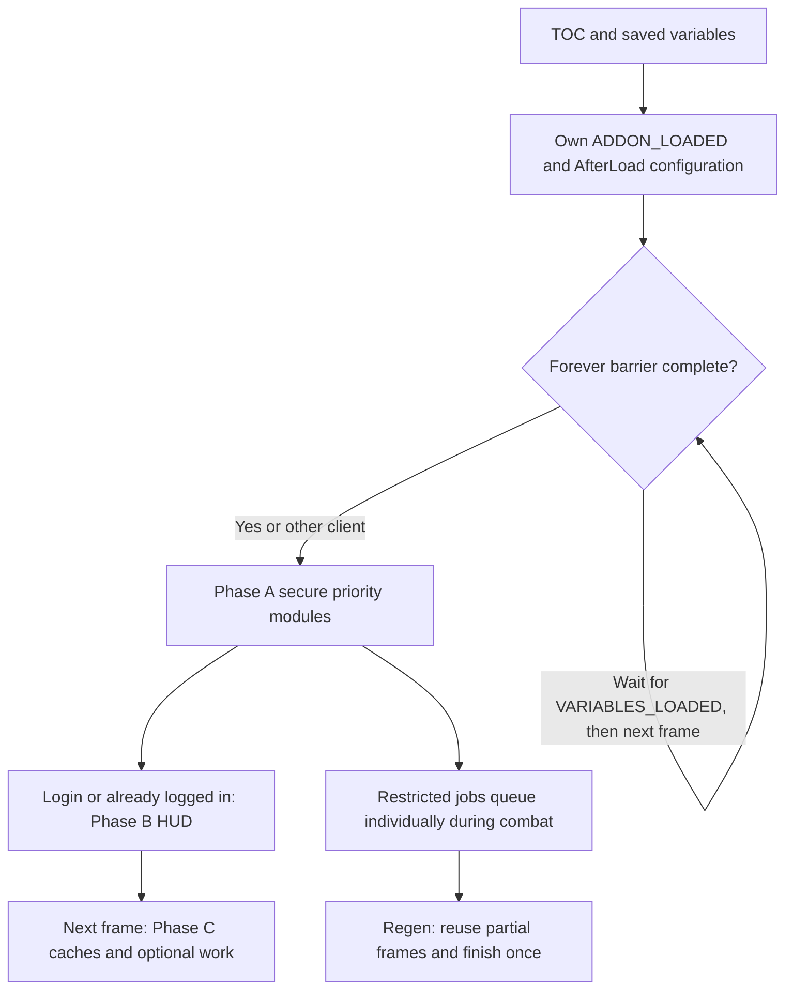

# Runtime architecture and startup

This chapter describes the current working-tree implementation. The addon combines a newer `Flux` kernel with older global and Ace-based feature code. A folder is a useful ownership boundary, but it is not necessarily a lifecycle module. Source coverage and unloaded files are indexed in [30-source-coverage.md](30-source-coverage.md).

## Executable scope and load order

[`_FluxUI.toc`](../_FluxUI.toc) is the entrypoint. Its file order and XML includes determine what executes; `_tmp_*` scripts, leftover engines and unused libraries do not execute just because they exist on disk. Per-file `AllowLoadGameType` annotations restrict some entries. Runtime guards provide a second check, particularly for Forever and the secret-value backends.

| Load phase | Contents and reason for ordering |
|---|---|
| Embedded essentials | LibStub, Unfit and LibCustomGlow are available before Flux consumers. |
| Kernel and compatibility | `Flux.lua`, dropdown support, Forever compatibility, client detection, hotkey display, capability probes, secure click proxies and Blizzard hiding. |
| Typed adapters and services | `Core/API`, ButtonFX, event/timer/ticker, restricted/combat/scheduler, range, mouseover, form/spellbook/context/identity and performance services. |
| Early feature foundation | WindowMover and inventory facts precede their consumers. Extra Button widgets, flyouts, grids and trinkets precede the main action strip. |
| Bars | Main strip, pet bar and stance bar create their namespaces and register lifecycle work. |
| Legacy facade | `Core/FluxAPI` exports compatibility helpers used by the remaining HUD code. It is a separate implementation surface, not an alias for every new adapter. |
| Options and binding | Border/defaults and Blizzard settings helpers load before Ace3-backed binding/options. The binding boot comes before options files in the TOC; both act later through events/timers. |
| HUD and services | Raid/unit frames, Micro Menu, status, minimap, Flux Window/map/meters, Respec, character panel, chat, nameplates and Salvage. |
| Economy bridges and final chrome | Restock/vendor libraries and features, Baganator compatibility, then the unified border. |

The TOC's early comment saying action bars, Binding and grids remain off the TOC is stale: the actual entries load all three. Follow entries and includes when reconstructing execution.

## Startup sequence

The [23 October implementation report](43-startup-optimization.md) records startup hazards, phase ordering, diagnostics, measured operation counts and native acceptance limits. `Core/Flux.lua` now runs secure priority modules after all `AfterLoad` callbacks, including saved-profile bootstrap, complete. Most clients can do that in the addon's own `ADDON_LOADED` transaction. Forever still waits for Blizzard's variable/gamepad setup and leaves that callback stack on the next frame; `EventUtil.ContinueOnVariablesLoaded` also covers late addon loading.

A combat-blocked secure module does not block permitted HUD presentation. Completed modules are skipped on transitions. False results and exceptions leave modules retryable; required optional dependencies retry after their own `ADDON_LOADED` handlers finish. The module list reports initialization failures. `Flux.Safecall` returns protected-call success/result while still reporting exceptions through the normal error handler.

`AfterLogin` remains the login callback API. Binding boot uses it immediately, with protected writes guarded by its existing coalesced Apply pipeline. Initial visual and secure-input milestones are separate. See `/fluxstartup` in the [command reference](31-commands-and-bindings.md).

## Namespaces and ownership

| Surface | Owner and role |
|---|---|
| `ns` | WoW's per-addon private table, passed through `...` to Lua files. Also holds feature exports. |
| `ns.Flux`, `_G.Flux` | The same kernel table created in `Flux.lua`; contains `Client`, `Cap`, API adapters, engine services and newer feature namespaces. |
| `Flux.API` | Grouped newer adapters. Common adapters are also exposed directly, e.g. `Flux.Spell == Flux.API.Spell`. |
| `Flux.Engine` | Grouped service aliases, e.g. `Flux.Engine.Scheduler == Flux.Scheduler`. Not every Core object belongs here. |
| `ns.API` | Legacy compatibility helper table populated in [`Core/FluxAPI/FluxAPI.lua`](../Core/FluxAPI/FluxAPI.lua). Distinct from `Flux.API`. |
| `FluxAPICompat`, `FLUX_API` | Global legacy compatibility objects. The boot file links `FluxAPICompat.API` to `ns.API` and publishes `ns.API.FLUX_API`. |
| Feature globals | Examples include `FluxOptions`, `FluxBorder`, `FluxBinding`, `FluxNonCombatAPI`, `FluxRaid_*` and `FluxUnitFrames_*`. They remain active integration contracts. |

Names that look equivalent can differ. `Flux.Client.isClassic` means Wrath/Cata/Mists, while `FLUX_API.isClassic` means Era. Use the appropriate family flag or `isAnyClassic`; see [02-multi-client-matrix.md](02-multi-client-matrix.md).

## Lifecycle module registry

[`Core/Module.lua`](../Core/Module.lua) exposes `Register`, `IsEligible`, `Enable`, `Disable`, `IsEnabled`, `EnableEligible` and `List`. A specification can provide `clients`, `capabilities`, `requiredAddons`, `OnLoad`, `OnEnable` and `OnDisable`.

- `clients` is a table keyed by kernel family (`era`, `anniversary`, `classic`, `midnight`). A missing table permits all families.
- `capabilities` is a list of truthy keys in `Flux.Cap`; all listed keys must pass.
- `requiredAddons` requires every named addon to be loaded through `Flux.AddOn.IsLoaded`. The registry retries after a required dependency loads, on the next frame after its event handlers complete.
- `optional` is descriptive metadata; it is not an eligibility gate.
- `OnLoad` is queued through `AfterLoad` when registered, independently of eligibility. `OnEnable` runs only after eligibility passes.
- Modules declare `phase` (secure, hud or deferred), stable `priority` and optional `protected`. Registration after a ready phase offers enable immediately. Enable also checks phase/combat barriers, guards recursion and marks success only after `OnEnable` succeeds without returning false.
- Disable calls the optional hook. It does not generically unregister events, remove hooks or undo secure state for a feature.

Registrations now include the action engines, grids/trinkets, supported unit frames, raid frames and Extra Ability in the secure phase; Micro Menu, status, minimap and unified border in the HUD phase; inventory, character overlays/flyout, window discovery and optional bridges in the deferred phase. `Flux.Module.List()` exposes each phase and status. Client capability gates and existing per-feature policies still apply; Forever has an explicit branch identity while retaining legacy family aliases.

Many legacy systems retain their event-driven presentation paths. The pipeline does not imply that every optional fact cache is ready at the secure milestone. Module registration and complete native input/taint verification remain distinct evidence levels.

## Blizzard coexistence boundaries

[`Blizzard/Hide.lua`](../Blizzard/Hide.lua), `Flux.Blizz.Hide/Unhide`, reparents selected Blizzard frames beneath a hidden Flux parent. It remembers original parents in weak-key tables, defers protected moves during combat and uses `FluxAfterEditMode` while Edit Mode is busy. `keepEvents=true` retains events; without it, `Unhide` restores parenting but removed event subscriptions require a reload.

This helper's rules apply to that helper, not to all addon code. The addon also installs compatibility aliases, hooks, collector detachments and selected global replacements. Examples and client guards are described in [03-midnight-constraints.md](03-midnight-constraints.md) and [08-shared-services.md](08-shared-services.md).

The legacy `FluxEditModeBusy`/`FluxAfterEditMode` queue in [`Core/FluxAPI/UI.lua`](../Core/FluxAPI/UI.lua) keeps layout work out of Blizzard's open/close pass; jobs collapse by key and run on a later frame after the mode closes. It also suppresses owned Edit Mode selection chrome and unregisters the manager's specialization-change layout event. Those are deliberate runtime effects, not merely visual preferences.

Bar startup has narrower coexistence rules than a blanket hide operation. [Bars/Blizzard.lua](../Bars/Blizzard.lua) detaches recognized stock grid-event pairs before alpha neutralization, including main-bar aliases and frames appearing on a later `ADDON_LOADED`; combat setup queues through `bars.stockgrid`. Native controller/page events remain owned by Blizzard. On Forever, [Restricted.lua](../Core/Engine/Restricted.lua) captures native attribute-driver functions before installing its legacy shims; bar setup can use those captured functions after a successful OOC paging probe. Shared action collector methods are never temporarily replaced on this path. [Action bars](11-action-bars.md) and [modern boundaries](03-midnight-constraints.md) explain the input and taint limits.

## Dependencies and observability

Only native Blizzard prerequisites retain TOC optional ordering. Companion integrations initialize from readiness and late-addon events; `Flux.Optional` separately probes loaded/readiness/API state. Syndicator readiness is tested through `Syndicator.API.IsReady`, so loaded does not always mean ready. See [29-integrations.md](29-integrations.md) and [90-reference-inspirations.md](90-reference-inspirations.md).

`Flux.Module.List`, `Flux.Perf.Snapshot`, scheduler statistics and ticker subscriptions expose pieces of runtime state. They do not prove that every legacy feature completed startup. [`Core/Slash.lua`](../Core/Slash.lua), [`Other/FluxPerfDebug.lua`](../Other/FluxPerfDebug.lua) and [`Other/FluxPerfCapture.lua`](../Other/FluxPerfCapture.lua) provide diagnostics; the later `/fluxperf` registration replaces the kernel handler. Exact command ownership is listed in [31-commands-and-bindings.md](31-commands-and-bindings.md).

For persistence see [09-persistence.md](09-persistence.md). For evidence limits, smoke results and client acceptance scenarios see [41-verification.md](41-verification.md).
