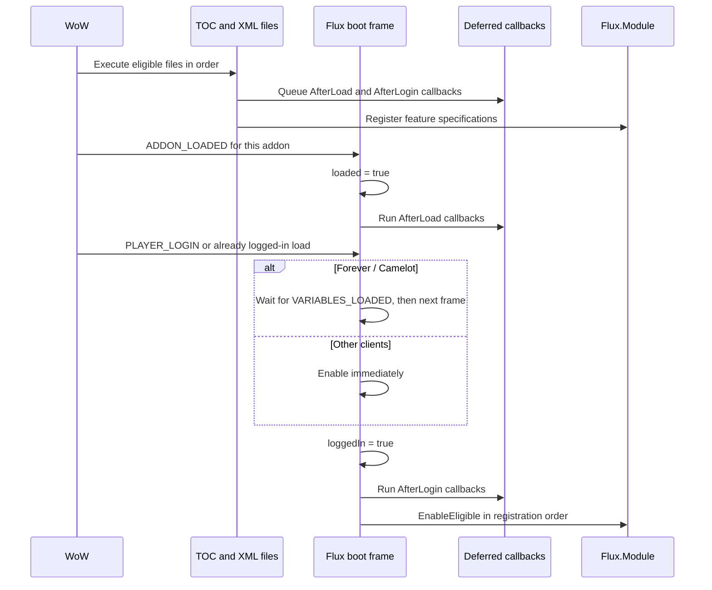

# Runtime architecture and startup

This chapter describes the current working-tree implementation. The addon combines a newer `Flux` kernel with older global and Ace-based feature code. A folder is a useful ownership boundary, but it is not necessarily a lifecycle module. Source coverage and unloaded files are indexed in [30-source-coverage.md](30-source-coverage.md).

## Executable scope and load order

[`_FluxUI.toc`](../_FluxUI.toc) is the entrypoint. Its file order and XML includes determine what executes; `_tmp_*` scripts, leftover engines and unused libraries do not execute just because they exist on disk. Per-file `AllowLoadGameType` annotations restrict some entries. Runtime guards provide a second check, particularly for Forever and the secret-value backends.

| Load phase | Contents and reason for ordering |
|---|---|
| Embedded essentials | LibStub, Unfit and LibCustomGlow are available before Flux consumers. |
| Kernel and compatibility | `Flux.lua`, dropdown support, Forever compatibility, client detection, hotkey display, capability probes, secure click proxies and Blizzard hiding. |
| Typed adapters and services | `Core/API`, ButtonFX, event/timer/ticker, restricted/combat/scheduler, range, mouseover, form/spellbook/context/identity and performance services. |
| Early feature foundation | WindowMover and inventory facts precede their consumers. Extra Button widgets, flyouts, grids and trinkets precede the main action strip. |
| Bars | Main strip, pet bar and stance bar create their namespaces and register lifecycle work. |
| Legacy facade | `Core/FluxAPI` exports compatibility helpers used by the remaining HUD code. It is a separate implementation surface, not an alias for every new adapter. |
| Options and binding | Border/defaults and Blizzard settings helpers load before Ace3-backed binding/options. The binding boot comes before options files in the TOC; both act later through events/timers. |
| HUD and services | Raid/unit frames, Micro Menu, status, minimap, Flux Window/map/meters, Respec, character panel, chat, nameplates and Salvage. |
| Economy bridges and final chrome | Restock/vendor libraries and features, Baganator compatibility, then the unified border. |

The TOC's early comment saying action bars, Binding and grids remain off the TOC is stale: the actual entries load all three. Follow entries and includes when reconstructing execution.

## Startup sequence

[`Core/Flux.lua`](../Core/Flux.lua), symbols `Flux.AfterLoad`, `Flux.AfterLogin`, `RequestModuleEnable` and `EnableModules`, owns the kernel sequence:

`AfterLoad` means every eligible TOC file has executed and the kernel's `ADDON_LOADED` handler has run. It does not mean every other feature's independent `ADDON_LOADED` handler, scan or delayed initialization has finished. For example, options create their AceDB instance in their own event handler.

Callbacks registered after their phase execute immediately through `Flux.Safecall`. A failed callback is reported through `geterrorhandler`; the protected call lets subsequent work continue. No callback return value is propagated by this helper.

On `/reload` or a mid-session addon load, `IsLoggedIn()` can already be true. The kernel requests module enable from `ADDON_LOADED` instead of requiring another `PLAYER_LOGIN`. Forever defers enable until Blizzard's variable setup has finished to avoid creating action-button state before gamepad setup. The next-frame callback uses `C_Timer.After(0)`; a one-second fallback covers a mid-session load that will not see `VARIABLES_LOADED` again. This fallback belongs to the kernel; independently event-driven features may have narrower startup handling.

## Namespaces and ownership

| Surface | Owner and role |
|---|---|
| `ns` | WoW's per-addon private table, passed through `...` to Lua files. Also holds feature exports. |
| `ns.Flux`, `_G.Flux` | The same kernel table created in `Flux.lua`; contains `Client`, `Cap`, API adapters, engine services and newer feature namespaces. |
| `Flux.API` | Grouped newer adapters. Common adapters are also exposed directly, e.g. `Flux.Spell == Flux.API.Spell`. |
| `Flux.Engine` | Grouped service aliases, e.g. `Flux.Engine.Scheduler == Flux.Scheduler`. Not every Core object belongs here. |
| `ns.API` | Legacy compatibility helper table populated in [`Core/FluxAPI/FluxAPI.lua`](../Core/FluxAPI/FluxAPI.lua). Distinct from `Flux.API`. |
| `FluxAPICompat`, `FLUX_API` | Global legacy compatibility objects. The boot file links `FluxAPICompat.API` to `ns.API` and publishes `ns.API.FLUX_API`. |
| Feature globals | Examples include `FluxOptions`, `FluxBorder`, `FluxBinding`, `FluxNonCombatAPI`, `FluxRaid_*` and `FluxUnitFrames_*`. They remain active integration contracts. |

Names that look equivalent can differ. `Flux.Client.isClassic` means Wrath/Cata/Mists, while `FLUX_API.isClassic` means Era. Use the appropriate family flag or `isAnyClassic`; see [02-multi-client-matrix.md](02-multi-client-matrix.md).

## Lifecycle module registry

[`Core/Module.lua`](../Core/Module.lua) exposes `Register`, `IsEligible`, `Enable`, `Disable`, `IsEnabled`, `EnableEligible` and `List`. A specification can provide `clients`, `capabilities`, `requiredAddons`, `OnLoad`, `OnEnable` and `OnDisable`.

- `clients` is a table keyed by kernel family (`era`, `anniversary`, `classic`, `midnight`). A missing table permits all families.
- `capabilities` is a list of truthy keys in `Flux.Cap`; all listed keys must pass.
- `requiredAddons` requires every named addon to be loaded through `Flux.AddOn.IsLoaded`. The registry does not automatically retry whenever a dependency later loads.
- `optional` is descriptive metadata; it is not an eligibility gate.
- `OnLoad` is queued through `AfterLoad` when registered, independently of eligibility. `OnEnable` runs only after eligibility passes.
- A module registered after `Flux.loggedIn` is immediately offered enable. Enable/disable guard against repeated calls. The enabled flag is set before `OnEnable`, so it records the attempted transition even if the protected callback errors.
- Disable calls the optional hook. It does not generically unregister events, remove hooks or undo secure state for a feature.

Current loaded registrations:

| Name | Registration source |
|---|---|
| `WindowMover` | [`WindowMover/Init.lua`](../WindowMover/Init.lua) |
| `Inventory` | [`Inventory/Init.lua`](../Inventory/Init.lua) |
| `ExtraButtons` | [`ExtraButtonSystem/Init.lua`](../ExtraButtonSystem/Init.lua) |
| `ActionBars` | [`Bars/Init.lua`](../Bars/Init.lua) |
| `PetBar` | [`Bars/Pet/Init.lua`](../Bars/Pet/Init.lua) |
| `StanceBar` | [`Bars/Stance/Init.lua`](../Bars/Stance/Init.lua) |
| `CharacterInfo` | [`CharacterInfo/Init.lua`](../CharacterInfo/Init.lua) |
| `EquipSlotFlyout` | [`CharacterInfo/PaperDollEquipFlyout.lua`](../CharacterInfo/PaperDollEquipFlyout.lua) |

These registrations share the four kernel client families. Many other loaded systems start from owned event frames or `AfterLoad`/timers. In particular, [`Binding/Boot.lua`](../Binding/Boot.lua) listens to `PLAYER_LOGIN`, waits one second, ensures the document, primes availability and requests an apply after bar creation. Its lifecycle is not a `Flux.Module` registration.

## Blizzard coexistence boundaries

[`Blizzard/Hide.lua`](../Blizzard/Hide.lua), `Flux.Blizz.Hide/Unhide`, reparents selected Blizzard frames beneath a hidden Flux parent. It remembers original parents in weak-key tables, defers protected moves during combat and uses `FluxAfterEditMode` while Edit Mode is busy. `keepEvents=true` retains events; without it, `Unhide` restores parenting but removed event subscriptions require a reload.

This helper's rules apply to that helper, not to all addon code. The addon also installs compatibility aliases, hooks, collector detachments and selected global replacements. Examples and client guards are described in [03-midnight-constraints.md](03-midnight-constraints.md) and [08-shared-services.md](08-shared-services.md).

The legacy `FluxEditModeBusy`/`FluxAfterEditMode` queue in [`Core/FluxAPI/UI.lua`](../Core/FluxAPI/UI.lua) keeps layout work out of Blizzard's open/close pass; jobs collapse by key and run on a later frame after the mode closes. It also suppresses owned Edit Mode selection chrome and unregisters the manager's specialization-change layout event. Those are deliberate runtime effects, not merely visual preferences.

## Dependencies and observability

TOC optional dependencies establish loading relationships; `Flux.Optional` separately probes loaded/readiness/API state. Syndicator readiness is tested through `Syndicator.API.IsReady`, so loaded does not always mean ready. See [29-integrations.md](29-integrations.md) and [90-reference-inspirations.md](90-reference-inspirations.md).

`Flux.Module.List`, `Flux.Perf.Snapshot`, scheduler statistics and ticker subscriptions expose pieces of runtime state. They do not prove that every legacy feature completed startup. [`Core/Slash.lua`](../Core/Slash.lua), [`Other/FluxPerfDebug.lua`](../Other/FluxPerfDebug.lua) and [`Other/FluxPerfCapture.lua`](../Other/FluxPerfCapture.lua) provide diagnostics; the later `/fluxperf` registration replaces the kernel handler. Exact command ownership is listed in [31-commands-and-bindings.md](31-commands-and-bindings.md).

For persistence see [09-persistence.md](09-persistence.md). For evidence limits, smoke results and client acceptance scenarios see [41-verification.md](41-verification.md).
