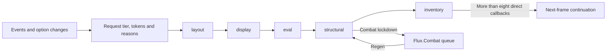

# Shared APIs, refresh services and button feedback

The newer shared layer is under `Core/API`, `Core/Engine` and `Core/ButtonFX`. Older HUD code still uses `Core/FluxAPI` and global helper functions. This chapter explains the contracts and data flow; [33-api-and-events.md](33-api-and-events.md) provides a lookup index.

## Adapter contracts

Adapters normalize API generations and selected tuple/table differences. They do not make every returned combat value accessible to Lua. Health, power, cooldown, charge, count and threat values can intentionally pass through to display widgets.

| Adapter | Important behavior | Source |
|---|---|---|
| `Flux.AddOn` | Chooses `C_AddOns` or globals. `Exists` scans the current game type's addon list first; `IsLoaded`, `Load`, `Enable`, metadata/info and loadability are guarded. | [`AddOn.lua`](../Core/API/AddOn.lua) |
| `Flux.Spell` | Cached tuple-style info/name/icon/subtext; conditional/live icons, base/override matching, cast attributes, flyout resolution, cooldown/charge duration objects, current/autorepeat, usability and range. | [`Spell.lua`](../Core/API/Spell.lua) |
| `Flux.Item` | Info/icon/count/spell, usability/equipped/current/range, consumable and charged-mana-gem policy, and cooldown fallback. | [`Item.lua`](../Core/API/Item.lua) |
| `Flux.Container` | Bag/slot validation and normalized item records. Modern API misses can fall back to legacy data; move/use/split APIs share validation. | [`Container.lua`](../Core/API/Container.lua) |
| `Flux.Aura` | Slot/index/instance access plus specialized player/cooldown-aura/duration queries; direct display wrappers for unit health/power. | [`Aura.lua`](../Core/API/Aura.lua) |
| `Flux.Action` | Action occupancy/texture/usability/count/cooldown/charges, Assisted Combat queries and safe collector detachment helpers. | [`Action.lua`](../Core/API/Action.lua) |
| `Flux.Pet`, `Flux.Shapeshift` | Normalize pet/form info and cooldown tuples or tables. Shapeshift identity uses base/override spell matching. | [`Pet.lua`](../Core/API/Pet.lua), [`Shapeshift.lua`](../Core/API/Shapeshift.lua) |
| `Flux.Spec` | Specialization and role fallbacks. Installs a global role shim only for a missing/broken non-Retail native API; does not replace `PlayerUtil.IsPlayerEffectivelyTank`. | [`Spec.lua`](../Core/API/Spec.lua) |
| `Flux.CVar` | Reads and guarded writes; blocks coupled nameplate/raid/target-cast settings on selected clients. The threat bitfield has a specific allowed route. | [`CVar.lua`](../Core/API/CVar.lua) |
| `Flux.Secrets` | Access/secret checks, safe comparison/booleans/GUID/cache/count/aura metadata helpers. | [`Secrets.lua`](../Core/API/Secrets.lua) |
| `Flux.Threat` | Client-aware threat query/display, warning/numeric/bitfield controls, group ranking and meter-row normalization. | [`Threat.lua`](../Core/API/Threat.lua) |
| `Flux.PlayerName` | Names, optional surnames, canonical keys, equality and existing-key migration. | [`Name.lua`](../Core/API/Name.lua) |

Specific distinctions that callers must preserve:

- `Spell.IsUsable` can return `nil, nil` for an unavailable/secret result; this is not the same as a known unusable spell. Spell range is tri-state: in range, out of range, or unknown/not applicable.
- `Spell.GetInfo` caches numeric-ID results. A cold record identified by `IsSpellDataCached` requests loading without caching a permanent miss. `SPELL_DATA_LOAD_RESULT`, icon events and learned-spell events invalidate relevant caches. `GetLiveFace` is separate from an assigned spell's original icon.
- `Item.GetCount` evaluates compatible three/four/five-argument queries and keeps the largest valid count when bank/reagent/account flags are involved. This is an API count helper, distinct from the inventory foundation's stored facts.
- `Item.UsesConsumableCharges` distinguishes stack quantities from charges, including known mana gems and consumer kind context. `Item.GetCooldown` tries modern/container/legacy APIs and prefers the longest accessible remaining timer over zero/GCD stubs; it retains a secret timer candidate when a useful readable timer is absent.
- `Container.GetItemInfo` returns a normalized table when available. Its second return can distinguish an empty slot from a slot whose item data is not yet cached. Bag IDs may be zero or negative; slots must be positive integers. It copies modern records before repairing fields rather than modifying Blizzard tables.
- `Action.OccupancyKey` is type plus ID. A macro displaying a different conditional spell is a display identity change, not a different slot occupant.
- New `Aura.GetSlots` returns the slot list and success/accessibility state. Legacy `SafeGetAuraSlots` preserves its consumers' continuation-token-shaped return list. They should not be interchanged solely because the names sound similar.
- Generic aura enumeration is gated by secret access. `GetPlayerAuraBySpellID` deliberately is not gated the same way, because a specialized query can return a usable nonsecret aura or nil while general access is restricted.

## Event and timer primitives

[`Core/Engine/Events.lua`](../Core/Engine/Events.lua) exposes `Register(event, fn)`, `Unregister(event, fn)`, `RegisterUnit(event, unit, fn)`, validation and owned-frame safe registration. Bus callbacks receive `(event, ...)` and are protected individually. The bus registers an event on its dispatcher only while a handler list exists. `RegisterUnit` creates a separate frame and returns it to the caller; its callback is invoked directly, rather than through the protected central loop.

Event validity is cached. `C_EventUtils.IsEventValid` is preferred; otherwise a probe frame attempts registration. Explicit learned-spell hints avoid registering obsolete events whose error reporting can escape a `pcall`. `RegisterLearnedSpell` combines `SPELLS_CHANGED` and client-appropriate learned-spell names.

[`Timer.lua`](../Core/Engine/Timer.lua) provides `After`, `NewTicker`, `Defer` and `HasPendingPolyfill`. It captures native timers and otherwise uses a local self-disarming wait frame; this newer implementation never assigns into `C_Timer`. The legacy [`Core/FluxAPI/Timers.lua`](../Core/FluxAPI/Timers.lua) separately exports global timer helpers and can install missing global `C_Timer` members. An addon-wide claim that timer globals are never patched would be inaccurate.

[`Ticker.lua`](../Core/Engine/Ticker.lua) runs keyed subscriptions from one shown frame. `Add(key, fn)` replaces the same key, `Remove(key)` uses swap removal, and the frame hides when the count reaches zero. `GetSubscribers` returns a copy for diagnosis. A zero shared ticker count does not account for standalone legacy frames or Blizzard-owned work.

## Tiered refresh and combat deferral

[`Scheduler.lua`](../Core/Engine/Scheduler.lua) accepts `Register(tier, listener)` and `Request(tier, token, callback, reason)`:

| Tier | Intended work | Actual scheduling contract |
|---|---|---|
| `layout` | Paging/layout fanout | Sets the paging flag; runs first. |
| `display` | Conditional faces, icons, usable/badge paint | Independent request; never implicitly becomes eval. |
| `eval` | Macro/occupancy/binding-plan evaluation | Work requested during layout remains pending and runs after display. |
| `structural` | Secure widget/attribute structure | Deferred through `Flux.Combat` when in lockdown. |
| `inventory` | Inventory-related callbacks | At most eight queued direct callbacks per flush; listeners still run for that bucket. |

Tokens and reasons are sets passed to callbacks/listeners. Repeating a token deduplicates the token, not the callback list. Ordinary buckets execute their callbacks then listeners. A request schedules a next-frame flush through `Flux.Timer.After(0)`. Work is not described as globally single-pass: feature-owned timers, listener costs, requests generated while flushing and combat deferrals still matter.

[`Combat.lua`](../Core/Engine/Combat.lua) has two queue forms:

- `Defer(key, fn)`: named last-writer-wins work, retaining first insertion order for distinct keys. Outside lockdown it attempts `Flush` immediately. A shared key cannot represent an arbitrary list of different jobs.
- `RegenDefer(fn, heavy)`: light/heavy callback lists. `PLAYER_REGEN_ENABLED` flushes named jobs, then schedules those lists for a later frame; light callbacks run before heavy callbacks. This avoids placing all scans on the regen tick.

`HasPending` and `PendingCount` describe the named queue. The list queues and feature-local flags need separate diagnosis.

## Change coalescers and display identity

| Service | Consumer-facing behavior |
|---|---|
| [`FormStorm`](../Core/Engine/FormStorm.lua) | Reads form, bonus, page, stealth and vehicle signatures. Unchanged events are ignored. `OnBurst(key, fn)` runs once next frame; `OnSettled(key, fn)` runs after 0.25 seconds quiet, with a `quiet` boolean describing whether trailing work occurred. Snapshot/burst/settle queries let consumers avoid repeated scans. |
| [`SpellBook`](../Core/Engine/SpellBook.lua) | Keyed `OnChanged` subscribers receive signature-changing spellbook events after a 0.25-second trailing debounce. It holds while FormStorm is open, checks again at 0.1 seconds, and caps holding from the first event at one second. `Sync` warms the signature without notifying. |
| [`Modifier`](../Core/Engine/Modifier.lua) | `Register(key, callback, {fallbackInterval, isActive})` and `Unregister`. Modifier events coalesce onto OnUpdate; optional active fallback intervals keep polling armed only when needed. Also exported as `FluxModifierTracker`. |
| [`Context`](../Core/Engine/Context.lua) | Fingerprints unit-frame peek, modifiers, accessible target/focus identities, mouseover reaction and combat. Subscribers receive kind flags on the display tier; unchanged fingerprints skip work. Mouseover requests coalesce, and short-lived peek polling handles transitions. |
| [`Identity`](../Core/Engine/Identity.lua) | Registers surfaces and publishes the shown `{kind, id}`. Stable signatures skip unchanged notifications. Slot and badge keys have helpers; `SoftSync` republishes current identities without requesting Binding Apply. |
| [`Range`](../Core/Engine/Range.lua) | Registered bar/extra sweeps share memoized spell/item/action probes for one sweep. Default bar interval is 0.25 seconds, extra interval 0.18; arm/disarm follows `needFn`. Mouseover events stamp a burst time instead of walking every host on each hop. |

Context, Identity and range concern what a surface currently shows. Binding documents and action-slot occupancy remain separate sources of truth. This separation lets a target/modifier change repaint a macro's face without recompiling the binding plan.

## Click-time targeting and secure helpers

[`MouseoverCast.lua`](../Core/Engine/MouseoverCast.lua) owns the click-time unit on plain action/spell/item hosts. Live/Classic use secure PreClick/PostClick wraps to pick mouseover, then target, then nil and remove stale unit attributes afterward. Macro/click overlays keep targeting in their compiled body. Legacy continuously evaluated mouseover state drivers are parked rather than rearmed.

Forever retains the legacy no-wrap policy for mouseover targeting, independently of the bar paging probe. `UsesNativeCVar` selects its native mouseover path, and `ApplyNativeCheck` stamps `checkmouseovercast` on plain types. The current `SyncCVar` deliberately does **not** write the Forever CVar: Blizzard's checkbox owns it, and `CVAR_UPDATE` synchronizes the Flux setting. On wrap clients the native CVar is kept off. Changing the Flux setting updates scoped options and the legacy character field, requests a binding recompile, invalidates range and refreshes presentation. The file's opening comments are less specific than this actual implementation.

[`Restricted.lua`](../Core/Engine/Restricted.lua) wraps Execute/WrapScript/snippets/state and unit drivers. Existing Forever callers keep an insecure, event-assisted 0.2-second fallback that does not apply structural attribute changes during combat. Bars separately use `PagingWorks`, `SetPagingSnippet`, `ExecutePaging` and captured native attribute-driver registration: a successful setup-time execution probe enables secure bar paging on repaired Forever builds while preserving v8's mouse/key input policy. A failed probe retains the OOC fallback. [`SecureClickProxy.lua`](../Core/SecureClickProxy.lua) overlays a separately parented secure click/macro button while the owner is hovered; the watcher polls hover without scripting the secure button. These are client-specific integration tools, not a way to bypass protected actions.

[`SpellBookChrome.lua`](../Core/Engine/SpellBookChrome.lua) places Mouseover Cast/rank-up controls in the modern spellbook footer or Classic title row. Rank controls are permitted for Era/TBC/Wrath and a suitable low-rank API, but excluded on Cata/Mists/live Midnight. It can restore missing Forever rank-label/CVar support; the native SettingsDropdown is retained.

## Shared button feedback

`Flux.ButtonFX` is shared by bar hosts, minirows, Extra Buttons and badges. It owns separate presentation objects so native action-button collectors do not dispatch through Flux code into later Blizzard protected buttons.

Collector ownership has a client exception: `Action.LeaveBlizzardCollector()` is true for Forever, and its nil/detach/sweep helpers return without changing native collector methods or registration tables. `WithRegistrationSuppressed(fn)` is now a pass-through despite its historical name. Forever strip widgets use `ActionButtonTemplate, SecureActionButtonTemplate`; other eligible post-DF strip widgets use `ActionBarButtonTemplate, SecureActionButtonTemplate`. [Hosts.lua](../Bars/Hosts.lua) and [EBS Widget.lua](../ExtraButtonSystem/Engine/Widget.lua) agree on that choice. Restoring a temporarily replaced native method would not erase its taint, so the new path avoids the replacement.

| Component | Responsibilities and useful entrypoints |
|---|---|
| [`Charges.lua`](../Core/ButtonFX/Charges.lua) | `Ensure`, `Apply`, `ClearCache`: primary spell/GCD swipe plus charge-recharge edge; duration-object fallback for unreadable numeric timers; accessible scalar signature skips; charge child created only when needed. It paints widget instances without replacing `CooldownFrame_Set`. |
| [`Click.lua`](../Core/ButtonFX/Click.lua) | `SyncCVars`, `MirrorTypeRelease`, `UsesWrap`, `Apply`: secure mouse/key press-release contract and `type*` to `typerelease*` mapping. Forever uses mouse-up visible hosts and hidden key-down proxies owned by bar click code. |
| [`Glow.lua`](../Core/ButtonFX/Glow.lua) | `Want`, `Set`, `Transfer`, `FaceShowsSpell`, `InstallSAO`, `Start`: proc membership from native/community sources; owned glow frames/LCG/fallback art; transfer existing animation between visible hosts instead of restarting the birth animation. Community SAO membership discovery includes guarded upvalue/environment-based compatibility paths. |
| [`Flash.lua`](../Core/ButtonFX/Flash.lua) | `WantSlot`, `WantSpell`, `WantItem`, `Set`, `Start`: auto-attack/auto-shot/wand flash. Melee state uses `PLAYER_ENTER_COMBAT`/`PLAYER_LEAVE_COMBAT`, distinct from general combat lockdown. Active flashes share a ticker. |
| [`Overlay.lua`](../Core/ButtonFX/Overlay.lua) | `Attach`, cast/channel/empower fills, reticle, interrupt/end-burst, checked/pushed chrome, live-state queries, clear/sync/transfer functions. Builds isolated child visuals and chooses native or Classic fallback animation. Resizing respects separate X squeeze and native height. |
| [`Cast.lua`](../Core/ButtonFX/Cast.lua) | `Register`, `Start`, `PickOwners`, `FollowColumn`, `AdoptFace`, `Debug`: one owned spellcast dispatcher for player/pet; resolves shown spell/rank/item/macro identity, selects matching visible owners, and transfers/adopts/clears cast presentation across row or face changes. Pet state is isolated from player state. |

Cast event handling distinguishes success, ordinary stop/cancel, interrupt, channel and empower endings, and reticle target/clear. Delayed stop cleanup checks generations so an old callback cannot cancel a newer cast. `FollowColumn` reconciles the currently shown face with in-flight presentation. Post-DF VFX remain enabled; pre-DF follows the action-bar `spellCastVFX` option.

These files use client-specific templates, atlas checks and bundled media; visual identity and asset provenance are described in [04-visual-system.md](04-visual-system.md) and [34-assets.md](34-assets.md). `Click2.lua` exists but is not the loaded click implementation.

## Legacy facade and diagnostics

`Core/FluxAPI` supplies cached spell/action wrappers, aura/unit pass-through functions, CVar guards, capability flags, timer globals, tooltip/portrait/micro helpers, talent-group helpers, Edit Mode deferral and bank-paint/transfer staging. `FluxAPI_Boot.lua` publishes exports and reprobes selected state on `PLAYER_LOGIN`. It duplicates some concepts from the newer API; callers must follow their actual contract rather than assume common ownership.

`Flux.Perf` counts passes and captures form/page, bag/drag and regen timings. `Perf.IsIdle` checks the kernel's known ticker/timer/scheduler queues; it is not a full frame-enumeration result. `Flux.HopLag` adds opt-in event/ticker/modifier tracing and the `/fluxhop`/`/fluxlag` overlay. `Other/FluxPerfDebug.lua` inspects broader drivers and `Other/FluxPerfCapture.lua` persists timed captures in `FluxPerfCaptureDB`.

Diagnostics change what is instrumented and can add polling/wrappers while active. Use the [verification procedure](41-verification.md) and exact [command reference](31-commands-and-bindings.md), especially for `/fluxperf`, whose final handler is the later-loaded diagnostic file.

The [idle performance follow-up](45-idle-performance.md) uses a native Forever baseline to guide bounded changes: the mouseover watchdog sleeps without a unit, repeated Forever fallback strings share one parse per sweep, and unit-frame health/threat samples use existing timer wrappers at unchanged deadlines. Timerless clients retain the private unit-frame OnUpdate fallback. `FluxUI_GetUnitFramePollStats` exposes active timer flags; kernel ticker counts alone do not enumerate these timer-driven samples.
