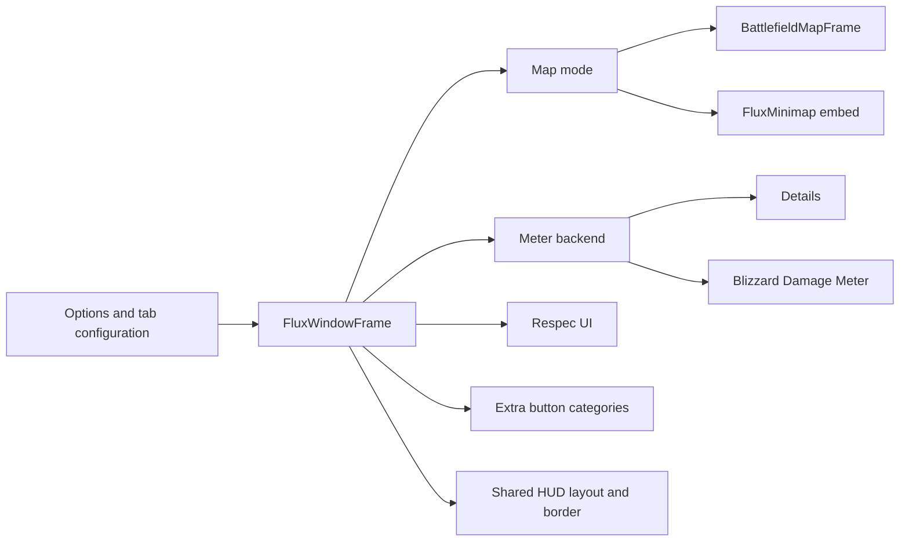

# Flux Window, Battlezone map and meters

The Flux Window is the bottom-right host for Map/Minimap, Meter, Respec and Buttons. It owns tab visibility, order and the shared content rectangle; each hosted system owns its contents. The main controller is global `FluxWindowFrame` in [FluxWindowFrame.lua](../Battlezonemap/FluxWindowFrame.lua). The loaded map/meter adapters are part of this system, not independent windows.

## Host and tab lifecycle

`GetFrame()` lazily creates the bordered frame. Initial dimensions are `300 * 1.35` by `200 * 1.35`; later layout/options calls can resize it. The host follows the status-bar bottom lift and participates in the bottom HUD envelope. `GetContentFrame()` exposes its interior.

`AddTab(name, onShow, onHide, tooltipText)` creates a tab/content frame. `SwitchToTab(name)` hides previous content and runs the new show callback. `RemoveTab`, `GetTabContent`, `GetActiveTab` and `GetManagedTabNames` support consumers. `SetTabEnabled`, `SetTabOrder`, `MoveTabInOrder` and `ApplyTabConfig` reconcile persisted configuration with available tabs. A missing meter backend can remove Meter without implying a broken host.

Map switches between battlefield map and embedded normal minimap. Embedding changes minimap parent, geometry and controls; disabling Map calls `ReleaseMinimapEmbedIfMapDisabled()` to restore it. Respec and Buttons install their own surfaces. Conditional binding authoring lives in **Options → Binding**, not a standard fifth window tab. See [Respec](23-respec.md), [extra buttons](12-extra-button-system.md) and [binding](13-binding-system.md).

Clicking the already-active Map tab toggles Map/Minimap mode and saves it; clicking it from another tab returns to the existing mode. Clicking the active Meter tab cycles layouts; right-click opens the layout menu and middle-click resets meter data outside combat. Tab-button handlers reject combat interactions. Failed map initialization/embedding shows a diagnostic fallback label rather than silently creating a different map.

## Battlefield map

[FluxBattlefieldMap.lua](../Battlezonemap/FluxBattlefieldMap.lua) manages initialization, show/hide, parent, scaling, refresh and cleanup. Public methods include `Initialize`, `SetScaling`, `UpdateLayout`, `IsActive`, `GetMapFrame` and `SetWorldMapFeaturesEnabled`. It uses available Blizzard map UI. Addon, entering-world/zone and combat events handle late construction and changing context.

| Layer | Responsibility |
|---|---|
| [Providers](../Battlezonemap/FluxBattlefieldMapProviders.lua) | Attach available world-map providers for quests, waypoints, POIs, vignettes, flight points, gossip, dig sites and dungeon entrances; track additions and required pin frame levels. |
| [World features](../Battlezonemap/FluxBattlefieldMapWorldFeatures.lua) | Enable policy, supported-provider activation, compatible feature clones, combat-unsafe-provider removal and visible-map synchronization. |
| [Pin router](../Battlezonemap/FluxBattlefieldMapPinRouter.lua) / [tooltips](../Battlezonemap/FluxBattlefieldMapPinTooltips.lua) | Route compatible HereBeDragons/Questie pins on clients lacking Blizzard quest providers, preserving pin templates and tooltips. |

WorldMapFrame has priority while open. HBD routing requires world features enabled, the Flux battlefield map active and a suitable source provider. Router installation retries on addon/zone transitions and schedules catch-up passes for late populations. Provider lists are capability candidates, not a guarantee every client supplies them. `GetRouteLabel`, `IsHBDAvailable` and tooltip diagnostics expose the selected path.

## Meter backend and layout editor

[FluxMeterLayout.lua](../Battlezonemap/FluxMeterLayout.lua) selects **Details when loaded, otherwise an available Blizzard meter**. Neither backend means no Meter tab. Backend-specific settings hold working/user layouts. Details has 11 built-in layouts; Blizzard has 6 and at most three session panes. Geometry uses top/bottom rows, up to three columns per row and normalized fractions; the row split is limited to 0.25–0.75.

The editor applies built-ins, changes pane contents/column counts/fractions, saves new named layouts, overwrites, renames and deletes user layouts. `BuildCatalog()` supplies Details attributes/plugins or native meter kinds. `ScheduleReembed()` coalesces changes; `SyncGeometryFromLayout()` can update existing panes. This is separate from moving the entire host.

[FluxDetails.lua](../Battlezonemap/FluxDetails.lua) creates enough instances, embeds them, suppresses instance chrome and refreshes after profile/instance changes. [WoWSkin tint](../Battlezonemap/FluxDetailsWoWSkinTint.lua) reapplies class tint. [Forever adaptation](../Battlezonemap/FluxDetailsForever.lua) handles its backend differences. [FluxThreat.lua](../Battlezonemap/FluxThreat.lua) supplies the Flux threat plugin using roster, target and threat-list updates; this is distinct from unit-frame/nameplate threat overlays.

[FluxBlizzardMeter.lua](../Battlezonemap/FluxBlizzardMeter.lua) discovers native session APIs and embeds supported session windows, accepting current secondary-window and older variants. Forever gamepad mode anchors it to the Flux window **without reparenting**, because reparenting taints native gamepad dropdown interaction. Both backend reset APIs require being out of combat.

## Settings and diagnosis

Layout, General and Battlezone builders provide placement/tab/map/meter controls; [options](26-options-map.md) records exact labels/scopes. Runtime tab arrays, active tab and embed state are distinct from persisted tab configuration. Meter layout storage is separate again.

`/fluxwindow show|hide|toggle` (also `/fw`) controls the host; empty input currently does nothing. `tab <name>` changes tabs outside combat; `addtab`/`removetab` are developer helpers. Inspect `GetActiveTab()` and `FluxMeterLayout.GetMeterBackend()` for wrong contents. Missing pins can mean disabled world features, world-map priority, unavailable providers or absent source pins. A blank meter can mean backend readiness rather than geometry.

Protected work is guarded/deferred on combat transitions. In-game verification must cover tab switching, map pan/zoom, Questie/HBD restoration, late meter loading and Forever gamepad dropdowns. Source guards alone do not prove taint safety; see [verification](41-verification.md).
