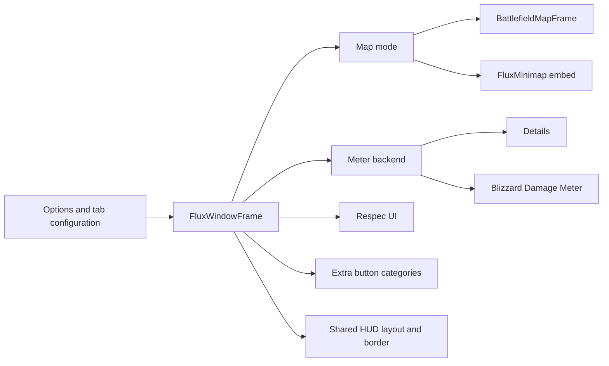

# Flux Window, Battlezone map and meters

13 November SECRET-UI-20261113 supersedes earlier automatic native meter
selection claims: Blizzard controls own types/window creation/Current; Flux
keeps saved layout requests with explicit setup feedback. Unit/pet/raid/preview
hover state is isolated from the world-cursor tooltip. Reload/native retest
required. [Fix, capability limit and evidence](SECRET_TOOLTIP_METER_ERRORS.md).

10 November passive pass 2: Meter timer election reuses a scalar helper; all native/owned reads and writes remain. [Before/after evidence and native limits](PASSIVE_PERFORMANCE_PASS2.md).

5 November native meter correction: Blizzard retains its rendering/Init, duration
and visibility methods. Flux applies green/white name tint only after native Init,
keeps tab boundaries with a secure posthook and avoids unchanged type/session
refreshes during geometry updates. Native formatting replaces the old unreadable
duration placeholder. The supplied Forever warning is documented; post-reload
native acceptance remains pending.
[Regression and source evidence](METER_RAID_NATIVE_OWNERSHIP.md).

The Flux Window is the bottom-right host for Map/Minimap, Meter, Respec and Buttons. It owns tab visibility, order and the shared content rectangle; each hosted system owns its contents. The main controller is global `FluxWindowFrame` in [FluxWindowFrame.lua](../Battlezonemap/FluxWindowFrame.lua). The loaded map/meter adapters are part of this system, not independent windows.

## Host and tab lifecycle

`GetFrame()` lazily creates the bordered frame. Initial dimensions are `300 * 1.35` by `200 * 1.35`; later layout/options calls can resize it. The host follows the status-bar bottom lift and participates in the bottom HUD envelope. `GetContentFrame()` exposes its interior.

`AddTab(name, onShow, onHide, tooltipText)` creates a tab/content frame. `SwitchToTab(name)` hides previous content and runs the new show callback. `RemoveTab`, `GetTabContent`, `GetActiveTab` and `GetManagedTabNames` support consumers. `SetTabEnabled`, `SetTabOrder`, `MoveTabInOrder` and `ApplyTabConfig` reconcile persisted configuration with available tabs. A missing meter backend can remove Meter without implying a broken host.

Map switches between battlefield map and embedded normal minimap. Embedding changes minimap parent, geometry and controls; disabling Map calls `ReleaseMinimapEmbedIfMapDisabled()` to restore it. Respec and Buttons install their own surfaces. Conditional binding authoring lives in **Options → Binding**, not a standard fifth window tab. See [Respec](23-respec.md), [extra buttons](12-extra-button-system.md) and [binding](13-binding-system.md).

Clicking the already-active Map tab toggles Map/Minimap mode and saves it; clicking it from another tab returns to the existing mode. Clicking the active Meter tab cycles layouts; right-click opens **HUD → Flux Window → Damage Meter** settings and middle-click resets meter data outside combat. Flux Window's General settings remain a separate tab. Tab-button handlers reject combat interactions. Failed map initialization/embedding shows a diagnostic fallback label rather than silently creating a different map.

## Battlefield map

[FluxBattlefieldMap.lua](../Battlezonemap/FluxBattlefieldMap.lua) manages initialization, show/hide, parent, scaling, refresh and cleanup. Public methods include `Initialize`, `SetScaling`, `UpdateLayout`, `IsActive`, `GetMapFrame` and `SetWorldMapFeaturesEnabled`. It uses available Blizzard map UI. Addon, entering-world/zone and combat events handle late construction and changing context.

| Layer | Responsibility |
|---|---|
| [Providers](../Battlezonemap/FluxBattlefieldMapProviders.lua) | Attach available world-map providers for quests, waypoints, POIs, vignettes, flight points, gossip, dig sites and dungeon entrances; track additions and required pin frame levels. |
| [World features](../Battlezonemap/FluxBattlefieldMapWorldFeatures.lua) | Enable policy, supported-provider activation, compatible feature clones, combat-unsafe-provider removal and visible-map synchronization. |
| [Pin router](../Battlezonemap/FluxBattlefieldMapPinRouter.lua) / [tooltips](../Battlezonemap/FluxBattlefieldMapPinTooltips.lua) | Route compatible HereBeDragons pins on older clients, plus Questie and standard HBD (including RestedXP) on Forever alongside native quest providers, preserving pin templates and tooltips. |

WorldMapFrame has priority while open. HBD routing requires world features enabled, the Flux battlefield map active and a suitable source provider. Router installation retries on addon/zone transitions until a live route is available. Provider lists are capability candidates, not a guarantee every client supplies them. `GetRouteLabel`, `IsHBDAvailable` and tooltip diagnostics expose the selected path.

Forever/Camelot routes Questie's World Map icon objects through its own HBD provider, so Questie's World Map visibility, quest filters, icon size/colors and tooltip behavior also apply inside the Flux Window. Questie's minimap-icon and tracker-enabled settings do not control this route. The standard HBD library also routes RestedXP and other addons using that shared library. The Flux “Map Pins” toggle enables/disables these battlefield routes. Existing Blizzard providers/pools remain in place; Retail retains its native-only policy.

The router releases an icon's previous pin before acquiring its new owner and uses the icon's direct parent for constant-time handoff. It does not scan the complete pin list for each new icon, force-drain Questie's batched draw queue, or rebuild the provider during zoom animation ticks. Refresh requests coalesce to one pass per frame, completed discovery retries skip further redraws, and combat-deferred work resumes after combat. There is no idle polling ticker. [The pin smoke check](../Battlezonemap/_tmp_questiepinsmoke.lua) covers ownership/settings, native-provider coexistence, late loading, combat and refresh bounds; `lua Battlezonemap/_tmp_questiepinsmoke.lua --benchmark` also measures 1,000/2,000 incremental mock pins and asserts zero full-list scans or provider refreshes during insertion. Mock CPU time does not establish in-game frame times or taint safety.

## Meter backend and layout editor

[FluxMeterLayout.lua](../Battlezonemap/FluxMeterLayout.lua) selects **Details when loaded, otherwise an available Blizzard meter**. Neither backend means no Meter tab. Backend-specific settings hold working/user layouts. Details has 11 built-in layouts; Blizzard has 6 and at most three session panes. Geometry uses top/bottom rows, up to three columns per row and normalized fractions; the row split is limited to 0.25–0.75.

The editor applies built-ins, changes pane contents/column counts/fractions, saves new named layouts, overwrites, renames and deletes user layouts. `BuildCatalog()` supplies Details attributes/plugins or native meter kinds. `ScheduleReembed()` coalesces changes; `SyncGeometryFromLayout()` can update existing panes. This is separate from moving the entire host.

[FluxDetails.lua](../Battlezonemap/FluxDetails.lua) creates enough instances, embeds them, suppresses instance chrome and refreshes after profile/instance changes. [WoWSkin tint](../Battlezonemap/FluxDetailsWoWSkinTint.lua) reapplies class tint. [Forever adaptation](../Battlezonemap/FluxDetailsForever.lua) handles its backend differences. [FluxThreat.lua](../Battlezonemap/FluxThreat.lua) supplies the Flux threat plugin using roster, target and threat-list updates; this is distinct from unit-frame/nameplate threat overlays.

[FluxBlizzardMeter.lua](../Battlezonemap/FluxBlizzardMeter.lua) discovers native session APIs and embeds supported session windows, accepting current secondary-window and older variants. Forever gamepad mode anchors it to the Flux window **without reparenting**, because reparenting taints native gamepad dropdown interaction. Both backend reset APIs require being out of combat.

Native meter visibility remains owned by Blizzard Edit Mode: Always, InCombat,
InGroup and Hidden settings are honored inside the Flux host/tab boundary.
Embedding no longer forces Always into Blizzard's native field, which was read
before combat timer updates. Timer and row rendering stay native; reload after
the fix and verify combat, source windows and pane controls in game.
[Combat visibility evidence and limits](METER_COMBAT_VISIBILITY.md).

The native backend now shares a Flux-themed skin made from existing Flux/Blizzard
assets and the client ARIALN font. On Forever without Details it also offers one
independent threat pane, including opt-in presets7-9; existing presets1-6/default1
remain. A custom layout may contain up to three native panes plus that threat
pane. Public threat can rank; opaque values stay in stable roster order and do
not display a fabricated rank. The pane stops recurring work when hidden or
superseded by Details. The public native meter option is enabled out of combat
for this backend as requested; native visibility/cache and UI loading stay native.
This recreates the approved look without reserved Details art/font; exact native
pixels/combat/taint remain pending. [Standalone feature record](METER_STANDALONE.md).
Native panes are now gated to Flux from startup before first Embed. Late native
anchor/size restoration queues geometry-only repair out of combat; disabled
Meter tabs and explicit cleanup release that ownership. Desktop checks pass;
native reload, rendering and taint acceptance remains pending.

## Settings and diagnosis

Layout, General and Battlezone builders provide placement/tab/map/meter controls; [options](26-options-map.md) records exact labels/scopes. Runtime tab arrays, active tab and embed state are distinct from persisted tab configuration. Meter layout storage is separate again.

`/fluxwindow show|hide|toggle` (also `/fw`) controls the host; empty input currently does nothing. `tab <name>` changes tabs outside combat; `addtab`/`removetab` are developer helpers. Inspect `GetActiveTab()` and `FluxMeterLayout.GetMeterBackend()` for wrong contents. Missing pins can mean disabled world features, world-map priority, unavailable providers or absent source pins. A blank meter can mean backend readiness rather than geometry.

Protected work is guarded/deferred on combat transitions. In-game verification must cover tab switching, map pan/zoom, Questie/HBD restoration, late meter loading and Forever gamepad dropdowns. Source guards alone do not prove taint safety; see [verification](41-verification.md).

## Pin ownership and delayed work

The presence of `QuestDataProviderMixin` changes library eligibility: modern native quest providers permit Forever's Questie-specific and standard HBD routes; other modern clients retain their native-only policy. Older clients without that mixin retain the existing supported HBD list. This decision is separate from whether Questie's tracker is enabled. Existing native providers and pools remain installed on Forever.

Cloned provider refreshes first check whether routing should own the icon. Closing World Map queues restoration for the next frame; refresh generations invalidate callbacks left over from an uninstalled route. Uninstall also marks the source World Map provider `forceUpdate` so reopening the same zone can rebuild its pins. Installing or redrawing during combat can remain pending until `PLAYER_REGEN_ENABLED`. These paths explain why a pin can be intentionally absent for a frame or while World Map owns it; they do not guarantee native combat safety. Sources: [router](../Battlezonemap/FluxBattlefieldMapPinRouter.lua), [world features](../Battlezonemap/FluxBattlefieldMapWorldFeatures.lua), [tooltips](../Battlezonemap/FluxBattlefieldMapPinTooltips.lua).

## RestedXP pins — 9 November 2026

Requirement **RXP-PINS-20261109**: show RestedXP's existing World Map pins on
the FluxWindow battlefield map when Map Pins is enabled. The supplied reference
is the installed Forever RXPGuides v4.11.35, using standard
`HereBeDragons-Pins-2.0` minor 17. Its `map.lua` submits numbered guide icons
through `AddWorldMapIconMap`; its vendor/treasure module uses the same library.
Forever previously excluded that library because native quest providers exist.
The library eligibility rule now admits it alongside Questie's renamed library.
This intentionally enables other owners of that shared standard HBD library too.

The existing bridge moves original icons; it does not rebuild guide content,
change RestedXP's pin count/visibility/scale, or introduce a new option. RestedXP
must supply pins under its own settings. World Map keeps priority while open;
Map Pins off returns ownership to its source provider. Original pin text,
textures and hover scripts remain owned by RestedXP. Its separately drawn route
lines and navigation arrow are unchanged. No new layout or artwork was designed;
the requested existing pin appearance is retained. No RestedXP code, art or guide
data was copied. Its CC BY-NC-SA 4.0 license was inspected read-only.

Source verification uses Forever Gethe commit
[`9dc84f0d3bbae1768ac3405b3716000bd93eda06`](https://github.com/Gethe/wow-ui-source/tree/9dc84f0d3bbae1768ac3405b3716000bd93eda06),
version 1.60.1. MapCanvas's provider lifecycle and pin ownership were checked
against pinned Lua/TOC sources; `CheckMouseButtonPassthrough` remains native.
The two failed guessed source paths in the evidence are lookup misses, not
claims that those capabilities are absent. Exact installed-reference and
upstream hashes: [sources](validation/rxp-map-pins-sources-2026-11-09.json).

Six alternating baseline/candidate pairs reject the old eligibility rule and
pass the candidate: three self-contained fixtures and three executing the
installed standard HBD provider methods with deterministic coordinate data.
Coverage includes Questie absent/present, late RestedXP library discovery,
guide-owner reset without removing another addon's pins, new steps, wrong zone,
original labels/size/scale/hover handlers, World Map handoff, combat deferral,
both visibility controls, and unchanged Retail isolation/older-client routing.
Mixed Questie/standard-HBD insertion checks at 1,000 / 2,000 pins record one
acquisition per icon, zero pin-list scans and zero full provider refreshes.
This is desktop behavior evidence, not native CPU/FPS, pixels or taint evidence.
[Raw paired runs](validation/rxp-map-pins-comparison-2026-11-09.json). Full desktop
validation passes 272 scripts and 942 Lua syntax files;
[complete source manifest/results](validation/rxp-map-pins-full-2026-11-09.json).

Resource cost: when standard HBD is loaded on active Forever Map Pins, the
existing router now also installs that library's cloned provider and pin pool,
with its existing tooltip/removal hooks and per-icon pin frames. No new driver,
event, timer, polling cadence, SavedVariables root or global client API override
was added. The external dated source ZIP/history bundle was verified before
runtime edits; on-disk settings metadata was inspected without settings writes.
[Checkpoint](validation/rxp-map-pins-checkpoint-2026-11-09.json). Read-only
[installed source hashes](validation/rxp-map-pins-source-guard-2026-11-09.json)
match across all five installed copies after the existing sync; no manual copy
was performed. Concurrent options changes were preserved. The complete current
Lua corpus matches the full validation manifest.

Native acceptance is **NOT RUN**. The prior Witchcraft in-game preference is
retained, but no Witchcraft or native Lua execution tool is connected. WoW was
left in the background; no input, clipboard or profiler preference was changed.
After reloading outside combat, select a guide with visible numbered World Map
pins, close World Map, select FluxWindow's battlefield Map mode and enable Map
Pins. Check matching guide pins/hover text and pan/zoom; open/close World Map;
advance a guide step; toggle Map Pins; test RestedXP pins disabled/zero count;
repeat with Questie absent/present and after a combat-deferred step. Record
actual client/build and errors before accepting native rendering or taint safety.
