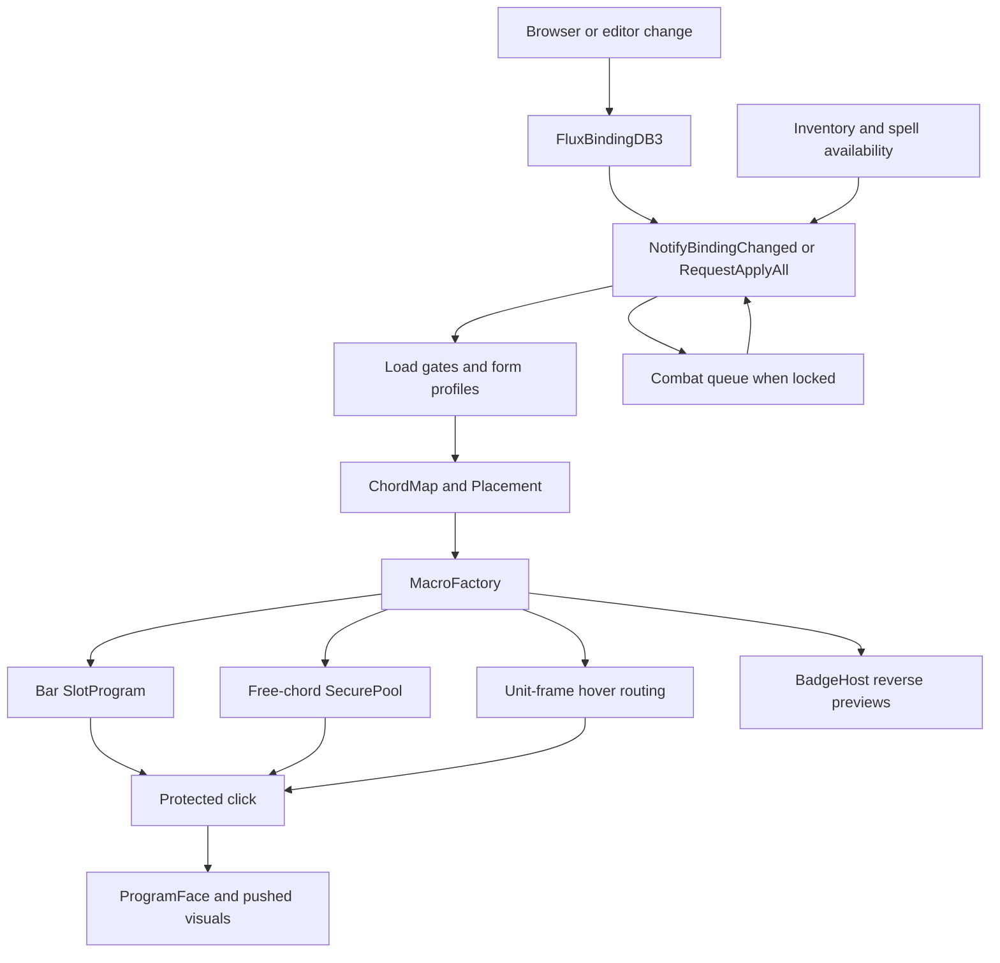

# Conditional binding system

<!-- RESPEC-ACTION-SAFETY-20261116 -->
16 November: opening LibKeyBound no longer reloads account bindings. Its existing scope checkbox remains responsible for explicit account/character switching and save/cancel. Automatic rank failures cannot advance saved binding IDs beyond a failed native bar replacement. [Evidence](validation/respec-action-safety-2026-11-16.json).
<!-- /RESPEC-ACTION-SAFETY-20261116 -->

15 November: range now follows the selected cast target, independently of idle
icons, pinned tooltips and reverse badge token swaps. Plain actions apply the
native friendly/hostile eligibility rule. The reported Frostbolt/friendly-hover
case is confirmed in game. [Rules and scoped validation](CAST_RANGE_TARGETING.md).

15 November action routing (`ACTION-ROUTING-RELIABILITY-20261115`): native
PreClick proved Shift globals are consumed while the large main already shows66;
old inheritance selected action6. Secure main now publishes its LIVE keyboard
bundle, with independent mouse modifier sets. Native Ctrl-Shift-½ capture selects
macro66 and macro parser reports both despite rawkeysfalse. User confirms:
"Fire Ward casts; icons return correctly." This verifies that reported cast and
release, not all19/pages/clients/taint/controller/FPS. No macro-condition rewrite.

Also corrected mini inverse page updates, temporary fallback overlays, shared-slot
badge prewarm, OOC and late-callback display indexing, held-modifier page bursts,
and hover native/free ownership/reconfigure/retry. New native restricted-builder
regression rejects the intermediate quoted-function error and accepts correction.
Focused:363885modifier;864nativehandler;21532visual;547hover;510badge;25920control
checks PASS. Full408/410 before final control-fixture repair; repaired25920PASS;
one unrelated portrait fixture misses GetUnitClassColor. No settings/action reset,
agent input/focus/profiler operation or manual installation copy. Nine Forever
runtime files match. Native broad acceptance and FPS measurement remain pending.
[Requirements, sources and measured limits](ACTION_ROUTING_RELIABILITY.md).

15 November read-only saved-variable follow-up for shared bindings: account/
character current and backup data audited at user request. Nine valid DB3 rows,
seven placements, no structural corruption or saved layout/badge conflict.
Latest SHIFT-½ entry has ShiftCtrl on/ALT off and both regular/hover input off;
it emits no conditional cast. R remains hover-only. Native F maps11 with no
explicit Shift-F override; hidden11/71 profiles match the reproduced source bug.
No settings changes; client action contents/page and loaded state unverified.
[Audit](SHARED_BINDING_MODIFIERS.md#read-only-saved-variable-follow-up).

15 November shared binding modifiers (`SHARED-BINDING-MODIFIERS-20261115`): fixed the
keyboard proxy selector leak across main/mini rows and obsolete live LeftButton
selectors. The saved hidden main11/Shift71/native35 pattern reproduces Shift-F
casting main11 in the linked GitHub version; candidate selects71 and releases
back to11 before display updates. 2,271 focused checks; exact246; three harmful
controls and12 focused scripts PASS. Regular key press OFF still disables that
binding including ALT; profiles/badges/compiler/settings remain unchanged.
The first full sweep400PASS/2FAIL preceded final test refinement and concurrent
changes. Final modifier checks and the bar smoke now PASS; fresh1,092-file
syntax passes. Other full-sweep results remain historical for newer unrelated
sources. Native casting/taint/controller/render/FPS acceptance remains pending;
no client input or manual installation copy. [Requirements and evidence](SHARED_BINDING_MODIFIERS.md).

14 November `GROUP-GHOST-HOVER-20261114`: secure `valid-hover` resolves a current
unit from the entered surface or its parent handle, requires IsVisible and
UnitExists, and runs before installing overrides. A real entered handle is
remembered independently of active bindings, so unit removal/reassignment under
a stationary cursor can clear/rearm through prepared OnAttributeChanged wrappers
in combat. Leave/hide retires that remembered handle; unrelated active peers are
preserved. The existing mouseover-exists callback validates the actual source
unit instead of keeping stale bindings for hovered geometry. Both visual scans
reject hidden ancestors. No new roster driver/poll or ordinary combat write.
381 scripts/1,069 syntax and 120 new group checks PASS; native retest pending.
[Evidence](validation/group-ghost-hover-2026-11-14.json).

14 November `PLAYER-GHOST-SECURE-FOLLOWUP-20261114`: the previous scan-only
guard did not remove native PlayerFrame from the actual secure casting registry.
Suppression now rejects every new registration route, clears an already active
root/legacy-child override through the Flux-owned header, and unregisters its
Flux wrappers. Retained legacy hooks are inactive after unregister and their
entered bookkeeping is balanced. Restore re-registers native casting, preserving
active peer bindings. The existing combat/Edit Mode boundaries defer protected
changes. 300 casting checks/five client models/9 controls PASS; native retest
pending. Literal frame deletion is unsupported and is not claimed.
[Evidence](validation/player-ghost-secure-followup-2026-11-14.json).

14 November `PLAYER-GHOST-HOVER-20261114`: both mouse-focus and fallback
geometry scans now honor the existing suppression service's addon-owned policy.
An alpha-zero native unit frame cannot count as hover context solely because
Blizzard keeps its root shown. Independently registered pet/Flux frames remain
eligible, and restoring Blizzard input restores hover eligibility. Existing
50ms scan cache and secure binding snippets are unchanged. Native retest pending.
[Evidence](validation/player-ghost-hover-2026-11-14.json).

<!-- STRESS-FIXES-20261107 -->
7 November applied stress fixes: Pending full Context invalidations survive later narrow mouseover requests. Hover fallback consumes all GetChildren varargs with no per-scan child table allocation. Local driver aliases preserve foreign native API provenance. [Evidence](../Stress%20test%20doc/applied-fixes/README.md). Native taint/pixels/performance acceptance remains pending.
<!-- /STRESS-FIXES-20261107 -->

Flux Binding configures target rules, forms, load conditions, cast flags, shared-key alternatives, multi-cast and corner previews. It differs from LibKeyBound's simple hover-and-press assignment mode. Binding documents compile to secure macro behavior; the editor does not execute combat decisions itself.

## Authoritative document

[DB.lua](../Binding/Core/DB.lua) owns per-character `FluxBindingDB3` (`version = 3`). `bindings[uid]` contains an action descriptor, optional single `key`, optional `placeId`, fallback, form subprofiles and sticky-Respec policy. Root tables separately store macro clause order (`chordStackOrder`), badge order (`badgeCornerOrder`), enabled form pages and Classic rank-sync names. `nextUid` allocates identities.

This rewritten DB starts fresh; it does **not** migrate the old dual databases automatically. Old SavedVariables declarations do not prove active migration. SoD engraving-ID repair and utility snapshot conversion are separate operations.

[Action.lua](../Binding/Core/Action.lua) normalizes spell, pet spell, item, equipment-slot, macro and extra-role descriptors and supplies strict/family keys, availability and macro tokens. Family identity can group Classic ranks. [Placement.lua](../Binding/Core/Placement.lua) describes `ab:<slot>`, stance, extra, trinket, utility, flyout-favorite and multi-cast locations. One action can have several placements and binding instances; it is not necessarily one global row per spell.

## Compilation and click flow

[Apply.lua](../Binding/Core/Apply.lua) is the global `FluxBinding` reconciliation pipeline. `RequestApplyAll(reason)` coalesces work; binding/bar-slot/occupancy/availability notifications narrow affected work. Secure writes are diffed, and blocked flushes resume after `PLAYER_REGEN_ENABLED`. Count-only inventory changes differ from action availability changes. `GetLastApplyStats()` exposes actual work.

[ChordMap.lua](../Binding/Core/ChordMap.lua) normalizes uppercase `ALT-CTRL-SHIFT-META-KEY`. If a base key belongs to a Flux column, bare/SHIFT/CTRL route through its current main/mini mapping. ALT, SHIFT+CTRL and keys without a column use pooled free-chord secure buttons. Promotion means effective routing must read current host state.

Column overrides preserve the click engine's input policy: wrapped clients use `FluxActionStripButton<column>` with `KeyBind`; Forever keeps `FluxActionStripKey<column>` with `LeftButton`. The keyboard proxy executes the secure main's current live program, including the forward conditional overlay; the displaced mini is not its target. Native click dispatch can consume raw modifier globals while macro parsing still retains the bound modifier context. Do not replace macro conditions with a raw-key guess. Hover passthrough preserves committed free-chord and exact native owners, and clears old vectors before stationary reconfiguration. Temporary pages 11 or greater suppress ordinary overlays on the first twelve main hosts while static columns retain their mappings. Profiles, order and action contents remain unchanged.

[MacroFactory.lua](../Binding/Core/MacroFactory.lua) builds forward programs by merging ordered binding clauses and a native-action tail, respecting fallback. Reverse programs let a badge preview the opposite shared-condition action. Complex sequences/petattack/multi-cast use hidden slot clickers; simpler programs can live on a visible surface. Native slot, compiled program and displayed macro face remain distinct.

## Conditions, forms and actions

[Conditions.lua](../Binding/Core/Conditions.lua) separates **Lua load gates** from **macro conditions**. Learned/owned action, equipment, zone, instance and specialization gates omit unavailable bindings during reconciliation. Combat/stealth/mounted/pet/outdoors/swimming/flying/channeling and target predicates become secure bracket clauses, evaluated by the client. These state flips do not require a secure rebuild. ALT/SHIFT+CTRL controls are offered only for compatible shared-bar routing; invalid saved selections are sanitized. “Never” parks a profile. Secret/unreadable slot data is not equivalent to an empty slot.

[Forms.lua](../Binding/Core/Forms.lua) maps `noform` and class stance tokens to both action pages and macro form/stealth conditions. Dedicated subprofiles can override inherited behavior; the Forms UI copies settings and controls form pages.

Subprofiles contain cast flags, hovercast/regular target chains, load options, prefix/extras/order and badge policy. Cast flags include interrupt, autoattack/petattack, stop targeting, cancel queued spell/form/aura, prevent toggle, rank subtext, cursor cast and target-after-cast. Targets have ordered unit, hostility and vitals tests. Hovercast and regular casting default on; the action-bar mouseover preference also participates.

The [universal mouseover setting](UNIVERSAL_MOUSEOVER.md) also applies to compiled
Default/Target casts, free chords and multi-cast extras. It follows Blizzard's
native switch/modifier where supported. Compatible mouseover choices precede
Default/Target choices across a shared chord; explicit Focus/Self/cursor rules
retain priority. Prefix flags such as `/stopcasting` still execute through the
existing protected click path. Settings changes that need a protected rebuild
defer during combat; ordinary macro condition changes do not rebuild bindings.

Multi-cast stores up to 20 extras and displays at most three extra badges. `mainCastIndex` puts the primary action before/between/after extras. The UI only exposes this feature where placement/overlap permits it. WoW macro/GCD/protected-action rules determine which commands one click can actually perform.

## Browser and editor

The [browser](../Binding/UI/Browser/Core.lua) embeds in **Options → Binding** through `FluxBindingBrowserEmbed`. `SpellLibrary` builds spellbook/item/macro/pet/equipment/extra catalogs, retains known pet identities, expands placements and includes drafts. The UI filters/searches/sorts, visualizes keys and selects a subject in the embedded editor.

[Editor/Core.lua](../Binding/UI/Editor/Core.lua) stores session subject, instance, placement, form and active panel. Controls write the document and call `Commit()`; live edits do not require an extra Save. Pristine/orphan rows can be pruned. [Chrome.lua](../Binding/UI/Editor/Chrome.lua) provides chord capture, inherited/locked keys, instance controls, shared-key peers and form strips.

| Panel in [Panels.lua](../Binding/UI/Editor/Panels.lua) | Capability |
|---|---|
| Cast | Action flags and macro prefix. |
| Multi-cast | Drag-order icon grid, cursor-drop extras, remove extras while retaining the primary action. |
| Targets | Hovercast and ordered regular target rows with hostility/vitals filters. |
| Conditions | Macro and Lua gates with contextual availability. |
| Forms | Per-form settings and copying. |
| Status | Actual generated macros, routing and availability evidence. |
| Bar & Badges | Display/alpha/cooldown digits and main/mini policy. |

Custom AceGUI widgets implement key capture, target ordering, native-style dropdowns, dialog chrome, toggles and multi-cast ordering. Editor strings use English fallback (`UI/Locale.lua`); macro previews use the vendored monospace font. [SpellbookBindingHooks](../Binding/UI/SpellbookBindingHooks.lua) adds a Flux entry button and right-click spell-row selection, with late-load/combat-safe installation.

[KeyVisualizer](../Binding/UI/KeyVisualizer/Core.lua) displays keyboard/mouse chords, source/modifier filters, loaded/empty/extra policy, layouts/sizes and alternate-action badges. Binding, action-slot, modifier and form events redraw it. It is a view of routing rather than another binding database.

## Hover routing, tooltips and Respec

[FluxMouseoverKeybind](../Binding/Input/FluxMouseoverKeybind.lua) registers unit frames/children so mouse-button/wheel keys fire over them. It maintains hover-routing tables and pending post-combat installation alongside shared mouseover context. A `[@mouseover]` macro alone does not explain this layer. [PushPress](../Binding/Core/PushPress.lua) mirrors held hidden/free/hover casts onto visible bar push textures, with release handling and a safety cap. [BindingTooltip](../Binding/Core/BindingTooltip.lua) appends peers/conditions/multi-cast; modern post-processing prevents native tooltip rebuilds erasing the lines.

The **Live / Respec profile** picker is a preview. It deep-copies the selected snapshot through `DB.SetDocumentOverride`; edits persist to that profile rather than live secure bindings. Profile bar/utility snapshots are used where available with explicit live fallbacks. Browsing does not equip gear or apply the profile.

[Respec.lua](../Binding/Respec.lua) captures compact customized documents and restores snapshots, merging sticky live rows back. `FluxSpellBindings_ApplySnapshot(snap, afterFn)` returns `false, "IN_COMBAT"` when queued and reports completion through the callback. Most pristine unbound defaults are omitted because catalogs can rediscover them.

## Commands and checks

`/fluxbind` opens an editor; `<spellId>` selects a spell; `viz`/`visualizer`/`keyboard` opens the key visualizer; `apply` requests reconciliation; `debug` reports state. Documents are per character; visualizer preferences use separate account settings.

Check clause vs badge order, implicit bar inheritance, promotion, duplicate placements, missing-item recovery, rank sync, form fallback, hover mouse/wheel routing, preview isolation, sticky restore and combat-deferred edits. Generated macros can be inspected locally; protected clicks and taint require [in-game verification](41-verification.md). See [API/events](33-api-and-events.md) for the wider integration surface.

<!-- ROSTER-HOVER-DRIVER-20261120 -->
Stable mouse-only roster discovery now skips an action-bar binding scan. Thirty modeled bursts across each client profile go from 570 native binding reads to zero. Early registrations still sample each action binding once per scan, including keys after nil or empty results. Forty newly discovered raid cells cut binding reads from 1,179 to 600 in the Forever model and from 419 to 120 in the Era model. Mouse and wheel routes, discovery and protected write counts match. Only spell-hover routes qualify for the native unit-exists driver. When the last spell-hover route is removed under the mouse, the same out-of-combat lifecycle parks that driver. Public routing detection still recognizes ordinary mouse and wheel bindings. Full binding and Edit Mode refreshes, frame registration and combat deferral retain their existing owners.
[Matched validation](validation/roster-hover-driver-2026-11-20.json).
<!-- /ROSTER-HOVER-DRIVER-20261120 -->
