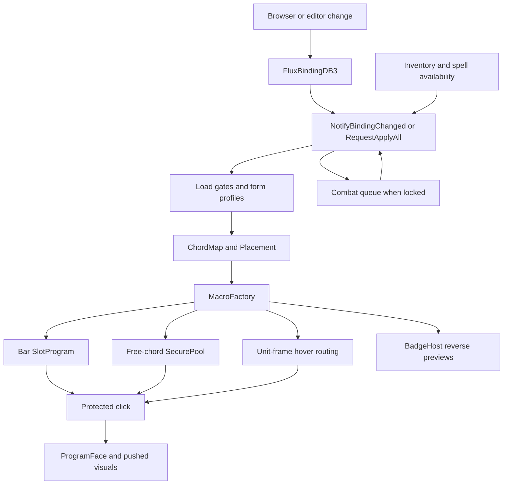

# Conditional binding system

Flux Binding configures target rules, forms, load conditions, cast flags, shared-key alternatives, multi-cast and corner previews. It differs from LibKeyBound's simple hover-and-press assignment mode. Binding documents compile to secure macro behavior; the editor does not execute combat decisions itself.

## Authoritative document

[DB.lua](../Binding/Core/DB.lua) owns per-character `FluxBindingDB3` (`version = 3`). `bindings[uid]` contains an action descriptor, optional single `key`, optional `placeId`, fallback, form subprofiles and sticky-Respec policy. Root tables separately store macro clause order (`chordStackOrder`), badge order (`badgeCornerOrder`), enabled form pages and Classic rank-sync names. `nextUid` allocates identities.

This rewritten DB starts fresh; it does **not** migrate the old dual databases automatically. Old SavedVariables declarations do not prove active migration. SoD engraving-ID repair and utility snapshot conversion are separate operations.

[Action.lua](../Binding/Core/Action.lua) normalizes spell, pet spell, item, equipment-slot, macro and extra-role descriptors and supplies strict/family keys, availability and macro tokens. Family identity can group Classic ranks. [Placement.lua](../Binding/Core/Placement.lua) describes `ab:<slot>`, stance, extra, trinket, utility, flyout-favorite and multi-cast locations. One action can have several placements and binding instances; it is not necessarily one global row per spell.

## Compilation and click flow

[Apply.lua](../Binding/Core/Apply.lua) is the global `FluxBinding` reconciliation pipeline. `RequestApplyAll(reason)` coalesces work; binding/bar-slot/occupancy/availability notifications narrow affected work. Secure writes are diffed, and blocked flushes resume after `PLAYER_REGEN_ENABLED`. Count-only inventory changes differ from action availability changes. `GetLastApplyStats()` exposes actual work.

[ChordMap.lua](../Binding/Core/ChordMap.lua) normalizes uppercase `ALT-CTRL-SHIFT-META-KEY`. If a base key belongs to a Flux column, bare/SHIFT/CTRL route through its current main/mini mapping. ALT, SHIFT+CTRL and keys without a column use pooled free-chord secure buttons. Promotion means effective routing must read current host state.

[MacroFactory.lua](../Binding/Core/MacroFactory.lua) builds forward programs by merging ordered binding clauses and a native-action tail, respecting fallback. Reverse programs let a badge preview the opposite shared-condition action. Complex sequences/petattack/multi-cast use hidden slot clickers; simpler programs can live on a visible surface. Native slot, compiled program and displayed macro face remain distinct.

## Conditions, forms and actions

[Conditions.lua](../Binding/Core/Conditions.lua) separates **Lua load gates** from **macro conditions**. Learned/owned action, equipment, zone, instance and specialization gates omit unavailable bindings during reconciliation. Combat/stealth/mounted/pet/outdoors/swimming/flying/channeling and target predicates become secure bracket clauses, evaluated by the client. These state flips do not require a secure rebuild. ALT/SHIFT+CTRL controls are offered only for compatible shared-bar routing; invalid saved selections are sanitized. “Never” parks a profile. Secret/unreadable slot data is not equivalent to an empty slot.

[Forms.lua](../Binding/Core/Forms.lua) maps `noform` and class stance tokens to both action pages and macro form/stealth conditions. Dedicated subprofiles can override inherited behavior; the Forms UI copies settings and controls form pages.

Subprofiles contain cast flags, hovercast/regular target chains, load options, prefix/extras/order and badge policy. Cast flags include interrupt, autoattack/petattack, stop targeting, cancel queued spell/form/aura, prevent toggle, rank subtext, cursor cast and target-after-cast. Targets have ordered unit, hostility and vitals tests. Hovercast and regular casting default on; the action-bar mouseover preference also participates.

Multi-cast stores up to 20 extras and displays at most three extra badges. `mainCastIndex` puts the primary action before/between/after extras. The UI only exposes this feature where placement/overlap permits it. WoW macro/GCD/protected-action rules determine which commands one click can actually perform.

## Browser and editor

The [browser](../Binding/UI/Browser/Core.lua) embeds in **Options → Binding** through `FluxBindingBrowserEmbed`. `SpellLibrary` builds spellbook/item/macro/pet/equipment/extra catalogs, retains known pet identities, expands placements and includes drafts. The UI filters/searches/sorts, visualizes keys and selects a subject in the embedded editor.

[Editor/Core.lua](../Binding/UI/Editor/Core.lua) stores session subject, instance, placement, form and active panel. Controls write the document and call `Commit()`; live edits do not require an extra Save. Pristine/orphan rows can be pruned. [Chrome.lua](../Binding/UI/Editor/Chrome.lua) provides chord capture, inherited/locked keys, instance controls, shared-key peers and form strips.

| Panel in [Panels.lua](../Binding/UI/Editor/Panels.lua) | Capability |
|---|---|
| Cast | Action flags and macro prefix. |
| Multi-cast | Drag-order icon grid, cursor-drop extras, remove extras while retaining the primary action. |
| Targets | Hovercast and ordered regular target rows with hostility/vitals filters. |
| Conditions | Macro and Lua gates with contextual availability. |
| Forms | Per-form settings and copying. |
| Status | Actual generated macros, routing and availability evidence. |
| Bar & Badges | Display/alpha/cooldown digits and main/mini policy. |

Custom AceGUI widgets implement key capture, target ordering, native-style dropdowns, dialog chrome, toggles and multi-cast ordering. Editor strings use English fallback (`UI/Locale.lua`); macro previews use the vendored monospace font. [SpellbookBindingHooks](../Binding/UI/SpellbookBindingHooks.lua) adds a Flux entry button and right-click spell-row selection, with late-load/combat-safe installation.

[KeyVisualizer](../Binding/UI/KeyVisualizer/Core.lua) displays keyboard/mouse chords, source/modifier filters, loaded/empty/extra policy, layouts/sizes and alternate-action badges. Binding, action-slot, modifier and form events redraw it. It is a view of routing rather than another binding database.

## Hover routing, tooltips and Respec

[FluxMouseoverKeybind](../Binding/Input/FluxMouseoverKeybind.lua) registers unit frames/children so mouse-button/wheel keys fire over them. It maintains hover-routing tables and pending post-combat installation alongside shared mouseover context. A `[@mouseover]` macro alone does not explain this layer. [PushPress](../Binding/Core/PushPress.lua) mirrors held hidden/free/hover casts onto visible bar push textures, with release handling and a safety cap. [BindingTooltip](../Binding/Core/BindingTooltip.lua) appends peers/conditions/multi-cast; modern post-processing prevents native tooltip rebuilds erasing the lines.

The **Live / Respec profile** picker is a preview. It deep-copies the selected snapshot through `DB.SetDocumentOverride`; edits persist to that profile rather than live secure bindings. Profile bar/utility snapshots are used where available with explicit live fallbacks. Browsing does not equip gear or apply the profile.

[Respec.lua](../Binding/Respec.lua) captures compact customized documents and restores snapshots, merging sticky live rows back. `FluxSpellBindings_ApplySnapshot(snap, afterFn)` returns `false, "IN_COMBAT"` when queued and reports completion through the callback. Most pristine unbound defaults are omitted because catalogs can rediscover them.

## Commands and checks

`/fluxbind` opens an editor; `<spellId>` selects a spell; `viz`/`visualizer`/`keyboard` opens the key visualizer; `apply` requests reconciliation; `debug` reports state. Documents are per character; visualizer preferences use separate account settings.

Check clause vs badge order, implicit bar inheritance, promotion, duplicate placements, missing-item recovery, rank sync, form fallback, hover mouse/wheel routing, preview isolation, sticky restore and combat-deferred edits. Generated macros can be inspected locally; protected clicks and taint require [in-game verification](41-verification.md). See [API/events](33-api-and-events.md) for the wider integration surface.
