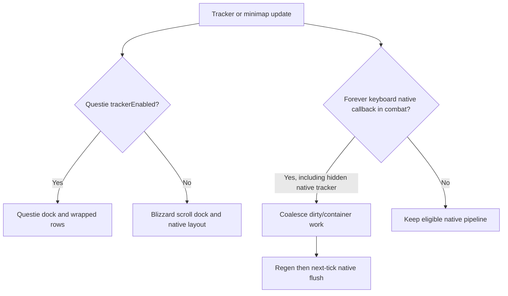

# Minimap, embedded buttons, objectives and buffs

Flux reshapes Blizzard's minimap and relocates surrounding widgets. It can embed that same map into the Flux Window instead of maintaining a second minimap. [FluxMinimap.lua](../Minimap/FluxMinimap.lua) owns the global controller and its runtime `embeddedState` (original parent/size/points plus current host).

## Map appearance, controls and lifecycle

Initial configuration is a 190px square with a white square mask near the upper-right corner. Style/cleanup repositions supported indicators, queue-status eye, mail, tracking and difficulty controls, removes unwanted stock chrome and supplies a bordered info bar. Mouse wheel zooms; mouse-up hooks preserve Blizzard's native ping handler before adding Flux behavior. Zone text has fit/scroll/tooltip handling; clock and info-bar click targets are separate.

Map right-click opens the tracking menu on the Retail path or available calendar on the older path. Info-bar/zone left-click toggles World Map and right-click opens calendar when supported. Clock-area left-click opens calendar; right-click invokes available TimeManager/stopwatch helpers. The comment suggesting Shift-left stopwatch is not an implemented Shift branch.

`Initialize`, `UpdateStyle`, `CleanupBlizzardFrames`, `PositionIndicators`, `PositionQueueStatusEye` and `EnforcePosition` reconcile this presentation. `RequestEnforcerBurst` temporarily tightens checking after layout changes; idle fallback runs less often. The code uses event-driven updates plus these bounded/idle enforcers, not just a one-time login anchor. Addon/world/difficulty/group/mail/tracking/display/UI-scale events cover changing widgets and late Blizzard UI.

`EmbedInFrame(parent)` remembers normal geometry and lays out the map within the Flux Window. `RestoreToNormal`, `HideEmbedded`, `ShowEmbedded`, `IsEmbedded` and `GetNormalWidth` support tab changes and restoration. Hiding a non-Map tab must not accidentally leave MinimapCluster visible. Embed changes also update tracker geometry, Info Frame and the micromenu's minimap placement. The saved layout preference and runtime parent state are different things.

Protected reposition/reparent work queues through combat exit. Edit Mode compatibility avoids adding methods to EditModeManagerFrame or mutating its registered system-frame table; those paths can taint action-bar/vehicle layout. See [runtime restrictions](03-midnight-constraints.md).

## Embedded 3×5 action strip

[FluxMinimapButtons.lua](../Minimap/FluxMinimapButtons.lua) creates 15 EBS widgets in three columns beside the embedded map. `_FluxUI_CharSavedVars.minimapExtraButtons[index]` stores assignments, including macro index/name/body recovery data. Creation, refresh, slot layout, accent refresh and `OnEmbedStateChanged` are separate methods. The strip uses [EBS](12-extra-button-system.md) action/count/cooldown handling and only belongs to the embedded map arrangement; it is not the four noncombat utility slots.

## Objective tracker scroll dock

[FluxObjectiveTrackerScroll.lua](../Minimap/FluxObjectiveTrackerScroll.lua) wraps the supported objective tracker in a viewport, computes content height and anchors it relative to minimap/layout bounds. It handles scrollbar/content size, top-module gaps, header and quest-timer placement, full-layout requests, dirty-state recovery and combat-delayed setup. The implementation works with the actual client tracker/manager rather than inventing a new quest log.

`EnsureViewport`, `ApplyViewportSize`, `LayoutScrollArea`, `SyncAfterUpdate` and `RefreshLayout` are the central operations. Height/anchor hooks keep Blizzard's update pipeline inside the dock. Overflow scrolls instead of extending indefinitely into the bottom HUD. Hidden/zero-height bodies and late async manager initialization have explicit recovery paths.

Retail and Forever both reserve 38px above the first module for the native header.
Flux moves that header outside the scrolling body, so the first visible module must
be anchored at the body's top after native layout. Both clients' container update
now receives the after-hook: Blizzard's saved dirty callback calls that mixin
directly and bypasses the later frame-instance hook. The deferred sync also repairs
anchors before its unchanged-height shortcut, covering Campaign/Quests replacements
with equal stack heights. Native padding values remain untouched. Child resizing
restores a requested zero scroll offset as well as positive offsets.
[The regression](../tests/objective_tracker_scroll.lua) replays the supplied native
Retail/Forever container and frame code with a callback saved before Flux hooks.
Its 40 geometry/dispatch checks pass; live rendering and taint checks remain pending.

Forever has additional compatibility: `InstallForeverCompat`, `StartForeverLoginPulse` and `KickScrollLayoutOnce` wait for the client's initialization sequence, correct stuck dirty state and stabilize the first dock. Ordinary world transitions do not continually force a full tracker layout. Current source deliberately avoids specialization/level listeners because Forever emits misleading spec events on level-up.

Forever's mouse/keyboard tracker also guards the container update entry during combat. `DirtiableMixin:SetDirtyMethod` captures `Frame.Update` at startup, so callbacks already queued before Flux's dirty-callback wrapper can bypass an instance hook and still reach `ManageFramePositions`. Captured callbacks and direct container updates coalesce until the tick after combat ends; native dirty processing then resumes. The gamepad container entry stays native because its caller performs protected navigation after the container returns. [The combat regression](../Minimap/_tmp_trackercombatsmoke.lua) replays the supplied native dirty/frame/container code, reproduces the original resize with the guard disabled, and checks deferred layout, regen timing and callback replacement. It does not emulate engine taint.

These combat guards install even with Questie's tracker enabled: Blizzard's hidden tracker can still receive a saved dirty callback. Questie continues to own the visible dock; skipping Blizzard scroll setup must not skip the combat guard.

## Questie and buff frames

[FluxQuestie.lua](../Minimap/FluxQuestie.lua) is optional. It imports tracker/line/base/combat-queue modules through QuestieLoader, hooks real tracker updates and expand/collapse interaction, then sizes/anchors/styles lines and base frames. It does not continuously poll the expand flag; post-update hooks cover transitions. This tracker integration is separate from [Battlezone HBD pin routing](10-flux-window.md).

Classic Era, Anniversary and Forever/Camelot share that same 175px Questie dock, wrapped objective rows, zone/quest controls and embedded-minimap placement. Selection follows Questie's `trackerEnabled` setting, including when Questie temporarily hides its tracker. With Questie's tracker enabled, Flux skips Blizzard viewport creation/recovery/watch sorting and hides any existing viewport, including its detached “All Objectives” header. Forever uses Questie's compatibility visibility helpers to suppress late native frames and release suppression when the tracker is disabled. With Questie disabled or used only for map pins, the Blizzard objective dock remains available.

Late addon/frame creation is handled by addon events and Questie's real updates; header hooks attach when the button exists. Combat-deferred layout runs after combat, and the scroll range is recalculated after text wrapping. Forever's optional Blizzard quest timer is moved to the Questie dock, reserves room above the objectives, and returns to its original parent/anchors when released. [The tracker smoke check](../Minimap/_tmp_questiesmoke.lua) exercises both client layouts, native/Questie ownership changes, late loading, wrapped overflow, collapse/expand, combat deferral and the optional timer with mocked frames. Run it with `lua Minimap/_tmp_questiesmoke.lua`; it does not establish live taint safety.

[FluxBuffDebuffFrames.lua](../Minimap/FluxBuffDebuffFrames.lua) installs positioning/squeeze hooks for Blizzard buff/debuff/consolidated-aura frames and anchors them around the map/layout. Actual aura contents remain Blizzard-owned here; this module differs from unit-frame aura rendering and the nameplate countdown overlay. Shared Core helpers provide the client-specific squeeze behavior.

## Configuration and checks

Map embedding/tab selection belongs to Flux Window; placement and surrounding tracker geometry use Layout/General settings. The minimap action strip is per character. Questie is detected automatically. Exact settings and commands are indexed in [options](26-options-map.md) and [commands](31-commands-and-bindings.md).

Test normal→embedded→other-tab→restored transitions, resizing/scale, combat entry/exit with pending positions, minimap ping/zoom, difficulty/mail/queue indicators, zone text overflow, the 15 saved actions, long/empty objective lists, late tracker load, collapse/expand, timers, Questie absent/present and Forever's first login/level-up. Source hooks and mock layout tests do not establish live taint safety.

## Tracker ownership and combat flow

`IsTrackerEnabled` checks Questie/loader/profile availability and the actual preference, rather than `IsShown`. Layout requests coalesce; a pending combat request resumes on regen. Late-created header buttons receive hooks when available. Timer placement starts from Questie's own quest-positioning function each time, reserves native timer height plus four pixels, and restores saved native parent/anchors on release. Repeated relayout therefore does not intentionally accumulate a timer offset. This is source/mocked evidence; [live scenarios](41-verification.md#current-compatibility-scenarios) remain pending.
