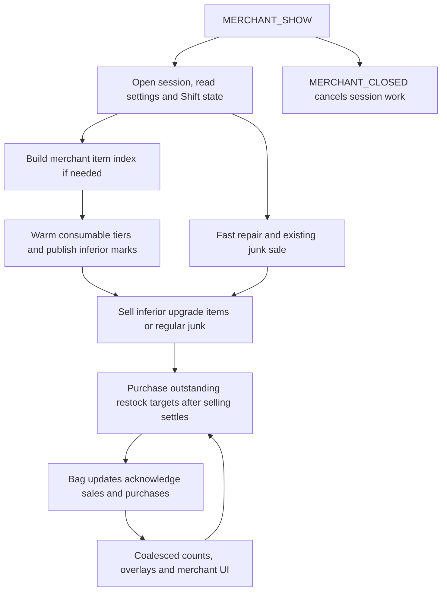
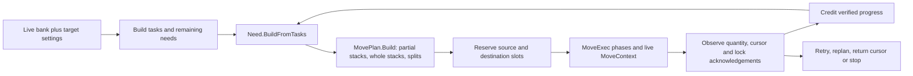

# Vendor, junk, tier targets, and bank restock

14 November casting/inventory lag: Potion needs calculate after final merge; bulk buying retires on merchant close/error; verified hidden merchants skip metadata/tint work. [Comparisons and limits](LAG_HOTSPOT_OPTIMIZATION.md).

14 November AHR-105/106: AH Restock opens with one shortage-only preparation.
Passive inventory/profession updates preserve live choices and do not restart
finished searches. Restock settings have independent AH upgrade prompt toggles:
healing on, mana on, bandages off by default. Direct/craft comparisons remain.
[Rules and acceptance](AUCTION_RESTOCK.md#shortage-only-opening-and-stable-passive-refresh).

14 November AHR-104: minimum restore now determines healing/mana potion tiers
globally, including owned buttons, crafting, vendor memory/restocking and automatic
junk. A higher maximum cannot displace a higher minimum. Saved data normalizes
when verified; unresolved old values stay saved without promoting. Manual Junk
priority remains. [Rules and acceptance](AUCTION_RESTOCK.md#global-potion-minimum-restore).

14 November AHR-102/103: AH upgrade actions use compact 44px cards with full
details in tooltips. Potions precede bandage presets, then spell reagents,
consumable configuration and other items; source metadata includes merged and
virtual presets. [Requirements and checks](AUCTION_RESTOCK.md#compact-upgrade-cards-and-preset-order).

14 November AHR-96–101: independent inline healing/mana/bandage upgrade choices,
shared manual exclusions and default-on automatic `discolored` healing-name filter.
Best/button/persist/vendor/AH/tier owners use the same policy, with combat binding
writes deferred. Three default-on global carried-upgrade Junk settings live under
Loot & Items → Vendor; manual Junk wins. [Behavior](AUCTION_RESTOCK.md#inline-upgrades-bandages-and-item-exclusions)
and [365-script/1053-syntax validation](validation/auction-inline-upgrades-2026-11-14.json).

13 November AUCTION-VENDOR-ROUTES-20261113: client-scoped vendor catalogue plus typed observations; strict cheaper-AH exceptions, exact physical-unit pricing and mixed recipe routes; configured visits learn without enabling automation. [Rules and native limits](AUCTION_RESTOCK.md#vendor-catalogue-observations-and-auction-discounts).

13 November AUCTION-FOLLOWUP-20261113: acknowledged AH restock jobs retain exact recipes for a conditional mail/vendor/craft HUD button. Closed-profession comparison uses saved learned facts. [Workflow and native limits](AUCTION_RESTOCK.md#follow-up-button-and-closed-profession-recipes).

13 November AUCTION-PURCHASE-CHARGES-20261113: matching purchase receipts, live commodity quantities, clearer selected cells and charged-item targets now share the existing restock/recipe/mail owners. [Behavior and native limits](AUCTION_RESTOCK.md#purchase-identity-selection-and-charged-items); [validation](validation/auction-purchase-charges-2026-11-13.json).

13 November saved character recipes (CHARACTER-RECIPES-20261113; CRP-01–06): existing
profession SavedVariables now retain complete learned material/output/yield/slot
facts for AH and future shared consumers. Filtered and partial scans preserve
known facts; explicit unlearn removes them; unknown learned state and NPC/legacy
linked knowledge are rejected. Output-based per-character queries deduplicate
modern aliases. Proven deterministic recipes work after closing/reloading the
profession; uncertain grades still require native operation proof. Finished-item
caps include crafting/vendor acquisition cost;0 stays unlimited. Selected missing
vendor inputs create temporary per-character targets in the ordinary vendor list.
They sum shared requirements, subtract bags/mail once, survive the vendor trip
and reload, and retire on completion/invalidation without changing permanent
targets. Live vendor price ceilings protect the plan; permanent base targets
still buy independently. Pure temporary rows are read-only; no new controls.
704 new recipe checks;20 models;17 harmful controls;320 scripts/1002 syntax PASS at captured run;17,229 combined auction/recipe checks. Five repeated
work models:4→2 schematic reads,4→2 duplicate-free catalogue rows,0→1 usable
closed-profession AH variants. These are work models, not native time/FPS.
Scoped guard:5 existing runtime files and1 new test;2,609-file external checkpoint
and47 settings metadata entries verified. Concurrent unrelated workspace edits
are retained and listed separately; captured full-run scope is explicit.
Open each relevant profession once after updating to populate the new facts.
Current native capture/reload/vendor/coexistence/controller/taint acceptance and
the prior Forever purchase BLOCKED resolution remain pending. No client input,
private settings/profiler write, manual sync, commit or publication.
[Behavior/API](CHARACTER_RECIPES.md);[evidence](validation/character-recipes-2026-11-13.json).

12 November potion discovery stall (AUCTION-POTION-STALL-20261112; AHR-38–40): the new
screenshot remains Finding stronger usable potions. The real parser reproduced
a spent shared-budget failure that the earlier classification stub missed. Each
deferred AH batch now renews that budget (still at most8 IDs). Potion results mark
whether restore is known; name-only placeholders retry until real tooltip data
arrives and cannot be ranked as restore1. Known unusable potions are skipped first.
Native ADDED browse payloads now contribute later rows and cumulative unique-key
progress, preserving the initial catalog instead of repeatedly reading its first
batch. Read-only /fluxah debug adds search phase/term/results/page/deadline.
Five repeated desktop work models: baseline refs100/101,734 load requests and
timeout; candidate refs201/300,30 requests and ready. Simulated elapsed times are
not native measurements. 552 potion/16525 auction checks;20 restock/15 receipt models;6 new harmful controls;314 scripts/995 syntax PASS.
Four existing runtime/test files changed;0 new; external2,608-file source/history
checkpoint and47 settings metadata entries verified. Existing UI, settings,
unquoted terms, price/usability/shared tiers and per-press buying are preserved.
User native reproduction route/direct implementation remain selected. Current
native retest and earlier Forever purchase BLOCKED resolution remain pending.
No client input/focus, private settings/profiler write, manual sync or publication.
[Current behavior](AUCTION_RESTOCK.md);[evidence](validation/auction-restock-potion-stall-2026-11-12.json).

12 November auction density/source/potion correction (AUCTION-DENSE-STOCK-20261112; AHR-28–37)
replaces the recipe/cost pane with a full-width paged grid and Direct/Craftable
labels (24cells at modeled800×600), retaining three money fields and one Buy next.
Old/unacknowledged pending attempts are pruned; real receipt/private/provider
incoming credits still reconcile once. Only typed unlimited merchant supply
excludes an item; limited/unknown/price-only/extended-cost records stay eligible.
Food/water are absent, including manual entries; vendor spell reagents use that
same unlimited-supply rule. All listed eligible items, including full/zero targets,
are price-scanned. Optional Auctionator public hints and guarded unit-price/history
write-back coalesce one notification; historical prices never authorize buys.
Plain unquoted partial healing potion / mana potion searches collect all native
result pages, validate usability/live offers/caps, choose stronger tiers and update
the real shared reference/tier. Weaker bag/bank stock cannot fill the stronger
target. Original caps survive a scrubbed ref; unknown metadata holds potion buys.
Craft preference, exact yields/shared inputs, price caps and one transaction per
press remain. 16413 focused checks;20 restock/15 receipt models;41 harmful controls;314 scripts/995 syntax PASS;226 pinned upstream blobs verified.
Source guard:15 existing changed runtime/test files and4 new since the verified
2,602-file external checkpoint;47 settings metadata entries, no private values.
Earlier Forever mouse BLOCKED failures and screenshot defects remain prior native
evidence; current live purchases/pixels/coexistence/controller/taint/FPS NOT RUN.
No client input/focus, manual sync, settings/profiler write, commit or publication.
[Behavior and remaining native checks](AUCTION_RESTOCK.md);
[current evidence](validation/auction-restock-dense-potions-2026-11-12.json).

## Automatic auction restock follow-up — 12 November 2026

12 November auction follow-up (AUCTION-AUTO-CRAFT-TAB-20261112; AHR-10–27) supersedes the
initial popup/two-press/zero-disables/clear-pending design below. Real AH tab uses
shared restock cells/current icons and three currency fields; top edge/height
match neighboring tabs. Whole-list/material planning is automatic; cell selection
only edits. One press quotes/confirms one qualifying transaction; next needs a new
press. Zero/unset is unlimited. Saved Prefer crafting materials toggle is in AH
and Vendor→Restock; equal/cheaper learned recipes use exact missing inputs/yield,
vendor costs/shared stock and finite parent budgets. Incoming inbox plus transit
credit reconciles automatically (19/20 feathers +1 pending blocks rebuy); there is
no Clear pending UI/API. Built-in inventory now publishes confirmed AH purchases
to its mail snapshot/ledger immediately, including other auction controls; provider
Ready handoff stays inert. Prediction/private transit credit counts once and an
early empty inbox cannot discard the own reservation. Proven owned failures and
synchronously blocked calls release their own credits without phantom delivery.
13078 focused checks;20 restock/15 receipt models;34 harmful controls;312 scripts/991 syntax PASS;202 upstream Git blobs verified;
source guard permits10 existing changed files/5 new files in this follow-up;
shared cells/professions/Syndicator adapter remain byte-identical. Built-in Mail/
Auctions are intentionally extended. External2,595/2,598-
file source/history checkpoint and47 settings metadata entries verified.
Two prior Forever mouse-click BLOCKED failures remain native evidence; direct
calls/action-before-disable candidate has NOT passed native retest. No-search,
pixels, transactions/coexistence, persistence, controller, taint and FPS acceptance
pending. Auctionator345/TSM4.15.6/Syndicator290 inspected read-only at explicit request;
ARR notices preserved; no copied code. No client focus/input, settings/profiler
write, manual sync or publication. Reload after user-managed synchronization.
[Current behavior and native checks](AUCTION_RESTOCK.md).

## Auction restock — 12 November 2026

12 November auction restock (AUCTION-RESTOCK-20261112; AHR-01–09): native-API
standalone implementation for Retail/Forever/MoP and Era/Anniversary. One action
button searches/quotes/buys; every purchase requires a press. Per-item saved unit
caps include active presets; known vendor stock excluded, unclassified items need
an explicit cap. Legacy default fits whole stacks; optional excess shows surplus
and total. Charge/tier/bank math and persistent pending-mail reservations prevent
duplicate refill. Competing queries/quotes yield; partial batches request more
selected-item rows. No Auctionator source/dependency or new inventory provider.
6,496 focused checks/20 models;12 harmful controls; full309 scripts/986 syntax PASS;
all final manifest hashes match. 87 pinned Git blobs verified. External2,587-file
source/history checkpoint and47 WTF metadata entries; private settings not copied.
Four new modules,one test;three existing runtime files changed;all other existing
Lua/XML/TOC bytes preserved. Direct implementation selected12November; prior
user native reproduction route retained. Native transactions/addon coexistence,
pixels/controller/persistence/taint/FPS NOT RUN. Reload after user-managed sync;
use Vendor→Restock→Auction restock & prices, `/fluxah` or auction-house button.
No foreground/input, settings/profiler-file write, manual sync or publication.
[Controls, target/price rules, recovery and native steps](AUCTION_RESTOCK.md).

## Junk tab freeze follow-up — 10 November 2026

`VENDOR-JUNK-TAB-FREEZE-20261110` fixes repeated cold-name requests, recursive
metadata-driven panel rebuilds and scroll geometry repainting. Junk/Useful content,
selling protection, editing, scrolling and saved data remain. Visual notifications
share the existing 200 ms item metadata retry; explicit edits stay immediate.
85 focused checks across five models, three matched pairs and four harmful controls
pass. Actual freeze removal needs the user's reload/retest; broader validation has
two raid-aura failures amid concurrent unrelated edits.
[Requirements, measurements and limitations](VENDOR_JUNK_TAB_FREEZE.md).

## Bank and vendor gossip checkbox — 10 November 2026

Follow-up `BANK-VENDOR-GOSSIP-20261110` / `REQ-VG-05–07` extends the existing
vendor feature to a separate per-character `Restock.autoOpenBankGossip` boolean,
default false. Preserve the original vendor key and choice. Both settings remain
under Loot & Items → Vendor → Automation.

For exactly one available bank/vendor choice and no quests, show a native
22-unit checkbox in the gossip footer's lower-left, beside Goodbye. Its label is
Auto open bank or Auto open vendor and its value matches the corresponding
options setting. Checking it saves the preference and immediately selects the
current eligible choice unless Shift is held. Shift reveals the saved checkbox
on later visits so it can be unchecked. Other NPC choices never show it.

Reuse the existing dispatcher and one lazily created checkbox. The requested
visible control needs GOSSIP_SHOW/CLOSED subscriptions even with automation off;
this intentionally supersedes the earlier disabled-zero-subscription rule.
Forever's declared GOSSIP_OPTIONS_REFRESHED event updates eligibility while open.
No new poll/timer/ticker/native-script hook or input-propagation setter. Closing
or changing choices clears the checkbox; stale clicks must revalidate the owner.
Native panels, Goodbye, confirmations, bank operations and merchant actions stay
with Blizzard. Retail remains outside this request's automation/UI scope.

The supplied screenshot and prior direct implementation choice establish the
layout; no new mock-up is requested. Use the native UICheckButtonTemplate and
its text/state art. Reuse English fallback catalog keys; other language review
and native layout remain pending. Controller cursor reachability, focus cue,
activation, Back, native gossip→bank/merchant handoff and label clearance need
per-client native checks. No bindings or user input-mode settings are changed.
User-performed native testing remains the route; no connected Witchcraft tools
are available. Earlier paused party/raid work remains paused.

Speed follow-up `REQ-VG-08`: submit the eligible choice in the same GOSSIP_SHOW
callback, before creating any checkbox. Resolve the two native icon assets at
login, outside the interaction path. No timer, polling or deferred selection;
the remaining server response and native panel work cannot be eliminated by
this gossip option. Opening/latency/FPS improvements require native measurement;
desktop operation counts only establish the removal of asset lookups/UI setup
from the automatic path. Refresh notifications update the checkbox without
submitting a second selection while a response is pending.

The gossip checkbox also refreshes an already-visible FluxUI options page through
its existing coalescer, after submitting the NPC interaction. Closed options and
fully automatic openings do no options-refresh work. The two controls therefore
share both saved intent and visible state without delaying selection.

Final desktop validation: 702 focused checks in three fresh processes; ten
harmful controls and the earlier vendor-only source rejected. Full suite:
279 scripts/950 Lua syntax checks PASS. Navigation 6,237, complete options shell
1,253 and data-integrity 36 checks PASS. Source/loading evidence verifies 82 exact
Gethe Git blobs at the same five pinned client commits documented below.
These checks establish same-event submission and zero interaction-time icon
lookups/checkbox allocations on the automatic path; actual native opening time,
NPC behavior, visuals/input/controller, persistence and taint remain NOT RUN.
Three feature files were installed to Forever/progression/Era/Anniversary with
external original backups after approved filesystem escalation; reload required.

[Checkpoint](validation/bank-vendor-gossip-checkpoint-2026-11-10.json),
[requirements/results](validation/bank-vendor-gossip-2026-11-10.json),
[source and template contracts](validation/bank-vendor-gossip-sources-2026-11-10.json),
[final controls](validation/bank-vendor-gossip-controls-final-2026-11-10.json),
[full validation](validation/bank-vendor-gossip-full-2026-11-10.json),
[installation](validation/bank-vendor-gossip-install-2026-11-10.json),
[final source/copy guard](validation/bank-vendor-gossip-source-guard-2026-11-10.json).

## Single-choice vendor gossip — 10 November 2026

`VENDOR-GOSSIP-20261110` / `REQ-VG-01`: add **Auto open vendor** under
Loot & Items → Vendor → Automation. Store the opt-in boolean per character in
`_FluxUI_CharSavedVars.Restock.autoOpenVendorGossip`, default false. Enable it
immediately without a reload. Retain the existing direct-implementation and
user-performed native testing choices recorded in NEXT_SESSION.md.

`REQ-VG-02`: on `GOSSIP_SHOW`, select immediately only when there is exactly one
option, its original icon is the native vendor icon, its status is Available,
and there are no active or available quests. Hold Shift to keep the gossip open.
Use Blizzard's `orderIndex` with `SelectOptionByIndex`; IDs may be hidden. Do not
auto-confirm a purchase, coded response or confirmation. Leave native automatic
single-option selection to Blizzard when it already applies.

`REQ-VG-03`: use the existing Flux.Events dispatcher; subscribe only while enabled
on Forever or the existing Classic progression/Era/Anniversary families. Add no
frame, polling, timer, global API replacement or gossip-frame manipulation.
Retail remains outside the requested automation scope. Keep all merchant repair,
sale, restock, Shift suppression and saved data behavior.

`REQ-VG-04`: reuse the options renderer's ordinary toggle, search, scrolling and
native settings launcher. English catalog fallback covers the new label/help;
other translations and native localized layout remain unreviewed. Controller
cursor reachability, focus indication, toggle activation, scrolling, Back/close
and the native gossip→merchant focus handoff require per-client checks. No new
bindings or input capture; directional/controller acceptance remains NOT RUN.

Native acceptance: enable/disable, reload persistence, the pictured Edna Mullby
vendor, a translated vendor, Shift, multi-choice/quest/trainer/banker NPCs, native
auto-selection and merchant handoff. Check Lua errors/taint and normal manual
merchant actions. Local fixtures do not certify pixels, input, taint or latency.
Witchcraft is unavailable in the current tools; no PC foreground/input is taken.
Fresh Gethe branch resolution on 10 November found these exact source identities:

| Client | Version | Commit |
|---|---|---|
| Forever | 1.60.1.70862 | [9dc84f0d3bbae1768ac3405b3716000bd93eda06](https://github.com/Gethe/wow-ui-source/tree/9dc84f0d3bbae1768ac3405b3716000bd93eda06) |
| Classic progression | 5.5.4.70631 | [e5d9b3a22c3f0f6f41ebac0e454f4969594261cf](https://github.com/Gethe/wow-ui-source/tree/e5d9b3a22c3f0f6f41ebac0e454f4969594261cf) |
| Era | 1.15.9.70576 | [4192ac60067fc55566182291bc67c85dd9b6794d](https://github.com/Gethe/wow-ui-source/tree/4192ac60067fc55566182291bc67c85dd9b6794d) |
| Anniversary | 2.5.6.70577 | [68e0a2ec559d9761dfc4e7f864c3944f9d758a49](https://github.com/Gethe/wow-ui-source/tree/68e0a2ec559d9761dfc4e7f864c3944f9d758a49) |
| Retail comparison; automation inactive | 12.1.5.70783 | [297d7aaaa736f346b3e036f38ee088eaf7f8c07f](https://github.com/Gethe/wow-ui-source/tree/297d7aaaa736f346b3e036f38ee088eaf7f8c07f) |

The generated `GossipOptionUIInfo` provides an icon, status and `orderIndex`, not
a vendor-type field. `GetFileIDFromPath` resolves the named native
`Interface\GossipFrame\VendorGossipIcon.blp`; compare the original icon rather
than a cosmetic `overrideIconID` or localized NPC text. The loaded
`Blizzard_UIPanels_Game/Shared/GossipFrameShared.lua` calls `SelectOptionByIndex`
with `orderIndex`, including its native single-option shortcut. FluxUI leaves
that shortcut alone when `ForceGossip()` is false. Selection supplies only the
index; native code owns any confirmation or code-entry interaction. Generated
declarations and native Lua establish the source contract; actual addon access
and NPC behavior remain separate native acceptance items.

Validation: 321 focused checks PASS in three fresh processes, including the real
settings/options/navigation/search code and pinned native `HandleShow` under
both handler orders. Six harmful controls are rejected. Full suite: 279 scripts
and 950 Lua syntax checks PASS. New gameplay resource cost: one shared event
subscription only while enabled; zero new frames/timers/tickers/hooks/OnUpdate.
This does not establish server latency, FPS, native input, taint or pixel parity.
Before edits, verified an external 2,495-file source archive/history bundle and
105 read-only on-disk FluxUI settings metadata entries; private settings were not
modified and no quiescent settings backup is claimed.
After approved filesystem escalation, the four feature files were installed in
Forever, progression, Era and Anniversary. All 20 source/installed copies match;
the 16 external copies' originals are archived outside AddOns. No game reload
or input was performed. Documentation validation also passes: 983 classified
sources, 606 reachable sources, 426 setting definitions and 15,994 local links.

[Checkpoint](validation/vendor-gossip-checkpoint-2026-11-10.json),
[source identities](validation/vendor-gossip-sources-2026-11-10.json),
[loaded contracts](validation/vendor-gossip-load-contracts-2026-11-10.json),
[focused evidence and limits](validation/vendor-gossip-2026-11-10.json),
[controls](validation/vendor-gossip-controls-2026-11-10.json),
[full validation](validation/vendor-gossip-full-2026-11-10.json),
[installation backup and hashes](validation/vendor-gossip-install-2026-11-10.json),
[installed copies](validation/vendor-gossip-client-copies-2026-11-10.json).

9 November Baganator detector activation: FluxUI now selects its own junk detector
once per active Baganator profile, with a saved previous detector and normal
setting/widget/search/layout notifications. Existing RXPGuides/poor-quality/none
selections are adopted once; later manual choices survive reopen and reload.
This addon fix supersedes the initial manual-selection remedy. Ranking and
Useful/restock/conjured protections are retained.403focused and full269-script/
936-syntax checks PASS; native coins/categories/persistence remain pending.
[Requirements and evidence](BAGANATOR_JUNK_ACTIVATION.md).

8 November combat consumable junk uses the best usable tier currently in bags;
learned recipes, stored items and saved/vendor tiers do not count as upgrades.
Purchasing thresholds and explicit overrides remain. See
[carried-tier policy](CARRIED_COMBAT_CONSUMABLE_JUNK.md).

7 November default Blizzard bank direct UI lifecycle (BANK-NATIVE-06): user
renews the no-Baganator close/layering fix. Source audit proves a missed path:
restock inventory fireCloseIfGone suppresses its private close callback while
Bank.IsOpen stays true. Earlier tests always delivered that callback. The bank
button now uses BANKFRAME_OPENED/CLOSED directly through the existing shared
Flux.Events dispatcher for native UI, independent of that inventory latch. A raw
close hides immediately, invalidates delayed attaches and blocks manual/stale
inventory-open resurrection until the next real open. Private callbacks remain
for Baganator and as fallback if direct registration is unavailable. Two native
subscriptions, no new frame/timer/ticker/polling or native-script hook.
Native layering now uses at least HIGH and the highest parent/search/panel/close/
NineSlice strata; level clears those children as well as the root. Native parent
and left-of-search position remain. GetControl exposes the actual owned widget
for diagnostics; no command/settings change. Baganator footer remains intact.
1780 production checks across five clients/both owners/cold-warm merchant/direct-
events-fallback modes PASS. Includes suppressed inventory close, stale shown
flags, stale open callbacks, HIGH/DIALOG children and reopen. Native ownership168,
visible Baganator260 and combined33 per Era/Anniversary PASS. Prior checkpoint
rejects. Fresh Gethe Forever9dc84f0d3bbae1768ac3405b3716000bd93eda06 (1.60.1.70862)
verifies close function/events/search owner. Native visuals/open-close/purchase/
combat/taint/FPS remain pending; actual hovered-frame evidence still unavailable.
Fresh external source/history/45 on-disk settings metadata verified. No game,
foreground, WTF/profiler or manual-sync operation.
[Evidence](validation/bank-direct-lifecycle-2026-11-07.json).

7 November native bank attachment (BANK-NATIVE-04): user reports the no-Baganator
button below the window and detached during opening/closing. Forever's control
was deliberately a UIParent sibling; it now uses the native BankFrame parent and
existing inside left-of-search anchor, inheriting visibility, movement and scale.
This supersedes the earlier UIParent parent restriction for this owned control.
Native scripts, purchases, mover and item decoration exclusions remain. Visible
ancestor checks hide stale/unattached controls on all clients. Existing two open
retries keep their cadence but use a close/reopen generation token, so stale
callbacks cannot resurrect a closed control. No new frame/event/hook/timer/ticker.
Baganator's full-size inside footer and existing settings/commands are retained.
828 production checks across5 clients/both owners/cold+warm merchants PASS,
including parent hide/show without callbacks, close/reopen retries, explicit
hidden-bank attachment and a shown frame under a hidden owner. Prior checkpoint
rejects; current code passes. Native ownership168/visibleBaganator260/combined33
per Era/Anniversary PASS. Fresh dated source/history/45 settings metadata entries
verified externally; no game/WTF/profiler/manual-sync operation. Existing pinned
Gethe9dc84f0d3bbae1768ac3405b3716000bd93eda06 source retains search/template evidence.
Native candidate placement/open-close/purchase/combat/taint/FPS remain pending;
no connected native tool.
[Evidence](validation/bank-native-attachment-2026-11-07.json).

7 November Baganator full-size inside action row (BANK-ICON-03): user rejects
the22px toolbar button and explicitly requires a location inside the window.
Existing restock control is now36x36 at scale1 in an owned48px bottom row, with
Bank Restock label and full-size auto checkbox. Native tab, currency/reagent/
purchase controls and item layout sit above that row. Existing completed-layout
wrapper releases owned geometry before native sizing; repeated attachment never
accumulates height. Tall windows reuse/shorten their existing scroll viewport;
owned heights restore on hide, locked tab or native/combined handoff. No native
bank placement changes; Forever remains left of search. No settings migration,
new frame/event/hook/timer/ticker; one lazy FontString and transient footer state.
668 production checks cover five clients, both bag owners, cold/warm merchant,
full-size geometry, viewport bounds, exact native completion ordering, repeated
refresh, lock and handoff. Ownership168/visibleBaganator260/combined33 per Era
and Anniversary PASS. Native candidate visuals/input/taint/FPS remain pending;
user reproduction route retained. Baganator843 interfaces inspected read-only;
rights retained, no implementation/art copied. Dated external source/history and
45 on-disk settings metadata verified. No game input/WTF/profiler/manual sync.
[Evidence](validation/bank-restock-footer-2026-11-07.json).

7 November bank restock slot follow-up (BANK-ICON-02): user rejects the first
icon-only fix and the Forever outside-window placement. Baganator843's toolbar
uses32x22 buttons; resizing only the hit rectangle left fixed64px merchant slot
art at its36px design size. The whole36px control now scales uniformly to the
shorter toolbar edge, including icon, frame, highlight/push and auto toggle.
Native/combined handoff resets scale1. Transfer/Sort/Customise references work.
Forever remains an addon-owned UIParent child but is visually inside BankFrame,
RIGHT of button to LEFT of BankItemSearchBox,4px gap, vertically centered; this
supersedes the previous external TOPRIGHT placement. Native bank hierarchy,
scripts/purchase/movement/decorations stay untouched. Fresh Gethe Forever source
9dc84f0d3bbae1768ac3405b3716000bd93eda06 (1.60.1.70862) verifies Mainline template
and Camelot loading/search owner. Baganator read-only reference retains rights.
358 production geometry/lifecycle checks PASS across5 clients/both bag owners/
cold+warm merchant; prior checkpoint rejects. Native ownership168 and combined33
per Era/Anniversary PASS. Native candidate pixels/input/taint/FPS remain pending;
user screenshot reproductions retained; no connected client tool or game input.
External fresh source/history verified;45 on-disk settings metadata read-only.
No new frame/event/hook/timer/ticker. Existing bounded retries/click/drop/tooltip/
auto settings retained.
[Evidence](validation/bank-restock-slot-2026-11-07.json).

7 November bank icon fix: restock artwork fills the bank button with a one-pixel
inset and follows toolbar resizing on all supported clients. Forever without
Baganator uses an addon-owned button beside Blizzard's bank, outside the native
child hierarchy. Existing click/drop/auto settings remain. Desktop checks pass;
native visuals/input/taint remain pending.
[Evidence](validation/bank-restock-icon-2026-11-07.json).

FluxUI extends merchant and bank windows with repairs, junk classification/selling, target-based purchases/withdrawals, Already Known tinting, and bulk buying. Current options live under **Inventory**; Vendor & Restock and Salvage are related controls within that page rather than separate top-level tools. Behavior is shared with combat/noncombat consumable buttons, Respec gear protection, Blizzard bags, and Baganator.

## State, entry points, and defaults

[`FluxRestockSettings.lua`](../Inventory/Restock/Core/FluxRestockSettings.lua), `FluxRestockSettings.Get`, owns `_FluxUI_CharSavedVars.Restock`. `FluxVendorAuto` is the merchant/options facade; `FluxRestock.Inv` adapts `Flux.Inventory` to this subsystem. Callers re-fetch the settings table rather than retaining it across load transitions.

| Stored area | Current behavior/default |
|---|---|
| `autoRepair`, `autoSellGray`, `autoRestock`, `autoBankRestock` | All false unless explicitly enabled. `autoSellGray` is the historical key for the broader Flux junk queue, not only gray items. |
| `repairPriority` | `personal`; guild-first is an optional choice when the game exposes guild repair. |
| `autoOpenVendorGossip` | False; per-character opt-in for a sole available vendor gossip choice without quests on Forever/Classic. Shift bypasses it. |
| `autoOpenBankGossip` | False; separate per-character opt-in for a sole available banker choice without quests. Gossip footer and options share the setting; Shift reveals its checkbox. |
| `restockItems` | Item-ID entries with target quantities and flags, including bank counting. `restockShowNotSold` defaults false. |
| `restockFoodWater` | Food/water targets default zero, inferior marking true. |
| `restockCombat` | Bandage/healing-potion/mana-potion targets default zero, inferior marking true. |
| `junkList` | `itemID = true` means explicit Junk; false means explicit Useful; nil delegates to automatic classification. Numeric-string keys are also accepted. |
| `junkFilters` | Low consumables, unusable equipment, destroy unsellable, safe batching, and conjure-inferior food/water default on; consumable level ratio defaults 0.15. |
| `junkDisplay` | Glow and coin indicators default on. |
| `alreadyKnown` | Enabled, green tint, monochrome/debug/exclude false. |
| Bulk buy | Separate per-character `buyEmAllEnabled` and `buyEmAllConfirmLarge` default true. |

`MigrateLegacyStores` now preserves `VendorAuto`, bank snapshots and existing Restock settings. Migration V1 imports validated preferences only when current Restock is absent, and records rollback/archive data in `_FluxUI_CharSavedVars._restockMigrationV1`. It does not replay pending vendor transactions or reinterpret cached bank topology. Old `FluxRestockDB` found in memory is archived inside that declared character root. See the [migration tests/report](43-startup-optimization.md).

## Merchant lifecycle and automation ordering

[`Vendor/FluxVendorBuy.lua`](../Inventory/Restock/Vendor/FluxVendorBuy.lua) handles `MERCHANT_SHOW`, `MERCHANT_UPDATE`, `MERCHANT_CLOSED`, bag-delayed pulses and merchant busy errors. On open it marks merchant/automation activity, initializes settings, decides whether an item index is needed, and schedules layout. Holding **Shift while opening** suppresses that open's automatic batch. Manual buttons remain separate entry points.

The fast path allows enabled repair/selling to start before a complete merchant index. Tier upgrades can introduce an inferior-only sale followed by purchasing the replacement tier; the pipeline waits for the needed inferior classification before deciding what to sell. Deferred callbacks repeatedly check whether the same merchant context is still open. Closing stops buy/sell state, clears pending UI/session work, and allows removal-only item identity refreshes after actual sales.

`GetMerchantItemIndex`, generation/invalidation methods and index listeners are the shared merchant facts API. [`FluxVendorRestockPanel.lua`](../Inventory/Restock/Vendor/FluxVendorRestockPanel.lua) caches the target list and can refresh counts without rebuilding rows. [`FluxVendorAutoMerchantUI.lua`](../Inventory/Restock/Vendor/FluxVendorAutoMerchantUI.lua) owns merchant controls, repair/sell/restock placement, native-vs-Classic layout, dirty-data flags, and lightweight versus full pipeline refreshes. [`FluxVendorRepairUI.lua`](../Inventory/Restock/Vendor/FluxVendorRepairUI.lua) owns the repair cluster and bounded layout retries. [`FluxVendorSession.lua`](../Inventory/Restock/Vendor/FluxVendorSession.lua) supplies compatibility session/defer predicates and deliberately schedules settled refresh callbacks off the current call stack.

Purchases are computed from target shortfalls, merchant bundle quantities, availability, currency/money and the available wallet, rather than assuming every merchant unit is a single gold-priced item. Repeated pulses continue an active buy pass. A bag update alone is not permission to run another full independent sell/buy automation.

## Junk classification, protection, and selling

[`Junk/FluxJunk.lua`](../Inventory/Restock/Junk/FluxJunk.lua), exposed as both `FluxJunk` and `FluxVendorJunk`, owns manual list state, cached automatic verdicts, inferior-item sets and worklists. `IsJunk` is the sale classifier; `IsJunkForDisplay` is the lighter overlay/plugin path. Cached item facts come from `FluxItemClass`; changing rules or resolving item data invalidates the appropriate verdicts.

Explicit Useful marks protect every quality. A positive manual restock target protects an item from automatic/inferior junk rules, while an explicit Junk mark can override that target exemption. Saved Respec gear receives slot-aware protection at sale/interaction boundaries. Conjured consumables and Well Fed handling are deliberate exceptions to simple low-food rules. The legacy base whitelist protects non-gray items; sellable gray items otherwise follow the gray rule regardless of item level or bind type. Consequently a list-only item-ID verdict and a live slot's final sellability are related but different queries.

[`FluxSellJunk.lua`](../Inventory/Restock/Junk/FluxSellJunk.lua), `SJ.Start(mode, opts)`, runs one queue in `all` or `inferiorOnly` mode, optionally restricted to affected tier kinds. It retains per-slot in-flight sale records and waits for live bag changes rather than repeatedly submitting the same stack. Re-clicking an active sale resumes/accelerates that session without duplicating unacknowledged requests. Upgrading inferior-only to all preserves pending work.

`ContinueIfNeeded` resumes on delayed bag events and a self-driving timer. Busy errors cause backoff. Locks, unchanged pending slots, finite pass/stall bounds, merchant closure and a final live rescan constrain progress. Relocated junk can therefore be rediscovered after a worklist drains. The queue uses the container sale route without running a competing native `SellAllJunkItems` batch or cursor-sale fallback. Unsellable junk deletion follows the destroy option and its own live checks; enabling the filter is distinct from opening a merchant and enabling auto sale.

Repair dispatch checks whether this merchant repairs and whether guild repair exists/has allowance before the chosen priority; manual repair can use its own path. UI totals and completion text are observations of the session and money changes, not an atomic all-or-nothing transaction.

Merchant chat amounts for the net vendor line, standalone junk sale and manual repair now split copper into gold, silver and copper with the matching coin textures. The transaction math and existing messages are unchanged; zero lower denominations remain visible so a whole-gold amount is unambiguous. Desktop checks cover the reported 3,494,236-copper example and gain/expense/repair lines; native chat rendering remains pending.

[`FluxJunkOverlay.lua`](../Inventory/Restock/Junk/FluxJunkOverlay.lua) decorates native or compatible bag/bank buttons with coin/highlight and registered slot decorators. Dirty-bag/slot counts can paint immediately; bank, login, vendor and transfer work have coalesced/deferred paths. Protection context is shared with Respec so overlay refreshes do not independently rescan every saved profile. [`FluxVendorJunkPanel.lua`](../Inventory/Restock/Junk/FluxVendorJunkPanel.lua) supplies Useful/Junk views, focused items, asynchronous item-data updates and list-change callbacks.

## Item targets, reagents, and consumable tiers

[`Core/FluxRestockList.lua`](../Inventory/Restock/Core/FluxRestockList.lua) implements target CRUD, per-item flags, reagent suggestions/dismissals, merchant availability filtering, costs, and the options-list cache. Spell-reagent discovery is warmed separately, so an initially incomplete spellbook scan does not imply there are no reagent targets. Session removal notifications prevent vendor close from triggering unnecessary discovery of items that only disappeared.

The tier subsystem is split into settings, matching/counting, bank candidates, vendor discoveries, inferior marking, and click/tooltip UI. [`FluxRestockTiers.lua`](../Inventory/Restock/Core/Tiers/FluxRestockTiers.lua) publishes compatibility APIs for the food/water and combat HUD. The five configurable kinds are food, water, bandage, healing potion and mana potion; eligibility depends on the character/client. `SetTarget` and `SetCountBankFlag` store per-character state. `RememberOwnedTiers` and the shared ConsumableBest service provide reference knowledge; remembered best and currently owned best are distinct.

[`FluxRestockTiers_Match.lua`](../Inventory/Restock/Core/Tiers/FluxRestockTiers_Match.lua) classifies and counts items against the relevant tier axis, excludes ineligible items, and separates vendor and bank matching. [`FluxRestockTiers_Vendor.lua`](../Inventory/Restock/Core/Tiers/FluxRestockTiers_Vendor.lua) warms vendor data, tracks pending upgrade kinds and handles late classification. [`FluxRestockTiers_Inferior.lua`](../Inventory/Restock/Core/Tiers/FluxRestockTiers_Inferior.lua) publishes inferior sets after bounded/coalesced work, with added/removed-item fast paths and explicit upgrade snapshots. Count-only inventory pulses need not rebuild every tier classification.

The target editor appears in Inventory options and merchant rows, with compact edit boxes on supported HUD buttons. Counts can include bank knowledge for display/policy, but withdrawals still require live bank access. Lowering/clearing a target changes subsequent need computation; it is not an instruction to return all excess bag items to a bank.

## Bank restock: needs, plans, reservations, and acknowledgements

[`Bank/FluxBankRestock.lua`](../Inventory/Restock/Bank/FluxBankRestock.lua), `BR.Start`, is the session owner. It requires a live bank and the current `MoveExec` engine, resets the executor, refreshes target/container/bank caches, builds tasks, clears session skips and cursor state, then runs the engine. A manual click starts from current bag/bank state rather than resuming an old plan. `BR.Stop` aborts the executor and finishes the session; progress and pending-item summaries feed the button tooltip.

The active decomposition is:

| Module | Responsibility |
|---|---|
| [`FluxBankRestockNeed.lua`](../Inventory/Restock/Bank/FluxBankRestockNeed.lua) | Normalize tasks into needs, credit progress and total remaining work. |
| [`FluxBankRestockInventory.lua`](../Inventory/Restock/Bank/FluxBankRestockInventory.lua) | Live bank/player-bag snapshots, matching and destination fit. |
| [`FluxBankRestockMovePlan.lua`](../Inventory/Restock/Bank/FluxBankRestockMovePlan.lua) | Assign exact quantities to source/destination slots, fill existing bag partials, then whole stacks and remaining splits. |
| [`FluxBankRestockLedger.lua`](../Inventory/Restock/Bank/FluxBankRestockLedger.lua) | Source reservation, confirmation, release, skip/cooldown and stale-reservation cleanup. |
| [`FluxBankRestockRules.lua`](../Inventory/Restock/Bank/FluxBankRestockRules.lua) | Target/charge limits, stack selection, overshoot prevention, consolidation and move-lane decisions. |
| [`FluxBankRestockMoveExec.lua`](../Inventory/Restock/Bank/FluxBankRestockMoveExec.lua) | Active plan execution, bank-fragment consolidation, whole/split phases, verification, replanning and completion. |
| [`FluxBankRestockMoveContext.lua`](../Inventory/Restock/Bank/FluxBankRestockMoveContext.lua) / [`FluxBankRestockMoves.lua`](../Inventory/Restock/Bank/FluxBankRestockMoves.lua) | Live quantities, locks/cursor state, pickup/split/place/return and whole-stack helpers. |
| [`FluxItemMover.lua`](../Inventory/FluxItemMover.lua) | Shared verified-action lane with one in-flight action, pacing, backoff and callback results where used. The direct MoveExec/context lanes also exist. |

The planner favors existing partial destinations to avoid needless leftover fragments. The executor can consolidate bank fragments before moving, then replan. Charges and stack counts have separate limits. Progress follows observed source/destination changes, not merely a successful API call. Locked slots, no space, pending item scans, split rejection, stranded cursor, stalls, closed bank or combat can defer or stop work. The state machines have finite retry/replan limits; they do not guarantee every target is reachable.

`BR.Start` currently wipes `persistentSplitState` rejection maps as well as executor state, despite older nearby comments describing cross-session retention. This reference follows the executed reset behavior. Compatibility references to older bank-engine/executor/planner globals in the session file do not establish that those engines are loaded; consult [source coverage](30-source-coverage.md).

[`FluxBankRestockButton.lua`](../Inventory/Restock/Bank/FluxBankRestockButton.lua) attaches to the available native bank layout or Baganator live bank. Forever's bags-in-bank chrome gets its own anchor rather than a Retail bottom-tab assumption. Live availability, cached availability and active progress use different refresh methods. Auto bank restock is opt-in; explicit Respec gear withdrawal is a separate workflow.

## Already Known and bulk buy

[`FluxAlreadyKnownShared.lua`](../Inventory/Restock/Vendor/FluxAlreadyKnownShared.lua) owns shared settings and yields when standalone AlreadyKnown is loaded. Retail/Classic implementations inspect available merchant/AH/guild-bank surfaces, memoize known-item checks, and refresh tint on relevant updates; they do not teach an unlearned collectible. Green/monochrome are display choices. The legacy settings import only fills nil fields after defaults have been established, so its presence does not mean existing standalone colors overwrite Flux defaults.

[`BuyEmAll/FluxBuyEmAll.lua`](../Inventory/Restock/Vendor/BuyEmAll/FluxBuyEmAll.lua) handles modified merchant clicks with quantity/stack/max controls, purchasable bag-space and alternate-currency handling, keyboard input, and optional large-purchase confirmation. Its compatibility and localization files remain active resources. The large-confirm default may inherit an existing `BEAConfirmToggle` value when the new per-character value is first created. Closing the merchant closes the purchase interaction.

## Interfaces and verification boundaries

The detailed controls/defaults are in [Options](26-options-map.md); commands include `/fluxbankdebug`/`/fbrdebug`, `/buyemall`, and the active Already Known backend's aliases. See [command reference](31-commands-and-bindings.md), [inventory](21-inventory-foundation.md), [Baganator](24-baganator-compat.md) and [Respec protection](23-respec.md) for shared contracts. Existing local junk/consumable/inventory mocks exercise many transitions, but source/mock evidence does not prove merchant throttling, protected mutations, taint, real bank topology or item-moving latency in the game.

## Queued listing identity

BUG-005 (`cdd752a`) checks the live merchant slot item ID before each queued purchase.
A missing/replaced listing is removed before buying or accounting; valid tasks keep
the existing eight-call budget and bag-driven cadence. A normal new request after
index refresh resolves remaining/moved targets. [Evidence and native checks](VENDOR_PURCHASE_IDENTITY.md):
660 focused checks and the 86-script/727-file desktop suite pass. Stable 40-item queues
retain five passes and add one identity lookup per purchase. Native acceptance is pending.

## Finite stock reservations

BUG-006 (`b505bb8`) treats zero merchant availability as a purchase cap and reserves
submitted quantities on the shared finite index entry. Repeated tasks share the
remaining budget until index refresh; the reservation is not an acceptance receipt.
Unlimited/nil helper semantics and ordinary affordability/cadence remain. A fresh
index/request can use replenished stock. [Evidence](VENDOR_STOCK_BUDGET.md): 177 stock
plus 660 identity checks, five matched pairs and the full 86-script/727-syntax pass.
External stock/price changes and delayed acknowledgements still require investigation.

## Vendor-open availability reuse

BUG-007/PERF-004 (`e02139a`) reuses the exact gray fallback result for reliable,
unchanged bag generations. Existing rule/item/list/slot invalidation, native-positive
precedence and unready live fallback remain. This avoids repeated no-junk bag walks
without changing button updates or storm timing. [Evidence](VENDOR_OPEN_WORK.md):
265 checks/seven API fixtures, five matched count pairs, full 87 scripts/728 syntax
pass. The user's idle-open hitch on Era still requires native confirmation; cold
classification, other merchant work and all visual/security acceptance remain pending.

## Vendor tier candidate work

PERF-005 (`1762826`) moves live usability checks after tier matching in vendor best/
status scans. Reference seeding, live level/skill rules, thresholds and price ties
remain. Unoffered families no longer repeat usability checks on unrelated stock at
every reopen. [Evidence](VENDOR_TIER_WORK.md): 340 checks; five matched pairs;
full 88 scripts/729 syntax pass. Classification remains; native Era spike confirmation,
including profiling-off comparison, is pending.

## Native bag and cached-bank count work

PERF-006 (`013bf40`) filters tier membership before live usability in bag and cached
personal/warband count paths. Matching live gates, quantities, bank badges,
protections and discovery remain. [Evidence](TIER_COUNT_WORK.md): 1,710 desktop
checks; full 89 scripts/730 syntax; five alternating native Era getter pairs with
identical quantities and lower CPU. The baseline vendor hitch is reproduced;
foreground after hitch resolution, positive native bank/warband counts, pixels,
security and other clients remain pending.

9 November native follow-up: conservative public geometry for full-resource pulses;
permission-gated vendor checkbox input configuration; old debuff reader absent.
Native preview stress and cleanup completed; combat roster/merchant acceptance
remain pending. [Exact scope and evidence](FOREVER_NATIVE_PERFORMANCE.md).
