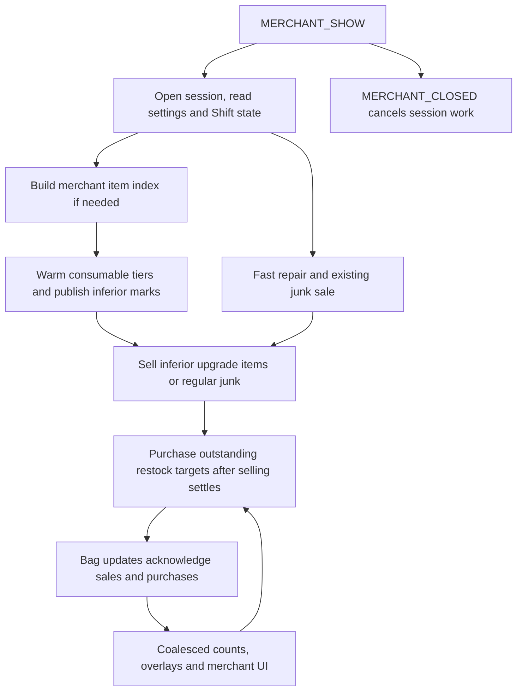
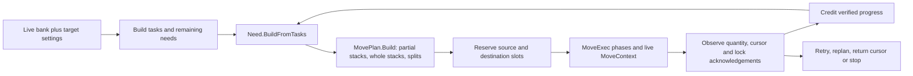

# Vendor, junk, tier targets, and bank restock

FluxUI extends merchant and bank windows with repairs, junk classification/selling, target-based purchases/withdrawals, Already Known tinting, and bulk buying. Current options live under **Inventory**; Vendor & Restock and Salvage are related controls within that page rather than separate top-level tools. Behavior is shared with combat/noncombat consumable buttons, Respec gear protection, Blizzard bags, and Baganator.

## State, entry points, and defaults

[`FluxRestockSettings.lua`](../Inventory/Restock/Core/FluxRestockSettings.lua), `FluxRestockSettings.Get`, owns `_FluxUI_CharSavedVars.Restock`. `FluxVendorAuto` is the merchant/options facade; `FluxRestock.Inv` adapts `Flux.Inventory` to this subsystem. Callers re-fetch the settings table rather than retaining it across load transitions.

| Stored area | Current behavior/default |
|---|---|
| `autoRepair`, `autoSellGray`, `autoRestock`, `autoBankRestock` | All false unless explicitly enabled. `autoSellGray` is the historical key for the broader Flux junk queue, not only gray items. |
| `repairPriority` | `personal`; guild-first is an optional choice when the game exposes guild repair. |
| `restockItems` | Item-ID entries with target quantities and flags, including bank counting. `restockShowNotSold` defaults false. |
| `restockFoodWater` | Food/water targets default zero, inferior marking true. |
| `restockCombat` | Bandage/healing-potion/mana-potion targets default zero, inferior marking true. |
| `junkList` | `itemID = true` means explicit Junk; false means explicit Useful; nil delegates to automatic classification. Numeric-string keys are also accepted. |
| `junkFilters` | Low consumables, unusable equipment, destroy unsellable, safe batching, and conjure-inferior food/water default on; consumable level ratio defaults 0.15. |
| `junkDisplay` | Glow and coin indicators default on. |
| `alreadyKnown` | Enabled, green tint, monochrome/debug/exclude false. |
| Bulk buy | Separate per-character `buyEmAllEnabled` and `buyEmAllConfirmLarge` default true. |

`MigrateLegacyStores` now preserves `VendorAuto`, bank snapshots and existing Restock settings. Migration V1 imports validated preferences only when current Restock is absent, and records rollback/archive data in `_FluxUI_CharSavedVars._restockMigrationV1`. It does not replay pending vendor transactions or reinterpret cached bank topology. Old `FluxRestockDB` found in memory is archived inside that declared character root. See the [migration tests/report](43-startup-optimization.md).

## Merchant lifecycle and automation ordering

[`Vendor/FluxVendorBuy.lua`](../Inventory/Restock/Vendor/FluxVendorBuy.lua) handles `MERCHANT_SHOW`, `MERCHANT_UPDATE`, `MERCHANT_CLOSED`, bag-delayed pulses and merchant busy errors. On open it marks merchant/automation activity, initializes settings, decides whether an item index is needed, and schedules layout. Holding **Shift while opening** suppresses that open's automatic batch. Manual buttons remain separate entry points.

The fast path allows enabled repair/selling to start before a complete merchant index. Tier upgrades can introduce an inferior-only sale followed by purchasing the replacement tier; the pipeline waits for the needed inferior classification before deciding what to sell. Deferred callbacks repeatedly check whether the same merchant context is still open. Closing stops buy/sell state, clears pending UI/session work, and allows removal-only item identity refreshes after actual sales.

`GetMerchantItemIndex`, generation/invalidation methods and index listeners are the shared merchant facts API. [`FluxVendorRestockPanel.lua`](../Inventory/Restock/Vendor/FluxVendorRestockPanel.lua) caches the target list and can refresh counts without rebuilding rows. [`FluxVendorAutoMerchantUI.lua`](../Inventory/Restock/Vendor/FluxVendorAutoMerchantUI.lua) owns merchant controls, repair/sell/restock placement, native-vs-Classic layout, dirty-data flags, and lightweight versus full pipeline refreshes. [`FluxVendorRepairUI.lua`](../Inventory/Restock/Vendor/FluxVendorRepairUI.lua) owns the repair cluster and bounded layout retries. [`FluxVendorSession.lua`](../Inventory/Restock/Vendor/FluxVendorSession.lua) supplies compatibility session/defer predicates and deliberately schedules settled refresh callbacks off the current call stack.

Purchases are computed from target shortfalls, merchant bundle quantities, availability, currency/money and the available wallet, rather than assuming every merchant unit is a single gold-priced item. Repeated pulses continue an active buy pass. A bag update alone is not permission to run another full independent sell/buy automation.

## Junk classification, protection, and selling

[`Junk/FluxJunk.lua`](../Inventory/Restock/Junk/FluxJunk.lua), exposed as both `FluxJunk` and `FluxVendorJunk`, owns manual list state, cached automatic verdicts, inferior-item sets and worklists. `IsJunk` is the sale classifier; `IsJunkForDisplay` is the lighter overlay/plugin path. Cached item facts come from `FluxItemClass`; changing rules or resolving item data invalidates the appropriate verdicts.

Explicit Useful marks protect every quality. A positive manual restock target protects an item from automatic/inferior junk rules, while an explicit Junk mark can override that target exemption. Saved Respec gear receives slot-aware protection at sale/interaction boundaries. Conjured consumables and Well Fed handling are deliberate exceptions to simple low-food rules. The legacy base whitelist protects non-gray items; sellable gray items otherwise follow the gray rule regardless of item level or bind type. Consequently a list-only item-ID verdict and a live slot's final sellability are related but different queries.

[`FluxSellJunk.lua`](../Inventory/Restock/Junk/FluxSellJunk.lua), `SJ.Start(mode, opts)`, runs one queue in `all` or `inferiorOnly` mode, optionally restricted to affected tier kinds. It retains per-slot in-flight sale records and waits for live bag changes rather than repeatedly submitting the same stack. Re-clicking an active sale resumes/accelerates that session without duplicating unacknowledged requests. Upgrading inferior-only to all preserves pending work.

`ContinueIfNeeded` resumes on delayed bag events and a self-driving timer. Busy errors cause backoff. Locks, unchanged pending slots, finite pass/stall bounds, merchant closure and a final live rescan constrain progress. Relocated junk can therefore be rediscovered after a worklist drains. The queue uses the container sale route without running a competing native `SellAllJunkItems` batch or cursor-sale fallback. Unsellable junk deletion follows the destroy option and its own live checks; enabling the filter is distinct from opening a merchant and enabling auto sale.

Repair dispatch checks whether this merchant repairs and whether guild repair exists/has allowance before the chosen priority; manual repair can use its own path. UI totals and completion text are observations of the session and money changes, not an atomic all-or-nothing transaction.

[`FluxJunkOverlay.lua`](../Inventory/Restock/Junk/FluxJunkOverlay.lua) decorates native or compatible bag/bank buttons with coin/highlight and registered slot decorators. Dirty-bag/slot counts can paint immediately; bank, login, vendor and transfer work have coalesced/deferred paths. Protection context is shared with Respec so overlay refreshes do not independently rescan every saved profile. [`FluxVendorJunkPanel.lua`](../Inventory/Restock/Junk/FluxVendorJunkPanel.lua) supplies Useful/Junk views, focused items, asynchronous item-data updates and list-change callbacks.

## Item targets, reagents, and consumable tiers

[`Core/FluxRestockList.lua`](../Inventory/Restock/Core/FluxRestockList.lua) implements target CRUD, per-item flags, reagent suggestions/dismissals, merchant availability filtering, costs, and the options-list cache. Spell-reagent discovery is warmed separately, so an initially incomplete spellbook scan does not imply there are no reagent targets. Session removal notifications prevent vendor close from triggering unnecessary discovery of items that only disappeared.

The tier subsystem is split into settings, matching/counting, bank candidates, vendor discoveries, inferior marking, and click/tooltip UI. [`FluxRestockTiers.lua`](../Inventory/Restock/Core/Tiers/FluxRestockTiers.lua) publishes compatibility APIs for the food/water and combat HUD. The five configurable kinds are food, water, bandage, healing potion and mana potion; eligibility depends on the character/client. `SetTarget` and `SetCountBankFlag` store per-character state. `RememberOwnedTiers` and the shared ConsumableBest service provide reference knowledge; remembered best and currently owned best are distinct.

[`FluxRestockTiers_Match.lua`](../Inventory/Restock/Core/Tiers/FluxRestockTiers_Match.lua) classifies and counts items against the relevant tier axis, excludes ineligible items, and separates vendor and bank matching. [`FluxRestockTiers_Vendor.lua`](../Inventory/Restock/Core/Tiers/FluxRestockTiers_Vendor.lua) warms vendor data, tracks pending upgrade kinds and handles late classification. [`FluxRestockTiers_Inferior.lua`](../Inventory/Restock/Core/Tiers/FluxRestockTiers_Inferior.lua) publishes inferior sets after bounded/coalesced work, with added/removed-item fast paths and explicit upgrade snapshots. Count-only inventory pulses need not rebuild every tier classification.

The target editor appears in Inventory options and merchant rows, with compact edit boxes on supported HUD buttons. Counts can include bank knowledge for display/policy, but withdrawals still require live bank access. Lowering/clearing a target changes subsequent need computation; it is not an instruction to return all excess bag items to a bank.

## Bank restock: needs, plans, reservations, and acknowledgements

[`Bank/FluxBankRestock.lua`](../Inventory/Restock/Bank/FluxBankRestock.lua), `BR.Start`, is the session owner. It requires a live bank and the current `MoveExec` engine, resets the executor, refreshes target/container/bank caches, builds tasks, clears session skips and cursor state, then runs the engine. A manual click starts from current bag/bank state rather than resuming an old plan. `BR.Stop` aborts the executor and finishes the session; progress and pending-item summaries feed the button tooltip.

The active decomposition is:

| Module | Responsibility |
|---|---|
| [`FluxBankRestockNeed.lua`](../Inventory/Restock/Bank/FluxBankRestockNeed.lua) | Normalize tasks into needs, credit progress and total remaining work. |
| [`FluxBankRestockInventory.lua`](../Inventory/Restock/Bank/FluxBankRestockInventory.lua) | Live bank/player-bag snapshots, matching and destination fit. |
| [`FluxBankRestockMovePlan.lua`](../Inventory/Restock/Bank/FluxBankRestockMovePlan.lua) | Assign exact quantities to source/destination slots, fill existing bag partials, then whole stacks and remaining splits. |
| [`FluxBankRestockLedger.lua`](../Inventory/Restock/Bank/FluxBankRestockLedger.lua) | Source reservation, confirmation, release, skip/cooldown and stale-reservation cleanup. |
| [`FluxBankRestockRules.lua`](../Inventory/Restock/Bank/FluxBankRestockRules.lua) | Target/charge limits, stack selection, overshoot prevention, consolidation and move-lane decisions. |
| [`FluxBankRestockMoveExec.lua`](../Inventory/Restock/Bank/FluxBankRestockMoveExec.lua) | Active plan execution, bank-fragment consolidation, whole/split phases, verification, replanning and completion. |
| [`FluxBankRestockMoveContext.lua`](../Inventory/Restock/Bank/FluxBankRestockMoveContext.lua) / [`FluxBankRestockMoves.lua`](../Inventory/Restock/Bank/FluxBankRestockMoves.lua) | Live quantities, locks/cursor state, pickup/split/place/return and whole-stack helpers. |
| [`FluxItemMover.lua`](../Inventory/FluxItemMover.lua) | Shared verified-action lane with one in-flight action, pacing, backoff and callback results where used. The direct MoveExec/context lanes also exist. |

The planner favors existing partial destinations to avoid needless leftover fragments. The executor can consolidate bank fragments before moving, then replan. Charges and stack counts have separate limits. Progress follows observed source/destination changes, not merely a successful API call. Locked slots, no space, pending item scans, split rejection, stranded cursor, stalls, closed bank or combat can defer or stop work. The state machines have finite retry/replan limits; they do not guarantee every target is reachable.

`BR.Start` currently wipes `persistentSplitState` rejection maps as well as executor state, despite older nearby comments describing cross-session retention. This reference follows the executed reset behavior. Compatibility references to older bank-engine/executor/planner globals in the session file do not establish that those engines are loaded; consult [source coverage](30-source-coverage.md).

[`FluxBankRestockButton.lua`](../Inventory/Restock/Bank/FluxBankRestockButton.lua) attaches to the available native bank layout or Baganator live bank. Forever's bags-in-bank chrome gets its own anchor rather than a Retail bottom-tab assumption. Live availability, cached availability and active progress use different refresh methods. Auto bank restock is opt-in; explicit Respec gear withdrawal is a separate workflow.

## Already Known and bulk buy

[`FluxAlreadyKnownShared.lua`](../Inventory/Restock/Vendor/FluxAlreadyKnownShared.lua) owns shared settings and yields when standalone AlreadyKnown is loaded. Retail/Classic implementations inspect available merchant/AH/guild-bank surfaces, memoize known-item checks, and refresh tint on relevant updates; they do not teach an unlearned collectible. Green/monochrome are display choices. The legacy settings import only fills nil fields after defaults have been established, so its presence does not mean existing standalone colors overwrite Flux defaults.

[`BuyEmAll/FluxBuyEmAll.lua`](../Inventory/Restock/Vendor/BuyEmAll/FluxBuyEmAll.lua) handles modified merchant clicks with quantity/stack/max controls, purchasable bag-space and alternate-currency handling, keyboard input, and optional large-purchase confirmation. Its compatibility and localization files remain active resources. The large-confirm default may inherit an existing `BEAConfirmToggle` value when the new per-character value is first created. Closing the merchant closes the purchase interaction.

## Interfaces and verification boundaries

The detailed controls/defaults are in [Options](26-options-map.md); commands include `/fluxbankdebug`/`/fbrdebug`, `/buyemall`, and the active Already Known backend's aliases. See [command reference](31-commands-and-bindings.md), [inventory](21-inventory-foundation.md), [Baganator](24-baganator-compat.md) and [Respec protection](23-respec.md) for shared contracts. Existing local junk/consumable/inventory mocks exercise many transitions, but source/mock evidence does not prove merchant throttling, protected mutations, taint, real bank topology or item-moving latency in the game.

## Queued listing identity

BUG-005 (`cdd752a`) checks the live merchant slot item ID before each queued purchase.
A missing/replaced listing is removed before buying or accounting; valid tasks keep
the existing eight-call budget and bag-driven cadence. A normal new request after
index refresh resolves remaining/moved targets. [Evidence and native checks](VENDOR_PURCHASE_IDENTITY.md):
660 focused checks and the 86-script/727-file desktop suite pass. Stable 40-item queues
retain five passes and add one identity lookup per purchase. Native acceptance is pending.

## Finite stock reservations

BUG-006 (`b505bb8`) treats zero merchant availability as a purchase cap and reserves
submitted quantities on the shared finite index entry. Repeated tasks share the
remaining budget until index refresh; the reservation is not an acceptance receipt.
Unlimited/nil helper semantics and ordinary affordability/cadence remain. A fresh
index/request can use replenished stock. [Evidence](VENDOR_STOCK_BUDGET.md): 177 stock
plus 660 identity checks, five matched pairs and the full 86-script/727-syntax pass.
External stock/price changes and delayed acknowledgements still require investigation.

## Vendor-open availability reuse

BUG-007/PERF-004 (`e02139a`) reuses the exact gray fallback result for reliable,
unchanged bag generations. Existing rule/item/list/slot invalidation, native-positive
precedence and unready live fallback remain. This avoids repeated no-junk bag walks
without changing button updates or storm timing. [Evidence](VENDOR_OPEN_WORK.md):
265 checks/seven API fixtures, five matched count pairs, full 87 scripts/728 syntax
pass. The user's idle-open hitch on Era still requires native confirmation; cold
classification, other merchant work and all visual/security acceptance remain pending.
