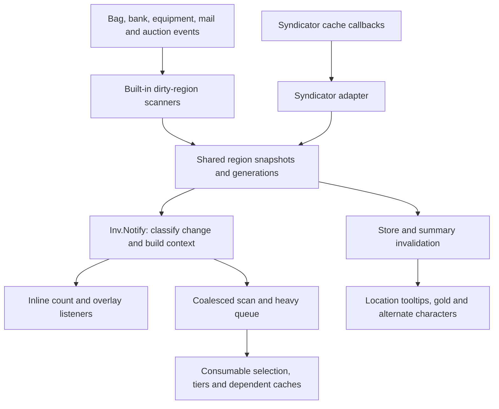

# Inventory: sources, snapshots, ledgers, and item knowledge

<!-- LHO-RESTOCK-REAGENT-NAME-READS-20261119 -->
19 November. The shared Restock builder now shares available native inventory names within a single rebuild. Three real-item comparisons matched all names and cut native requests from 207 to 69 per sample pair. Full Restock and frame-spike timing remain open. [Evidence](validation/restock-reagent-name-reads-2026-11-19.json).

<!-- LHO-RESTORE-PARSER-PATTERNS-20261119 -->
19 November. Consumable duration parsing and potion minimum parsing skip patterns if the required duration word or resource name is absent. Original localized text rules and potion floors remain in force. The paired Forever helper comparisons matched all sampled live inputs. [Evidence](validation/restore-parser-patterns-2026-11-19.json).

<!-- LHO-BANK-TIER-LIVE-COUNTS-20261119 -->
19 November. After the Forever world refresh, one native tier build queried 290 positive bag quantities across 51 item IDs. All 239 repeated results agreed. The bank builder now shares positive counts across tiers within that one rebuild, using the existing public path during reliability holds or with replacement providers. Zero and fallback reads remain live.

Both Lua files pass Lua 5.1 and 5.4 syntax and match the installed Forever copies. Reload 133 returned to the world. Two opposite-order live comparisons reduced tier rebuilds from 16.0921/15.2402 ms to 10.1717/11.1664 ms. Each candidate build used 51 distinct positive counts. All five tier totals matched in both comparisons, neither returned withdrawal rows, and the observer restored with zero errors. This covers the closed-bank rebuild. [Evidence](validation/bank-tier-live-counts-2026-11-19.json).
<!-- /LHO-BANK-TIER-LIVE-COUNTS-20261119 -->

<!-- LHO-BANK-TIER-MATCHER-20261119 -->
19 November. The Forever Bank Restock tooltip's first read took 44.7333 ms for four rows. All four had Count Bank off. The warm read took 1.1500 ms. The 39.9320 ms registry build included 39.712 ms in the consumable tier builder. A follow-up found 250 usability checks, with 135 tooltip reads taking 22.1383 ms before matching native unusable answers.

The tier matcher now checks numeric non-consumable metadata against the defining classifiers before running usability. Unknown metadata, consumable classes and replacement methods keep the existing matching path. Lua 5.1 and 5.4 syntax pass. Retail and Forever file hashes match. Native 129 confirmed reload and world return. Two same-session Forever pairs in opposite order reduced tier rebuilds from 43.3845/44.7337 to 13.8876/15.3005 ms. Usability calls fell 250→90 in both. All five tier totals matched in each pair. Both builders returned zero tier withdrawal rows, all temporary functions were restored, and error counts were zero. Bank-open, eligible withdrawals, active Pending, other clients and frame-spike acceptance remain open. [Evidence](validation/bank-tier-matcher-2026-11-19.json).
<!-- /LHO-BANK-TIER-MATCHER-20261119 -->

<!-- LHO-SLOT-DIFF-TOUCH-20261119 -->
19 November. `Inventory/Containers.lua` `d043cfe0` → `372664bf` simplifies the shared built-in and Syndicator slot-diff path. The old-slot pass records same-item count and link changes. The new-slot pass on normalized maps only needs to mark new slots and replacement IDs. Both delta loops retain their original arithmetic and order. Map metatables retain the full comparison. Provider coordination and count delivery cadence stay in place.

Lua 5.1 and 5.4 passed for both files in the before/after check. Retail and Forever disk copies match. Native 119 was a read-only view of fresh raid join and leave activity. No test command, item move, jump or reload was sent in this slice. The next live proof needs a safe opportunity to reload, then a real bag or bank update on the new revision. Earlier cast-to-bag and item move captures remain valid for their dated source sets.
[Source and current native evidence](validation/inventory-slot-diff-touch-2026-11-19.json).
<!-- /LHO-SLOT-DIFF-TOUCH-20261119 -->

<!-- LHO-RECIPE-PAIR-MAIL-QUEUE-20261119 -->
19 November. Forever native 118 paired the loaded modern recipe lookup with its full-catalogue fallback in the same session. Three passes over 147 eligible saved recipes returned the same knownness and exact saved record in all 441 pairs. Median pass total fell from 138.5646 ms to 43.3418 ms (68.7%). Both method identities were restored and the session error count was zero. The fallback used one forwarding call. The longest diagnostic batch took 5.902 ms. Full workflow and frame-spike timing remain open.

`Mail/Restock.lua` `09f764dc` → `952b6a19` creates the action row only on the first matching restock attachment. An eligible message with no match now allocates none of the three queue tables. It contributes the same attachment counts to the authority scan. Header and attachment reads, scan budget, COD and GM checks, retries and publication stay intact. Before/after Lua 5.1 and 5.4 syntax passed. The Forever disk copy now matches, and native adoption is pending. The existing populated-mail authority decision remains open. No new simulation, item action or jump was performed.
[Native recipe comparison](validation/modern-recipe-paired-native-2026-11-19.json). [Mail source and verification](validation/mail-lazy-queue-rows-2026-11-19.json).
<!-- /LHO-RECIPE-PAIR-MAIL-QUEUE-20261119 -->

<!-- LHO-FIXED-RECIPE-SLOTS-20261119 -->
18–19 November. Auction craft planning now appends each fixed reagent to its private variant in place. This removes the prefix copies for single-option slots. Multi-option expansion, the 64-variant cap, allocation order and native recipe verification stay on their existing paths. `FluxAuctionRestockCraft.lua` changes from `8462442f` to `143c59c1`. Four before/after Lua 5.1 and 5.4 syntax checks and six Retail/Forever disk hash comparisons passed.

Forever reload 115 completed and native 116 returned the same IDs, yield, variant count and slot count for actual bandage items 8544 and 3530. The two individual full-query pairs were 0.9445→1.0710 ms and 0.7717→0.7018 ms. Native 117 confirmed recipe 18560 known with one reagent and a present item 1191 hyperlink matching the snapshot with the bank closed. Current build was 1.60.1/70959/16001 with the Syndicator provider and zero session errors reported. All accepted reads were visually confirmed and released. No craft, item transaction, profiler setting change or jump occurred. Full field, frame-spike, multi-option and remaining workflow/client checks stay open. No further reload is needed for these exact source files while the current session remains loaded.
[Exact files and live results](validation/fixed-recipe-slots-2026-11-19.json).
<!-- /LHO-FIXED-RECIPE-SLOTS-20261119 -->

<!-- LHO-BANK-SNAPSHOT-LINK-20261118 -->
18 November. Cold item metadata can fall back to one link from the bank and carried snapshots. Index.lua (`e2f7919a` → `452aa904`) and FluxRestock_Inv.lua (`4488ee52` → `f3890c5e`) now read that link in the same carried, character bank and supported warband order without allocating an item map or its per-item records. The existing live stack check runs first. Replacement public getters keep the full-map path.

Eight before/after Lua 5.1 and 5.4 syntax checks passed. Both edited files match the Forever copies on disk. After the diagnostic text closed, native 113 queued two read-only queries. The output capture guard stopped during a focus change. An independent screenshot showed fresh startup messages and a group invitation, with neither result visible. The reservation was released. Native adoption and timing of the link and modern recipe lookups remain pending, as do the stale closed-bank case and populated-mail authority decision. The full goal stays active.
[Exact source, observed client state and validation limits](validation/bank-snapshot-link-2026-11-18.json).
<!-- /LHO-BANK-SNAPSHOT-LINK-20261118 -->

<!-- LHO-MODERN-RECIPE-KNOWLEDGE-20261118 -->
18 November. The goal dashboard is active again. Professions.lua `9a12130d` → `24b89db1` limits a standard modern `GetRecipeKnowledge` query to catalogue keys for the requested recipe. It still walks the saved records, applies the same revocation rules and ranks every matching alias in the original order. Legacy descriptors and replacement catalogue getters still take the full path. There is no persistent cache or change to recipe validation cadence.

All four before/after Lua 5.1 and 5.4 syntax checks passed. Retail and Forever disk hashes match. The earlier native capture supplied 148 real catalogue records and exercised a different live recipe query. AH111 and charge112 stopped before input, with both reservations released. The client showed a focused BugTabs copy field and one raid secure-handler stack with its top error line clipped. No reload or jump was sent by this continuation. Candidate adoption and timing remain pending. Keep the full inventory, casting, client and provider acceptance matrix open.
[Exact source and native evidence](validation/modern-recipe-knowledge-2026-11-18.json).
<!-- /LHO-MODERN-RECIPE-KNOWLEDGE-20261118 -->

<!-- LHO-CARRIED-SCAN-COUNT-20261118 -->
18 November continuation. The carried-consumable scan skips one options-table allocation per canonical bag snapshot count. It reads the same current snapshot through the same index method and capability check. The public fallback still receives its original fresh options when either getter is replaced. Saved-potion eligibility reuse now also requires the original classifier methods and a plain classifier table.

Lua 5.1 and 5.4 before/after syntax passed. Native 109 in Forever 1.60.1 / 70959 observed zero eligible saved-reference passes and restored the temporary wrappers. Probe 110 ended before input. These captures preceded the new Lua edits. Native adoption, matched frame times and remaining LHO-01–13 workflow acceptance are pending. The jump helper remains stopped from the earlier pause. The goal dashboard still reports paused despite the text request to continue.
[Exact source identities and native evidence](validation/carried-scan-count-2026-11-18.json).
<!-- /LHO-CARRIED-SCAN-COUNT-20261118 -->

<!-- LHO-PAUSED-20261118-FINAL -->
USER PAUSED FULLY: no commands/tests/edits/jumps until explicit "continue". Saved18November. Actual Persist7082172e/Scan21883c7d edits adopted by101guardedreload/freshstartup;native10354counts match,food1487-14-841 unchanged,bothprovidersready,queue4/errors0/preferences0-120-30,cursorclear. After-timing104did NOT run:104a modifierguard stopped before input;pending retry auto-review rejected because user paused. Gain/fullrecord/override/reentry/native-otherclient/FPS/hitch acceptance remainsPENDING. Baseline99/100 samples and source proof/8syntaxchecks retained.

All testing/jumps stopped. R20supervisor37448 stopped-before-launch/verified absent;noR20host. EarlierR19host33664 stopped before101reload. CANCEL/nativeJUMP_STOP remain. Pause-only guardedReloadUI was queued bypause1811reload_b;fresh startup confirmation failed because WoW was minimized. Do not claim confirmed final reload/world return. Latest user insists fullstop,so no further verification now. On continue revalidate actual session/current source;temporary probes/cue must be freshly installed only if needed. Never replay spent commands. Preserve all newer/unrelated work. Full original optimization scope unfinished.
[Resume checkpoint](validation/persist-ref-eligibility-2026-11-18.json).
<!-- /LHO-PAUSED-20261118-FINAL -->

<!-- LHO-PERSIST-REF-ELIGIBILITY-20261118 -->
18 November: applied private same-pass saved-reference eligibility reuse in Persist.lua7082172e and Scan.lua21883c7d;**native adoption/performance acceptance PENDING**. Current client still runs preceding source until the next guarded reload. Direct public reads retain live checks. Matching numeric ID/kind can reuse only this synchronous scan's already-checked allowed result;clock/frame/scan serial/classifier revision/bag generation/runtime publication and defining owner checks guard reuse. Changed public persist/score/item helpers,metatables,secret IDs,missing approvals,reentry or later frames take ordinary checks. Normalization/scrub/ratchet/cold retries/features/look/cadence retained. Professions loads later than Persist;its owner pins on first query.

Dated external source/history verified;12settings stat rows. Before/afterLua5.1/5.4syntax8checks PASS;original GetRef/MaybeUpdateRef cores restored exactly after removing only approval plumbing,remaining vendor bodies unchanged;30Retail/Forever sourcepairs match. Native99/100 baseline7passes/3s,4stored full4.618000/4.336800/5.275400/5.667300ms;notify0.036400/0.036700/0.055700/0.043300ms. Runtime retained/errors0,methods restored/rootsclean. No new simulation. Native92-98 prior evidence found17tooltipreads/13for7valid IDs;no proposed gain accepted yet.

Next: stop currentR19host33664 before guarded adoption reload,install freshjumpcue,then current counts/fullrecords and same scan-only timing protocol. Keep allclient/override/reentry/secret/taint/pixel/controller/fullworkflow/FPS acceptance OPEN;do not infer from source checks. Useraway:asknoquestions;pause promptly withCANCEL/nativeJUMP_STOP before requestedreload. FullLHO01-13ACTIVE. Preserve all unrelatedwork/no commits or external addon edits.
[Exact checkpoint and pending validation](validation/persist-ref-eligibility-2026-11-18.json).
<!-- /LHO-PERSIST-REF-ELIGIBILITY-20261118 -->

<!-- LHO-PASSIVE-TOOLTIP-ATTRIBUTION-20261118 -->
18 November native92-98: actual passive validation attribution,**no productLua edit/new simulation/reload**. Three-second trace7passes/4stored,all classifyPendingRead retain runtime. Full envelopes4.410900/4.180900/5.288500/4.404300ms;17tooltipreads each cost2.240000/2.080900/2.305200/2.164900ms. GetInfo82calls cost0.0580/0.0573/0.0603/0.0581ms;GetFirst17calls cost0.1352/0.1391/0.1407/0.1357ms. Nested inclusive costs overlap/include wrappers;not additive/FPS/hitch/beforeafter evidence. Rounded6decimal transcriptions;original PNGs retained.

One94pass has17reads/11IDs:1487x1,1645x2,2633x1,3703x1,3928x2,4599x3,4601x1,5634x1,6149x2,7516x1,8544x2. Pending2633/3703/5634/7516 eachreadonce;7valid IDs account13reads. Returned pending strings describe cure/alcohol/movement immunity/readable item. Do not force-reject or change0.4s cold retries on current strings alone.

Correction:94broad caller-tag search matched the classifier filename embedded in unnamed loadstring source;all classify labels INVALID,counts/pendingflags remainvalid.96rawstack overflowedchat;97filteredstack partlyclipped. Complete caller attribution remainsunproven;use explicit chunk names/anchored addon frames next.97PNG personally viewed butACK attempted too late and rejected asstale;not restamped/replayed or called ACKed.98fresh independentread/ACK confirms all owned92/94code/reports absent,jumpcueactive,cursorclear/errors0,food1487-14-841/preferences0-120-30 unchanged;freshbuild1.60.1/70959/16001/project18. All addon-method wrappers restored byidentity;no nativeAPI replacement/item actions/external-addon edits.29Retail/Forever sourcepairs freshlymatch.

CurrentR19_J90q/j18n90a7 host33664/supervisor14932 remains;180s queue forchat/casts/crafting/unsafeinput,15sPCidle exception,movementunverified. Pause promptly viaCANCEL/nativeJUMP_STOP before requestedguardedreload. Useraway:asknoquestions. Next: shared per-pass eligibility for repeated valid-item reads with defining-method/override/reentry guards;no candidate yet implemented/measured. Keepfreshness/features/cadence and coldretry contracts. FullLHO01-13ACTIVE;~5ms path and broader workflow/provider-off/client/taint/pixel/controller/matchedFPS-spikes remainOPEN. Accepted Score13f/Scan94c/parser689/recipe9a and priorwork intact;no unattended merchant automation.
[Exact attribution and limits](validation/passive-tooltip-attribution-2026-11-18.json).
<!-- /LHO-PASSIVE-TOOLTIP-ATTRIBUTION-20261118 -->

<!-- LHO-SCORE-REQUIREMENT-PREFILTER-REJECTED-20261118 -->
18 November: rejected the requirement-parser literal guard after checking the actual active workload. The two-line candidate in Inventory/FluxConsumableBest/Score.lua13f28db1 ->86b4fe20 skipped patterns when lowercase text lacked "requir". Native81/82 used54real carried-item tooltips,34without the fragment:three alternating270-call pairs old0.780300/0.739700/0.725000ms,new0.576400/0.561700/0.531800ms,all54results equal. Acquisition/native restriction reads were outside these parser timings. This mixed inventory includes materials/gear and does not establish the consumable hotspot's benefit.

Native88 narrowed the same private comparison to7actual published consumables,allwith requirement text:three alternating140-call pairs old0.511600/0.497400/0.512500ms,new0.535200/0.525100/0.518200ms. Allresults match,but every candidate pair is slower. Removed ONLY the two inserted lines;whole file restored exactly13f28db1,all earlier accepted Score/parser/Scan/queue/recipe/vendor/EBS work retained. No new simulation. Fresh before/after/restoredLua5.1/5.4syntax and29Retail/Forever sourcepairs pass;dated source/history and12settings-stat records retained externally. Initial immediate diskpair check failed after write;later allmatch,no manualsync;visibility cause unproven.

Own83reload adopted the trial;native85 retained54counts/food1487-14-841,providers/errors/preferences. Native86/87 full IsKnownUnusable comparison on54actual items also matched,0failures/0errors,both variants blocked0 (no real rejection branch induced). After rejection,own89guardedreload readiness ACKed and fresh startup separately viewed;native91 freshly1.60.1/70959/16001/project18,bothSyndicator+Baganatorloaded/source syndicator/readytrue,54counts0mismatches,samefood/queue4/errors0/preferences0-120-30,cursorclear. Owned probes/reports removed;no installed/native API replacements,craft/mail/item transactions or external addon edits. Unrelated party/loot-setting traffic is a retained confound,not this goal's commands. No causal full-validation/FPS/hitch claim.

Current jump R19 _J90q/j18n90a7,supervisor14932/host33664/live20261118s verifiedlive. R17host42332 andR18host42984 stopped/verified absent before respective reloads;only matching ownedstop/setupholdsremoved,INPUT_HALTED retained. Keep180s queued forchat/casts/crafting/unsafeinput;15sPCidle activation/priorapp restoration exception;Space injection is not visual movement proof. Pause promptly with CANCEL/nativeJUMP_STOP before requested guardedreload;freshnonce afterresume. Useraway:asknoquestions. All trial inputs spent;do not replay.

FullLHO01-13ACTIVE. Prior recipe9a12130d still accepted:148cached fullrecords/reagents match native79/80;local warm-query saving only. Next: real tooltip-acquisition/repeated eligibility work for the active consumable set,then established-evidence Inventory/EBS fixes. Do not reapply this guard,the rejectedR29catalogue/taskcopy caches or unmeasuredlegacy-index hint. Broader vendor/AH/bank/mail/pending/craft/cast/provider-off mutation,otherclients/taint/pixels/controller and matchedFPS/spikes remainOPEN. Vendor unattended opening remains unsafe without native Shift skip.
[Exact rejection and restoration evidence](validation/score-requirement-prefilter-2026-11-18.json).
<!-- /LHO-SCORE-REQUIREMENT-PREFILTER-REJECTED-20261118 -->

<!-- LHO-PROFESSION-LIVE-SCHEMATIC-20261118 -->
18 November: actual **Inventory/Professions.lua39c656ae -> 9a12130d** removes a duplicate native schematic read from GetRecipeLive. A successful quantity helper now returns its fresh schematic as a third private result;the same call passes it to the existing reagent extractor. Three substitutions only;no persistent cache/event/timer/cadence/public-result changes. Other callers consume their original two results;nil/error/non-table quantity lookups still leave the ordinary reagent retry/fallback. Whole-file three-substitution restoration and measured-worker equivalence PASS;before/afterLua5.1/5.4parse PASS. Dated external source/history verified,12settings stat rows;29Retail/Forever diskpairs match,no manualsync or new simulation. Preserve existing17November profession edits;8095e63c followup execution unchanged.

Native73 finds148cached recipes and modern APIs while professioninfo is absent;actual learned IDs1263032SpinningWheel/1263425FactionBanner/18560Mooncloth returnlive quantity1 and3/2/1reagentrows. Before edit,74 compares unmodified public query vs private candidate:threealternatingpairs,9queries pervariant perpair,old0.258700/0.263900/0.271200ms,new0.202700/0.211700/0.214800ms. All returned fields/nested reagent rows match3of3perpair;installed method unchanged. After own75reload,78 compares exact preceding private helpers with current installed query:old0.242800/0.263000/0.260800ms,new0.190100/0.186700/0.203000ms;again3of3fullrecordmatches eachpair/installedidentityretained,errors0,ownedrootsremoved. Local warm-query saving only;public/private placement,cache/world/system/GC/unrelated party activity are confounds. No overall FPS/hitch/Pendingbutton/end-to-end crafting claim;no party actions were this goal's commands.

Own75guardedreload readiness ACKed/freshstartup separately viewed. Native77 freshly1.60.1/70959/16001/project18,bothaddonsloaded/source syndicator/readytrue,54counts0mismatches,food1487/14/841 unchanged,queue4,errors0,preferences0/120/30,cursorclear. No craft/consume/buy/sell/delete/mail/window-opening or nativeAPI overrides. Packaged pinned schema says Retail/Forever GetRecipeSchematic returns CraftingRecipeSchematic;Forever snapshot70862 differs from actual70959. Classic declaration miss is unknown,not removal. Node18 narrow-query launch hit EPERM/insufficientversion;read only matching packaged JSON instead. Otherclients,quality/foreign/partial/cold/skill-change paths,largecatalogue/currentrecipe-change/actual craft lifecycle,taint/pixels/controller and matchedFPS/spikes remainOPEN. FullLHO01-13ACTIVE;~5ms consumable validation and broader vendor/AH/bank/mail/pending/craft/cast/provider-off mutation work remains.

Fresh R17 _J76q/j18n76a7 installed/ACKed;supervisor46232 launchedhost42332/live20261118q,host liveverified,3Spacepairs at recordtime,motionunverified. R16host37972 stopped/verified absent before reload;only ownedstop/setupholdsremoved,INPUT_HALTEDretained. Keep180s queued during commands/casts/crafting/unsafeinput;15sPCidle activation/priorapp restoration exception. Pause promptly viaCANCEL/nativeJUMP_STOP before requestedguardedreload;freshnonce afterresume. Useraway:asknoquestions. PreserveScan94c403db/Score13f28db1/parser689c630a/queue36a7b896/Craft853273d8/paneldc6de0aa/Watch08350be5 and unrelatedwork. Next: other real recipe IDs/full-field query coverage and established-evidence inventory/crafting fixes;do not apply unmeasured legacy-index or rejected catalogue/task-copy caches. Vendor unattended opening remains unsafe without genuine Shift skip.
[Exact source and native evidence](validation/profession-live-schematic-2026-11-18.json).
Native79/80 follow-up: all148actual cached recipes returnlive from both exact preceding private worker and installed current query;148full-record/nested-reagent matches,0mismatches/0failures,101learned,148withreagents,4quantityMin~=1. Three recipes per0.1s batch;5.078s walltime,maxpaired-query-plus-comparison1.1447ms (not frame/FPS). Installed method identity unchanged;probe/report removed,jumpcue restored,cursorclear/sessionerrors0. This closes current cached-catalogue field parity only;foreign/partial/quality/cold/skill-change/end-to-end UI and otherclient checks remainOPEN. Fresh29Retail/Forever sourcepairs unchanged;no addonLua edit or new simulation in this follow-up.

<!-- /LHO-PROFESSION-LIVE-SCHEMATIC-20261118 -->

<!-- LHO-NATIVE-CURRENT-BAG69-20261118 -->
18 November: current-source real bag mutation acceptance,**no addon Lua edit or new simulation in this slice**. Food4599x18 moved0:8->2:6 and returned automatically on firstattempt;final0:8has4599x18,destinationempty,cursorclear,baggen5->7. All54carried counts match WoW;food1487/count14/effective841 retained,bothSyndicator+Baganatorloaded/source syndicator/readytrue,queue4,errors0. Current Scan94c403db/Score13f28db1/parser689c630a/queue36a7b896 and all28Retail/Forever pins freshlymatch. After ordinary inventory changes rebuild publication, later Bestgeneration2169->2170 retains the same runtime across0.6s:reuse continues with fresh snapshot cardinalities. Full REUSE69 tuple personally viewed in finishcapture;helperREUSE70 prints only its first tuple value because of Lua and-expression adjustment,not an addon error.

One existing optional watch30.003s/4289driverframes/220observedcallbacks:peak34ms,0recorded>=50ms gaps,0observed>=10ms callbacks,watcherrors0/0. Directmove/return envelopes4.7003/3.4735ms at442388.800/442390.801;Notify0.710400/0.526700ms at442388.986/442390.987. No matched before/after FPS/spike gain or regression inferred from earlier source/windows. Watch covers specific service seams,not every handler/GPU/taint/pixel/controller/client. OriginalNotify/prior diagnostic root/prior spike report restored by identity;watchstopped,owned_M69/_M69r removed,originaljumpcueflag restored. Preferences0/120/30 unchanged;no buy/sell/delete/consume/mail/craftqueue/external-addon actions. Nativewatchfreshly1.60.1/70959;interface16001/project18 retained from native68.

Read-only vendor entry review pins Buy3e0b50e0:MERCHANT_SHOW latches private native Shift skip;otherwise After0 begins fastselling/repair. No public session-suppression setter found in inspected Buy/Session modules. Do not open unattended or replace native modifier APIs;vendor lifecycle acceptance remains pending. FullLHO01-13 staysACTIVE. Cold/newloot/quantitydepletion/charges,provider-off mutations,allkind/fullfield selection parity,bank/mail/vendor/AH/pending/craft/cast/otherclients and matched FPS/hitch benefits remainOPEN. Next: current-source Food cast/cancel/receive check if needed,then established-evidence Inventory/EBS fixes;keep0.4s cold retries/liveeligibility and ordinary notifications. No new simulation or foreign-addon edits.

R16 _J65q/j18n65a7 remains current,host37972/live20261118p via supervisor42708;liveverified,7Space pairs at recordtime,motionunverified. No reload69;temporaryjumpcue remains valid. Keep180s queued aroundcommands/casts/crafting/unsafeinput;15sPCidle activation/priorapp restoration exception. Stop promptly onpause viaCANCEL/nativeJUMP_STOP before requestedguardedreload;freshnonce afterresume. Only ownedprobe state touched;INPUT_HALTED retained. Useraway:asknoquestions. Preserve unrelatedwork/main;no commit/publication.
[Exact current native evidence](validation/inventory-current-native-bag69-2026-11-18.json).
Native72 follow-up: currentclient/session GetTradeSkillLine/GetNumTradeSkills/GetTradeSkillInfo/GetTradeSkillReagentInfo allnil,TradeSkillFrameabsent/Skilletclosed,cursorclear/errors0;no windows opened or crafting. Do not apply the unmeasured legacy-readiness index hint on this evidence. CanCraft discards Prepare index while CraftClick consumes it;future readonly hint must revalidate full live recipe and retain execution search/order. Review modern profession path next. This is current-session absence,not allclient removal. Gate rejected initial incorrect controller hash before native input;fresh label used with actual builder hash.
<!-- /LHO-NATIVE-CURRENT-BAG69-20261118 -->

<!-- LHO-PUBLICATION-CARDINALITY-20261118 -->
18 November: actual Scan.lua **8f9ebfdb -> 94c403db** saves each private publication row's entry count during ordinary snapshot creation. The original secret-value checker path verifies live key/value matches once plus cardinality for removals; the exact preceding two-pass worker remains for checker replacement. All secret/metatable/depth/128-table guards and scan/classifier/count/persist/selection/notification/retry/cadence paths remain. Cardinality uses pairs,including false values,not length. Whole-source restoration and measured-worker source equivalence (comments/whitespace/local names only) PASS;before/afterLua5.1/5.4parse PASS. An initial overly strict blank-line text comparison failed; normalized worker comparison passes. Dated external source/history verified,12settings stat rows,28Retail/Forever diskpairs match,no manualsync or new simulation.

Before editing, native63 privately compares exact preceding worker against candidate on **23real current published tables/158entries**,5calls pervariant perpair,three alternating pairs. Old0.599500/0.554200/0.900700ms;new0.344900/0.334800/0.532000ms;all true/true,real public tables unchanged,private root removed,errors0. Applied candidate worker matches measured worker. This establishes an isolated native comparison saving; snapshot construction/cardinality capture was outside that timing. No mocked item data,synthetic mutation suite or nativeAPI/installed-dispatcher replacements. Removal/addition/change equivalence is source proof; intentional secret/metatable/checker replacement cases were not natively induced.

Own64guardedreload readiness ACKed/freshstartup separately viewed. Current-source66/67 retains runtime identity on all4stored of7passive passes/3s,reason classifyPendingRead,4invalidations perpass,ordinary notifications;both dispatchers restored and roots removed. Fullpass4.8186/6.0142/5.4133/5.0837ms versus previous-source4.8335/5.6013/5.6334/5.7219ms:overlapping variation acrossreload. Mean5.447525->5.332450ms does NOT prove overall gain or regression;~5ms remains OPEN. Native68 freshly1.60.1/70959/16001/project18,bothaddonsloaded/source syndicator/readytrue,54nativecounts0mismatches,food1487/14/841 unchanged,queue4,errors0,preferences0/120/30,cursorclear. No FPS/hitch/all-workflow/otherclient/taint/pixel/controller claim.

Fresh R16 _J65q/j18n65a7 installed/ACKed;supervisor42708 launchedhost37972/live20261118p,host liveverified,2Space pairs at lastread,motionunverified. R15host56040 stopped/verified absent before reload;only ownedstop/setupholdsremoved,INPUT_HALTEDretained. Keep180s queue around commands/casts/crafting/unsafeinput;15sPCidle activation/priorapp restoration exception remains. Pause promptly viaCANCEL/nativeJUMP_STOP before requestedguardedreload;freshnonce afterresume. Useraway:asknoquestions. FullLHO01-13 ACTIVE. PreserveScore13f28db1/parser689c630a/queue36a7b896/Craft853273d8/paneldc6de0aa/Watch08350be5 and unrelatedwork. Next: safe real bag relocation/automaticreturn on current sources,verify fresh publication/count/selection and restored inputs;then remaining Inventory/EBS validation/tooltip costs. Cold/depletion/charges/provider-off mutations,bank/mail/vendor/AH/pending/craft/cast/allclients and matchedspike gains remainOPEN. No unattended merchant transactions or new simulation.
[Exact source and native evidence](validation/publication-cardinality-2026-11-18.json).
<!-- /LHO-PUBLICATION-CARDINALITY-20261118 -->

<!-- LHO-SCORE-RESTRICTION-CAPABILITY-20261118 -->
18 November: actual Score.lua **c542c20d -> 13f28db1** now checks the four existing restriction enum members before fetching native tooltip data. Native57 Forever70959 exposes their table but all four members are nil; food1487 native lines have types22/0/44/43. Unsupported typed-color checks now return false without the unusable native read; existing textual level/skill fallback stays live. Supported-member fetch/line body remains. Intentional compatibility fix: nil line.type must not match a nonexistent enum member as positive restriction evidence; that unknown/red case was not natively induced. No cache, timer, event, retry or cadence changes. Whole-source restoration proof and before/after Lua5.1/5.4 parse PASS; dated external source/history verified,12settings stat rows,28Retail/Forever disk pairs match; no manual sync or new simulation.

Native52 identifies classifyPendingRead:4invalidations every~0.4s,5.31-7.11ms inclusive. Native55/56 corrects the earlier rebuild hypothesis: runtime identity is retained on all four stored passes, so reuse works. Notification envelopes only0.0381/0.0617/0.0430/0.0411ms; the repeated validation/retry path owns most observed cost. Before55 first4of7 passes:5.4691/5.9857/7.2414/5.9833ms. After60 first4of7:4.8335/5.6013/5.6334/5.7219ms; runtime identity retained,4invalidations and ordinary notifications continue. One3s window per source acrossreload; mean6.169875->5.447525ms (11.7% lower observed),median5.98450->5.61735ms (6.1%). World/cache/system/GC differences and transparent-wrapper overhead remain. No causal FPS/hitch or full-workflow claim;~5ms passive cost remains open.

Own guardedreload58 readiness ACKed and freshstartup separately viewed. Native61:1.60.1/build70959/interface16001/project18;both Syndicator+Baganator loaded,source syndicator/readytrue,all54carried counts match native;food1487/count14/effective841 unchanged;queue4,errors0,scriptProfile0/maxFPS120/maxFPSBk30,cursorclear. Five actual eligible IDs remain unblocked;empty managem remains blocked. All trace dispatchers restored by identity;owned roots removed and prior diagnostics untouched. Four after rows scrolled off61;62 reads existing chat history only,not a replay. Percentage/cold/depletion/charges/other-provider mutations,typed-red/locale/otherclient/taint/pixels/controller and bank/mail/vendor/AH/pending/craft/matched spike coverage remain OPEN. Do not drop cold retries or change0.4s cadence.

Fresh R15 _J59q/j18n59a7 installed/ACKed;supervisor55536 launched host56040/live20261118o,host liveverified and2Space pairs at last read. R14host20380 stopped/verified absent before reload. Only owned stop/setup holds removed;INPUT_HALTED retained. Keep180s jumps queued during commands/casts/crafting/unsafeinput;15sPCidle activation/prior-app restoration exception remains,motion unverified. Pause promptly viaCANCEL/nativeJUMP_STOP before requestedguardedreload;freshnonce afterresume. Useraway:ask noquestions. FullLHO01-13 goal ACTIVE;preserve parser689c630a/queue36a7b896/Scan8f9ebfdb/Craft853273d8/paneldc6de0aa/Watch08350be5 and unrelated work. Next: reduce remaining live eligibility/tooltip validation cost without stale caching or skipped callbacks;safe real workflows only. No unattended merchant transactions.
[Exact source and native evidence](validation/score-restriction-capability-2026-11-18.json).
<!-- /LHO-SCORE-RESTRICTION-CAPABILITY-20261118 -->

<!-- LHO-PARSER-KEYWORD-POOLS-20261118 -->
18 November: parser source **689c630a** is loaded through our guarded reload48 and a separately viewed fresh startup. Native50 freshly reports Forever1.60.1/build70959/interface16001/project18, both Syndicator and Baganator loaded, source syndicator and ready. All54carried item counts match WoW; selectedfood1487/count14/effective841 is unchanged. Native51 retains3food/1water/1bandage/1heal/1mana classification matches;7current fixed records match unchanged scoring with live pools. Errors0,scriptProfile0,maxFPS120/maxFPSBk30;owned probes cleaned. Percentage/cold/otherclient/taint/pixel/controller and full-field comparisons remain open.

Native parser samples,50calls per sample on10real tooltips: before663a539a2.325100/2.471400/2.363900ms;after689c630a1.740600/1.904900/1.771100ms. Median2.36390->1.77110ms (~25.1% lower observed). Same collection method/inputcount/pools1037/2637;exact strings/IDs/order not exported. One sequential batch per revision acrossreload with cache/world/system differences supports a local observation,not causal FPS/fullworkflow/hitch gain. Source proof and5.1/5.4parse remain;28Retail/Forever diskpairs freshly match,0new simulations/manualsync. Three changes only:impossible flatcombo/generic resource guards and unused nonpercentage pool reads;no cache/retry/cadence changes.

The larger cost remains open. Prior native43-45 identifies actual2633/5634/7516 and3tooltip reads0.6039ms within1.0674ms nested query;source663a539a retained separately. Current full food query0.593300ms remains above initial0.147600ms baseline and below later0.818500/0.703600ms observations;states differ,so no fullquery gain claim. Native47 shows4invalidations betweencommands,but none inside its3GetAllBest calls;caller remains unproven. Next: trace actual tooltip collection and background invalidation owner,keeping live text/latecold recovery and0.4s read cadence. Do not drop pending retries or transfer old native acceptance.

Current jump helper is R14 _J49q/j18n49a7,host20380/live20261118n via supervisor26456,installed/ACKed and freshly liveverified. R13host51700 stopped/verified absent before reload. Guarded180s Space pairs/prior-app restoration requested;visual movement unverified. Queue aroundcommands/casts/crafting/unsafeinput;retain15sPCidle exception. Only our stop/setup markers removed;INPUT_HALTED retained. Stop promptly onpause viaCANCEL/nativeJUMP_STOP before requestedguardedreload;installfreshnonce onresume. All native probes finished;only intentional jumpcue remains. Useraway:ask noquestions. FullLHO01–13 ACTIVE;preserveScorec542c20d/queue36a7b896/Scan8f9ebfdb/Craft853273d8/paneldc6de0aa/Watch08350be5 and unrelated work. Broader workflow/provider/client coverage and matched spike gains remainOPEN.
[Exact source and native evidence](validation/parser-keyword-pools-2026-11-18.json).
<!-- /LHO-PARSER-KEYWORD-POOLS-20261118 -->

<!-- LHO-SCORE-FIXED-RESTORE-20261118 -->
18 November: Inventory/FluxConsumableBest/Score.lua a1d84a7d->c542c20d skips unused health/mana pool queries when missing pool arguments, original pool getter, plain nonpercentage record and numeric effective fully determine the result. No pool cache; supplied-pool/percent/nonnumeric/metatable/replacementgetter paths retain original full body. Removing only capture/early guard restores preceding whole source. Before/afterLua5.1/5.4parse and whitespace PASS; dated external source/history verified,12settingsstat rows;28Retail/Forever disk pairs match, no manual sync/new simulation. Tiers Match allocation idea was not applied;1a02bc12 remains.

Own guardedreload39 readiness ACKed/freshstartup separately viewed. Real queries over54IDs keep matches3food/1water/1bandage/1heal/1mana;7actual fixed restore values equal original explicit-live-pool calculation,selectedfood1487/14/841 unchanged,bothaddonsloaded/source syndicator/readytrue,errors0,cursorclear. Exact preceding scorer retained privately for native42 comparison against live candidate on7actual cached records:3pairs,140calculations pervariant perpair,old0.989300/0.979100/0.988300ms,new0.074500/0.081100/0.095500ms. All7outputs equal;public candidate identity unchanged. This is an isolated native computation gain,NOT FPS/full workflow proof.

OPEN regression/uncertainty: full first food query0.147600ms before versus0.818500after and0.703600followup;all samples retained. Othercategory samples smaller, but full query gain is unproven. Isolated scorer is faster;food-path cause not isolated. Revalidate actual pending items/cold classification/retries next;do not attribute to tooltip/cache/world or reject cold food without evidence. Previous4pending IDs are historical,not freshly queried39-42. Percentage/override/metatable paths source-reviewed,not natively induced. Full merchant/AH/pending/bank/mail/crafting/provider/cast/client/taint/pixel/controller/matched spike acceptance remains OPEN.

All owned _T39/_T40/_T41/_S42 code/data removed;no native APIs overridden,transactions or item moves;preferences preserved. CurrentR13 _J40q/j18n40a7 installed/ACKed,supervisor56212 launchedhost51700/live20261118m,live verified;oldR12host48628 stopped/verified absent. Guarded180s Space pairs and prior-app restoration requested;movement unverified. Queue during commands/casts/crafting/unsafe input,retain15s idle exception. Stop promptly onpause viaCANCEL/native JUMP_STOP before requested guardedreload;freshnonce afterresume. Only owned holds removed,INPUT_HALTED retained. Useraway:ask noquestions. Whole LHO01–13 ACTIVE;preserve queue36a7b896/classifier663a539a/Scan8f9ebfdb/Craft853273d8/paneldc6de0aa/Watch08350be5 and unrelatedwork.
[Exact source and native evidence](validation/score-fixed-restore-2026-11-18.json).
<!-- /LHO-SCORE-FIXED-RESTORE-20261118 -->

<!-- LHO-INVENTORY-QUEUE-MINIMUM-20261118 -->

Final source **36a7b896** is now adopted through own guarded reload37 and a separately viewed fresh startup. Native38 moved food4599x18 from0:8 to2:6 and returned it; source/destination/cursor restored, all54carried IDs match native, food selection1487/14/841 retained, generation5->7. Both Syndicator and Baganator explicitly loaded; source syndicator/readytrue, classification queue4 remains. Original Notify and prior diagnostic root/report restored by identity; owned watch/code/data _M38/_M38r removed, jump cue restored. Errors0/0; preferences0/120/30 unchanged. Lua5.1/5.4 syntax/source proof retained; all27Retail/Forever source pairs freshly match without manual sync or new simulation.

Final-source Notify envelopes0.509200/0.475200ms (mean0.49220ms), baseline0.571000/0.571300ms (mean0.57115ms). One sequential window each; reload/cache/world differences and231vs136observed callbacks prevent causal CPU/FPS/hitch claims. Final30.001s watch5254frames/136callbacks,peak30.000001ms,0>=50ms gaps/0slowcallbacks. Native35before e42893e4,36intermediate3c3ba2e5 and38final36a7b896 remain separate evidence. The positive-minimum guard handles unknown/ghost ordered entries through the original scan; forced error/reentry paths are source-reviewed, not natively induced.

Current R12 _J38q/j18n38a7 is installed/ACKed; oldR11host47908 stopped and verified absent. R12host48628/live20261118l is verified live, with guarded180s Space pairs and prior-app restoration requested; visual movement is unverified. Queue jumps during commands/casts/crafting/unsafe input, retain15s idle exception and shared input ownership. Stop promptly on pause via CANCEL/native JUMP_STOP before requested guarded reload; fresh nonce after resume. All native probes cleaned, only intentional jump cue remains. User away: ask no questions.

Full LHO01–13 remains ACTIVE. Preserve appearance/features/cadence/settings, classifier663a539a/Scan8f9ebfdb/Craft853273d8/paneldc6de0aa/Watch08350be5 and unrelated work. Continue Inventory/EBS fixes from existing evidence with safe native workflows; no new simulations or unattended merchant transactions. Other provider mutations, cold/depletion/charges, merchant/AH/pending/bank/mail/crafting/cast paths, other clients/taint/pixels/controller and matched hitch improvements remain OPEN. Historical paragraphs below refer to their stated earlier source/helper, not current acceptance.

18 November: Inventory/Init.lua e42893e4->3c3ba2e5 avoids repeated full queue-minimum scans when a new deferred job is the only mutation since the cached minimum. Append/update/cancel/dequeue advance a private version before fallible work;reentry/interrupted enqueue,existing updates,cancel/dequeue/wakes use original full scan. Entire deadline/timer/frame/budget suffix and all other source restore exactly to preceding file after removing only this metadata/hint patch. No callback batching or slower cadence:queue/context/order,inline counts,quiet/maxwait,2jobs/frame,1.5ms and idle detach remain. Before/after5.1/5.4syntax and whitespace PASS;27Retail/Forever source/helper pairs match;dated external source/history verified,12settings stat-only records;no private contents copied/manual sync/new simulations. Source-derived fresh-append work n(n+1)/2 queue visits becomes1visit+n-1 scalar comparisons;15registered scan listeners is NOT proof15actuallyqueued.

Real native35/36 before/after:4599x18 moves0:8->2:6 and returns;both windows restore source/destination/cursor,all54carried counts match,food1487/14/841 retained,gen5->7,errors0. Two Notify envelopes before0.571000/0.571300ms,after0.554600/0.487000ms;mean0.57115->0.52080ms (~8.8% lower observed). One sequential pair/reload/cache/world differences and231vs127observed Flux callbacks prevent causal CPU/FPS/spike claims. Both30s watches record0>=50msgaps/0slowcallbacks;peaks40vs36ms are not a proven gain. Notify original/prior diagnostic root AND report restored by identity;owned watches/code/data roots _M35/_M35r/_M36/_M36r removed. ScriptProfile0/caps120/30 unchanged. Own guarded reload readiness ACKed and fresh startup separately viewed;no loaded-byte hash.

Fresh R11 _J36q/j18n36a7 installed/ACKed after reload;R10b host50368 stopped/verified absent. Current host47908/live20261118k via supervisor5416 verified live,first Space pair15:27:19UTC/prior-app restoration requested,motion unverified. Own stop/setup holds removed only by matching ownership;retained INPUT_HALTED preserved. Keep180s jumps queued during commands/casts/crafting/unsafe input;15sidle activation/prior-app restore exception unchanged. All native probes finished;only intentional jump cue remains. Pause promptly via CANCEL/GOAL_DONE/native JUMP_STOP before requested guardedreload;fresh nonce after resume. User away:ask no questions.

Full LHO01–13 ACTIVE. Existing-job update scans remain;native cancellation/reentry/forced/cold/provider-off mutation coverage,all clients/taint/pixels/controller and merchant/AH/pending/bank/mail/crafting/cast workflows/matched hitch gains remain OPEN. Preserve classifier663a539a,Scan8f9ebfdb,Craft853273d8,paneldc6de0aa,Watch08350be5 and unrelated owners. Next: continue Inventory/EBS source fixes from existing evidence;use safe real workflows only,no simulation or unattended merchant transactions. Before another reload stop/replace current47908 helper;never replay spent packets.
[Exact source, native samples and limits](validation/inventory-queue-minimum-2026-11-18.json).
<!-- /LHO-INVENTORY-QUEUE-MINIMUM-20261118 -->

<!-- LHO-CRAFT-CLIENT-PREDICATES-20261118 -->
18 November: actual Inventory/Craft.lua edit75197d0a->853273d8 removes private8-field ClientFlags allocation. Dynamic scalar IsPostDF/IsCamelot preserve original relevant primary/fallback precedence,Forever aliases,truthiness and FirstAid rules. No flag/recipe/native-fact caching. Restoring only private predicate region plus old IsPostDF definition exactly restores preceding whole source after newline normalization;all other public/native/classification/count/reagent/rank/cache/event/refresh bodies remain. Before/after5.1/5.4syntax and whitespace PASS;26Inventory/EBS/helper Retail/Forever disk pairs match without manual sync. Dated external source/history verified and12settings stat-only rows available;no private settings contents copied or new simulation.

Native34 before/after scoped crafting readiness PASS:availabilitytrue/true/true,list sizes5heal/2mana/9bandage,same no-affordable best selections,plain client/API flags. Before list calls1.6934/1.2390/1.0011ms;after1.6667/1.1857/1.1918ms. One sample each and reload/cache/world differences do NOT prove CPU/FPS/hitch improvement or causal regression;only allocation removal is established. Own ReloadUI command fully queued;initial submitted capture was too early/blankchat and remains unaccepted. Separate personally viewed fresh startup verifies reload association;controller correctly refused submitted-phase refresh,no replay. After-read batch formally ACKed;generation9->5reset,scriptProfile0,no new session errors. Prior diagnostic-only session1 becomes0on normal reload;logs not manually cleared. Native actual crafting/ingredients/active pending legacy execution,full row equality,other clients/taint/pixels/controller remain OPEN.

Reload resets temporary code. R9host49768 stopped/verified absent through owned marker. Fresh R10b _J34q/j18n34a7 cue installed/ACKed;supervisor55884 launched host50368/live20261118j,verified live at15:00:02UTC,3Space pairs/latest14:57:52UTC/prior-app restore requested,motion unverified. Own setup no_jump released;retained INPUT_HALTED preserved. R10source-only package neverexecuted;R10b byte lengths recomputed for longer nonce. Initial install_a begin stopped before input because setup hold absent;fresh install_b accepted,never replay spent packets. Current stop protocol CANCEL/GOAL_DONE/native JUMP_STOP;queue during commands/casts/crafting/unsafe input,15sidle activation/prior-app restore. Pause promptly. User away:ask no questions.

Whole LHO01–13 goal ACTIVE. Other current classifier663a539a/scan8f9ebfdb/paneldc6de0aa and Watch08350be5 preserved. Source review flags pending legacy readiness full-list lookup;do not add a stale index cache without full current recipe/reagent validation and real path coverage. No change to FollowupCraft8095e63c and no revival of rejected catalogue/task-copy candidates. Continue actual Inventory/EBS fixes from existing evidence;no new simulations. Vendor/AH/pending/bank/mail/crafting/provider-off mutations/cold/deplete/charges,allclient and matched spike gains remain OPEN;avoid unattended merchant automation and all buy/sell/delete/consume/mail actions.
[Exact source, native observations and limits](validation/craft-client-predicates-2026-11-18.json).
<!-- /LHO-CRAFT-CLIENT-PREDICATES-20261118 -->

<!-- LHO-NATIVE-CAST-RECEIVE33-20261118 -->
18 November: actual highest-rank Food cast/cancel/complete and received-item check, no simulation or new addon Lua edit. Native trace START+8.438s/STOP+8.682s, three INTERRUPTED+8.814s, second START+9.111s, SUCCEEDED/STOP+12.017s, BAG_UPDATE_DELAYED+12.074/+12.437s relative428631.826. Completed cast creates14Conjured Pumpernickel1487; native/Flux14/14, all54carried IDs0mismatches, generation7->9. Food selection changes to1487/count14/effective841 as new food arrives; queue4 remains. Items retained; no buy/sell/delete/use/mail/craftqueue/external-addon changes.

Existing optional30s watch:30.007s/4362driver frames/998observed callbacks,0recorded>=50ms gaps,peak45ms;1slow inclusive Scheduler structural.callback at+12.455s/15.8371ms,only border.junctions token. This does not prove inventory-exclusive CPU or matched FPS/spike gain. Diagnostic sections69.8221ms total/.1544ms peak,watch errors0/0,scriptProfile0/maxFPS120/maxFPSBk30 unchanged. Exact loaded border/cast hashes not captured; no revision-specific attribution or allclient/taint/pixel certification. PrintWindow/world/system/party activity remains a confound; unrelated party/loot actions were not this goal's commands.

Owned event frame detached and watch stopped; prior diagnostic root/report restored by identity; _C33/_C33r removed, R9 cue prior flag resumed. A later read-only report printer incorrectly table.concat'ed native string tokens, causing1diagnostic-only error AFTER watch/cleanup; corrected tostring print verifies string. Error log preserved; session is NOT zero-error. Final count/selection/root results were personally viewed and formally ACKed. R9 host49768/client42724 freshly verified live at14:35:01UTC,22guarded Space pairs/latest14:32:15UTC; motion not visually verified. Keep180s queue during commands/casts/crafting and15s idle activation/prior-app restore. No reload in33; only intentional jump cue remains. Pause promptly using CANCEL/native JUMP_STOP before cleanup/reload. User away: ask no questions.

Full LHO01–13 stays ACTIVE. Current classifier663a539a,scan8f9ebfdb,paneldc6de0aa and all24Inventory/EBS pins remain unchanged through33. Scoped cast cancel/finish/new-food count/selection acceptance now recorded on Forever70959. Native crafting/channel/delay/pet,provider-off mutations,cold/deplete/charges,merchant/AH/pending/bank/mail workflows and other clients/matched gains remain OPEN. Continue actual Lua fixes from established evidence; no new simulations or unnecessary captures. Avoid unattended merchant opening that could run buying/selling automation.
[Exact native trace, source pins and limits](validation/inventory-native-cast-receive-2026-11-18.json).
<!-- /LHO-NATIVE-CAST-RECEIVE33-20261118 -->

<!-- LHO-NATIVE-BAG-MOVE32-20261118 -->
18 November: real authorized food-stack relocation, no simulation. Unlocked4599x18 moved backpack0:8->genericbag2:4 and automatically returned on first attempt. Final0:8has4599x18,2:4empty,cursorclear;bag generation5->7;native/Flux food18/18,selected food4599/count18/tier1338;all53unique carried IDs still match native,0errors. Both addons remain loaded from restored prior flags. Native70959/1.60.1 observed;scriptProfile0,maxFPS120,maxFPSBk30 unchanged. Existing optional30s watch used;prior diagnostic root AND prior spike report restored by identity, own watch stopped, _M32/_M32r removed, owned jump cue resumed. No buy/sell/delete/use,craft queue,external-addon edits or addon Lua change in this slice.

Actual watch30.001s:4667driver frames/273observed callbacks,3gaps120/248/93ms at+2.540/+2.788/+4.976s. Two slow inclusive scheduler callbacks190.0694/72.3385ms at+2.540/+4.883s, both only tokenborder.junctions;generic label unmapped. They precede the deliberately delayed move (minimum+8s). Direct guarded move/return envelopes4.2417/3.0836ms,GetTime426712.797/426714.801. No recorded>=50ms gap or>=10ms observed Flux-service callback during/after the move phases in this one window. This does not certify all inventory handlers or a paired FPS gain. PrintWindow/setup/system/party activity are confounds;248ms is not attributed to inventory. Exact loaded BorderJunctions hash was not captured;no claim that a particular border revision regressed,and no border source edits here. Recorded diagnostic sections78.3133ms total/.4415ms peak exclude some observer overhead.

Full LHO01–13 remains ACTIVE. Native actual relocation with both addons now has scoped acceptance;cold/loot/new quantities/depletion/charges,provider-off mutations,bank/mail/vendor/AH/pending/crafting,cast/channel/interrupt/finish,all clients/taint/pixels/controller and matched spike improvements remain OPEN. Next: native Food cast/cancel/completion and received-item updates, reusing bounded existing watch with prior diagnostic roots/preferences preserved. CurrentR9 _J23q/j18n9p9 keepalive remains authorized;host49768 last verified live, reverify now rather than trusting a state file. Pause promptly using CANCEL/native JUMP_STOP before cleanup/reload. No questions while user away. Current process42724/window50333792/birth134394624880288175.
[Native phases and ownership evidence](validation/inventory-native-bag-move-2026-11-18.json).
<!-- /LHO-NATIVE-BAG-MOVE32-20261118 -->

<!-- LHO-NATIVE-COUNT-COMBOS31-20261118 -->
18 November: all3legal live addon combinations checked on same Forever client: both11/Syndicator-only10/built-in00 each ready and Flux/native food4599count18/18, scriptProfile0/errors0. Original flags captured before changes; both restored and natively verified loadedtrue, character2/global2. Final restored state compares all53unique carried item IDs with native counts:0mismatches. Seven current best rows recorded; no complete before/after selection equality inferred from the obscured earlier baseline. No agent purchases/sales/deletions/moves/craft queues or external-addon source edits. Unrelated party/loot-setting messages are not this goal's actions and do not establish another test's provenance.

Actual Vendor panel dc6de0aa is now adopted by observed ownC1/restoration reload association, as is classifier663a539a. Vendor tab first-open/hide-show/reentry/cold metadata and actual bag mutation/loot/zero/bank/mail/AH/native frame-spike acceptance remain OPEN; count smoke is not those workflows or a measured performance gain. Existing single30s parser pair remains1168calls/71.3209ms vs1152/60.4172ms, no causal overall FPS claim. All broad LHO01–13 requirements remain ACTIVE. No questions while user away.

Combo reloads reset temporary code. Fresh R9 _J23q/j18n9p9 cue installed/ACKed after original addons restored; supervisor38984 launched host49768/live20261118h. Host49768 verified live at13:32:49UTC;2Space pairs delivered, latest13:30:22UTC, with prior-app restoration requested. Movement not visually verified. Final read-only client capture shows world/chatclosed and refresh notice gone;no reconnect performed;new maxHP1297 versus prior1037 timing windows. Keep180s timer queued during commands/casts/crafting/unsafe physical input. Stop promptly on pause; CANCEL/GOAL_DONE/native JUMP_STOP remain authoritative. Reinstall fresh nonce after a real reload rather than replaying spent packets. Actual world-refresh countdown observed, about13:33UTC due; normal warning/Reconnect/named-character selection already authorized, verify exact client first. Current process42724/window50333792/birth134394624880288175. Next safe checks: native real bag move/return or Food cast/receive under optional bounded existing watch, preserve prior diagnostic roots/preferences; first review current client/cursor/item locations and shared input ownership. No simulation.
[Native evidence and limits](validation/inventory-native-count-combos-current-2026-11-18.json).
<!-- /LHO-NATIVE-COUNT-COMBOS31-20261118 -->

<!-- LHO-VENDOR-SELECT-COALESCE-20261118 -->
18 November: user is away for a long time and explicitly says ask no questions. Continue autonomously within existing permissions; unavailable native state stays OPEN, no purchases/sales/deletion or external Syndicator/Baganator edits. Active three-minute jump host is41780 (R8 _J22q/j18n8p9); stop promptly on pause and queue around commands/casts/crafting/input activity.

Edited actual Vendor/FluxVendorRestockPanel.lua e42f40bf->dc6de0aa. Verified SecureTabs.Update invokes OnSelect before SetShown; Restock OnSelect and OnShow both invoke OnTabSelected and queued duplicate After0 rebuilds. One private boolean now preserves the first next-frame callback, reading latest state and resetting before QueryItems so reentrant requests still schedule. Both synchronous tab handlers, invalidation/settings/scroll, hidden-panel checks, row/list/query/count/render bodies,0.2s metadata retry and0.2/0.35s bag/burst refresh remain. Removing only the guard/reset/declaration restores the entire exact preceding source after newline normalization. Before/after Lua5.1/5.4 syntax and whitespace PASS;24Retail/Forever disk pairs match. Dated external source/history verified and12settings stat-only records available. No new simulation; no settings/private contents copied.

This coalescing edit is NOT LOADED yet. Native first-open/tab/hide-show/reentrant/cold-metadata and timing acceptance remain pending; earlier9row2.313ms/empty-panel0.1148ms observations are historical scope, not acceptance or measured reduction. Avoid merchant opening that could trigger buying/selling while unattended. Current adopted classifier663a539a has the recorded30s samples1168/71.3209ms before and1152/60.4172ms after, both restore/error0; one sequential pair is not causal FPS/spike proof. Whole LHO01–13 goal remains ACTIVE. Next safe adoption batch should load dc6de0aa and restore temporary readiness cue after reload; resume legal addon-combination/query/bag UI validation with original flags restored and no transactions.
[Exact sources and limits](validation/inventory-vendor-select-coalesce-2026-11-18.json).
<!-- /LHO-VENDOR-SELECT-COALESCE-20261118 -->

<!-- LHO-PARSER-AXIS-PREFILTER-20261118 -->
18 November: continued actual Inventory Lua work; no new simulation. Direct `FluxConsumableClassify.lua` source663a539a now skips per-line health/mana axis workers only when the normalized line lacks that required literal, and combo-percent only when both are present. All22existing private patterns require their axis word; workers, amounts, percent pools, retry/load/invalidation/budget/cadence and public entry points remain unchanged. Removing only the loop gates restores the entire preceding source. Before/after Lua5.1/5.4 syntax and whitespace PASS;24Retail/Forever disk pairs match. Verified external history/source checkpoint and12settings stat-only rows; no settings contents copied. Concurrent Engine/Watch.lua change08350be5 preserved.

Actual native baseline:30seconds,1168ParseFoodWaterRestore calls,71.320901ms total,0.231800ms maximum; original parser restored, BugTabs session0, bags generation5, queue4, merchant closed. New source adopted through own guarded reload `parserAxisReload_c`, loading screen personally viewed and formal ACK accepted. Native after:30seconds/1152calls/60.417198ms total/0.208700ms maximum; original restored/error0, bagGen5/queue4/merchantclosed unchanged. Observed mean0.06106to0.05245ms (14.1% lower) is a single sequential sample pair with camera/mode/roster and concurrent Watch source differences, not repeated matched causal FPS/spike acceptance. Queue4 remains. No overall FPS/spike gain or other-client certification claimed. Previous cached-negative budget correction was adopted/tested, but controlled scans still queue3; seven-kind equality and restoration true, single6–10ms envelopes do not establish gain.27formal result ACK was late/rejected. Accepted28trace identifies pending5634Free Action Potion,7516Tabetha instructions,2633Jungle Remedy,3703Southshore Stout; observer restored/error0. Read-demand resets and late-tooltip retries remain open; do not simply remove them.

User confirms no other WoW test is running.28also confirms prior jump globals nil, cause unproven. R6waiting supervisor57056 stopped. Fresh R7cue installed/ACKed; host57060 delivered3Space down/up pairs then was explicitly stopped for our reload. Key delivery is not visually verified character motion. R8fresh cue `_J22q`/`j18n8p9` installed/ACKed after own reload; supervisor43356 started for live20261118g. Host41780 process verified live at12:55:17UTC; current readiness calibration passed and a foreground Space key pair completed with input lock released. Three-minute timer active; no visual character-motion certification. Inspect current state on resume. Explicit CANCEL/GOAL_DONE/JUMP_STOP, auth lifetime, idle15 focus exception, advancing readiness/chat/crafting/combat/input ownership gates retained; parent AND capture-child no longer silently expire after600s of agent/tool latency. Failed calibration backs off15s. On pause stop immediately, honor requested guarded reload and record temporary-root reset. Goal ACTIVE; broad Inventory/EBS/vendor/AH/pending/bank/mail/casting/provider combinations remain tracked.
[Exact evidence](validation/inventory-parser-axis-prefilter-2026-11-18.json).
<!-- /LHO-PARSER-AXIS-PREFILTER-20261118 -->

<!-- LHO-CACHED-REJECTION-BUDGET-20261118 -->
18 November: edited actual Inventory/FluxConsumableClassify.lua (2718aaba) and FluxConsumableBest/Scan.lua (8f9ebfdb), on main. Addon-private defining-owner/cache query exempts only already-loaded, exact cached false classifications from budget decrement while budget remains. Still calls ordinary classifier; actual candidate/parse work stays capped24. Exhausted-budget queue path, retries/cadence/live counts/ranking/render bodies unchanged. Replaced Classify/IsPending, metatables or absent private record keep old accounting.8before/after Lua5.1/5.4 syntax jobs PASS; removing only new chunks restores both entire baseline files after LF normalization;24Retail/Forever pairs match. External history bundle verified;12FluxUI settings stat records and byte-exact source checkpoint external, no private contents copied. Native before: generations1918to2152 in186.240s with bagGen10 unchanged, pending load0 and classify queue2to3; contexts flight then vendor, so no controlled idle CPU/FPS inference. IB24 nineteen consumable IDs/47cached negatives across whole bag set, overlap unmeasured. No new simulation/mock. Timing24 setup expired0calls; late arm diagnostic assertion preserved, original method untouched.25arm never succeeded;26batch source-only abort. Native CPU gain unproven. NEW LUA NOT LOADED/NOT NATIVE-TESTED yet. Next guarded reload/adoption and actual queue/selection/count/replacement checks; preserve both grids and all clients. Jump host39428 is STOPPED since11:18 on stale heartbeat, after2successful FG/BG key pairs; current process absent. Restore helper with explicit pause/goal stops and auth lifetime that survives long agent/tool waits; do not claim running yet. Goal ACTIVE.
[Evidence](validation/inventory-cached-rejection-budget-2026-11-18.json).
<!-- /LHO-CACHED-REJECTION-BUDGET-20261118 -->

<!-- LHO-JUMP-RESTORED-20261118 -->
18 November jump reminder: current external r5 periodic host PID39428 RUNNING. Supervisor48892 observed native BG red advancing counter and launched the host, then exited. Interval180s after completed pair; latest state linked below. It waits for15s PC idle and fresh readiness before each jump. Due jump stays queued while chat/scripts, casting/crafting, movement or taxi flight blocks it; all actual Space requires original fresh GREEN + chat-open red/heartbeat-green acknowledgement and shared input.lock. First Space pair not yet accepted at this receipt. User currently on taxi (~11min remaining at last photo), so red/queued is expected. Old helpers25000 and49400 stopped with0pairs; do not revive them. Apparent UI restart cleared old cue after earlier vendor checks. New RAM cue _J19q/j18n5p8: first24 setup packets fully queued, Ctrl in packet gap stopped before25; batch terminal, not replayed. Actual INIT true viewed; separately sent only missing enable command, new J83CUE visually ACKed. No addon Lua/settings/item actions. Idle activation/minimized restore paths preserved; native activation repair and first jump remain pending. Stop promptly via P4/CANCEL on pause; verify helper exit and perform requested guarded reload. Reload clears cue; reinstall fresh when continuing. Refresh native/agent-heartbeat every5min during active work;600s stale heartbeat stops it. Inventory24 unchanged; VC24 nine-row2.313ms/empty VR24.115ms remain scoped pre-restart single samples without paired FPS benefit. Goal ACTIVE.
[Evidence](validation/inventory-jump-restored-2026-11-18.json).
<!-- /LHO-JUMP-RESTORED-20261118 -->

<!-- LHO-VENDOR-COUNTS-LIVE-20261118 -->
18 November: current24 Retail/Forever source pairs remain identical; no addon Lua edits in this slice. Native VC24 successfully refreshed nine actual options rows in 2.3129999637604ms. New VS24 normal tab display and VR24 shown empty sold-only panel count refresh (0.11480003595352ms) visually ACKed. Session count1 is Skillet recipe drag-start nil skill at Skillet.lua:1784; bounded stack read shows SetSelectedSkill/SkillButton_OnDragStart. Counter remained1 through VR24; errors were preserved. No item actions, filters, profiler changes, temporary globals/hooks or simulations. These are single current24 timings, without a matched baseline, per-entry parity or populated panel render certification. Earlier selectionC queued final Enter but failed capture on Foreground unknown; terminal and unaccepted, never replay. BG capture policy now permits switching between other apps while preserving WoW mode/input guards. All command locks released and five lease observer PIDs absent in host read. Duplicate scheduling remains unapplied pending native evidence/cold-readiness review. User renewed three-minute jump request; restore helper next and record actual running state separately. Goal ACTIVE.
[Evidence](validation/inventory-vendor-counts-live-2026-11-18.json).
<!-- /LHO-VENDOR-COUNTS-LIVE-20261118 -->

<!-- LHO-VENDOR-PANEL-LIVE-20261118 -->
18 November: current24 source pairs remain stable; no new addon Lua edits.
User opened Edna Mullby merchant. Initial ID24 source-only probe sent no command;
its lease ended Not drawable when client minimized. Restored exact WoW window
behind other windows with documented NOACTIVATE flags; foreground692126702
unchanged across that call, no keys/mouse/cursor/clipboard/activation API used.
Then actual SecureTabs normal handler selected Restock; VS24/new panel display
visually ACKed. Sold-only list empty; filter remains unchecked and unchanged.
VR24 count preflight aborted before Enter/characters on foreground physical
input; lock released and run terminal. Later reads still showed active foreground
mouse input; do not type into that or replay retired runs. Count/zero-error/native
spike acceptance has NOT advanced. No items, filters/profiler preferences or
persistent probe roots/hooks changed. Native24 earlier ownreload stands.
New UNAPPLIED source lead: enabled tab OnSelect and panel OnShow each schedule
After0 QueryItems/full rebuild; size change may add another cache miss. Actual
multiplicity/timing unmeasured. Preserve ordinary metadata0.2s retry and separate
tier/classification readiness; do not blindly coalesce a cold-data useful retry.
Next when input is idle/background: prepared VR24 actual panel count; use VC24
real options rows if populated coverage is needed without changing filter. Then
measure tab-open query count before optimizing duplicate scheduling. No simulations.
Goal ACTIVE; no input/jump helper running. Pause promptly on request.
[Evidence](validation/inventory-vendor-panel-live-2026-11-18.json).
<!-- /LHO-VENDOR-PANEL-LIVE-20261118 -->

<!-- LHO-VENDOR-ROW-RELOAD-20261118 -->
18 November: own guarded reload vendorowner_reload_20261118a observed loading
then world, adopting current24 source set. No further reload needed for vendor
check. Standalone VC24 count preflight sent NO input: a physical foreground key
was held. Released only its unused lease; run is retired, do not replay it.
User says can open vendor with Shift. Latest passive view shows Edna Mullby
before merchant opening; leave input alone while user moves/opens. Prepared
VR24 actor requires shown MerchantFrame and named Restock panel before actual
RefreshCountsOnly. Native24 count/panel/craft/override/spike checks remain
pending. Input lock absent; no jump helper. Goal ACTIVE.
[Evidence](validation/inventory-vendor-row-ownership-2026-11-18.json).
<!-- /LHO-VENDOR-ROW-RELOAD-20261118 -->

<!-- LHO-VENDOR-ROW-OWNERSHIP-20261118 -->
Tier count-view native follow-up on Forever70959: actual normal and forwarded
public bag getter select the same owned-food tier1338/item4601; final inventory
ready through Syndicator, both addons loaded,1487 counts0/0, profile0/errors0.
This is behavior smoke on preceding23 source set, not a native spike gain.
Vendor count refresh now also checks a private craft-getter owner/dependency
record before borrowing retained base rows. Public replacements and metatable
rows retain their original shallow-copy isolation. Ordinary canonical reuse,
craft target rebasing, validation and update cadence stay. New24 reload and
vendor/craft-path acceptance remain pending; external addons untouched.
[Ownership evidence](validation/inventory-vendor-row-ownership-2026-11-18.json); [preceding23 native evidence](validation/inventory-tier-bag-native-followup-2026-11-18.json).
<!-- /LHO-VENDOR-ROW-OWNERSHIP-20261118 -->

<!-- LHO-TIER-BAG-COUNT-VIEW-20261118 -->
The existing addon-private unique-query record now supplies a fresh scalar
bag-count view to the restock adapter. It traverses the same bag rows and keeps
duplicate sum/zero membership and link-read order, without per-ID location
records. The tier-only consumer selects it for the exact defining inventory,
Index and restock bag getters; replacement getters use the existing record
query. Public query shape, snapshots, classification, live fallback and update
cadence stay unchanged. No persistent count cache or new timer. Syntax/source
checks pass; native count/provider acceptance is pending after the next reload.
[Evidence](validation/inventory-tier-bag-count-view-2026-11-18.json).
<!-- /LHO-TIER-BAG-COUNT-VIEW-20261118 -->

<!-- LHO-IDLE-FOLLOWUP-NATIVE-SHUTDOWN-20261118 -->
18 November, before the announced server shutdown: verified new Forever
process42724/window50333792 and retargeted fixed guarded actors to its exact
birth identity. Status read: inventory ready/source syndicator, Syndicator and
Baganator both loaded, item1487 snapshot/native0/0, scriptProfile0, BugTabs0.
Status screenshot was personally viewed after certificate expiry: its journal
remains unacknowledged; no restamping or replay. Three subsequent runs were
freshly viewed and ACKed: idle pending-work0 targets/0.014899969100952ms/errors0,
normal guarded reload with observed loading screen, then actual zero-job
GetBankTargets0 targets/0.02209997177124ms/errors0 after world return.
The pre-reload in-memory source identity is uncertain; these are single smoke
observations, NOT a matched baseline/candidate comparison or FPS/spike gain.
Current21 Retail/Forever disk source pairs were rehashed and all match the
recorded candidate pins. Own reload establishes loading of this disk set;
only the canonical zero-job pending-work call was exercised after reload.
Active jobs and merchant burst/close/cancellation remain PENDING, along with
remaining client/provider and matched frame-spike acceptance. No new runtime
Lua edits, simulations, item transactions, addon toggles or profiler-setting
changes in this slice. No persistent probe globals/hooks were installed.
Stopped game input ahead of shutdown; input lock absent and native observers
absent in host check. No jump helper runs. Goal remains ACTIVE: shutdown is
an external testing interruption, not a user-requested goal pause. After restart,
verify client/window/world, build/providers/settings anew; reinsert only needed
temporary diagnostics because reload reset earlier runtime state.
[Evidence](validation/inventory-idle-followup-native-2026-11-18.json).
<!-- /LHO-IDLE-FOLLOWUP-NATIVE-SHUTDOWN-20261118 -->

<!-- LHO-IDLE-FOLLOWUP-VENDOR-WORKERS-20261118 -->
18 November resumed after user pause/reactivation: host inspection found a NEW
Forever process42724/window50333792, birth134394624880288175, launched09:01:28
CET. Passive capture shows Mario Super38 at Stormwind AH with Auctionator and
Skillet open. No input, reload, addon toggles, profiler changes or item actions
this slice. Old PID26544/window460342 controllers MUST NOT be reused for this
client; prepare and review exact new-target actors before future native input.
All preceding20 runtime hashes were unchanged on resumption. Followupb1488189
is now cfb392c6: F.Refresh creates the three count-memo tables only when a valid
job exists and Build will consume them. Active job Build/memo use and fresh
GetBankTargets return copies remain. VendorUI69bed000 is now f97f0873:
protected cancellation and both debounce callbacks reuse private workers.
Three moved bodies match exactly after indentation normalization. Timer field
clearing, all visibility/tab/burst guards, queries, writes and fallback branches
remain. Delays stay0.2/0.35 seconds for data and0.15 for frame updates.
This removes conditional temporary allocations; no new cache/framework/event
or update delay. Eight before/after Lua5.1/5.4 syntax checks PASS and whitespace
check passes. Current source set now21 files; all Retail/Forever pairs match.
Dated external source/history verified;125 settings paths statted, values not
read/copied. External Syndicator/Baganator code untouched. No simulations or
mock tests. Three callbacks now allocate once at module load rather than at
those scheduling/cancellation sites. Native CPU/FPS/spike gain is UNMEASURED.
Candidate native acceptance is PENDING a normal reload and actual zero-job,
active pending-work and merchant burst/close/cancellation checks. The prior
seven-ladder pass stays evidence for its exact earlier source set; it does not
accept these new followup/vendor workers. New client build/provider flags and
profiling preferences have not been queried; do not carry prior-process values.
Goal ACTIVE. Continue Inventory/EBS lag-spike work with all LHO01-13 requirements
preserved. Avoid interrupting live AH/craft activity; no native input helper or
jump helper is running. Pause promptly if requested and save exact continuity.
[Evidence](validation/inventory-idle-followup-vendor-workers-2026-11-18.json).
<!-- /LHO-IDLE-FOLLOWUP-VENDOR-WORKERS-20261118 -->

<!-- LHO-LADDER-USABILITY-NATIVE-20261118 -->
18 November: guarded own reload now adopted the current20 disk set, including
Best53df5afe, Bridge42366bf9 and List2178f495. Seven actual ladder queries and
selected IDs/counts completed. Inventory ready/source syndicator; both external
addons loaded; item1487 snapshot/native0/0; profile0 and final BugTabs0.
Current top picks: food4599/18, water1645/19, bandage8544/20,
heal3928/5, mana6149/5, healthstone nil, mana gem5513/1. List lengths are
2/1/1/1/1/0/2. Single native ms: food2.0235, water1.2141, bandage0.2829,
heal0.2614, mana0.2335, healthstone0.4280, mana gem0.1869.
A real forwarding checker wrapper activated the compatibility path: success,
four original checker calls for two food candidates, exact function restoration.
A real forwarding tooltip-text wrapper on the normal path recorded two original
tooltip-text calls for two food candidates, success and exact restoration.
No fake API data or simulations; wrappers lived only within one synchronous
command each. These are different call-site counts; source explains their
relationship. Before/after food/water lengths and stock differ, so timings do
NOT establish matched CPU/FPS/frame-spike gain. All seven runs visually ACKed.
An earlier source-only reload preflight terminated because WoW was minimized,
not timer expiry; it sent no command. No window-restoration helper was needed
or implemented: read-only placement inspection later found it already restored.
The actual successful reload was observed; merchant/bags stayed or reappeared,
so the earlier expectation that reload would close vendor is not acceptance.
Agent issued no item-action commands, addon toggles or profiler-setting changes.
All eight current watchdogs absent at01:52:20UTC; input lock absent; both wrappers
restored. Twenty source pairs remain stable. No jump helper runs.
Native test work finished before announced server shutdown (last image8:00).
Current client HAS reloaded: previous temporary globals reset; the new queries
leave no persistent instrumentation. After shutdown, verify exact client/world
again before any input and reinject only necessary temporary diagnostics.
Goal ACTIVE. Next native scope: unchanged-stock paired costs/spikes, combo-food
kind/fallback-cache paths, C1/C2 with these identities, retained vendor quantity
changes and craft routes, plus bank/mail/AH/pending/craft and other clients.
List2178f495 is loaded but its crafting-row optimization remains separately
unaccepted; ladder smoke cannot prove that vendor/craft path.
[Evidence](validation/inventory-ladder-usability-native-2026-11-18.json).
<!-- /LHO-LADDER-USABILITY-NATIVE-20261118 -->

<!-- LHO-LADDER-USABILITY-PASS-20261118 -->
18 November: native seven real ladder queries measured food4.8051ms,
water3.7481, bandage1.2613, healPotion1.1158, manaPotion1.1464,
healthstone0.8998 and managem0.1975; lengths3/2/1/1/1/0/2. One sample each,
not a latency distribution. Source tracing shows Best.GetLadder and its immediate
binding filter both call tooltip-based IsBlockedForBest for the same candidate.
Best123a8f7d -> 53df5afe and Bridgeb9f20c0f -> 42366bf9 now share approvals
only for exact fresh records within that call. The addon-private namespace owns
the helper; the public GetLadder signature/result stays. Replaced Best getter or
named Score/checker dependencies use original checks. Combo food with a different
kind is rechecked; ordinary ladder-cache hits keep full live usability filtering.
Live bag/charge counts, stale/login fallbacks, fresh outputs, retries, settings,
commands, timers and update cadence remain. No across-call usability cache.
Eight before/after Lua5.1/5.4 syntax checks PASS; 20 Retail/Forever disk pairs
match. External source/history verified;125 settings paths statted, no values.
Native AFTER is NOT RUN: reload preflight stopped on physical key/activity;
a fresh preflight then found the client non-drawable before creating a run.
No reload command entered, no temporary globals reset, no game-item actions or
profiler changes. Both finished watchdogs absent; input lock absent. Previous
native timings/combination checks do not accept these new Lua identities.
Goal ACTIVE. Next when drawable/idle: guarded normal reload, then candidate
seven-kind IDs/counts/timing and combo/fallback/overridden-checker validation.
List2178f495 also remains pending reload/vendor/craft-route acceptance.
Other full-goal bank/mail/AH/pending/craft/quantity-change/client and FPS/spike
requirements stay open. No new simulations or mock tests. No jump helper runs.
[Evidence](validation/inventory-ladder-usability-pass-2026-11-18.json).
<!-- /LHO-LADDER-USABILITY-PASS-20261118 -->

<!-- LHO-VENDOR-COUNT-ROW-COPIES-20261118 -->
18 November: List 1586463f -> 2178f495 limits count-refresh row copies to rows
with craftBaseTarget (including zero). A fresh bases array still contains every
row in the same order. Ordinary rows are borrowed read-only by the canonical
GetVendorCraftTargets consumer, which already copies before SetItemUnits/Need
or DirectItems; crafting rows retain the original full shallow copy and target
rebase. The crafting getter still runs once, including mail/settings/invalid-plan
side effects. Counts, bank rules, fields, timers, rendering and transactions stay.
This removes one temporary row table and one field traversal per ordinary row;
CPU/FPS/spike gain is UNMEASURED. No skipped crafting validation or new cache.
Before/after Lua 5.1/5.4 syntax PASS (four checks); 20 Retail/Forever source pairs
match. External source/history checkpoint verified; 125 settings paths statted
without reading values. No simulations, benchmarks, native input or external
addon edits this slice. Current WoW still has preceding List1586463f loaded;
its earlier seven-row 3.0051ms/zero-error smoke is baseline evidence ONLY.
Native acceptance after a normal reload remains PENDING, including active and
removed craft routes. Preserve present vendor context; no reload this slice.
Empty merchant-list rebuild lead remains UNAPPLIED: do not cache unresolved
empty results without proving metadata/stock membership invalidation.
Goal ACTIVE; continue Inventory/EBS Lua optimization and native quantity-change,
vendor/button/cost, craft, AH/pending, bank/mail and other-client checks.
Original addon flags/effective filter remain restored; no jump helper runs.
[Evidence](validation/inventory-vendor-count-row-copies-2026-11-18.json).
<!-- /LHO-VENDOR-COUNT-ROW-COPIES-20261118 -->

<!-- LHO-NATIVE-COMBOS-VENDOR-20261118 -->
18 November: current20 C1 Syndicator-only and C2 built-in actual bag open/close
checks PASS: ready true, food 42/42, profile 0, BugTabs 0. All 12 runs viewed
and acknowledged; original GUID/account enable states 2/2 for both external
addons restored and verified. With the earlier both-addon check, all three legal
combinations now have current-source bag UI lifecycle coverage, not mutation or
whole-workflow acceptance. External addon sources were not edited.
User then opened Helenia Olden with Shift and left Restock visible. The real
empty panel refresh completed in 0.10749995708466 ms; temporarily showing unsold
rows exposed five tier plus two item rows. A real populated refresh completed in
3.0051000118256 ms, with the same displayed counts and BugTabs 0. This accepts
the repaired local renderer call on actual populated data; stable quantities do
not prove bag-change propagation. These are different-scenario single candidate
samples, NOT a before/after comparison or FPS/spike gain. The original unchecked
view filter is restored. No targets or transactions changed; raw nil/false
SavedVariables representation was not captured, so byte identity is not claimed.
All 16 finished watchdogs absent on host check 01:01:39 UTC; input lock absent,
foreign halt retained. No runtime edits, new simulations, item actions or profiler
changes in these slices. All 20 current Retail/Forever disk source pairs match.
Goal ACTIVE. Next: real retained-tier bag quantity changes/zero and bank-included
counts; vendor button/cost, AH, pending, craft, mail and other-client native
checks remain open. Do not reload/toggle addons for the present vendor context.
No jump helper runs. Stop promptly on pause and save continuity before pausing.
[Combo evidence](validation/inventory-native-bag-combos-2026-11-18.json);
[vendor evidence](validation/inventory-native-vendor-refresh-2026-11-18.json).
<!-- /LHO-NATIVE-COMBOS-VENDOR-20261118 -->

<!-- LHO-NATIVE-BAG-LIFECYCLE-20261118 -->
18 November: current 20-file disk set is stable across a guarded Forever
reload. Readiness/source true/syndicator, both external addons loaded, food
42/42, profile 0. Actual Baganator bag open and final toggle-close were observed;
BugTabs 0 throughout the queried points. CloseAllBags printed successfully but
left the bag visible even later: NOT accepted as close. Read-only Baganator
source identifies ToggleAllBags as its normal toggle; a fresh distinct action
closed it. Original closed-bag state restored. Four accepted runs plus one
unaccepted close receipt retained; all five watchdogs exited; input lock absent.
No items moved/used/bought/sold/deleted, simulations, profiling or runtime edits
this slice. External Syndicator 37 / Baganator 157 sources remain unchanged.
This establishes current startup and one both-addon bag UI lifecycle only;
merchant count/name changes and actual spikes are NOT accepted by this smoke.
Full-build bank-query shortcut remains unapplied because raw rows/query behavior
would change. Vendor unavailable at tailor; optional question remains pending.
Goal ACTIVE. Next: current-source C1/C2 real bag lifecycle, then available native
vendor/bank/mail/AH/craft scenarios; preserve original addon enable states after
any combo test. No jump helper runs; pause promptly when requested.
[Evidence](validation/inventory-native-bag-lifecycle-2026-11-18.json).
<!-- /LHO-NATIVE-BAG-LIFECYCLE-20261118 -->

<!-- LHO-VENDOR-TIER-COUNTS-20261118 -->
18 November: List 1586463f fixes stale tier counts in retained merchant rows.
BuildTierEntry creates tier rows without itemID; the count-only cache updater
previously updated only itemID rows. Panel and merchant button data updates
could therefore render/use previous tier quantities. The updater now calls the
existing Tiers.GetTierCount with the current merchant index and refreshes the
count-bank flag. It queries bank counts only when bank inclusion is enabled.
This intentionally adds necessary reads; positive counts use the existing tier
cache and cold/zero metadata still retries. No new timer/cache or timing change.
Item rows, row identity, targets, list membership, availability fields and
purchase validation remain. It is a correctness fix, not a measured speed win.
Lua 5.1/5.4 syntax and whitespace pass; all 20 current Retail/Forever source
pairs match. External source/history checkpoint and 125 settings metadata paths
verified. No simulations/benchmarks/native input this slice. Actual vendor bag
updates, zero/depletion, included-bank and button/cost checks remain PENDING.
This resolves the preceding source lead; other clients/workflows and native
FPS/lag-spike gain remain OPEN. Goal ACTIVE; continue inventory Lua work.
Vendor availability question remains optional/pending. No jump helper runs.
[Evidence](validation/inventory-vendor-tier-counts-2026-11-18.json).
<!-- /LHO-VENDOR-TIER-COUNTS-20261118 -->

<!-- LHO-VENDOR-PANEL-REFRESH-20261118 -->
18 November: vendor Restock panel count refresh now captures the local renderer.
Compiler evidence changes GETGLOBAL RefreshScrollList to GETUPVAL; the old call
preceded the local declaration and could call nil when shown with cached rows.
Private tab-selection and bag-debounce callbacks are reused at their original
zero/0.2/0.35-second delays. Item rows pass complete, freshly read metadata into
the existing name formatter, avoiding a second lookup in the canonical path.
Missing data still retries; existing formatter callers retain their old call.
No across-frame metadata cache, visual-write removal, purchase/settings change.
Final Panel e42f40bf / ItemDisplay 8399fc26 pass Lua 5.1/5.4 syntax; final local
binding verified. Twenty current Retail/Forever source pairs match; external
Syndicator 37 / Baganator 157 source files are unchanged. Source/history and
125 settings metadata paths verified. No simulations, benchmarks or native input
this slice; last native reload accepted the preceding 18-file set only.
Actual shown vendor-panel bag updates/rendering and FPS/spike gains are pending.
Goal ACTIVE. Vendor availability requested asynchronously; continue independent
Inventory/EBS edits. Additional source lead: count-only cache refresh skips tier
rows; validate/fix live tier count propagation next. Original addon setup retained;
no jump helper runs. Never infer new-source acceptance from earlier warm smoke.
[Binding and callback evidence](validation/inventory-vendor-panel-refresh-2026-11-18.json);
[metadata reuse evidence](validation/inventory-vendor-name-metadata-2026-11-18.json).
<!-- /LHO-VENDOR-PANEL-REFRESH-20261118 -->

<!-- LHO-SCAN-PRIVATE-WORKERS-20261118 -->
18 November: private Best.Scan helper/constant reuse is applied at 0f73c69e.
Two syntax checks pass. Post-reload Forever smoke with both addons retains
42/42 food and all seven lengths/top selections, BugTabs 0 and profile 0.
No simulations or measured lag-spike gain; worker/ticker-specific, other-client
and complete workflow validation remain open.
[Evidence](validation/inventory-scan-private-workers-2026-11-18.json).
<!-- /LHO-SCAN-PRIVATE-WORKERS-20261118 -->

<!-- LHO-PROVIDER-COMBOS-20261118 -->
18 November: the current 18-file source set passed scoped Forever 70938/16001
readiness, food-count and seven-kind top-selection checks with Syndicator only,
neither external addon, and restored Syndicator+Baganator. All returned food
42/42, the same seven lengths/top IDs/counts, profile 0 and BugTabs 0.
Both original GUID/account enable states 2/2 and loaded=true were restored.
An initial name-key toggle did not unload Baganator; excluded from C1 coverage.
Pinned Blizzard AddonList identifies UnitGUID as the in-game character key.
All 12 successful runs were personally viewed and promptly acknowledged;
watchdogs exited, input lock absent. External Syndicator 37 and Baganator 157
source files remained byte-identical. No new simulations or timing trials.
This covers warm state and top selections, not full ladders, bag mutations in
each combo, FPS/spike improvement, other clients or commerce/bank/mail workflows.
No jump helper runs. Goal ACTIVE. This evidence precedes Scan private-worker edit.
[Evidence](validation/inventory-provider-combos-2026-11-18.json).
<!-- /LHO-PROVIDER-COMBOS-20261118 -->

<!-- LHO-CLASSIFY-RESULT-PROFESSION-WORKERS-20261117 -->
17 November: private food/water and potion result construction helpers receive
current-call state explicitly and retain fresh result tables and existing min/max/
percent/query semantics. EBS profession updates reuse their queued callback at
the same0.25s delay.2files/4syntax-only checks pass; native behavior/performance
remains unverified. Earlier proof scopes stay dated.
[Current source](validation/inventory-classify-result-workers-2026-11-17.json).
<!-- /LHO-CLASSIFY-RESULT-PROFESSION-WORKERS-20261117 -->

<!-- LHO-KEYS-ONLY-CONSUMERS-20261117 -->
17 November: Best.Scan, crafting's missing reagent-ID name search and login
bag counting now select the existing Index-owned fresh-ID helper. Same fresh
options/keys and native count/link/name reads remain; public query replacements
delegate as before. Consumers requiring count/link/location rows are unchanged.
3files/6syntax-only compiles pass; native functionality and performance pending.
[Evidence](validation/inventory-keys-only-consumers-2026-11-17.json).
<!-- /LHO-KEYS-ONLY-CONSUMERS-20261117 -->

<!-- LHO-DIRECT-INVENTORY-RESUME-20261117 -->
17 November direct optimization resume: Index Find/ForEachLocation retain
normalized flags without a private temporary options table; walkers take the
current callback explicitly and keep every location row fresh. Canonical unique
queries reuse only their private empty default. Restock charge tooltip workers
keep native lookups inside pcall and per-line data access live. No callback,
cache, integration, command, setting or refresh timing was changed intentionally.
Syntax-only validation passes; native functionality/performance remains open.
[Source and validation record](validation/inventory-direct-resume-2026-11-17.json).
<!-- /LHO-DIRECT-INVENTORY-RESUME-20261117 -->

16 November (`LHO-SYNDICATOR-PARTIAL-OLDROWS-20261116`): partial Syndicator
bag/bank rebuilds now capture first presence in the existing subtraction pass,
removing one old-row walk. Adapter8ce1a745/test702faa13 are applied; full routes,
public callbacks, persistence, notifications, data and cadence remain. Whole-child
CPU models improve6.67%/8.11%/9.00% on three partial shapes; all allocation slopes
match. Full-control pair2 +4.7619% CPU/+3.9989% wall and foreign CPU ties remain.
Frozen421/1110, captured focused10/81,363+1111 syntax and postapply4/815 plus owned
5.1/5.4 syntax/10 disk hashes have distinct scopes. Newer unrelated edits are
preserved; no current whole full PASS/native adoption/FPS gain. Goal stays ACTIVE.
[Source, controls and native limits](validation/syndicator-partial-oldrows-2026-11-16.json).

15 November bank effective visibility: the native BankPanel fallback now uses
`IsVisible` rather than its own `IsShown` bit. A shown but invisible panel no
longer grants bank access. Native PIM/BankFrame, Baganator cached/live priority,
event latches, data, true live zero and throttle cadence remain. Three matched
actual-source pairs pass3,285 checks each; full390scripts/1,078syntax PASS. The
specific Forever native false-access case passes after a guarded idle reload:
panel shown=true/visible=false, canonical open/live=false. Runtime parent links
were not inspected; pinned XML supports the mechanism. Count-cache/cold-zero,
Syndicator cold-close/stale-mail and all-client native performance/taint/pixels/
controller remain pending. [Exact bug contract and evidence](validation/bank-effective-visibility-2026-11-15.json).

15 November 00:09CET reagent-name work: each primitive string name is lowercased
once per remember call and the local key serves blacklist, name-map and pending
updates. The original nonstring method/error path remains. This adds no global
cache and removes no native read, harvest or historical name update. Desktop
work/CPU improves with unchanged allocation; native after-validation is NOT RUN.
[Measured scope](LAG_HOTSPOT_OPTIMIZATION.md#reagent-name-lowercase-reuse)
and [exact evidence](validation/reagent-name-lower-work-2026-11-15.json).

14 November fresh item-ID query (C1): reagent-name harvesting uses a fresh
ID-keyed snapshot map without constructing unused public item records. Public
query overrides, exact native-name reads and harvest cadence remain. The shared
restock fixture allocates less. Native51-ID query allocation/key parity passes;
whole-workflow and all-client native acceptance remains pending.
[Contracts and measured limits](LAG_HOTSPOT_OPTIMIZATION.md#fresh-item-id-query-c1)
and [exact evidence](validation/passive-inventory-item-ids-2026-11-14.json).

14 November casting/inventory lag: Dirty bank updates retain fresh maps and persistence, classify touched IDs, and retain publication debt through failure and nested updates. Mail keeps live capacity checks with early availability exit. [Comparisons and limits](LAG_HOTSPOT_OPTIMIZATION.md).

14 November AHR-104: minimum restore now determines healing/mana potion tiers
globally, including owned buttons, crafting, vendor memory/restocking and automatic
junk. A higher maximum cannot displace a higher minimum. Saved data normalizes
when verified; unresolved old values stay saved without promoting. Manual Junk
priority remains. [Rules and acceptance](AUCTION_RESTOCK.md#global-potion-minimum-restore).

14 November AHR-96–101: independent inline healing/mana/bandage upgrade choices,
shared manual exclusions and default-on automatic `discolored` healing-name filter.
Best/button/persist/vendor/AH/tier owners use the same policy, with combat binding
writes deferred. Three default-on global carried-upgrade Junk settings live under
Loot & Items → Vendor; manual Junk wins. [Behavior](AUCTION_RESTOCK.md#inline-upgrades-bandages-and-item-exclusions)
and [365-script/1053-syntax validation](validation/auction-inline-upgrades-2026-11-14.json).

13 November AUCTION-VENDOR-ROUTES-20261113: client-scoped vendor catalogue plus typed observations; strict cheaper-AH exceptions, exact physical-unit pricing and mixed recipe routes; configured visits learn without enabling automation. [Rules and native limits](AUCTION_RESTOCK.md#vendor-catalogue-observations-and-auction-discounts).

13 November AUCTION-FOLLOWUP-20261113: acknowledged AH restock jobs retain exact recipes for a conditional mail/vendor/craft HUD button. Closed-profession comparison uses saved learned facts. [Workflow and native limits](AUCTION_RESTOCK.md#follow-up-button-and-closed-profession-recipes).

13 November AUCTION-PURCHASE-CHARGES-20261113: matching purchase receipts, live commodity quantities, clearer selected cells and charged-item targets now share the existing restock/recipe/mail owners. [Behavior and native limits](AUCTION_RESTOCK.md#purchase-identity-selection-and-charged-items); [validation](validation/auction-purchase-charges-2026-11-13.json).

13 November saved character recipes (CHARACTER-RECIPES-20261113; CRP-01–06): existing
profession SavedVariables now retain complete learned material/output/yield/slot
facts for AH and future shared consumers. Filtered and partial scans preserve
known facts; explicit unlearn removes them; unknown learned state and NPC/legacy
linked knowledge are rejected. Output-based per-character queries deduplicate
modern aliases. Proven deterministic recipes work after closing/reloading the
profession; uncertain grades still require native operation proof. Finished-item
caps include crafting/vendor acquisition cost;0 stays unlimited. Selected missing
vendor inputs create temporary per-character targets in the ordinary vendor list.
They sum shared requirements, subtract bags/mail once, survive the vendor trip
and reload, and retire on completion/invalidation without changing permanent
targets. Live vendor price ceilings protect the plan; permanent base targets
still buy independently. Pure temporary rows are read-only; no new controls.
704 new recipe checks;20 models;17 harmful controls;320 scripts/1002 syntax PASS at captured run;17,229 combined auction/recipe checks. Five repeated
work models:4→2 schematic reads,4→2 duplicate-free catalogue rows,0→1 usable
closed-profession AH variants. These are work models, not native time/FPS.
Scoped guard:5 existing runtime files and1 new test;2,609-file external checkpoint
and47 settings metadata entries verified. Concurrent unrelated workspace edits
are retained and listed separately; captured full-run scope is explicit.
Open each relevant profession once after updating to populate the new facts.
Current native capture/reload/vendor/coexistence/controller/taint acceptance and
the prior Forever purchase BLOCKED resolution remain pending. No client input,
private settings/profiler write, manual sync, commit or publication.
[Behavior/API](CHARACTER_RECIPES.md);[evidence](validation/character-recipes-2026-11-13.json).

12 November potion discovery stall (AUCTION-POTION-STALL-20261112; AHR-38–40): the new
screenshot remains Finding stronger usable potions. The real parser reproduced
a spent shared-budget failure that the earlier classification stub missed. Each
deferred AH batch now renews that budget (still at most8 IDs). Potion results mark
whether restore is known; name-only placeholders retry until real tooltip data
arrives and cannot be ranked as restore1. Known unusable potions are skipped first.
Native ADDED browse payloads now contribute later rows and cumulative unique-key
progress, preserving the initial catalog instead of repeatedly reading its first
batch. Read-only /fluxah debug adds search phase/term/results/page/deadline.
Five repeated desktop work models: baseline refs100/101,734 load requests and
timeout; candidate refs201/300,30 requests and ready. Simulated elapsed times are
not native measurements. 552 potion/16525 auction checks;20 restock/15 receipt models;6 new harmful controls;314 scripts/995 syntax PASS.
Four existing runtime/test files changed;0 new; external2,608-file source/history
checkpoint and47 settings metadata entries verified. Existing UI, settings,
unquoted terms, price/usability/shared tiers and per-press buying are preserved.
User native reproduction route/direct implementation remain selected. Current
native retest and earlier Forever purchase BLOCKED resolution remain pending.
No client input/focus, private settings/profiler write, manual sync or publication.
[Current behavior](AUCTION_RESTOCK.md);[evidence](validation/auction-restock-potion-stall-2026-11-12.json).

12 November auction density/source/potion correction (AUCTION-DENSE-STOCK-20261112; AHR-28–37)
replaces the recipe/cost pane with a full-width paged grid and Direct/Craftable
labels (24cells at modeled800×600), retaining three money fields and one Buy next.
Old/unacknowledged pending attempts are pruned; real receipt/private/provider
incoming credits still reconcile once. Only typed unlimited merchant supply
excludes an item; limited/unknown/price-only/extended-cost records stay eligible.
Food/water are absent, including manual entries; vendor spell reagents use that
same unlimited-supply rule. All listed eligible items, including full/zero targets,
are price-scanned. Optional Auctionator public hints and guarded unit-price/history
write-back coalesce one notification; historical prices never authorize buys.
Plain unquoted partial healing potion / mana potion searches collect all native
result pages, validate usability/live offers/caps, choose stronger tiers and update
the real shared reference/tier. Weaker bag/bank stock cannot fill the stronger
target. Original caps survive a scrubbed ref; unknown metadata holds potion buys.
Craft preference, exact yields/shared inputs, price caps and one transaction per
press remain. 16413 focused checks;20 restock/15 receipt models;41 harmful controls;314 scripts/995 syntax PASS;226 pinned upstream blobs verified.
Source guard:15 existing changed runtime/test files and4 new since the verified
2,602-file external checkpoint;47 settings metadata entries, no private values.
Earlier Forever mouse BLOCKED failures and screenshot defects remain prior native
evidence; current live purchases/pixels/coexistence/controller/taint/FPS NOT RUN.
No client input/focus, manual sync, settings/profiler write, commit or publication.
[Behavior and remaining native checks](AUCTION_RESTOCK.md);
[current evidence](validation/auction-restock-dense-potions-2026-11-12.json).

## Immediate auction purchase mail — 12 November 2026

12 November auction follow-up (AUCTION-AUTO-CRAFT-TAB-20261112; AHR-10–27) supersedes the
initial popup/two-press/zero-disables/clear-pending design below. Real AH tab uses
shared restock cells/current icons and three currency fields; top edge/height
match neighboring tabs. Whole-list/material planning is automatic; cell selection
only edits. One press quotes/confirms one qualifying transaction; next needs a new
press. Zero/unset is unlimited. Saved Prefer crafting materials toggle is in AH
and Vendor→Restock; equal/cheaper learned recipes use exact missing inputs/yield,
vendor costs/shared stock and finite parent budgets. Incoming inbox plus transit
credit reconciles automatically (19/20 feathers +1 pending blocks rebuy); there is
no Clear pending UI/API. Built-in inventory now publishes confirmed AH purchases
to its mail snapshot/ledger immediately, including other auction controls; provider
Ready handoff stays inert. Prediction/private transit credit counts once and an
early empty inbox cannot discard the own reservation. Proven owned failures and
synchronously blocked calls release their own credits without phantom delivery.
13078 focused checks;20 restock/15 receipt models;34 harmful controls;312 scripts/991 syntax PASS;202 upstream Git blobs verified;
source guard permits10 existing changed files/5 new files in this follow-up;
shared cells/professions/Syndicator adapter remain byte-identical. Built-in Mail/
Auctions are intentionally extended. External2,595/2,598-
file source/history checkpoint and47 settings metadata entries verified.
Two prior Forever mouse-click BLOCKED failures remain native evidence; direct
calls/action-before-disable candidate has NOT passed native retest. No-search,
pixels, transactions/coexistence, persistence, controller, taint and FPS acceptance
pending. Auctionator345/TSM4.15.6/Syndicator290 inspected read-only at explicit request;
ARR notices preserved; no copied code. No client focus/input, settings/profiler
write, manual sync or publication. Reload after user-managed synchronization.
[Current behavior and native checks](AUCTION_RESTOCK.md).

11 November all-consumable audit: all seven real button modules execute together with both grid count methods across five client models and both providers. Loading/depletion/refill/charges/regen and bounded shared work PASS; no additional runtime changes. [2,580 integrated checks, source guard and pending native acceptance](COMBAT_GRID_LIVE_COUNTS.md#all-seven-real-button-modules-audited-together).

11 November native loading-hold fix: the capture proves food 1 with all sources 0 because an open loading latch pins it. A guarded loading-screen completion event now resumes the existing world refresh and bounded settle. All seven kinds and both providers share the fix; no new background driver or protected write. [Captured failure, tests and pending native retest](COMBAT_GRID_LIVE_COUNTS.md#native-capture-loading-completion-left-open).

11 November screenshot follow-up: loading/world-entry handoff and portal count-only recovery now share inventory ownership; valid carried-only modern zero is retained. Covers all seven kinds and other item faces with either provider. Optional `/fluxinv buttons` captures an intermittent bad state without polling. Desktop regressions pass; native symptom acceptance stays open. [Source reconciliation and evidence](COMBAT_GRID_LIVE_COUNTS.md#screenshot-follow-up-count-sources-and-loading-holds).

10 November passive pass 3: Index count options use scalars, live conversion reuses a helper and GetFirst stops after one fresh result; full Find and override seams remain. [Before/after and native limits](PASSIVE_PERFORMANCE_PASS3.md).

10 November use/depletion follow-up: all seven kinds show dark0 for the displayed exhausted item in combat; OOC selection advances or clears to the empty placeholder. Cooldown-only signals, stale text-cache hits and conjured recharge recovery use existing owners with both providers. Same-frame work coalesces with one100ms follow-up. [User symptom,4066 focused checks and native limits](COMBAT_GRID_LIVE_COUNTS.md).

10 November combat grid count correction: all seven consumable kinds use the existing native bag-event fallback with Syndicator, including gems/stones. Reliable live copies keep count/tint and charged ownership current; same-frame recounts coalesce. Built-in dispatch, loading holds and combat action ownership remain. [Requirements, 2,175 checks and native limits](COMBAT_GRID_LIVE_COUNTS.md).

<!-- STRESS-FIXES-20261107 -->
7 November applied stress fixes: Inventory callback tails use a cursor, retaining nested callback/token/reason requests without quadratic old-tail copying. After two cancelled auction scans, retry waits for the existing quiet interval; final snapshots remain atomic and publish after quiet. Guild-bank/void callbacks are unchanged. [Evidence](../Stress%20test%20doc/applied-fixes/README.md). Native taint/pixels/performance acceptance remains pending.
<!-- /STRESS-FIXES-20261107 -->

Current built-in [mail](BUILTIN_MAIL_PUBLICATION.md) and
[auction](BUILTIN_AUCTION_PUBLICATION.md) scans prepare completed generations
within their existing budgets and publish their internal maps atomically.
The [mail/auction flow record](MAIL_AUCTION_REWORK.md) separates this desktop
evidence from pending native purchase, sale, cancellation and mailbox checks.

This is the current implementation reference for `Flux.Inventory`, its adapters, and the item/profession services built beside it. The inventory foundation supplies facts to buttons, restock, salvage, Respec, tooltips, and status bars. Era/Anniversary also have Flux combined bag and character-bank windows when no alternative bag UI owns them. The bank hosts Blizzard item buttons, bank bag slots and purchase controls; see [combined bank evidence](CLASSIC_COMBINED_BANK.md). Saying Flux only supplies inventory data would miss these active features.

## Ownership and initialization

[`Inventory/Init.lua`](../Inventory/Init.lua), `Inv.Start`, registers the inventory module, installs scheduler and bank-state hooks, begins the login reliability hold, and chooses a source. [`Syndicator/Adapter.lua`](../Inventory/Syndicator/Adapter.lua), `Adapter.Start`, leaves built-in facts available while waiting for Syndicator readiness, starting the built-in source immediately if none exists. `Ready` calls the idempotent `Bind`, transfers ownership to Syndicator and rebuilds snapshots. An absent provider remains retryable through late addon loading. There is no three-second timeout or session-long refusal to hand off. Built-in currency callbacks check ownership at execution time after the handoff; their four shared event subscriptions remain installed but perform no currency work. See [regression evidence](PERFORMANCE_PROTOCOL.md).

The inventory facade starts the built-in provider if Syndicator is loaded but its adapter cannot claim ownership. Only the adapter claims Syndicator ownership. Ready and late addon loading still allow the normal handoff.

13 November [Syndicator data continuity](SYNDICATOR_SYNC.md) adds a saved live-root
mirror while the companion owns inventory. Leaving that provider converts the
mirror into a detached built-in ledger once; returning reconciles proven newer
built-in fields/containers into unchanged external records before the existing
handoff. Independently changed external data and deletions remain authoritative.
This adds no synchronization polling, recurring timer or cache subscriptions;
bounded existing callbacks refresh changed records only at the transition,
including neutral mail notifications for account-search invalidation. Alt bag
notifications are avoided because Baganator treats their sender as live.
Guild-bank and void callbacks retain their existing owners. Native SavedVariables
reload persistence and performance acceptance remain pending.

`Inv.source` is `nil`, `builtin`, or `syndicator`; `ready`, `started`, and source readiness are separate state. [`LegacyBridge.lua`](../Inventory/LegacyBridge.lua) exposes old `FluxInv`/`FluxInventory` names over the new facade. [`Restock/FluxRestock_Inv.lua`](../Inventory/Restock/FluxRestock_Inv.lua) adds the economy-specific adapter and live mutation helpers; [`Respec/FluxRespec_Inv.lua`](../Respec/FluxRespec_Inv.lua) adds gear-oriented queries. The older `Inventory/FluxInv/` implementation is present on disk but is not the loaded scanner.

The diagram describes the two alternative source paths. It does not mean both scanners ordinarily run together.

## Snapshot and query contracts

`Inv.snapshots` contains `bags`, `bank`, `warband`, `equip`, `mail`, `void`, `auctions`, `guild`, and `currencies`. Each region keeps a `generation`; item regions expose aggregate `counts[itemID]`. Containers use `byBag`; equipped slots use `bySlot`; mail and auctions use `byIndex`. Currency state includes money and warband money. Slot records and the detailed account store retain more identity and location information than the aggregate count map.

[`Index.lua`](../Inventory/Index.lua), `Index.GetCount`, defaults to carried bags. Callers explicitly include `bank`, `warband`, `equipped`, `mail`, `void`, `auctions`, or `guild`; `includeBank` is a compatibility alias, and `bags = false` excludes carried bags. `GetCount` reads snapshots; `GetLiveCount` also uses current game counts, including charge-aware queries. During a reliability hold, a nonzero snapshot can cover temporary live-zero answers. Once inventory is reliable, a genuine live zero may mean the final potion or charge was consumed.

Important query families are `GetCount`/`GetLiveCount`, `Find`/`GetFirst`, `GetUniqueItems`/`GetUniqueItemIDs`, `ForEachLocation`, `GetSnapshotGeneration`, and `GetFirstFreeBagSlot`. A cached bank count establishes last-seen ownership, not permission or ability to withdraw that item. `IsBankOpen`, `IsBankLive`, and `CanTakeFromBank` distinguish interaction state, live visible access, and usable withdrawal context; Baganator's cached bank browser alone is insufficient.

`Index.GetUniqueItems(opts)` and `Inv.GetUniqueItems(opts)` continue returning
fresh item-ID maps with fresh count/link/location records. The additive
`GetUniqueItemIDs(opts)` query returns a fresh map keyed by the same item IDs;
**its values are opaque**. Consumers may iterate keys or test
`map[itemID] ~= nil`, but must not treat values as counts, booleans, records or
stable indices. An overridden public
`GetUniqueItems` query can supply its original record map through this fallback.
Callers needing record fields continue using `GetUniqueItems`.

The ID query walks the same current `byBag`, `bySlot` and `byIndex` structures,
using the existing unique-query options and `includeBank` alias. It does not infer
locations from persisted aggregate counts or cache native facts. Count/link field
reads, duplicate rules, option order, errors and nested query independence remain;
only unused returned record construction is avoided. Each public getter is read
once before its identity check and delegated call, preserving accessor behavior.

[`SpellReagents.lua`](../Inventory/SpellReagents.lua) selects the ID query only
for the exact Inventory owner/helper pair established by `Index.lua` in the shared
private addon namespace. Foreign Inventory objects, copied or replaced facade
helpers, and missing capability records retain the legacy public-query route.
The facade privately captures its owned Index helper; replacing the public
`Index.GetUniqueItemIDs` cannot redirect it. It also keeps its original local
Index ownership even if `Inv.Index` is replaced. This authority check works when replacements precede or follow consumer
loading. Every unconditional visible-name harvest and native name query remains,
including cold historical names and changed aliases; no scan, retry or update
interval is extended. [Regression and performance scope](validation/passive-inventory-item-ids-2026-11-14.json).

The subsequent reagent-name change reuses one lowercased key **within one
`RememberItemName` call** for primitive string names. It still checks the current
blacklist before writing the current item ID and clearing that pending key.
There is no normalized-name cache across calls: later visible aliases, item-ID
changes and newly learned localized Soul Shard names retain their prior behavior.
Nonstring merchant values keep the original two `lower` method accesses, including
distinct keys, callbacks, reentry and raw first/second-call errors. Native name
queries, unconditional harvesting, pending finalization and scan cadence remain.
[Before/after and native limits](validation/reagent-name-lower-work-2026-11-15.json).

[`Containers.lua`](../Inventory/Containers.lua) owns carried, character-bank, warband-bank, reagent, specialty, and keyring container enumeration. Callers use it instead of assuming bags are `0..4` or that all negative IDs are banks. Camelot/Forever enumerates bank tabs until no tab remains; enum bank-tab sentinels are not scannable bags. Legacy bags-in-bank, Retail named-tab banks, reagent banks, and the keyring have distinct paths. `GetPlayerRestockBagIDs` and equipment-candidate exclusions serve different needs.

## Change delivery and work scheduling

`Inv.Register(key, fn, opts)` replaces the listener with that key; `Unregister` removes it and its queued work. `RegisterListener` is an alias. `opts` accepts `tier` (`instant`, `light`, `scan`, `heavy`), `regions` as a list or set, `deferHeavy`, and `sync`. The default is scan-tier delivery. Callbacks receive one context table:

| Field | Meaning |
|---|---|
| `regions` | Set of affected regions; a pulse is filtered against listener interest. |
| `source`, `tier`, `time` | Active source, delivery tier, and current game time. |
| `changeKind` | `none`, `countOnly`, or `identityChanged`; identity means the aggregate item-ID set changed. |
| `addedItemIDs`, `removedItemIDs` | Item-ID sets for identities entering or leaving the aggregate snapshot. |
| `dirtyBags` | Containers refreshed for this pulse, when known. |
| `touchedItemIDs`, `changedItemIDs` | Bag item sets carried from the source for dependency-sensitive consumers. |
| `force` | Explicit refresh that can bypass deferred delivery. |

`ClassifyCountKeys` compares item-ID membership: changing stack totals or moving an existing identity is not automatically an identity change. Deferred contexts union regions and item sets, and identity changes take precedence over count-only changes. A forced delivery incorporates any pending context rather than dropping earlier bag/mail work. Consumers must treat missing metadata conservatively.

Count text and overlays can run inline through `sync` and the explicit synchronous-key list. Scan/heavy listeners normally coalesce by key. Current constants in `Init.lua` are 0.05 seconds quiet time, 0.12 while banking, and 0.18 during merchant/mail/bag storms, with a 0.6-second maximum wait. The queue drains at most two callbacks per frame with a 1.5 ms budget. Those numbers describe source limits, not measured CPU savings. Callback failures are contained through `Flux.Safecall`; registering a listener does not make it transactional with other listeners.

[`Builtin/Watch.lua`](../Inventory/Builtin/Watch.lua), `Builtin.Flush`, connects scheduler tokens to the affected scanners. Era/Anniversary accumulate dirty bags until `BAG_UPDATE_DELAYED`; other paths request refreshes as their events arrive. Containers, equipment, bank interactions, and login/zone events invalidate only their relevant snapshots. Heavy work receives a later pass even when the immediate notification is light.

The Syndicator adapter rebuilds affected bags/banks from `BagCacheUpdate` deltas, with full-region rebuilds when container shape changes. It also subscribes to equipment, warband, mail, void, auctions, guild, and currency cache updates. Character-scoped callbacks filter to the current character where supplied. The adapter publishes the same change context contract, so consumers do not need separate Syndicator behavior.

## Reliability and asynchronous regions

`MarkUnreliable`, `BeginLoginHold`, `NoteLoginBagsDelayed`, `NoteRefreshSettling`, and `IsReliable` protect loading screens and container swaps from appearing to delete the player's inventory. The settling logic uses snapshot generations, time limits, and collapsed-snapshot checks. `RequestItemData` queues callbacks and asks the game to load missing records; `IsScanPending` exposes unresolved item data so movers can avoid acting mid-scan. Readiness and completeness are therefore different questions.

| Region | Refresh and persistence behavior |
|---|---|
| Bags | [`Builtin/Bags.lua`](../Inventory/Builtin/Bags.lua) updates dirty containers and produces count/identity metadata. |
| Bank/warband | [`Builtin/Bank.lua`](../Inventory/Builtin/Bank.lua) scans accessible bank containers, retains closed-bank facts, and publishes last-change metadata. |
| Equipped | [`Builtin/Equip.lua`](../Inventory/Builtin/Equip.lua) snapshots inventory slots and refreshes on relevant equipment changes. |
| Mail | [`Builtin/Mail.lua`](../Inventory/Builtin/Mail.lua) debounces inbox updates, reads attachments in bounded steps, and notifies after publication. It deliberately avoids `GetInboxItemLink` in the scan hot path. Closing forces a final scan request. |
| Owned auctions | [`Builtin/Auctions.lua`](../Inventory/Builtin/Auctions.lua) queries owned listings while the AH is open, debounces updates with a maximum wait, and stops scanning when closed. |
| Guild/void | [`Builtin/Guild.lua`](../Inventory/Builtin/Guild.lua) and [`Builtin/Void.lua`](../Inventory/Builtin/Void.lua) inspect accessible vault state on supported clients; absence of a visit is not proof of emptiness. |
| Money/currency | [`Builtin/Currency.lua`](../Inventory/Builtin/Currency.lua) maintains money and available currency facts; unsupported client facilities remain gated. |

Outgoing mail is attributed to an already-known alt only after send success. Return-mail handling similarly captures attachment facts and credits the known recipient on success. Failed sends clear pending attribution. This is last-visit/send awareness, not access to an unlogged character's live inventory. Syndicator owns these facts when delegated.

## Account store, summaries, and tooltips

[`Store.lua`](../Inventory/Store.lua), `EnsureDB`, creates `FluxUIInventoryDB` with `Version = 1`, `Characters`, `Guilds`, `Warband`, `Pending`, and `Summaries`. Character entries include identity/display details, bags, bank, equipped, mail, void, auctions, currencies, and money. `Store.BindLive` binds live source tables into the current character record; pending flags invalidate derived summaries. [`Summaries.lua`](../Inventory/Summaries.lua) builds item-location summaries keyed for cross-character lookup; [`Ledger.lua`](../Inventory/Ledger.lua) derives gold and currency rows.

Character keys use shared player-name helpers where available, including regional-name handling. Historical `FluxUIGoldLedger` rows can seed character stubs through `ImportGoldLedgerStubs`. Gold display deduplicates folded name/realm identities and respects hidden/deleted rows. Shared-currency handling avoids blindly summing currencies such as Trader's Tender across characters.

When `Store.UsesSyndicator()` is true, accessors proxy Syndicator's account API and `Store.GetDB()` returns nil. The transition bridge retains the complete provider root through `FluxUIInventoryDB.SyndicatorSync.data`; it does not rebuild a second ledger on each provider update. `Store.GetSyncDB()` supplies the local root only to that bridge, and `EnsureDB` restores a detached ledger once after a delegated session. See [freshness rules and native limits](SYNDICATOR_SYNC.md). The current-character bank-count compatibility store remains `_FluxUI_CharSavedVars.Bank.charCounts/warCounts`; `LoadPersistedBankCounts` can seed empty snapshots. `PersistBankCounts` only overwrites those fallback maps when the live map is nonempty; an empty fallback map should not be read as a guaranteed fresh bank scan.

[`Tooltip.lua`](../Inventory/Tooltip.lua) appends location lines only when Syndicator is not supplying them. Configure **Inventory Awareness in Loot & Items → Loot**: item/currency lines, Shift-only, connected realms, faction, equipped, guild, blank line, and race icons. The controls retain their existing scoped Status Bars storage; no values or scopes migrate when their navigation moves. Default behavior shows item/currency lines, equipped and guild locations, a separator and race icons; Shift/realm/faction filters default off. Character detail is capped at twenty rows. Cached location lines describe the last known store, not real-time alt access.

## Classification, consumables, spells, and professions

| Service | Behavior and important contract |
|---|---|
| [`FluxItemClass.lua`](../Inventory/FluxItemClass.lua) | Session item facts, quality/sell price, links, tooltip/restore caches, asynchronous item loading, and invalidation callbacks. Cold tooltip parsing has a per-frame budget; an unavailable item remains pending instead of becoming a permanent negative. |
| [`FluxConsumableClassify.lua`](../Inventory/FluxConsumableClassify.lua) | Food/water, bandage, healing/mana potion, healthstone and mana-gem classification with client subclass differences, locale-aware restore parsing, Well Fed/conjured checks, and combat-utility potion exclusions. |
| [`FluxConsumableBest/Scan.lua`](../Inventory/FluxConsumableBest/Scan.lua) | Bounded unique-item/classification/load work, added-item fast paths and pending-only follow-ups. Login, portal and conjure holds retain useful faces while inventory settles. Pending caps prevent endless churn without permanently banning an unresolved item. |
| [`FluxConsumableBest/Score.lua`](../Inventory/FluxConsumableBest/Score.lua) | Eligibility, effective restore, kind-specific food/drink tiers, explicit healthstone ranks, stack size and deterministic price/ID tie-breaks. Food/drink ordering can prefer conjured types ahead of a numerically larger vendor restore. |
| [`FluxConsumableBest/Persist.lua`](../Inventory/FluxConsumableBest/Persist.lua) | `_FluxUI_CharSavedVars.ConsumableBest.refs` and `vendorSeen`; references ratchet to better eligible non-conjured discoveries. Conjured references and known unusable legacy references are scrubbed. A remembered best reference is not necessarily currently owned. |
| [`FluxConsumableBest/FluxConsumableBest.lua`](../Inventory/FluxConsumableBest/FluxConsumableBest.lua) | Consumer facade: `GetBest`, `GetBestOwned`, `GetBestRef`, ladders/stacks, listener registration, and recompute scheduling. Count updates and identity/selection work follow different refresh paths. |
| [`CreateSpells.lua`](../Inventory/CreateSpells.lua) | Known create/conjure spell map and preferred food/water/gem/healthstone/group spell queries. Full discovery follows spellbook-shape invalidation, not each button paint. |
| [`SpellReagents.lua`](../Inventory/SpellReagents.lua) | Paced reagent discovery, item-ID/name resolution and spell-to-reagent/reagent-to-spell queries. A warmed flag distinguishes incomplete discovery from a true empty reagent set. |
| [`MountFlyable.lua`](../Inventory/MountFlyable.lua) | Flying preference and mount-item usability from client APIs, continent/instance rules, riding requirements, tooltip traits and a location-settle window; it is shared knowledge for mount buttons. |
| [`Professions.lua`](../Inventory/Professions.lua) | Session plus `FluxInvDB.professions[characterKey].bySkillLine` recipe cache with live/cached/needs-open completeness. Open-profession scans are authoritative; a failed empty scan preserves previous recipes. |
| [`Craft.lua`](../Inventory/Craft.lua) | Craftable count, recipe output quantities, highest eligible affordable recipe, dependency-aware invalidation, and click-driven craft dispatch for bandages/healing/mana potions. |
| [`FluxEquipSlotCandidates.lua`](../Inventory/FluxEquipSlotCandidates.lua) | Usability/equipment-slot candidates, optional empty-slot actions and live equip/unequip helpers used by paperdoll and binding surfaces. |

Profession startup currently marks missing recipes as `needsOpen`; it does not auto-open protected profession windows from timers. Forever uses available filtered recipe/profession APIs instead of assuming `GetAllRecipeIDs` or the older profession-info API exists. `Craft.ExecuteCraft` may open, scan, and attempt one craft from the player's click. `TryFlushPendingCraft` only invalidates the craftability cache and returns false: profession events do not execute a queued protected craft. A short click lock prevents overlapping hosts or down/up clicks from crafting twice.

9 November craft-tier correction: any affordable learned bandage/healing/mana
potion recipe can keep Auto visible. Crafting prefers the highest ranked
affordable tier, with fallback and promotion as bag materials change. This
supersedes the old top-recipe-only rule. [Checks and native steps](CONSUMABLE_CRAFT_TIERS.md).

## Built-in Classic combined bags

[`Builtin/FluxClassicCombinedBag.lua`](../Inventory/Builtin/FluxClassicCombinedBag.lua) runs on Era/Anniversary when no alternative bag UI is detected. `FluxCombinedBags` collects ordinary carried-bag buttons into a ten-column neutral silver/dark window, leaving native slot clicks, cooldowns and tooltips on those buttons. It supplies search, bag-slot chrome, cleanup/sorting and native-open/close bridging. Specialty bags, ammo/quivers, reagent bags, keyring, and bank windows retain separate handling.

Sorting stacks first, then orders items in the applicable bag groups, using live cursor/lock observations and a bounded number of passes. Bag-event follow-ups continue the work; closing the combined window ends its active sort work. This module owns bag presentation and some mutations, while the index remains the shared facts layer. Baganator/Bagnon/Bagnonium and the shared alternative-bag detector gate ownership.

## Reading related contracts

[Vendor, junk and bank restock](20-vendor-restock-junk.md), [Salvage](22-salvage.md), [Respec](23-respec.md), and [Baganator](24-baganator-compat.md) consume this foundation. The [SavedVariables reference](32-saved-variables.md), [API/events index](33-api-and-events.md), and [source coverage](30-source-coverage.md) provide the complete inventories. Source inspection and local smoke tests do not establish real bank permission behavior, protected execution, secure taint, or scan performance in the game.

Syndicator bag updates now preserve every added/removed item across a batched
notification, so better consumables and last-use depletion reach selection.
[Regression and native checks](SYNDICATOR_CONSUMABLE_UPDATES.md).

## Built-in request and summary ownership — 5 November 2026

The existing lazy item-data frame now coalesces requests/callbacks, bounds active
retry work and retains late updates through slot ownership and passive unknown-
bag observers. A partial bag summary removes only derived all-zero owner rows.
The source records and saved roots remain; external-provider handoff clears the
built-in work. Read the [item-data lifecycle](BUILTIN_ITEM_DATA.md) and
[summary-cache correction](INVENTORY_SUMMARY_PRUNING.md) for exact failures,
tradeoffs and desktop/native evidence limits. Runtime item-data revision
`20261105.1` is available in the existing inventory diagnostic output.

8 November grid bag/craft correction: reliable live bags override stale positive
reagent snapshots. Existing craft coalescing also reevaluates Auto visibility;
Forever healing-potion First Aid routing is retained and regression checked.
Pending item classification survives metadata invalidation. Stored items do
not count as carried outputs/materials. [Scope and native checks](CONSUMABLE_BAG_VISIBILITY.md).
