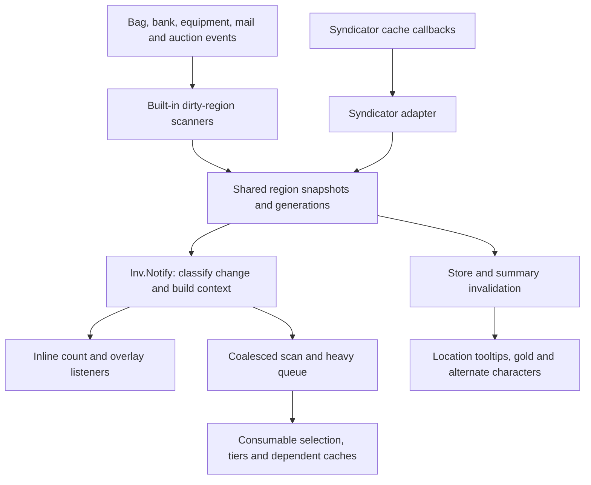

# Inventory: sources, snapshots, ledgers, and item knowledge

This is the current implementation reference for `Flux.Inventory`, its adapters, and the item/profession services built beside it. The inventory foundation supplies facts to buttons, restock, salvage, Respec, tooltips, and status bars. There is also a Flux combined-bag window on Era/Anniversary; saying Flux only supplies inventory data would miss that active feature.

## Ownership and initialization

[`Inventory/Init.lua`](../Inventory/Init.lua), `Inv.Start`, registers the inventory module, installs scheduler and bank-state hooks, begins the login reliability hold, and chooses a source. When Syndicator is loaded with its callback registry, the adapter waits for readiness; otherwise the built-in scanners start. [`Syndicator/Adapter.lua`](../Inventory/Syndicator/Adapter.lua), `Adapter.Start`, falls back to the built-in source after three seconds if readiness never arrives. `Bind` declines to take over once the built-in source owns the inventory. The selection is not a continuous race between two scanners.

`Inv.source` is `nil`, `builtin`, or `syndicator`; `ready`, `started`, and source readiness are separate state. [`LegacyBridge.lua`](../Inventory/LegacyBridge.lua) exposes old `FluxInv`/`FluxInventory` names over the new facade. [`Restock/FluxRestock_Inv.lua`](../Inventory/Restock/FluxRestock_Inv.lua) adds the economy-specific adapter and live mutation helpers; [`Respec/FluxRespec_Inv.lua`](../Respec/FluxRespec_Inv.lua) adds gear-oriented queries. The older `Inventory/FluxInv/` implementation is present on disk but is not the loaded scanner.

The diagram describes the two alternative source paths. It does not mean both scanners ordinarily run together.

## Snapshot and query contracts

`Inv.snapshots` contains `bags`, `bank`, `warband`, `equip`, `mail`, `void`, `auctions`, `guild`, and `currencies`. Each region keeps a `generation`; item regions expose aggregate `counts[itemID]`. Containers use `byBag`; equipped slots use `bySlot`; mail and auctions use `byIndex`. Currency state includes money and warband money. Slot records and the detailed account store retain more identity and location information than the aggregate count map.

[`Index.lua`](../Inventory/Index.lua), `Index.GetCount`, defaults to carried bags. Callers explicitly include `bank`, `warband`, `equipped`, `mail`, `void`, `auctions`, or `guild`; `includeBank` is a compatibility alias, and `bags = false` excludes carried bags. `GetCount` reads snapshots; `GetLiveCount` also uses current game counts, including charge-aware queries. During a reliability hold, a nonzero snapshot can cover temporary live-zero answers. Once inventory is reliable, a genuine live zero may mean the final potion or charge was consumed.

Important query families are `GetCount`/`GetLiveCount`, `Find`/`GetFirst`, `GetUniqueItems`, `ForEachLocation`, `GetSnapshotGeneration`, and `GetFirstFreeBagSlot`. A cached bank count establishes last-seen ownership, not permission or ability to withdraw that item. `IsBankOpen`, `IsBankLive`, and `CanTakeFromBank` distinguish interaction state, live visible access, and usable withdrawal context; Baganator's cached bank browser alone is insufficient.

[`Containers.lua`](../Inventory/Containers.lua) owns carried, character-bank, warband-bank, reagent, specialty, and keyring container enumeration. Callers use it instead of assuming bags are `0..4` or that all negative IDs are banks. Camelot/Forever enumerates bank tabs until no tab remains; enum bank-tab sentinels are not scannable bags. Legacy bags-in-bank, Retail named-tab banks, reagent banks, and the keyring have distinct paths. `GetPlayerRestockBagIDs` and equipment-candidate exclusions serve different needs.

## Change delivery and work scheduling

`Inv.Register(key, fn, opts)` replaces the listener with that key; `Unregister` removes it and its queued work. `RegisterListener` is an alias. `opts` accepts `tier` (`instant`, `light`, `scan`, `heavy`), `regions` as a list or set, `deferHeavy`, and `sync`. The default is scan-tier delivery. Callbacks receive one context table:

| Field | Meaning |
|---|---|
| `regions` | Set of affected regions; a pulse is filtered against listener interest. |
| `source`, `tier`, `time` | Active source, delivery tier, and current game time. |
| `changeKind` | `none`, `countOnly`, or `identityChanged`; identity means the aggregate item-ID set changed. |
| `addedItemIDs`, `removedItemIDs` | Item-ID sets for identities entering or leaving the aggregate snapshot. |
| `dirtyBags` | Containers refreshed for this pulse, when known. |
| `touchedItemIDs`, `changedItemIDs` | Bag item sets carried from the source for dependency-sensitive consumers. |
| `force` | Explicit refresh that can bypass deferred delivery. |

`ClassifyCountKeys` compares item-ID membership: changing stack totals or moving an existing identity is not automatically an identity change. Deferred contexts union regions and item sets, and identity changes take precedence over count-only changes. A forced delivery incorporates any pending context rather than dropping earlier bag/mail work. Consumers must treat missing metadata conservatively.

Count text and overlays can run inline through `sync` and the explicit synchronous-key list. Scan/heavy listeners normally coalesce by key. Current constants in `Init.lua` are 0.05 seconds quiet time, 0.12 while banking, and 0.18 during merchant/mail/bag storms, with a 0.6-second maximum wait. The queue drains at most two callbacks per frame with a 1.5 ms budget. Those numbers describe source limits, not measured CPU savings. Callback failures are contained through `Flux.Safecall`; registering a listener does not make it transactional with other listeners.

[`Builtin/Watch.lua`](../Inventory/Builtin/Watch.lua), `Builtin.Flush`, connects scheduler tokens to the affected scanners. Era/Anniversary accumulate dirty bags until `BAG_UPDATE_DELAYED`; other paths request refreshes as their events arrive. Containers, equipment, bank interactions, and login/zone events invalidate only their relevant snapshots. Heavy work receives a later pass even when the immediate notification is light.

The Syndicator adapter rebuilds affected bags/banks from `BagCacheUpdate` deltas, with full-region rebuilds when container shape changes. It also subscribes to equipment, warband, mail, void, auctions, guild, and currency cache updates. Character-scoped callbacks filter to the current character where supplied. The adapter publishes the same change context contract, so consumers do not need separate Syndicator behavior.

## Reliability and asynchronous regions

`MarkUnreliable`, `BeginLoginHold`, `NoteLoginBagsDelayed`, `NoteRefreshSettling`, and `IsReliable` protect loading screens and container swaps from appearing to delete the player's inventory. The settling logic uses snapshot generations, time limits, and collapsed-snapshot checks. `RequestItemData` queues callbacks and asks the game to load missing records; `IsScanPending` exposes unresolved item data so movers can avoid acting mid-scan. Readiness and completeness are therefore different questions.

| Region | Refresh and persistence behavior |
|---|---|
| Bags | [`Builtin/Bags.lua`](../Inventory/Builtin/Bags.lua) updates dirty containers and produces count/identity metadata. |
| Bank/warband | [`Builtin/Bank.lua`](../Inventory/Builtin/Bank.lua) scans accessible bank containers, retains closed-bank facts, and publishes last-change metadata. |
| Equipped | [`Builtin/Equip.lua`](../Inventory/Builtin/Equip.lua) snapshots inventory slots and refreshes on relevant equipment changes. |
| Mail | [`Builtin/Mail.lua`](../Inventory/Builtin/Mail.lua) debounces inbox updates, reads attachments in bounded steps, and notifies after publication. It deliberately avoids `GetInboxItemLink` in the scan hot path. Closing forces a final scan request. |
| Owned auctions | [`Builtin/Auctions.lua`](../Inventory/Builtin/Auctions.lua) queries owned listings while the AH is open, debounces updates with a maximum wait, and stops scanning when closed. |
| Guild/void | [`Builtin/Guild.lua`](../Inventory/Builtin/Guild.lua) and [`Builtin/Void.lua`](../Inventory/Builtin/Void.lua) inspect accessible vault state on supported clients; absence of a visit is not proof of emptiness. |
| Money/currency | [`Builtin/Currency.lua`](../Inventory/Builtin/Currency.lua) maintains money and available currency facts; unsupported client facilities remain gated. |

Outgoing mail is attributed to an already-known alt only after send success. Return-mail handling similarly captures attachment facts and credits the known recipient on success. Failed sends clear pending attribution. This is last-visit/send awareness, not access to an unlogged character's live inventory. Syndicator owns these facts when delegated.

## Account store, summaries, and tooltips

[`Store.lua`](../Inventory/Store.lua), `EnsureDB`, creates `FluxUIInventoryDB` with `Version = 1`, `Characters`, `Guilds`, `Warband`, `Pending`, and `Summaries`. Character entries include identity/display details, bags, bank, equipped, mail, void, auctions, currencies, and money. `Store.BindLive` binds live source tables into the current character record; pending flags invalidate derived summaries. [`Summaries.lua`](../Inventory/Summaries.lua) builds item-location summaries keyed for cross-character lookup; [`Ledger.lua`](../Inventory/Ledger.lua) derives gold and currency rows.

Character keys use shared player-name helpers where available, including regional-name handling. Historical `FluxUIGoldLedger` rows can seed character stubs through `ImportGoldLedgerStubs`. Gold display deduplicates folded name/realm identities and respects hidden/deleted rows. Shared-currency handling avoids blindly summing currencies such as Trader's Tender across characters.

When `Store.UsesSyndicator()` is true, accessors proxy Syndicator's account API instead of writing a second account ledger. `Store.GetDB()` returns nil in that mode. The current-character bank-count compatibility store remains `_FluxUI_CharSavedVars.Bank.charCounts/warCounts`; `LoadPersistedBankCounts` can seed empty snapshots. `PersistBankCounts` only overwrites those fallback maps when the live map is nonempty; an empty fallback map should not be read as a guaranteed fresh bank scan.

[`Tooltip.lua`](../Inventory/Tooltip.lua) appends location lines only when Syndicator is not supplying them. Settings come from scoped Status Bars options: item/currency lines, Shift-only, connected realms, faction, equipped, guild, blank line, and race icons. Default behavior shows item/currency lines, equipped and guild locations, a separator and race icons; Shift/realm/faction filters default off. Character detail is capped at twenty rows. Cached location lines describe the last known store, not real-time alt access.

## Classification, consumables, spells, and professions

| Service | Behavior and important contract |
|---|---|
| [`FluxItemClass.lua`](../Inventory/FluxItemClass.lua) | Session item facts, quality/sell price, links, tooltip/restore caches, asynchronous item loading, and invalidation callbacks. Cold tooltip parsing has a per-frame budget; an unavailable item remains pending instead of becoming a permanent negative. |
| [`FluxConsumableClassify.lua`](../Inventory/FluxConsumableClassify.lua) | Food/water, bandage, healing/mana potion, healthstone and mana-gem classification with client subclass differences, locale-aware restore parsing, Well Fed/conjured checks, and combat-utility potion exclusions. |
| [`FluxConsumableBest/Scan.lua`](../Inventory/FluxConsumableBest/Scan.lua) | Bounded unique-item/classification/load work, added-item fast paths and pending-only follow-ups. Login, portal and conjure holds retain useful faces while inventory settles. Pending caps prevent endless churn without permanently banning an unresolved item. |
| [`FluxConsumableBest/Score.lua`](../Inventory/FluxConsumableBest/Score.lua) | Eligibility, effective restore, kind-specific food/drink tiers, explicit healthstone ranks, stack size and deterministic price/ID tie-breaks. Food/drink ordering can prefer conjured types ahead of a numerically larger vendor restore. |
| [`FluxConsumableBest/Persist.lua`](../Inventory/FluxConsumableBest/Persist.lua) | `_FluxUI_CharSavedVars.ConsumableBest.refs` and `vendorSeen`; references ratchet to better eligible non-conjured discoveries. Conjured references and known unusable legacy references are scrubbed. A remembered best reference is not necessarily currently owned. |
| [`FluxConsumableBest/FluxConsumableBest.lua`](../Inventory/FluxConsumableBest/FluxConsumableBest.lua) | Consumer facade: `GetBest`, `GetBestOwned`, `GetBestRef`, ladders/stacks, listener registration, and recompute scheduling. Count updates and identity/selection work follow different refresh paths. |
| [`CreateSpells.lua`](../Inventory/CreateSpells.lua) | Known create/conjure spell map and preferred food/water/gem/healthstone/group spell queries. Full discovery follows spellbook-shape invalidation, not each button paint. |
| [`SpellReagents.lua`](../Inventory/SpellReagents.lua) | Paced reagent discovery, item-ID/name resolution and spell-to-reagent/reagent-to-spell queries. A warmed flag distinguishes incomplete discovery from a true empty reagent set. |
| [`MountFlyable.lua`](../Inventory/MountFlyable.lua) | Flying preference and mount-item usability from client APIs, continent/instance rules, riding requirements, tooltip traits and a location-settle window; it is shared knowledge for mount buttons. |
| [`Professions.lua`](../Inventory/Professions.lua) | Session plus `FluxInvDB.professions[characterKey].bySkillLine` recipe cache with live/cached/needs-open completeness. Open-profession scans are authoritative; a failed empty scan preserves previous recipes. |
| [`Craft.lua`](../Inventory/Craft.lua) | Craftable count, recipe output quantities, highest eligible affordable recipe, dependency-aware invalidation, and click-driven craft dispatch for bandages/healing/mana potions. |
| [`FluxEquipSlotCandidates.lua`](../Inventory/FluxEquipSlotCandidates.lua) | Usability/equipment-slot candidates, optional empty-slot actions and live equip/unequip helpers used by paperdoll and binding surfaces. |

Profession startup currently marks missing recipes as `needsOpen`; it does not auto-open protected profession windows from timers. Forever uses available filtered recipe/profession APIs instead of assuming `GetAllRecipeIDs` or the older profession-info API exists. `Craft.ExecuteCraft` may open, scan, and attempt one craft from the player's click. `TryFlushPendingCraft` only invalidates the craftability cache and returns false: profession events do not execute a queued protected craft. A short click lock prevents overlapping hosts or down/up clicks from crafting twice.

## Built-in Classic combined bags

[`Builtin/FluxClassicCombinedBag.lua`](../Inventory/Builtin/FluxClassicCombinedBag.lua) runs on Era/Anniversary when no alternative bag UI is detected. `FluxCombinedBags` collects ordinary carried-bag buttons into a ten-column neutral silver/dark window, leaving native slot clicks, cooldowns and tooltips on those buttons. It supplies search, bag-slot chrome, cleanup/sorting and native-open/close bridging. Specialty bags, ammo/quivers, reagent bags, keyring, and bank windows retain separate handling.

Sorting stacks first, then orders items in the applicable bag groups, using live cursor/lock observations and a bounded number of passes. Bag-event follow-ups continue the work; closing the combined window ends its active sort work. This module owns bag presentation and some mutations, while the index remains the shared facts layer. Baganator/Bagnon/Bagnonium and the shared alternative-bag detector gate ownership.

## Reading related contracts

[Vendor, junk and bank restock](20-vendor-restock-junk.md), [Salvage](22-salvage.md), [Respec](23-respec.md), and [Baganator](24-baganator-compat.md) consume this foundation. The [SavedVariables reference](32-saved-variables.md), [API/events index](33-api-and-events.md), and [source coverage](30-source-coverage.md) provide the complete inventories. Source inspection and local smoke tests do not establish real bank permission behavior, protected execution, secure taint, or scan performance in the game.
