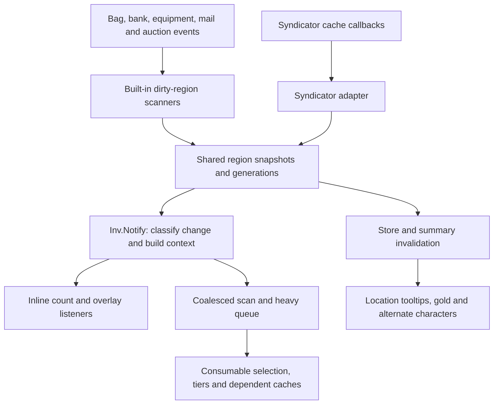

# Inventory: sources, snapshots, ledgers, and item knowledge

14 November casting/inventory lag: Dirty bank updates retain fresh maps and persistence, classify touched IDs, and retain publication debt through failure and nested updates. Mail keeps live capacity checks with early availability exit. [Comparisons and limits](LAG_HOTSPOT_OPTIMIZATION.md).

14 November AHR-104: minimum restore now determines healing/mana potion tiers
globally, including owned buttons, crafting, vendor memory/restocking and automatic
junk. A higher maximum cannot displace a higher minimum. Saved data normalizes
when verified; unresolved old values stay saved without promoting. Manual Junk
priority remains. [Rules and acceptance](AUCTION_RESTOCK.md#global-potion-minimum-restore).

14 November AHR-96–101: independent inline healing/mana/bandage upgrade choices,
shared manual exclusions and default-on automatic `discolored` healing-name filter.
Best/button/persist/vendor/AH/tier owners use the same policy, with combat binding
writes deferred. Three default-on global carried-upgrade Junk settings live under
Loot & Items → Vendor; manual Junk wins. [Behavior](AUCTION_RESTOCK.md#inline-upgrades-bandages-and-item-exclusions)
and [365-script/1053-syntax validation](validation/auction-inline-upgrades-2026-11-14.json).

13 November AUCTION-VENDOR-ROUTES-20261113: client-scoped vendor catalogue plus typed observations; strict cheaper-AH exceptions, exact physical-unit pricing and mixed recipe routes; configured visits learn without enabling automation. [Rules and native limits](AUCTION_RESTOCK.md#vendor-catalogue-observations-and-auction-discounts).

13 November AUCTION-FOLLOWUP-20261113: acknowledged AH restock jobs retain exact recipes for a conditional mail/vendor/craft HUD button. Closed-profession comparison uses saved learned facts. [Workflow and native limits](AUCTION_RESTOCK.md#follow-up-button-and-closed-profession-recipes).

13 November AUCTION-PURCHASE-CHARGES-20261113: matching purchase receipts, live commodity quantities, clearer selected cells and charged-item targets now share the existing restock/recipe/mail owners. [Behavior and native limits](AUCTION_RESTOCK.md#purchase-identity-selection-and-charged-items); [validation](validation/auction-purchase-charges-2026-11-13.json).

13 November saved character recipes (CHARACTER-RECIPES-20261113; CRP-01–06): existing
profession SavedVariables now retain complete learned material/output/yield/slot
facts for AH and future shared consumers. Filtered and partial scans preserve
known facts; explicit unlearn removes them; unknown learned state and NPC/legacy
linked knowledge are rejected. Output-based per-character queries deduplicate
modern aliases. Proven deterministic recipes work after closing/reloading the
profession; uncertain grades still require native operation proof. Finished-item
caps include crafting/vendor acquisition cost;0 stays unlimited. Selected missing
vendor inputs create temporary per-character targets in the ordinary vendor list.
They sum shared requirements, subtract bags/mail once, survive the vendor trip
and reload, and retire on completion/invalidation without changing permanent
targets. Live vendor price ceilings protect the plan; permanent base targets
still buy independently. Pure temporary rows are read-only; no new controls.
704 new recipe checks;20 models;17 harmful controls;320 scripts/1002 syntax PASS at captured run;17,229 combined auction/recipe checks. Five repeated
work models:4→2 schematic reads,4→2 duplicate-free catalogue rows,0→1 usable
closed-profession AH variants. These are work models, not native time/FPS.
Scoped guard:5 existing runtime files and1 new test;2,609-file external checkpoint
and47 settings metadata entries verified. Concurrent unrelated workspace edits
are retained and listed separately; captured full-run scope is explicit.
Open each relevant profession once after updating to populate the new facts.
Current native capture/reload/vendor/coexistence/controller/taint acceptance and
the prior Forever purchase BLOCKED resolution remain pending. No client input,
private settings/profiler write, manual sync, commit or publication.
[Behavior/API](CHARACTER_RECIPES.md);[evidence](validation/character-recipes-2026-11-13.json).

12 November potion discovery stall (AUCTION-POTION-STALL-20261112; AHR-38–40): the new
screenshot remains Finding stronger usable potions. The real parser reproduced
a spent shared-budget failure that the earlier classification stub missed. Each
deferred AH batch now renews that budget (still at most8 IDs). Potion results mark
whether restore is known; name-only placeholders retry until real tooltip data
arrives and cannot be ranked as restore1. Known unusable potions are skipped first.
Native ADDED browse payloads now contribute later rows and cumulative unique-key
progress, preserving the initial catalog instead of repeatedly reading its first
batch. Read-only /fluxah debug adds search phase/term/results/page/deadline.
Five repeated desktop work models: baseline refs100/101,734 load requests and
timeout; candidate refs201/300,30 requests and ready. Simulated elapsed times are
not native measurements. 552 potion/16525 auction checks;20 restock/15 receipt models;6 new harmful controls;314 scripts/995 syntax PASS.
Four existing runtime/test files changed;0 new; external2,608-file source/history
checkpoint and47 settings metadata entries verified. Existing UI, settings,
unquoted terms, price/usability/shared tiers and per-press buying are preserved.
User native reproduction route/direct implementation remain selected. Current
native retest and earlier Forever purchase BLOCKED resolution remain pending.
No client input/focus, private settings/profiler write, manual sync or publication.
[Current behavior](AUCTION_RESTOCK.md);[evidence](validation/auction-restock-potion-stall-2026-11-12.json).

12 November auction density/source/potion correction (AUCTION-DENSE-STOCK-20261112; AHR-28–37)
replaces the recipe/cost pane with a full-width paged grid and Direct/Craftable
labels (24cells at modeled800×600), retaining three money fields and one Buy next.
Old/unacknowledged pending attempts are pruned; real receipt/private/provider
incoming credits still reconcile once. Only typed unlimited merchant supply
excludes an item; limited/unknown/price-only/extended-cost records stay eligible.
Food/water are absent, including manual entries; vendor spell reagents use that
same unlimited-supply rule. All listed eligible items, including full/zero targets,
are price-scanned. Optional Auctionator public hints and guarded unit-price/history
write-back coalesce one notification; historical prices never authorize buys.
Plain unquoted partial healing potion / mana potion searches collect all native
result pages, validate usability/live offers/caps, choose stronger tiers and update
the real shared reference/tier. Weaker bag/bank stock cannot fill the stronger
target. Original caps survive a scrubbed ref; unknown metadata holds potion buys.
Craft preference, exact yields/shared inputs, price caps and one transaction per
press remain. 16413 focused checks;20 restock/15 receipt models;41 harmful controls;314 scripts/995 syntax PASS;226 pinned upstream blobs verified.
Source guard:15 existing changed runtime/test files and4 new since the verified
2,602-file external checkpoint;47 settings metadata entries, no private values.
Earlier Forever mouse BLOCKED failures and screenshot defects remain prior native
evidence; current live purchases/pixels/coexistence/controller/taint/FPS NOT RUN.
No client input/focus, manual sync, settings/profiler write, commit or publication.
[Behavior and remaining native checks](AUCTION_RESTOCK.md);
[current evidence](validation/auction-restock-dense-potions-2026-11-12.json).

## Immediate auction purchase mail — 12 November 2026

12 November auction follow-up (AUCTION-AUTO-CRAFT-TAB-20261112; AHR-10–27) supersedes the
initial popup/two-press/zero-disables/clear-pending design below. Real AH tab uses
shared restock cells/current icons and three currency fields; top edge/height
match neighboring tabs. Whole-list/material planning is automatic; cell selection
only edits. One press quotes/confirms one qualifying transaction; next needs a new
press. Zero/unset is unlimited. Saved Prefer crafting materials toggle is in AH
and Vendor→Restock; equal/cheaper learned recipes use exact missing inputs/yield,
vendor costs/shared stock and finite parent budgets. Incoming inbox plus transit
credit reconciles automatically (19/20 feathers +1 pending blocks rebuy); there is
no Clear pending UI/API. Built-in inventory now publishes confirmed AH purchases
to its mail snapshot/ledger immediately, including other auction controls; provider
Ready handoff stays inert. Prediction/private transit credit counts once and an
early empty inbox cannot discard the own reservation. Proven owned failures and
synchronously blocked calls release their own credits without phantom delivery.
13078 focused checks;20 restock/15 receipt models;34 harmful controls;312 scripts/991 syntax PASS;202 upstream Git blobs verified;
source guard permits10 existing changed files/5 new files in this follow-up;
shared cells/professions/Syndicator adapter remain byte-identical. Built-in Mail/
Auctions are intentionally extended. External2,595/2,598-
file source/history checkpoint and47 settings metadata entries verified.
Two prior Forever mouse-click BLOCKED failures remain native evidence; direct
calls/action-before-disable candidate has NOT passed native retest. No-search,
pixels, transactions/coexistence, persistence, controller, taint and FPS acceptance
pending. Auctionator345/TSM4.15.6/Syndicator290 inspected read-only at explicit request;
ARR notices preserved; no copied code. No client focus/input, settings/profiler
write, manual sync or publication. Reload after user-managed synchronization.
[Current behavior and native checks](AUCTION_RESTOCK.md).

11 November all-consumable audit: all seven real button modules execute together with both grid count methods across five client models and both providers. Loading/depletion/refill/charges/regen and bounded shared work PASS; no additional runtime changes. [2,580 integrated checks, source guard and pending native acceptance](COMBAT_GRID_LIVE_COUNTS.md#all-seven-real-button-modules-audited-together).

11 November native loading-hold fix: the capture proves food 1 with all sources 0 because an open loading latch pins it. A guarded loading-screen completion event now resumes the existing world refresh and bounded settle. All seven kinds and both providers share the fix; no new background driver or protected write. [Captured failure, tests and pending native retest](COMBAT_GRID_LIVE_COUNTS.md#native-capture-loading-completion-left-open).

11 November screenshot follow-up: loading/world-entry handoff and portal count-only recovery now share inventory ownership; valid carried-only modern zero is retained. Covers all seven kinds and other item faces with either provider. Optional `/fluxinv buttons` captures an intermittent bad state without polling. Desktop regressions pass; native symptom acceptance stays open. [Source reconciliation and evidence](COMBAT_GRID_LIVE_COUNTS.md#screenshot-follow-up-count-sources-and-loading-holds).

10 November passive pass 3: Index count options use scalars, live conversion reuses a helper and GetFirst stops after one fresh result; full Find and override seams remain. [Before/after and native limits](PASSIVE_PERFORMANCE_PASS3.md).

10 November use/depletion follow-up: all seven kinds show dark0 for the displayed exhausted item in combat; OOC selection advances or clears to the empty placeholder. Cooldown-only signals, stale text-cache hits and conjured recharge recovery use existing owners with both providers. Same-frame work coalesces with one100ms follow-up. [User symptom,4066 focused checks and native limits](COMBAT_GRID_LIVE_COUNTS.md).

10 November combat grid count correction: all seven consumable kinds use the existing native bag-event fallback with Syndicator, including gems/stones. Reliable live copies keep count/tint and charged ownership current; same-frame recounts coalesce. Built-in dispatch, loading holds and combat action ownership remain. [Requirements, 2,175 checks and native limits](COMBAT_GRID_LIVE_COUNTS.md).

<!-- STRESS-FIXES-20261107 -->
7 November applied stress fixes: Inventory callback tails use a cursor, retaining nested callback/token/reason requests without quadratic old-tail copying. After two cancelled auction scans, retry waits for the existing quiet interval; final snapshots remain atomic and publish after quiet. Guild-bank/void callbacks are unchanged. [Evidence](../Stress%20test%20doc/applied-fixes/README.md). Native taint/pixels/performance acceptance remains pending.
<!-- /STRESS-FIXES-20261107 -->

Current built-in [mail](BUILTIN_MAIL_PUBLICATION.md) and
[auction](BUILTIN_AUCTION_PUBLICATION.md) scans prepare completed generations
within their existing budgets and publish their internal maps atomically.
The [mail/auction flow record](MAIL_AUCTION_REWORK.md) separates this desktop
evidence from pending native purchase, sale, cancellation and mailbox checks.

This is the current implementation reference for `Flux.Inventory`, its adapters, and the item/profession services built beside it. The inventory foundation supplies facts to buttons, restock, salvage, Respec, tooltips, and status bars. Era/Anniversary also have Flux combined bag and character-bank windows when no alternative bag UI owns them. The bank hosts Blizzard item buttons, bank bag slots and purchase controls; see [combined bank evidence](CLASSIC_COMBINED_BANK.md). Saying Flux only supplies inventory data would miss these active features.

## Ownership and initialization

[`Inventory/Init.lua`](../Inventory/Init.lua), `Inv.Start`, registers the inventory module, installs scheduler and bank-state hooks, begins the login reliability hold, and chooses a source. [`Syndicator/Adapter.lua`](../Inventory/Syndicator/Adapter.lua), `Adapter.Start`, leaves built-in facts available while waiting for Syndicator readiness, starting the built-in source immediately if none exists. `Ready` calls the idempotent `Bind`, transfers ownership to Syndicator and rebuilds snapshots. An absent provider remains retryable through late addon loading. There is no three-second timeout or session-long refusal to hand off. Built-in currency callbacks check ownership at execution time after the handoff; their four shared event subscriptions remain installed but perform no currency work. See [regression evidence](PERFORMANCE_PROTOCOL.md).

13 November [Syndicator data continuity](SYNDICATOR_SYNC.md) adds a saved live-root
mirror while the companion owns inventory. Leaving that provider converts the
mirror into a detached built-in ledger once; returning reconciles proven newer
built-in fields/containers into unchanged external records before the existing
handoff. Independently changed external data and deletions remain authoritative.
This adds no synchronization polling, recurring timer or cache subscriptions;
bounded existing callbacks refresh changed records only at the transition,
including neutral mail notifications for account-search invalidation. Alt bag
notifications are avoided because Baganator treats their sender as live.
Guild-bank and void callbacks retain their existing owners. Native SavedVariables
reload persistence and performance acceptance remain pending.

`Inv.source` is `nil`, `builtin`, or `syndicator`; `ready`, `started`, and source readiness are separate state. [`LegacyBridge.lua`](../Inventory/LegacyBridge.lua) exposes old `FluxInv`/`FluxInventory` names over the new facade. [`Restock/FluxRestock_Inv.lua`](../Inventory/Restock/FluxRestock_Inv.lua) adds the economy-specific adapter and live mutation helpers; [`Respec/FluxRespec_Inv.lua`](../Respec/FluxRespec_Inv.lua) adds gear-oriented queries. The older `Inventory/FluxInv/` implementation is present on disk but is not the loaded scanner.

The diagram describes the two alternative source paths. It does not mean both scanners ordinarily run together.

## Snapshot and query contracts

`Inv.snapshots` contains `bags`, `bank`, `warband`, `equip`, `mail`, `void`, `auctions`, `guild`, and `currencies`. Each region keeps a `generation`; item regions expose aggregate `counts[itemID]`. Containers use `byBag`; equipped slots use `bySlot`; mail and auctions use `byIndex`. Currency state includes money and warband money. Slot records and the detailed account store retain more identity and location information than the aggregate count map.

[`Index.lua`](../Inventory/Index.lua), `Index.GetCount`, defaults to carried bags. Callers explicitly include `bank`, `warband`, `equipped`, `mail`, `void`, `auctions`, or `guild`; `includeBank` is a compatibility alias, and `bags = false` excludes carried bags. `GetCount` reads snapshots; `GetLiveCount` also uses current game counts, including charge-aware queries. During a reliability hold, a nonzero snapshot can cover temporary live-zero answers. Once inventory is reliable, a genuine live zero may mean the final potion or charge was consumed.

Important query families are `GetCount`/`GetLiveCount`, `Find`/`GetFirst`, `GetUniqueItems`, `ForEachLocation`, `GetSnapshotGeneration`, and `GetFirstFreeBagSlot`. A cached bank count establishes last-seen ownership, not permission or ability to withdraw that item. `IsBankOpen`, `IsBankLive`, and `CanTakeFromBank` distinguish interaction state, live visible access, and usable withdrawal context; Baganator's cached bank browser alone is insufficient.

[`Containers.lua`](../Inventory/Containers.lua) owns carried, character-bank, warband-bank, reagent, specialty, and keyring container enumeration. Callers use it instead of assuming bags are `0..4` or that all negative IDs are banks. Camelot/Forever enumerates bank tabs until no tab remains; enum bank-tab sentinels are not scannable bags. Legacy bags-in-bank, Retail named-tab banks, reagent banks, and the keyring have distinct paths. `GetPlayerRestockBagIDs` and equipment-candidate exclusions serve different needs.

## Change delivery and work scheduling

`Inv.Register(key, fn, opts)` replaces the listener with that key; `Unregister` removes it and its queued work. `RegisterListener` is an alias. `opts` accepts `tier` (`instant`, `light`, `scan`, `heavy`), `regions` as a list or set, `deferHeavy`, and `sync`. The default is scan-tier delivery. Callbacks receive one context table:

| Field | Meaning |
|---|---|
| `regions` | Set of affected regions; a pulse is filtered against listener interest. |
| `source`, `tier`, `time` | Active source, delivery tier, and current game time. |
| `changeKind` | `none`, `countOnly`, or `identityChanged`; identity means the aggregate item-ID set changed. |
| `addedItemIDs`, `removedItemIDs` | Item-ID sets for identities entering or leaving the aggregate snapshot. |
| `dirtyBags` | Containers refreshed for this pulse, when known. |
| `touchedItemIDs`, `changedItemIDs` | Bag item sets carried from the source for dependency-sensitive consumers. |
| `force` | Explicit refresh that can bypass deferred delivery. |

`ClassifyCountKeys` compares item-ID membership: changing stack totals or moving an existing identity is not automatically an identity change. Deferred contexts union regions and item sets, and identity changes take precedence over count-only changes. A forced delivery incorporates any pending context rather than dropping earlier bag/mail work. Consumers must treat missing metadata conservatively.

Count text and overlays can run inline through `sync` and the explicit synchronous-key list. Scan/heavy listeners normally coalesce by key. Current constants in `Init.lua` are 0.05 seconds quiet time, 0.12 while banking, and 0.18 during merchant/mail/bag storms, with a 0.6-second maximum wait. The queue drains at most two callbacks per frame with a 1.5 ms budget. Those numbers describe source limits, not measured CPU savings. Callback failures are contained through `Flux.Safecall`; registering a listener does not make it transactional with other listeners.

[`Builtin/Watch.lua`](../Inventory/Builtin/Watch.lua), `Builtin.Flush`, connects scheduler tokens to the affected scanners. Era/Anniversary accumulate dirty bags until `BAG_UPDATE_DELAYED`; other paths request refreshes as their events arrive. Containers, equipment, bank interactions, and login/zone events invalidate only their relevant snapshots. Heavy work receives a later pass even when the immediate notification is light.

The Syndicator adapter rebuilds affected bags/banks from `BagCacheUpdate` deltas, with full-region rebuilds when container shape changes. It also subscribes to equipment, warband, mail, void, auctions, guild, and currency cache updates. Character-scoped callbacks filter to the current character where supplied. The adapter publishes the same change context contract, so consumers do not need separate Syndicator behavior.

## Reliability and asynchronous regions

`MarkUnreliable`, `BeginLoginHold`, `NoteLoginBagsDelayed`, `NoteRefreshSettling`, and `IsReliable` protect loading screens and container swaps from appearing to delete the player's inventory. The settling logic uses snapshot generations, time limits, and collapsed-snapshot checks. `RequestItemData` queues callbacks and asks the game to load missing records; `IsScanPending` exposes unresolved item data so movers can avoid acting mid-scan. Readiness and completeness are therefore different questions.

| Region | Refresh and persistence behavior |
|---|---|
| Bags | [`Builtin/Bags.lua`](../Inventory/Builtin/Bags.lua) updates dirty containers and produces count/identity metadata. |
| Bank/warband | [`Builtin/Bank.lua`](../Inventory/Builtin/Bank.lua) scans accessible bank containers, retains closed-bank facts, and publishes last-change metadata. |
| Equipped | [`Builtin/Equip.lua`](../Inventory/Builtin/Equip.lua) snapshots inventory slots and refreshes on relevant equipment changes. |
| Mail | [`Builtin/Mail.lua`](../Inventory/Builtin/Mail.lua) debounces inbox updates, reads attachments in bounded steps, and notifies after publication. It deliberately avoids `GetInboxItemLink` in the scan hot path. Closing forces a final scan request. |
| Owned auctions | [`Builtin/Auctions.lua`](../Inventory/Builtin/Auctions.lua) queries owned listings while the AH is open, debounces updates with a maximum wait, and stops scanning when closed. |
| Guild/void | [`Builtin/Guild.lua`](../Inventory/Builtin/Guild.lua) and [`Builtin/Void.lua`](../Inventory/Builtin/Void.lua) inspect accessible vault state on supported clients; absence of a visit is not proof of emptiness. |
| Money/currency | [`Builtin/Currency.lua`](../Inventory/Builtin/Currency.lua) maintains money and available currency facts; unsupported client facilities remain gated. |

Outgoing mail is attributed to an already-known alt only after send success. Return-mail handling similarly captures attachment facts and credits the known recipient on success. Failed sends clear pending attribution. This is last-visit/send awareness, not access to an unlogged character's live inventory. Syndicator owns these facts when delegated.

## Account store, summaries, and tooltips

[`Store.lua`](../Inventory/Store.lua), `EnsureDB`, creates `FluxUIInventoryDB` with `Version = 1`, `Characters`, `Guilds`, `Warband`, `Pending`, and `Summaries`. Character entries include identity/display details, bags, bank, equipped, mail, void, auctions, currencies, and money. `Store.BindLive` binds live source tables into the current character record; pending flags invalidate derived summaries. [`Summaries.lua`](../Inventory/Summaries.lua) builds item-location summaries keyed for cross-character lookup; [`Ledger.lua`](../Inventory/Ledger.lua) derives gold and currency rows.

Character keys use shared player-name helpers where available, including regional-name handling. Historical `FluxUIGoldLedger` rows can seed character stubs through `ImportGoldLedgerStubs`. Gold display deduplicates folded name/realm identities and respects hidden/deleted rows. Shared-currency handling avoids blindly summing currencies such as Trader's Tender across characters.

When `Store.UsesSyndicator()` is true, accessors proxy Syndicator's account API and `Store.GetDB()` returns nil. The transition bridge retains the complete provider root through `FluxUIInventoryDB.SyndicatorSync.data`; it does not rebuild a second ledger on each provider update. `Store.GetSyncDB()` supplies the local root only to that bridge, and `EnsureDB` restores a detached ledger once after a delegated session. See [freshness rules and native limits](SYNDICATOR_SYNC.md). The current-character bank-count compatibility store remains `_FluxUI_CharSavedVars.Bank.charCounts/warCounts`; `LoadPersistedBankCounts` can seed empty snapshots. `PersistBankCounts` only overwrites those fallback maps when the live map is nonempty; an empty fallback map should not be read as a guaranteed fresh bank scan.

[`Tooltip.lua`](../Inventory/Tooltip.lua) appends location lines only when Syndicator is not supplying them. Configure **Inventory Awareness in Loot & Items → Loot**: item/currency lines, Shift-only, connected realms, faction, equipped, guild, blank line, and race icons. The controls retain their existing scoped Status Bars storage; no values or scopes migrate when their navigation moves. Default behavior shows item/currency lines, equipped and guild locations, a separator and race icons; Shift/realm/faction filters default off. Character detail is capped at twenty rows. Cached location lines describe the last known store, not real-time alt access.

## Classification, consumables, spells, and professions

| Service | Behavior and important contract |
|---|---|
| [`FluxItemClass.lua`](../Inventory/FluxItemClass.lua) | Session item facts, quality/sell price, links, tooltip/restore caches, asynchronous item loading, and invalidation callbacks. Cold tooltip parsing has a per-frame budget; an unavailable item remains pending instead of becoming a permanent negative. |
| [`FluxConsumableClassify.lua`](../Inventory/FluxConsumableClassify.lua) | Food/water, bandage, healing/mana potion, healthstone and mana-gem classification with client subclass differences, locale-aware restore parsing, Well Fed/conjured checks, and combat-utility potion exclusions. |
| [`FluxConsumableBest/Scan.lua`](../Inventory/FluxConsumableBest/Scan.lua) | Bounded unique-item/classification/load work, added-item fast paths and pending-only follow-ups. Login, portal and conjure holds retain useful faces while inventory settles. Pending caps prevent endless churn without permanently banning an unresolved item. |
| [`FluxConsumableBest/Score.lua`](../Inventory/FluxConsumableBest/Score.lua) | Eligibility, effective restore, kind-specific food/drink tiers, explicit healthstone ranks, stack size and deterministic price/ID tie-breaks. Food/drink ordering can prefer conjured types ahead of a numerically larger vendor restore. |
| [`FluxConsumableBest/Persist.lua`](../Inventory/FluxConsumableBest/Persist.lua) | `_FluxUI_CharSavedVars.ConsumableBest.refs` and `vendorSeen`; references ratchet to better eligible non-conjured discoveries. Conjured references and known unusable legacy references are scrubbed. A remembered best reference is not necessarily currently owned. |
| [`FluxConsumableBest/FluxConsumableBest.lua`](../Inventory/FluxConsumableBest/FluxConsumableBest.lua) | Consumer facade: `GetBest`, `GetBestOwned`, `GetBestRef`, ladders/stacks, listener registration, and recompute scheduling. Count updates and identity/selection work follow different refresh paths. |
| [`CreateSpells.lua`](../Inventory/CreateSpells.lua) | Known create/conjure spell map and preferred food/water/gem/healthstone/group spell queries. Full discovery follows spellbook-shape invalidation, not each button paint. |
| [`SpellReagents.lua`](../Inventory/SpellReagents.lua) | Paced reagent discovery, item-ID/name resolution and spell-to-reagent/reagent-to-spell queries. A warmed flag distinguishes incomplete discovery from a true empty reagent set. |
| [`MountFlyable.lua`](../Inventory/MountFlyable.lua) | Flying preference and mount-item usability from client APIs, continent/instance rules, riding requirements, tooltip traits and a location-settle window; it is shared knowledge for mount buttons. |
| [`Professions.lua`](../Inventory/Professions.lua) | Session plus `FluxInvDB.professions[characterKey].bySkillLine` recipe cache with live/cached/needs-open completeness. Open-profession scans are authoritative; a failed empty scan preserves previous recipes. |
| [`Craft.lua`](../Inventory/Craft.lua) | Craftable count, recipe output quantities, highest eligible affordable recipe, dependency-aware invalidation, and click-driven craft dispatch for bandages/healing/mana potions. |
| [`FluxEquipSlotCandidates.lua`](../Inventory/FluxEquipSlotCandidates.lua) | Usability/equipment-slot candidates, optional empty-slot actions and live equip/unequip helpers used by paperdoll and binding surfaces. |

Profession startup currently marks missing recipes as `needsOpen`; it does not auto-open protected profession windows from timers. Forever uses available filtered recipe/profession APIs instead of assuming `GetAllRecipeIDs` or the older profession-info API exists. `Craft.ExecuteCraft` may open, scan, and attempt one craft from the player's click. `TryFlushPendingCraft` only invalidates the craftability cache and returns false: profession events do not execute a queued protected craft. A short click lock prevents overlapping hosts or down/up clicks from crafting twice.

9 November craft-tier correction: any affordable learned bandage/healing/mana
potion recipe can keep Auto visible. Crafting prefers the highest ranked
affordable tier, with fallback and promotion as bag materials change. This
supersedes the old top-recipe-only rule. [Checks and native steps](CONSUMABLE_CRAFT_TIERS.md).

## Built-in Classic combined bags

[`Builtin/FluxClassicCombinedBag.lua`](../Inventory/Builtin/FluxClassicCombinedBag.lua) runs on Era/Anniversary when no alternative bag UI is detected. `FluxCombinedBags` collects ordinary carried-bag buttons into a ten-column neutral silver/dark window, leaving native slot clicks, cooldowns and tooltips on those buttons. It supplies search, bag-slot chrome, cleanup/sorting and native-open/close bridging. Specialty bags, ammo/quivers, reagent bags, keyring, and bank windows retain separate handling.

Sorting stacks first, then orders items in the applicable bag groups, using live cursor/lock observations and a bounded number of passes. Bag-event follow-ups continue the work; closing the combined window ends its active sort work. This module owns bag presentation and some mutations, while the index remains the shared facts layer. Baganator/Bagnon/Bagnonium and the shared alternative-bag detector gate ownership.

## Reading related contracts

[Vendor, junk and bank restock](20-vendor-restock-junk.md), [Salvage](22-salvage.md), [Respec](23-respec.md), and [Baganator](24-baganator-compat.md) consume this foundation. The [SavedVariables reference](32-saved-variables.md), [API/events index](33-api-and-events.md), and [source coverage](30-source-coverage.md) provide the complete inventories. Source inspection and local smoke tests do not establish real bank permission behavior, protected execution, secure taint, or scan performance in the game.

Syndicator bag updates now preserve every added/removed item across a batched
notification, so better consumables and last-use depletion reach selection.
[Regression and native checks](SYNDICATOR_CONSUMABLE_UPDATES.md).

## Built-in request and summary ownership — 5 November 2026

The existing lazy item-data frame now coalesces requests/callbacks, bounds active
retry work and retains late updates through slot ownership and passive unknown-
bag observers. A partial bag summary removes only derived all-zero owner rows.
The source records and saved roots remain; external-provider handoff clears the
built-in work. Read the [item-data lifecycle](BUILTIN_ITEM_DATA.md) and
[summary-cache correction](INVENTORY_SUMMARY_PRUNING.md) for exact failures,
tradeoffs and desktop/native evidence limits. Runtime item-data revision
`20261105.1` is available in the existing inventory diagnostic output.

8 November grid bag/craft correction: reliable live bags override stale positive
reagent snapshots. Existing craft coalescing also reevaluates Auto visibility;
Forever healing-potion First Aid routing is retained and regression checked.
Pending item classification survives metadata invalidation. Stored items do
not count as carried outputs/materials. [Scope and native checks](CONSUMABLE_BAG_VISIBILITY.md).
