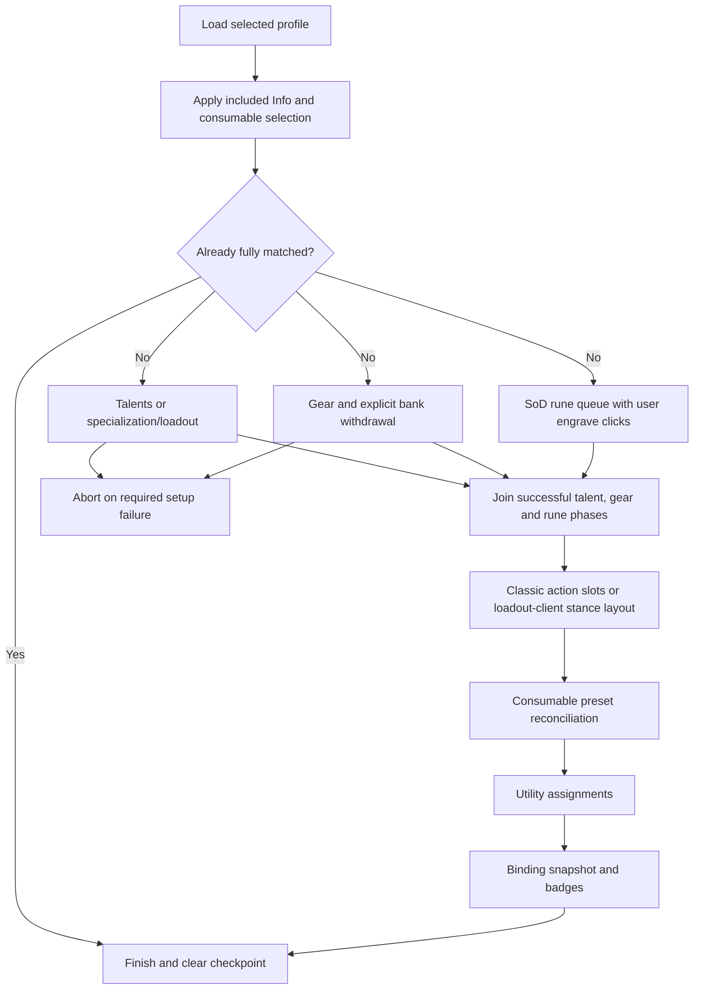

# Respec: profiles, presets, apply orchestration, and protection

`FluxRespec` saves and loads a character's gear, talents/loadout, runes where supported, bar/stance configuration, consumable preset link, utility slots, bindings, and Info preferences. It hosts its UI in the Flux Window's **Respec** tab. This is separate from Ace configuration profiles: changing an Ace profile is not the same action as loading a Respec gameplay profile.

## Runtime ownership and stored model

[`FluxRespec_Core.lua`](../Respec/FluxRespec_Core.lua), `EnsureStore`, initializes `_FluxUI_CharSavedVars.respec` with `profiles`, selected `activeName`, settings, and optional unit-frame armed/checkpoint state. `settings.protectGearSetItems` defaults true. `CreateProfile`, `CaptureInto`, `SetSection`, rename/duplicate/delete methods and the callback bus belong here. Client facilities are probed in [`FluxRespec_Compat.lua`](../Respec/FluxRespec_Compat.lua); the SoD check calls the engraving-enabled API rather than inferring runes from a version number.

A profile contains timestamps, client tag, icon, section snapshots, linked preset names, and `includes`. Relevant shapes are:

| Field | Stored meaning |
|---|---|
| `equipment[slotID]` | `{ itemID, itemLink, itemKey }` or `{ empty = true }`; identity can retain enchant/gem/rune distinctions. |
| `talents` on Classic path | Character class, talent group, nested point ranks and saved spec icon. |
| `talents` on loadout path | `kind = loadout`, class/spec identity, loadout name, starter/no-named-loadout/spec-only flags, export string and optional configuration hash. |
| `bars` | Classic action-slot entries plus stance order/hidden/custom slots; on talent-loadout clients the capture is stance layout only. |
| `runes` | Equipped engravings by eligible slot on SoD-capable clients. |
| `consumables` | Active noncombat consumables preset **name**, not a copied list of that preset's items. |
| `utilitySlots` | Utility assignment snapshot; `spellBookSlots` remains a supported older alias. |
| `spellBindings` | Binding-system snapshot, with V3 validation on restore. Nil means never captured and does not mean clear live bindings. |
| `infoFrame` | Info Frame pin/order/toggle snapshot through its serialization API. |
| `runePreset`, `equipmentPreset` | UI links to separately named presets, defaulting to the reserved `default` selection. |

Equipment presets live under `_FluxUI_CharSavedVars.equipmentPresets`; rune presets under `.runePresets`. Their `presets` maps and active selection are separate from `respec.profiles`, but remain **per character** despite older code comments calling them global. Equipment presets store gear. Rune presets can bundle runes, utility and talent-tagged bars with dual-spec-aware selection. The reserved `default` means a live/default selection, not an ordinary named preset to persist or delete.

Trainer reset price memory and `loadCheckpointProfile`/`loadCheckpointStep` also live in the Respec store. These fields let the UI describe a remaining step after interruption; they are not a serialization of the live callback state machine or an instruction to perform protected work automatically after reload.

## Include masks and saving

[`FluxRespec_Includes.lua`](../Respec/FluxRespec_Includes.lua) owns eight section flags: equipment, talents, bars, runes, consumables, utility slots, spell bindings, and Info Frame. Gear/rune slots have separate include maps. Section defaults are true; slot migration preserves older omitted shirt/tabard behavior where necessary. Checkbox changes persist immediately and emit update events. A draft mask is retained for creating a new profile from **No profile**.

`CaptureInto` captures checked sections and merges only checked gear/rune slots, preserving prior snapshot data for unchecked parts. Loading applies the same mask. For example, selecting only rings and trinkets updates/swaps those slots without touching armor. A saved empty entry means intentionally unequip; an absent entry can mean uncaptured/legacy omission. Two-handed main-hand handling can suppress an incompatible off-hand requirement.

Selecting a profile sets the selection and links preset names. It does not immediately apply saved Info pins or switch the consumable list. `Apply.Run` performs those included changes on the actual Load click. The unit-frame spec flyout maintains additional armed-profile state so selecting, showing a matching icon, and initiating a load remain distinct interactions.

## Apply pipeline

[`FluxRespec_Apply.lua`](../Respec/FluxRespec_Apply.lua), `Apply.Run(name)`, validates the profile, normalizes masks, sets active state, applies included Info preferences, links presets, and emits `APPLY_START(name)`. It immediately switches the included consumable preset before starting parallel setup; a later consumable step reconciles it again if needed. Matching sections are skipped.

Parallel setup tracks talent, gear and rune completion separately; bars wait until all required phases succeed and the active rune queue is empty. Callbacks carry an apply-state identity, preventing completion from an older load from advancing a newer one. Loading another profile while waiting for runes can cancel the old queue; an unrelated concurrent load otherwise reports that one is already in progress. Repeated clicks can advance the current rune queue rather than starting another pipeline.

Checkpoints are recorded for `parallel`, `bars`, and `bindings`. Successful completion and explicit cancellation clear them; binding-restore failures retain the binding recovery checkpoint. `Apply.Cancel` also cancels its pending binding restore so combat exit cannot apply it later. `IsRunning`, `IsWaitingForRuneEngrave`, `IsEngraveButtonMode`, `WillSwitchSpec`, `NextStepLabel` and matching queries continue to drive the main button and status affordances.

Talent/parallel failures stop advancement. A failed, rejected, throwing, invalid or legacy captured spell-binding restore now ends application with `APPLY_DONE(false, reason)` exactly once and does not call `FinishSuccess`. A never-captured binding section can still be skipped without wiping the live document. The binding adapter stages replacements, detaches queued snapshots from mutable callers, supports supersession/cancellation and reuses its combat watcher. See the [implementation report and regressions](43-startup-optimization.md).

Combat handling is stage-specific. Talents/gear can decline and ask for a new Load out of combat; a binding snapshot returning `IN_COMBAT` can remain pending until its callback completes. This is not a blanket guarantee that an entire interrupted profile automatically resumes after combat.

## Talents, loadouts, runes, and bars

| Backend | Current responsibilities and boundaries |
|---|---|
| [`FluxRespec_Talents.lua`](../Respec/FluxRespec_Talents.lua) | Capture/compare talent ranks, find a matching group, switch dual spec, compute learn deltas, and learn in a paced/event-aware loop. Class/trainer/reset/combat gates can stop the load. Trainer prompts remember the last observed reset cost and synchronize the queued reset interaction. |
| [`FluxRespec_TalentsRetail.lua`](../Respec/FluxRespec_TalentsRetail.lua) | Select specialization, named loadout, starter build or export/import route according to the saved snapshot and available APIs. Asynchronous readiness/events, cancellation generation and finite switch waits protect stale callbacks. A short post-apply match grace covers lagging client APIs. |
| [`FluxRespec_Runes.lua`](../Respec/FluxRespec_Runes.lua) | Capture engraving, diff slots, build/clear the rune queue and cast the next eligible engraving through player interaction. Gear prerequisites can block the queue head; enqueuing is not equivalent to completing every engraving. |
| [`FluxRespec_ActionBars.lua`](../Respec/FluxRespec_ActionBars.lua) | Collect/capture Classic action slots, compare and restore differing entries, and capture/apply stance order/hidden/custom slots. Macro identity can be resolved by name; mount/pet/equipment-set entries have their own pickup routes. Loadout clients leave ordinary action slots to Blizzard's loadout ownership. |
| [`FluxRespec_PresetBundle.lua`](../Respec/FluxRespec_PresetBundle.lua) / [`FluxRespec_RunePresets.lua`](../Respec/FluxRespec_RunePresets.lua) | Talent-tagged preset bars/utility bundles, matching-spec quick switches and explicit confirmation when the preset's saved talent tree matches neither spec. Loadout clients skip preset ordinary-bar restoration. |
| [`FluxRespec_AtieshDualSpecFix.lua`](../Respec/FluxRespec_AtieshDualSpecFix.lua) | Watches actual dual-spec transitions to temporarily unequip/re-equip Atiesh, with interruption/timeout handling. It does not run an Atiesh swap merely on login. |

The UI's **Engrave next** and secure slot clicks are hardware interaction surfaces; timers/events coordinate queue state but do not grant arbitrary protected casting. `Compat.SecureUIPanelsBlockRespecWork` also gates work around client secure panel ownership.

## Gear identity, availability, and equipment-set bridge

[`FluxRespec_Equipment.lua`](../Respec/FluxRespec_Equipment.lua) captures item keys, matches wanted identities, allocates duplicate requirements, chooses swaps and reports equipped/bags/bank/missing status. Matching uses slot compatibility and saved identity rather than item display names. Two equal-name rings need two allocated copies; enchant/gem/rune-specific wants can be stricter than an item-ID match. Empty-slot and two-handed/off-hand rules prevent treating every absence identically.

`ApplyWithCallback` coordinates the swap queue and live continuation after equipment/bag events. Open-bank retrieval is initiated from explicit Equip/Load actions; bank-open discovery alone does not silently withdraw the active profile's gear. [`FluxRespec_Inv.lua`](../Respec/FluxRespec_Inv.lua) distinguishes cached bank knowledge from `CanTakeFromBank`, so a last-visit record can report bank availability without enabling a real withdrawal. Slot-level status is computed for included requirements, while protection later considers all retained saved gear.

[`FluxRespec_EquipmentSets.lua`](../Respec/FluxRespec_EquipmentSets.lua) bridges available `C_EquipmentSet` facilities. The code caps managed names at sixteen characters and uses the API's set quota where available, with ten as its fallback. On clients without usable equipment sets, Flux's own snapshot/equip path remains.

| Situation | Implemented behavior |
|---|---|
| Existing same-name set | Resolve/adopt it, retaining ownership metadata so adoption is different from creation. |
| New name and free quota | Create/update the linked set with the saved include/ignored-slot policy. |
| Quota full | Keep the Flux snapshot and use Flux gear application rather than discarding the profile. |
| External Blizzard sets | Import into equipment preset choices and reconcile names/icons/items on relevant set events. |
| Rename/icon change | Push or reconcile the corresponding linked metadata while suppressing recursive sync work. |
| Delete | Delete a linked Blizzard set only when Flux owns its creation; an adopted set is unlinked. |
| Profile/preset share name | They can resolve the same Blizzard set; subsequent saves update that shared set. |
| Loading masked gear | `WouldViolateWanted` prevents `UseEquipmentSet` from changing an unchecked requirement, then Flux handles remaining slot work. |

`TryApply` has event/callback and timeout completion handling; a submitted equipment-set request is not immediately considered verified. The gear picker, icon picker and dropdowns expose the linked live set name/icon without replacing Blizzard's Equipment Manager UI.

## Saved-gear protection

[`FluxRespec_GearSetIndex.lua`](../Respec/FluxRespec_GearSetIndex.lua) indexes retained equipment snapshots from **all** profiles and named equipment presets. Its identity and allocation logic protects the required copies across bag/equipped locations. Unchecking a slot's current apply mask does not erase its saved snapshot or remove it from protection. Allocation freshness follows inventory/equipment/profile changes; callers can query a saved-set identity separately from whether a particular live slot is allocated.

[`FluxRespec_GearSetLock.lua`](../Respec/FluxRespec_GearSetLock.lua) supplies `IsSlotProtected`, `IsInventorySlotProtected`, merchant/disenchant context predicates, context snapshots, blocked-action feedback and click guards. Enabled state is `respec.settings.protectGearSetItems`. Protection is context-sensitive: moving/equipping ordinary saved gear and selling/disenchanting it are different actions. Native bag buttons, paperdoll equip/unequip guards, junk selling, salvage and Baganator integrate at their respective boundaries.

[`FluxRespec_GearSetTooltip.lua`](../Respec/FluxRespec_GearSetTooltip.lua) explains set membership; [`FluxRespec_GearSetOverlay.lua`](../Respec/FluxRespec_GearSetOverlay.lua) and [`FluxRespec_GearSetEquipGuard.lua`](../Respec/FluxRespec_GearSetEquipGuard.lua) supply visual/manual guards. The protection index is shared so every bag slot need not independently traverse every saved profile. This is protection for operations the addon intercepts/cooperates with, not a claim of server-side item locking.

## UI, events, and public entry points

[`FluxRespec_Register.lua`](../Respec/FluxRespec_Register.lua), `Register.AddTab`, idempotently registers the Flux Window tab, retrying after login/world entry until the host exists. [`FluxRespec_UI.lua`](../Respec/FluxRespec_UI.lua) owns profile/preset dropdowns, Save/Load/Delete/rename interactions, section masks, summaries, gear/rune controls and the load/engrave status. UI shared/rows/gear/runes files attach focused helpers; dedicated gear/rune/icon pickers supply the selection surfaces.

`FluxRespec.On(event, fn)` appends a callback; `Fire` calls registered listeners with `pcall`. There is no matching public unsubscription method in this bus. Important payloads include:

| Event | Payload |
|---|---|
| `READY` / `PROFILES_CHANGED` | No required arguments; consumers re-query store state. |
| `ACTIVE_CHANGED` | Selected name or nil. |
| `PROFILE_CREATED`, `PROFILE_SAVED` | Name and profile table. |
| `PROFILE_UPDATED` | Name and section/field label. |
| `PROFILE_RENAMED` / `PROFILE_DELETED` | Old/new name, or deleted name. |
| `APPLY_START` / `APPLY_DONE` | Name; or completion boolean and reason. See the binding-failure limitation above. |
| `TALENTS_APPLIED`, `RUNES_APPLIED`, `CONSUMABLES_APPLIED` | Backend success and reason where supplied. |
| `EQUIPMENT_APPLIED` | Gear success boolean. |
| `RUNE_QUEUE_CHANGED`, `GEAR_SET_INDEX_CHANGED`, `GEAR_SET_LOCK_CHANGED` | Invalidation/refresh notifications; query current module state. |

Other preset/equipment-set events refresh their dropdowns, category bridges and related indicators. Profile changes also refresh the player spec-click affordance. The complete registrations are in [API/events](33-api-and-events.md).

`/fluxrespec` and `/respec` support `list`, `save <name>`, `load <name>`, and `delete <name>`; empty/other input prints usage in the current handler. The Flux Window tab is the normal interactive surface. [Commands](31-commands-and-bindings.md), [saved variables](32-saved-variables.md), [Bindings](13-binding-system.md), [Info/status](16-status-bars.md) and [Baganator](24-baganator-compat.md) document the surrounding contracts.

Local source/mocks establish ordering, masks and callback behavior; they cannot prove successful protected talent learning, secure engraving, gear movement, server permissions or taint safety on every client. A completed pipeline has no automatic rollback of earlier gear/talent changes if a later stage fails.
