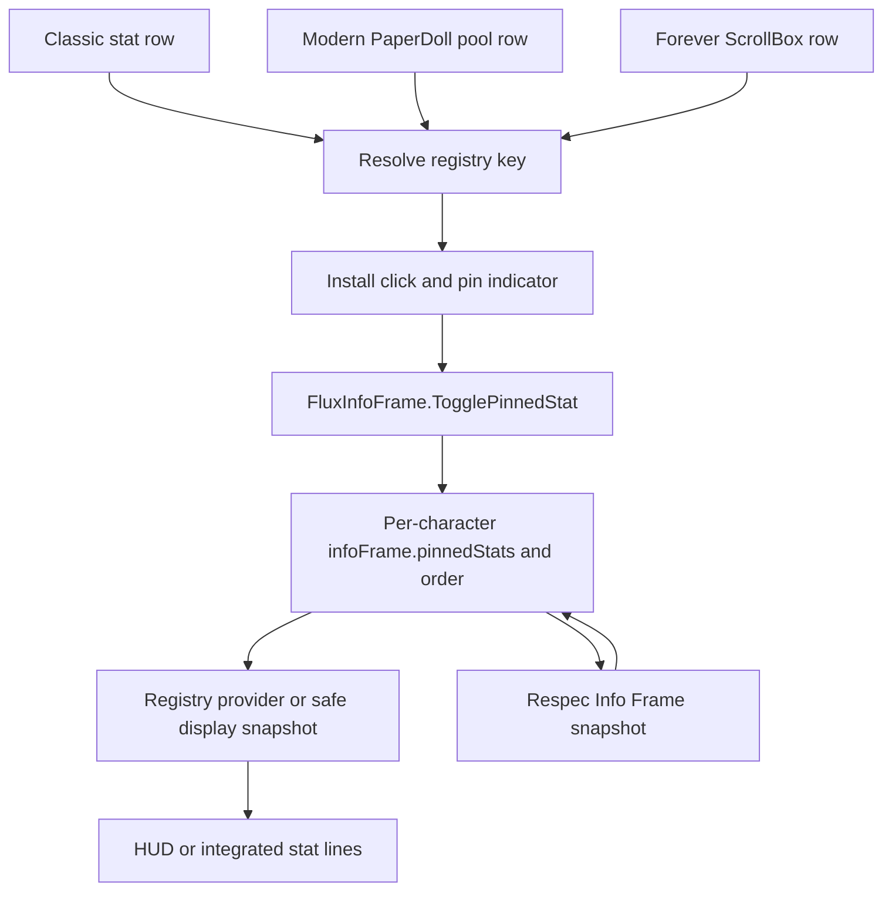

# Character Info and character stat providers

Flux adds statistics and paperdoll helpers to Blizzard CharacterFrame. Character/reputation/skills/currency tabs remain Blizzard-owned. This is distinct from the player unit frame and the Info Frame HUD. [Shared.lua](../CharacterInfo/Shared.lua) defines `ns.CharacterStats`; [Init.lua](../CharacterInfo/Init.lua) exposes `Flux.CharacterInfo.TryInstall()` and installs eligible overlays.

## Client paths and installation

Client flags come from `Flux.Client`, not a bare `1.x` version check: Forever also has a 1.x build identity. Era uses [StatsEra.lua](../CharacterInfo/StatsEra.lua); Anniversary/TBC/Wrath use [StatsProgression.lua](../CharacterInfo/StatsProgression.lua). Those paths create Classic custom-stat dropdown panels and classic paperdoll chrome. Cata/Mists and mainline use [RetailPane.lua](../CharacterInfo/RetailPane.lua) hooks rather than that panel. File presence/load does not mean both implementations are active.

Installation waits for actual character UI and retries on supported `ADDON_LOADED`, login and entering-world events. Each installer is idempotent/safecalled. Capabilities refresh before installation because the relevant widgets can be load-on-demand. TacoTip loading can trigger another pass. Frame constructors that have not run yet are a normal startup condition.

Account presentation settings live under `FluxUI_DB.CharacterStats[mode].global`; per-character category/settings state lives under `_FluxUI_CharSavedVars.CharacterStats[mode]`, where `mode` is `era|progression|retail`. These storage scopes are separate from Info Frame pins and Layout placement.

## Classic statistics and calculations

The Classic panel replaces the attributes area with two independently selectable stat categories. Era/progression implementations include primary attributes, melee/ranged/spell statistics, defenses/resistances and version-specific combat ratings, with breakdown tooltips and persisted category choices. Progression additionally lays out supported side-stat groups. Missing older/native APIs have compatible fallbacks; the display is not an authoritative simulator for every talent/item interaction.

[StatsCustomExtensions.lua](../CharacterInfo/StatsCustomExtensions.lua) adds class-relevant spell schools, school-specific hit/damage/healing and rune/talent supplements. [StatsCritCalculator.lua](../CharacterInfo/StatsCritCalculator.lua) starts from Blizzard crit APIs, then applies explicit talent/aura registry supplements for known API gaps. Registry entries distinguish already-included bonuses, multiplicative effects and hidden/stacking auras; supported combat-log tracking supplies otherwise hidden state. Crit display caps at 100. This is targeted supplementation, not a general tooltip-derived combat engine.

Stat/equipment/aura/rating/form events request `QueuePlayerStatRefresh()`. One coalesced next-frame flush updates visible custom panels and Info Frame providers together. It avoids redundant refresh while conflicting LFG listing UI is visible. Ten localization files provide the custom labels; English fallback and individual embedded strings mean this is not a claim of complete addon localization.

## Modern/Forever pane hooks

Live modern panes use `CharacterStatsPane.statsFramePool`; Forever visible rows are enumerated from `CharacterStatsPaneScrollBox.ScrollBox:GetView():GetFrames()` after the window opens. The scratch pool is not its visible surface. The current Forever installer deliberately avoids native UpdateStats/SetSpellPower/PaperDoll OnShow and row-initializer hooks, using `InfoFrame.AfterCharacterShown(BindForeverStatRows)` instead. `BindForeverStatRows` returns during combat; an independent watcher catches the next safe post-open refresh. RetailPane shortens supported labels, formats ilvl to one decimal and maps native identifiers to Info Frame registry keys.

Mappings include health/power, ilvl, movement, primary attributes, crit/haste/mastery/versatility/leech/avoidance, attack/ranged power and damage/speed, hit/expertise, spell power/healing/regen/penetration, armor/defense/dodge/parry/block. A mapping does not promise the corresponding stat exists on every client. Forever folds combat aliases into shared **Crit**, **Haste** and **Hit** pins, including labels, indicators and tooltip source rows; [Info Frame](16-status-bars.md) describes exact value/migration rules.

Forever category headers support collapse/expand with `_FluxUI_CharSavedVars.paperDollCollapsed`. Headers can be handled in both player and pet panes, but actual **pet stat rows are skipped** before spell-tooltip decoration, value formatting or player pin binding. Item level has an owned footer row instead of inserting a stat into native category/provider definitions. This avoids altering the native character-show calculation path.

## Paperdoll helpers and gear facts

| Source | Behavior |
|---|---|
| [ItemLevel.lua](../CharacterInfo/ItemLevel.lua) | Equipped average ilvl, Classic wrist rows and cross-linked ilvl/GS tooltips; async item-data/equipment refresh; exported `FluxCSC_GetPlayerItemLevel`. |
| [GearScore.lua](../CharacterInfo/GearScore.lua) | Optional TacoTip-compatible score path/internal calculation and quality color; exported `FluxCSC_GetPlayerGearScore` / `FluxCSC_GetGearScoreQualityRGB`. |
| [PaperDollQuality.lua](../CharacterInfo/PaperDollQuality.lua) | Classic paperdoll item-quality chrome updated on equipment changes. |
| [PaperDollVisibility.lua](../CharacterInfo/PaperDollVisibility.lua) | Helmet/cloak checkboxes beside model controls when supported, synchronized with game Display settings. |
| [PaperDollSecondaryName.lua](../CharacterInfo/PaperDollSecondaryName.lua) | Supported regional-unique-name/Forever secondary-name toggle via `Flux.PlayerName` and `UnitSurnameOwn`; refreshes self display names. |
| [PaperDollEquipFlyout.lua](../CharacterInfo/PaperDollEquipFlyout.lua) | Alternate gear from shared inventory candidates on paperdoll hover, with Blizzard's own set-editor flyout preserved while equipment manager is open. |
| [TacoTip.lua](../CharacterInfo/TacoTip.lua) | Hides duplicate TacoTip paperdoll ilvl/GS widgets on Classic chrome paths, including after TacoTip refresh/OnShow. |

Equip-slot candidates and the actual gear flyout renderer live in Inventory/Other, not this chapter's stat panel. Protection/equip semantics belong to [Respec](23-respec.md) and [inventory](21-inventory-foundation.md). GearScore is a display calculation, not a requirement to use profiles or equip items.

## Character row to Info Frame pin

Info Frame installs different row hooks for each path, records stable keys and updates pin indicators after rebuilds. `RememberPinnedStatValue` and Forever display-text helpers retain compatible associations; restricted combat values still require supported display/provider paths. A pin is not a request to parse secret text into a usable combat decision.

On Forever, opening in combat postpones player-row installation/indicators until combat ends. A window left open through combat also refreshes once afterward; closing it cancels pending open-refresh work. Pin intent may be saved during combat while the Info Frame line rebuild is deferred. Shared combat stats use live values through the native text renderer, independently of the plain text used for layout. Visible native player rows supply combined totals; without a current native hit total, the live rating and modifier contributions appear on the shared Hit line. Hidden rows and old snapshots do not replace current stats.

The HUD refreshes these native-renderer arguments even when its plain layout sample and frame size stay unchanged, including merged stat lines. This refresh does not require reopening the character window or rebuilding the line geometry; see `_RefreshCamelotLiveText` and `_RenderCamelotLiveText` in [FluxInfoFrame.lua](../StatusBars/FluxInfoFrame.lua).

`SerializeRespecProfileSnapshot`/`ApplyRespecProfileSnapshot` capture/restore line toggles, pins, spell-display mode and order. The character panel row selection and its underlying native stat are separate from the pin. See [status/Info Frame](16-status-bars.md) for rendering, providers and layout.

## Verification

Check initial/late character UI, Era and progression dropdowns, native modern panes, recycled Forever ScrollBox rows, all supported categories, school/rune bonuses, gear changes with uncached items, ilvl/GS disabled/enabled, helm/cloak synchronization, secondary names and gear-flyout coexistence with the set editor. Verify pin/unpin, shared aliases/order, indicators, tooltip association, combat-open/close recovery, pet-row exclusion and Respec restore. The updated [Forever stat smoke](../CharacterInfo/_tmp_foreverstatssmoke.lua) passed on Lua 5.4.6 on 2026-10-22 after the latest concurrent Info Frame change; it uses real providers/pin handlers and the real stat-update loop with mocked APIs, secret tokens and formatted-text rendering. It covers changing combat text with stable layout samples and visible/hidden native totals. Native protected execution, category hit testing and taint still require live observation. [Verification](41-verification.md) identifies the tested source contents.
