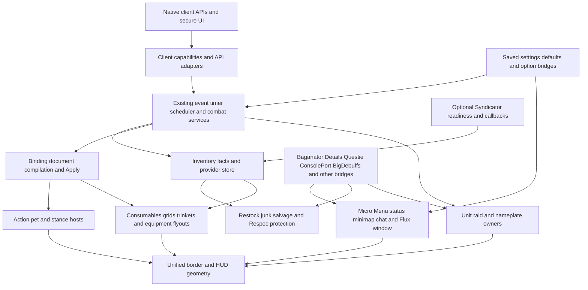

# Module ownership and dependency audit

Updated 2026-10-29. The original preserved baseline is `7436820`. BUG-001 guards builtin currency callbacks, BUG-002 cancels stale mail/auction scans, and BUG-003 discards pending builtin mail attribution after provider handoff. BUG-003 runtime commit is `ab4e658a98a7ce3ee6688ac6170e7e0991325af0`. [MODULE_OWNERSHIP.csv](MODULE_OWNERSHIP.csv) maps every loaded source domain and the shared services within Core/Inventory. [API_MIGRATION.csv](API_MIGRATION.csv) records overlapping contracts and explicit retirement conditions. Neither ledger declares the unfinished modernization complete. Window lifecycle runtime is `19c40a0c84212b24fdf221a9653a4116d32f9020`: BUG-004/PERF-003 fixes the disabled Windows lifecycle. The user deferred auction/guild-bank/void callback audits; those findings remain unmeasured. All native acceptance remains pending.

Latest behavior-changing runtime: `cdd752abd060588bc1602e880d997a60dd0b34a9`, tree
`d18478f458e670f18931c070a00d53a708387fee`. BUG-005 revalidates each queued merchant
slot through the existing resolver before purchase/accounting. Refreshing an index
alone does not repair retained task references. Stale tasks are removed; a normal
fresh request resolves current listings and remaining counts. The suite passes
86 scripts/727 syntax files, including 660 focused checks. This adds one identity
lookup per valid purchase. [Evidence](VENDOR_PURCHASE_IDENTITY.md); native acceptance
remains pending. The API ledger now has 19 domain contracts.

The load graph below was reconstructed from the current `_FluxUI.toc` and XML includes using `docs/tools/source_inventory.py:load_graph`, not copied from the older generated reference. File reachability establishes potential execution, not native support, option activation, or resource counts. TOC gates and runtime checks still apply. `Bindings.xml` is separate metadata-loaded binding data. Static assets and unloaded source are indexed by the existing asset/source inventories and remain preserved.

## Dependency direction and ownership

Arrows identify dependencies and supplied data, not initialization order. In particular, options bootstrap must complete before secure initialization, while deferred inventory/provider caches can settle after protected hosts exist. Legacy `Core/FluxAPI` still executes after Bars in the manifest and exports globals used by later HUD consumers. `Flux.API` and `ns.API` are distinct tables. Preserve the return shapes and meaning of each facade while moving callers to an existing canonical implementation.

The layout is shared through several explicit owners: Bars owns slot geometry, each HUD feature owns its children, UnifiedBorder coordinates outer chrome, and WindowMover owns supported native windows. A future extraction must identify which owner is authoritative for each anchor before moving code. No new generic layout or lifecycle framework was introduced.

## Lifecycle findings and exceptions

`Core/Module.lua` is an initialization registry. `Disable` clears an enabled flag and calls `OnDisable` if supplied; current production registrations do not supply that callback. It does not unregister events, cancel work, restore native frame state, or disable a player's option. Therefore a successful `Module.Disable` return cannot be used as evidence of resource teardown. Do not expose generic module toggles without defining actual feature policy.

Current resource contracts include central event registration/removal, returned dedicated unit-event frames, keyed Ticker subscriptions, callback-specific inventory unregister, named combat deferral, and feature-owned visibility/animation gates. Scheduler listeners have no unregister method and combat jobs have no owner cancellation API. Most native hooks are permanent for the loaded session. Their bodies need an active/provider/visibility check; hiding a parent alone does not prove no update work remains.

Important retained exceptions and follow-up work:

- Core event dispatch, scheduling, combat state and shared inventory facts remain available while any consumer needs them. Shared work cannot be assigned wholly to one feature's CPU total.
- Native secure hosts and frames are reused; WoW frame allocation is not reclaimed by dropping the Lua reference. Disabling a feature should stop unnecessary subscriptions/timers/animation without repeatedly allocating hosts on re-enable.
- `Blizzard/Hide.lua` can retain native events with `keepEvents`, and `keepParent` is a separate native ownership decision. Unhide alone cannot restore discarded event subscriptions. A blanket suppression rewrite would affect secure/native behavior.
- Existing unit spell-cost watcher and resource-spark reuse fixes are already in the baseline. The older report's operation reductions are historical evidence, not measurements from this batch.
- Builtin inventory listeners remain registered after Syndicator readiness. Bag/equipment handlers already return when their source is inactive. Currency did not: BUG-001/PERF-001 reproduced competing snapshot writes and redundant inventory requests after handoff.
- BUG-001 added provider guards to all four builtin currency callbacks. The four callbacks remain registered with the shared event service for the session. After handoff they perform only the existing ownership query and return; they no longer read money, dirty token state, write snapshots, or enqueue refreshes. This is an explicit retained-subscription exception, not full provider teardown.
- BUG-002 cancels queued or partially completed mail/owned-auction scans at the start of their next StepScan callback when ownership has transferred. It clears partial/queued work and removes OnUpdate while retaining reusable frames and mailbox/auction open state. The latter remains relevant to inventory heavy-work deferral. See [provider lifecycle evidence](PROVIDER_HANDOFF_LIFECYCLE.md).
- BUG-003 prevents retained builtin mail send/return completion from obtaining and mutating a provider-owned recipient table through `Store.GetCharacter` after Ready. The completion callback checks ownership before lookup or credit, clears pending attribution and removes its temporary completion subscriptions. The frame remains reusable; standalone send/return accounting is preserved. No native symptom or acceptance is claimed.
- Auction SHOW callbacks, guild-bank queries and Void callbacks remain source-audit follow-ups. Their native cost and effects have not been measured; do not treat them as fixed defects or measured hotspots.
- [The event-dispatch audit](EVENT_DISPATCH_AUDIT.md) reproduces skipped handlers and inconsistent additions under mutation, but identifies no current production call to `Context.Unsubscribe`, the route to the sole active central-bus unregister owner. This is a latent API defect; defer dispatcher changes until a real teardown caller or demonstrated trigger justifies them.
- The inventory scheduler carryover bucket and no-native-timer fallback still warrant targeted edge tests. No current player-facing reproduction was established for those candidates; they are not counted as reproduced gameplay bugs.
- WindowMover BUG-004/PERF-003 gates Scan before discovery/native attachment, stops the panel watcher through Refresh and stops gestures on public disable. `Start` retains two addon/world subscriptions, bounded startup callbacks and reusable proxy/driver; permanent hooks remain guarded. All 220 focused checks/100 cycles pass; full suite 85 scripts/726 syntax. [Evidence](WINDOW_MOVER_LIFECYCLE.md); native geometry/input remains pending.
- Optional integrations own their readiness and permanent hooks. `Flux.Optional` is a read-time probe; it is not a universal installer or guarantee that a loaded provider is ready.

## Completed bounded fix evidence

`tests/currency_provider_handoff.lua` executes production Currency, Store, readiness handoff and currency snapshot builders. Other region scans and native APIs are mocked. It covers standalone startup and immediate money updates, duplicate starts, absent/pending/initially-ready providers, all four events, token/bank capability gates, saved ledger preservation, duplicate Ready, and subsequent external currency callbacks.

The baseline produced 50 failed regression checks out of 150 checks. For each block of 400 post-handoff events it performed 100 builtin money reads, 100 snapshot generation changes, and 300 inventory requests on the no-warband models or 400 on Retail/Forever models. Provider money `999` was overwritten with builtin money `654`. The candidate passes all 150 checks and reduces those unwanted operations to zero while preserving provider money. These are deterministic desktop operation counts. The parent audit's alternating-run artifacts and performance ledger record repetitions and fingerprints; native CPU, latency, rendering, taint and FPS remain pending.

BUG-002's production Store/Mail/Auctions/Adapter replay passes 210 checks after 42 baseline failures. Five alternating process pairs exercise queued/partial scans with empty/populated providers and modern/legacy auction APIs. Post-handoff mail reads fall from 105/56 to zero, and auction reads from 71/38 to zero; stale snapshot increments and notifications fall from one to zero. Per-case count variation is zero across the five pairs. Runtime commit `05e9f79` passes the complete 83-script suite and 724-file Lua syntax check. These are mocked operation counts, not native CPU, allocation, frame-time, visual or secure acceptance. [The detailed lifecycle report](PROVIDER_HANDOFF_LIFECYCLE.md) records identities, raw samples and native steps.

BUG-003's `tests/pending_mail_provider_handoff.lua` passes 410 checks after eight baseline failures. Five matched baseline/candidate process pairs reduce provider lookup and foreign mail-row append counts from one to zero in each of four successful completion cases. For each send/return action, 100 standalone cycles retain one reusable frame, finish with zero subscribed completion events, and retain 50 successful credits. Runtime commit `ab4e658a98a7ce3ee6688ac6170e7e0991325af0`, tree `67b4890083fe13e242ffbc47c36ff6037a172f82`, passes the complete 84-script suite and 725-file syntax check with zero failures. These are desktop ownership/resource controls, not measured native performance gains. Auction/guild/Void event queries are deferred by the user; they remain unmeasured.

## Baseline documentation discrepancies reconciled in this batch

- The baseline generated source coverage reported a 574-file closure. Regenerated references now record 577 reachable files and no missing includes, using the existing tooling.
- Baseline `docs/29-integrations.md` described companion addons in `OptionalDeps` and a Syndicator readiness timeout. Corrected prose records only Blizzard_UnitFrame and Blizzard_CompactRaidFrames in OptionalDeps, built-in facts while waiting and the Ready handoff. No behavioral rollback was made to match the old prose.
- Baseline `docs/07-runtime-architecture.md` warned about an old off-TOC comment. Corrected prose reflects the current TOC and loaded Bars/Binding/grids.
- Historical native performance reports identify previous commits/builds. Their accepted and rejected samples remain valuable history but cannot certify the current tree's client matrix or this new handoff change.

## Current load coverage

The generated tables below enumerate the fresh graph's top-level ownership and actual module registration sites. Dynamic `UnitFrame.<unit>` registration represents player, target, focus, focustarget, targettarget, pet and pettarget; capability guards can suppress unsupported units. Other legacy domains initialize through their own events/hooks rather than the registry.

| Source domain | Reachable files | Ownership |
|---|---:|---|
| `AddonOptions` | 37 | See matching domain/service rows in MODULE_OWNERSHIP.csv |
| `BaganatorCompat` | 12 | See matching domain/service rows in MODULE_OWNERSHIP.csv |
| `Bars` | 31 | See matching domain/service rows in MODULE_OWNERSHIP.csv |
| `Battlezonemap` | 12 | See matching domain/service rows in MODULE_OWNERSHIP.csv |
| `Binding` | 38 | See matching domain/service rows in MODULE_OWNERSHIP.csv |
| `Blizzard` | 1 | See matching domain/service rows in MODULE_OWNERSHIP.csv |
| `BlizzardSettings` | 3 | See matching domain/service rows in MODULE_OWNERSHIP.csv |
| `CharacterInfo` | 24 | See matching domain/service rows in MODULE_OWNERSHIP.csv |
| `ConsoleportCompat` | 4 | See matching domain/service rows in MODULE_OWNERSHIP.csv |
| `Core` | 62 | See matching domain/service rows in MODULE_OWNERSHIP.csv |
| `ExtraButtonSystem` | 53 | See matching domain/service rows in MODULE_OWNERSHIP.csv |
| `FluxBorder.lua` | 1 | See matching domain/service rows in MODULE_OWNERSHIP.csv |
| `FluxDefaultSettings.lua` | 1 | See matching domain/service rows in MODULE_OWNERSHIP.csv |
| `Inventory` | 83 | See matching domain/service rows in MODULE_OWNERSHIP.csv |
| `Layout` | 1 | See matching domain/service rows in MODULE_OWNERSHIP.csv |
| `MicroMenu` | 13 | See matching domain/service rows in MODULE_OWNERSHIP.csv |
| `Minimap` | 5 | See matching domain/service rows in MODULE_OWNERSHIP.csv |
| `NamePlates` | 5 | See matching domain/service rows in MODULE_OWNERSHIP.csv |
| `Other` | 18 | See matching domain/service rows in MODULE_OWNERSHIP.csv |
| `RaidFrame` | 8 | See matching domain/service rows in MODULE_OWNERSHIP.csv |
| `Respec` | 30 | See matching domain/service rows in MODULE_OWNERSHIP.csv |
| `Salvage` | 16 | See matching domain/service rows in MODULE_OWNERSHIP.csv |
| `StatusBars` | 6 | See matching domain/service rows in MODULE_OWNERSHIP.csv |
| `UnitFrames` | 43 | See matching domain/service rows in MODULE_OWNERSHIP.csv |
| `WindowMover` | 4 | See matching domain/service rows in MODULE_OWNERSHIP.csv |
| `libs` | 66 | See matching domain/service rows in MODULE_OWNERSHIP.csv |

Total: **577 reachable files**, **0 missing includes**. `Bindings.xml` in include closure: no (loaded separately through TOC binding metadata).

| Registry name/expression | Source |
|---|---|
| `"WindowMover"` | [WindowMover/Init.lua](../WindowMover/Init.lua) line 25 |
| `"Inventory"` | [Inventory/Init.lua](../Inventory/Init.lua) line 1570 |
| `"ExtraButtons"` | [ExtraButtonSystem/Init.lua](../ExtraButtonSystem/Init.lua) line 255 |
| `"TrinketMenu"` | [ExtraButtonSystem/TrinketMenu/FluxTrinketMenuManager.lua](../ExtraButtonSystem/TrinketMenu/FluxTrinketMenuManager.lua) line 157 |
| `"TrinketInventory"` | [ExtraButtonSystem/TrinketMenu/FluxTrinketMenuManager.lua](../ExtraButtonSystem/TrinketMenu/FluxTrinketMenuManager.lua) line 160 |
| `"NonCombatGrid"` | [ExtraButtonSystem/NonCombatGrid/GridInit.lua](../ExtraButtonSystem/NonCombatGrid/GridInit.lua) line 110 |
| `"CombatGrid"` | [ExtraButtonSystem/CombatGrid/GridManager.lua](../ExtraButtonSystem/CombatGrid/GridManager.lua) line 145 |
| `"ActionBars"` | [Bars/Init.lua](../Bars/Init.lua) line 390 |
| `"PetBar"` | [Bars/Pet/Init.lua](../Bars/Pet/Init.lua) line 319 |
| `"StanceBar"` | [Bars/Stance/Init.lua](../Bars/Stance/Init.lua) line 358 |
| `"RaidFrames"` | [RaidFrame/FluxRaidFrame.lua](../RaidFrame/FluxRaidFrame.lua) line 296 |
| `"UnitFrame." .. unit` | [UnitFrames/FluxUnitFrames_Lifecycle.lua](../UnitFrames/FluxUnitFrames_Lifecycle.lua) line 67 |
| `"BigDebuffsUnitFrames"` | [UnitFrames/FluxUnitFrames_BigDebuffs.lua](../UnitFrames/FluxUnitFrames_BigDebuffs.lua) line 216 |
| `"MicroMenu"` | [MicroMenu/FluxMicroMenu.lua](../MicroMenu/FluxMicroMenu.lua) line 3091 |
| `"StatusBars"` | [StatusBars/FluxStatusBar.lua](../StatusBars/FluxStatusBar.lua) line 2985 |
| `"MinimapHUD"` | [Minimap/FluxMinimap.lua](../Minimap/FluxMinimap.lua) line 2680 |
| `"ExtraAbilityHUD"` | [Other/FluxExtraAbilityHUD.lua](../Other/FluxExtraAbilityHUD.lua) line 245 |
| `"EquipSlotFlyout"` | [CharacterInfo/PaperDollEquipFlyout.lua](../CharacterInfo/PaperDollEquipFlyout.lua) line 376 |
| `"CharacterInfo"` | [CharacterInfo/Init.lua](../CharacterInfo/Init.lua) line 74 |
| `"ChatLayout"` | [Other/FluxChatFrame.lua](../Other/FluxChatFrame.lua) line 1417 |
| `"BaganatorIntegration"` | [BaganatorCompat/Loader.lua](../BaganatorCompat/Loader.lua) line 111 |
| `"UnifiedBorder"` | [Layout/UnifiedBorder.lua](../Layout/UnifiedBorder.lua) line 1001 |

22 registration sites; these are source declarations, not enabled-module counts.
